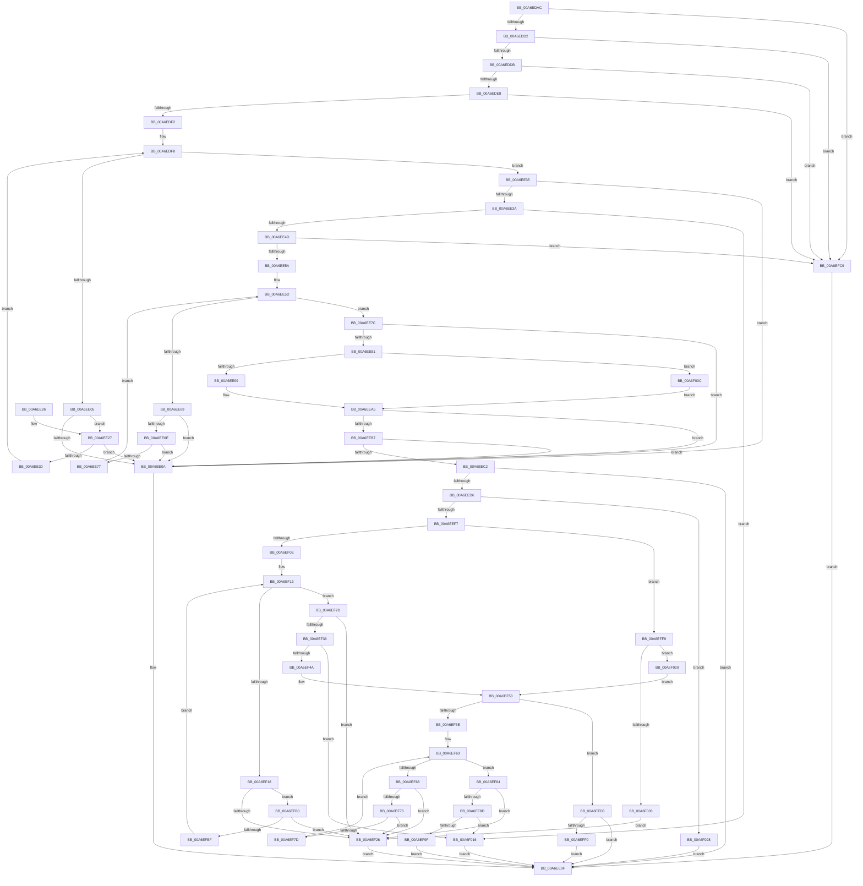

# sub_00A6EDAC

- RVA: `0x00A6EDAC`–`0x00A6F032` (길이 `646` bytes)
- VA: `0x0000000140A6EDAC`
- 실행 섹션: `PAGE`
- PDB 이름 있음: `아니요`; PDB Function 태그: `아니요`
- unwind 정보 RVA: `0x000B4C44`
- 디코드: `188`개 명령, `646/646` bytes 표시
- 미해석 바이트: `0` (있으면 어셈블리에 `.byte`로 보존)

> 이 문서는 커널 이미지의 기계어와 PDB 기호를 분석해 생성했습니다. 4번과 5번은 함수 원형과 자료형을 바이너리 사용 방식에서 추정한 C 해석이며 원본 소스 복구 결과는 아닙니다.

## 1. Dependencies

- 직접 호출 지점: **2**; 고유 호출 대상: **2**
- 직접 호출자로 확인된 함수: **1**
- RIP 상대 이미지 참조: **1**

### Outgoing calls
- `0x00A6EE9E` → [guard_dispatch_icall](../../text/6B/guard_dispatch_icall_function_006BAAD0.md) (function, `0x006BAAD0`)
- `0x00A6EEE9` → [ExAllocatePool2](../../poolcode/B8/ExAllocatePool2_function_00B820F0.md) (function, `0x00B820F0`)

### Direct callers
- [sub_00968AF6](../96/Unknown_function_00968AF6.md) at `0x00969D47`

### Static image references
- `0x00A6EE81` → RVA `0x00FD83F8` (`PAGEDATA`; read)

## 2. Other-region calls and transfers

- 다른 실행 섹션으로 향하는 call: **2**
  - `0x00A6EE9E` → [guard_dispatch_icall](../../text/6B/guard_dispatch_icall_function_006BAAD0.md) (`PAGE` → `.text`)
  - `0x00A6EEE9` → [ExAllocatePool2](../../poolcode/B8/ExAllocatePool2_function_00B820F0.md) (`PAGE` → `POOLCODE`)
- 별도 외부 분기/꼬리 이동을 확인하지 못했습니다.

## 3. Assembly (complete function range)

```asm
00A6EDAC  48 89 5C 24 08                  mov qword ptr [rsp + 8], rbx
00A6EDB1  48 89 6C 24 10                  mov qword ptr [rsp + 0x10], rbp
00A6EDB6  48 89 74 24 18                  mov qword ptr [rsp + 0x18], rsi
00A6EDBB  57                              push rdi
00A6EDBC  48 83 EC 20                     sub rsp, 0x20
00A6EDC0  49 8B F9                        mov rdi, r9
00A6EDC3  48 8B DA                        mov rbx, rdx
00A6EDC6  4C 8B C1                        mov r8, rcx
00A6EDC9  48 85 D2                        test rdx, rdx
00A6EDCC  0F 84 F7 01 00 00               je 0x140a6efc9
00A6EDD2  4D 85 C9                        test r9, r9
00A6EDD5  0F 84 EE 01 00 00               je 0x140a6efc9
00A6EDDB  48 8B 49 08                     mov rcx, qword ptr [rcx + 8]
00A6EDDF  48 85 C9                        test rcx, rcx
00A6EDE2  0F 84 E1 01 00 00               je 0x140a6efc9
00A6EDE8  41 83 38 03                     cmp dword ptr [r8], 3
00A6EDEC  0F 86 D7 01 00 00               jbe 0x140a6efc9
00A6EDF2  48 8B C1                        mov rax, rcx
00A6EDF5  45 33 C9                        xor r9d, r9d
00A6EDF8  44 8B 10                        mov r10d, dword ptr [rax]
00A6EDFB  48 8D 50 04                     lea rdx, [rax + 4]
00A6EDFF  41 83 F9 03                     cmp r9d, 3
00A6EE03  73 30                           jae 0x140a6ee35
00A6EE05  48 3B D0                        cmp rdx, rax
00A6EE08  73 1D                           jae 0x140a6ee27
00A6EE0A  BA 95 00 00 C0                  mov edx, 0xc0000095
00A6EE0F  48 8B 5C 24 30                  mov rbx, qword ptr [rsp + 0x30]
00A6EE14  8B C2                           mov eax, edx
00A6EE16  48 8B 6C 24 38                  mov rbp, qword ptr [rsp + 0x38]
00A6EE1B  48 8B 74 24 40                  mov rsi, qword ptr [rsp + 0x40]
00A6EE20  48 83 C4 20                     add rsp, 0x20
00A6EE24  5F                              pop rdi
00A6EE25  C3                              ret
00A6EE26  CC                              int3
00A6EE27  4A 8D 04 12                     lea rax, [rdx + r10]
00A6EE2B  48 3B C2                        cmp rax, rdx
00A6EE2E  72 DA                           jb 0x140a6ee0a
00A6EE30  41 FF C1                        inc r9d
00A6EE33  EB C3                           jmp 0x140a6edf8
00A6EE35  48 3B D0                        cmp rdx, rax
00A6EE38  72 D0                           jb 0x140a6ee0a
00A6EE3A  33 F6                           xor esi, esi
00A6EE3C  45 85 D2                        test r10d, r10d
00A6EE3F  48 0F 45 F2                     cmovne rsi, rdx
00A6EE43  41 83 FA 08                     cmp r10d, 8
00A6EE47  0F 85 C9 01 00 00               jne 0x140a6f016
00A6EE4D  41 83 38 04                     cmp dword ptr [r8], 4
00A6EE51  48 8B 36                        mov rsi, qword ptr [rsi]
00A6EE54  0F 86 6F 01 00 00               jbe 0x140a6efc9
00A6EE5A  45 33 C0                        xor r8d, r8d
00A6EE5D  8B 01                           mov eax, dword ptr [rcx]
00A6EE5F  48 8D 51 04                     lea rdx, [rcx + 4]
00A6EE63  41 83 F8 04                     cmp r8d, 4
00A6EE67  73 13                           jae 0x140a6ee7c
00A6EE69  48 3B D1                        cmp rdx, rcx
00A6EE6C  72 9C                           jb 0x140a6ee0a
00A6EE6E  48 8D 0C 02                     lea rcx, [rdx + rax]
00A6EE72  48 3B CA                        cmp rcx, rdx
00A6EE75  72 93                           jb 0x140a6ee0a
00A6EE77  41 FF C0                        inc r8d
00A6EE7A  EB E1                           jmp 0x140a6ee5d
00A6EE7C  48 3B D1                        cmp rdx, rcx
00A6EE7F  72 89                           jb 0x140a6ee0a
00A6EE81  4C 8B 05 70 95 56 00            mov r8, qword ptr [rip + 0x569570]
00A6EE88  33 C9                           xor ecx, ecx
00A6EE8A  85 C0                           test eax, eax
00A6EE8C  48 0F 45 CA                     cmovne rcx, rdx
00A6EE90  4D 85 C0                        test r8, r8
00A6EE93  0F 84 73 01 00 00               je 0x140a6f00c
00A6EE99  8B D0                           mov edx, eax
00A6EE9B  49 8B C0                        mov rax, r8
00A6EE9E  E8 2D BC C4 FF                  call 0x1406baad0
00A6EEA3  8B E8                           mov ebp, eax
00A6EEA5  8B 43 10                        mov eax, dword ptr [rbx + 0x10]
00A6EEA8  8B 53 20                        mov edx, dword ptr [rbx + 0x20]
00A6EEAB  83 C0 30                        add eax, 0x30
00A6EEAE  83 F8 30                        cmp eax, 0x30
00A6EEB1  0F 82 53 FF FF FF               jb 0x140a6ee0a
00A6EEB7  8D 48 04                        lea ecx, [rax + 4]
00A6EEBA  3B C8                           cmp ecx, eax
00A6EEBC  0F 82 48 FF FF FF               jb 0x140a6ee0a
00A6EEC2  8D 04 11                        lea eax, [rcx + rdx]
00A6EEC5  BB 95 00 00 C0                  mov ebx, 0xc0000095
00A6EECA  3B C1                           cmp eax, ecx
00A6EECC  1B D2                           sbb edx, edx
00A6EECE  23 D3                           and edx, ebx
00A6EED0  0F 8C 39 FF FF FF               jl 0x140a6ee0f
00A6EED6  BA 14 00 00 00                  mov edx, 0x14
00A6EEDB  B9 00 01 00 00                  mov ecx, 0x100
00A6EEE0  41 B8 53 4C 53 20               mov r8d, 0x20534c53
00A6EEE6  89 57 04                        mov dword ptr [rdi + 4], edx
00A6EEE9  E8 02 32 11 00                  call 0x140b820f0
00A6EEEE  48 85 C0                        test rax, rax
00A6EEF1  0F 84 31 01 00 00               je 0x140a6f028
00A6EEF7  48 89 47 08                     mov qword ptr [rdi + 8], rax
00A6EEFB  83 27 00                        and dword ptr [rdi], 0
00A6EEFE  0F BA ED 1C                     bts ebp, 0x1c
00A6EF02  48 8B D0                        mov rdx, rax
00A6EF05  48 85 C0                        test rax, rax
00A6EF08  0F 84 EB 00 00 00               je 0x140a6eff9
00A6EF0E  44 8B 0F                        mov r9d, dword ptr [rdi]
00A6EF11  33 C9                           xor ecx, ecx
00A6EF13  41 3B C9                        cmp ecx, r9d
00A6EF16  73 15                           jae 0x140a6ef2d
00A6EF18  8B 02                           mov eax, dword ptr [rdx]
00A6EF1A  83 C0 04                        add eax, 4
00A6EF1D  83 F8 04                        cmp eax, 4
00A6EF20  0F 83 8A 00 00 00               jae 0x140a6efb0
00A6EF26  8B D3                           mov edx, ebx
00A6EF28  E9 E2 FE FF FF                  jmp 0x140a6ee0f
00A6EF2D  4C 8D 42 04                     lea r8, [rdx + 4]
00A6EF31  4C 3B C2                        cmp r8, rdx
00A6EF34  72 F0                           jb 0x140a6ef26
00A6EF36  8B 4F 04                        mov ecx, dword ptr [rdi + 4]
00A6EF39  48 8D 42 08                     lea rax, [rdx + 8]
00A6EF3D  48 03 4F 08                     add rcx, qword ptr [rdi + 8]
00A6EF41  48 3B C1                        cmp rax, rcx
00A6EF44  0F 87 CC 00 00 00               ja 0x140a6f016
00A6EF4A  C7 02 04 00 00 00               mov dword ptr [rdx], 4
00A6EF50  41 89 28                        mov dword ptr [r8], ebp
00A6EF53  FF 07                           inc dword ptr [rdi]
00A6EF55  4C 8B 47 08                     mov r8, qword ptr [rdi + 8]
00A6EF59  4D 85 C0                        test r8, r8
00A6EF5C  74 75                           je 0x140a6efd3
00A6EF5E  44 8B 0F                        mov r9d, dword ptr [rdi]
00A6EF61  33 C9                           xor ecx, ecx
00A6EF63  41 3B C9                        cmp ecx, r9d
00A6EF66  73 1C                           jae 0x140a6ef84
00A6EF68  41 8B 00                        mov eax, dword ptr [r8]
00A6EF6B  83 C0 04                        add eax, 4
00A6EF6E  83 F8 04                        cmp eax, 4
00A6EF71  72 B3                           jb 0x140a6ef26
00A6EF73  8B D0                           mov edx, eax
00A6EF75  49 03 D0                        add rdx, r8
00A6EF78  49 3B D0                        cmp rdx, r8
00A6EF7B  72 A9                           jb 0x140a6ef26
00A6EF7D  4C 8B C2                        mov r8, rdx
00A6EF80  FF C1                           inc ecx
00A6EF82  EB DF                           jmp 0x140a6ef63
00A6EF84  4D 8D 48 04                     lea r9, [r8 + 4]
00A6EF88  4D 3B C8                        cmp r9, r8
00A6EF8B  72 99                           jb 0x140a6ef26
00A6EF8D  8B 4F 04                        mov ecx, dword ptr [rdi + 4]
00A6EF90  49 8D 40 0C                     lea rax, [r8 + 0xc]
00A6EF94  48 03 4F 08                     add rcx, qword ptr [rdi + 8]
00A6EF98  33 D2                           xor edx, edx
00A6EF9A  48 3B C1                        cmp rax, rcx
00A6EF9D  77 77                           ja 0x140a6f016
00A6EF9F  41 C7 00 08 00 00 00            mov dword ptr [r8], 8
00A6EFA6  49 89 31                        mov qword ptr [r9], rsi
00A6EFA9  FF 07                           inc dword ptr [rdi]
00A6EFAB  E9 5F FE FF FF                  jmp 0x140a6ee0f
00A6EFB0  44 8B C0                        mov r8d, eax
00A6EFB3  4C 03 C2                        add r8, rdx
00A6EFB6  4C 3B C2                        cmp r8, rdx
00A6EFB9  0F 82 67 FF FF FF               jb 0x140a6ef26
00A6EFBF  49 8B D0                        mov rdx, r8
00A6EFC2  FF C1                           inc ecx
00A6EFC4  E9 4A FF FF FF                  jmp 0x140a6ef13
00A6EFC9  BA 0D 00 00 C0                  mov edx, 0xc000000d
00A6EFCE  E9 3C FE FF FF                  jmp 0x140a6ee0f
00A6EFD3  8B 4F 04                        mov ecx, dword ptr [rdi + 4]
00A6EFD6  83 CA FF                        or edx, 0xffffffff
00A6EFD9  8D 41 0C                        lea eax, [rcx + 0xc]
00A6EFDC  3B C1                           cmp eax, ecx
00A6EFDE  0F 43 D0                        cmovae edx, eax
00A6EFE1  89 57 04                        mov dword ptr [rdi + 4], edx
00A6EFE4  1B D2                           sbb edx, edx
00A6EFE6  23 D3                           and edx, ebx
00A6EFE8  3B C1                           cmp eax, ecx
00A6EFEA  0F 82 1F FE FF FF               jb 0x140a6ee0f
00A6EFF0  FF 07                           inc dword ptr [rdi]
00A6EFF2  33 D2                           xor edx, edx
00A6EFF4  E9 16 FE FF FF                  jmp 0x140a6ee0f
00A6EFF9  8B 47 04                        mov eax, dword ptr [rdi + 4]
00A6EFFC  8D 48 08                        lea ecx, [rax + 8]
00A6EFFF  3B C8                           cmp ecx, eax
00A6F001  73 1D                           jae 0x140a6f020
00A6F003  83 4F 04 FF                     or dword ptr [rdi + 4], 0xffffffff
00A6F007  E9 1A FF FF FF                  jmp 0x140a6ef26
00A6F00C  BD BB 00 00 C0                  mov ebp, 0xc00000bb
00A6F011  E9 8F FE FF FF                  jmp 0x140a6eea5
00A6F016  BA 23 00 00 C0                  mov edx, 0xc0000023
00A6F01B  E9 EF FD FF FF                  jmp 0x140a6ee0f
00A6F020  89 4F 04                        mov dword ptr [rdi + 4], ecx
00A6F023  E9 2B FF FF FF                  jmp 0x140a6ef53
00A6F028  BA 17 00 00 C0                  mov edx, 0xc0000017
00A6F02D  E9 DD FD FF FF                  jmp 0x140a6ee0f
```

## 4. C-style interpretation (structured pseudocode)

```c
__int64 __fastcall sub_00A6EDAC(__int64 a1, __int64 a2, __int64 a3, __int64 a4)
{
    __int64 result;
    __int64 v_rsi;
    __int64 v_rsp;
    unsigned __int64 v_stack_p10;
    unsigned __int64 v_stack_p18;
    unsigned __int64 v_stack_p8;

    v_stack_p8 = v_rbx;
    v_stack_p10 = v_rbp;
    v_stack_p18 = v_rsi;
    v_rsp = (v_rsp) - (32);
    if (a2 == 0) goto loc_00A6EFC9;
    if (a4 == 0) goto loc_00A6EFC9;
    if (*(unsigned __int64 *)(a1 + 8) == 0) goto loc_00A6EFC9;
    if ((*(unsigned int *)(a1)) <= 3) goto loc_00A6EFC9;
    a4 = 0;
loc_00A6EDF8:
    if (0 >= 3) goto loc_00A6EE35;
    if ((*(unsigned __int64 *)(a1 + 8) + 4) >= (*(unsigned __int64 *)(a1 + 8))) goto loc_00A6EE27;
loc_00A6EE0A:
loc_00A6EE0F:
    v_rsp = (v_rsp) + (32);
    return (unsigned int)((unsigned int)((unsigned int)(0xC0000095ULL)));
loc_00A6EE27:
    if (((unsigned int)(0xC0000095ULL) + (unsigned int)(*(unsigned int *)(*(unsigned __int64 *)(a1 + 8))) * 1) < ((unsigned int)(0xC0000095ULL))) goto loc_00A6EE0A;
    a4 = (unsigned int)((a4) + 1);
    goto loc_00A6EDF8;
loc_00A6EE35:
    if (((unsigned int)(0xC0000095ULL)) < ((unsigned int)(0xC0000095ULL) + (unsigned int)(*(unsigned int *)(*(unsigned __int64 *)(a1 + 8))) * 1)) goto loc_00A6EE0A;
    v_rsi = 0;
    if ((unsigned int)((unsigned int)(*(unsigned int *)(*(unsigned __int64 *)(a1 + 8)))) != 0) { v_rsi = (unsigned int)(0xC0000095ULL); }
    if (((unsigned int)((unsigned int)(*(unsigned int *)(*(unsigned __int64 *)(a1 + 8))))) != 8) goto loc_00A6F016;
    if ((*(unsigned int *)(a1)) <= 4) goto loc_00A6EFC9;
    a3 = 0;
loc_00A6EE5D:
    if (0 >= 4) goto loc_00A6EE7C;
    if ((*(unsigned __int64 *)(a1 + 8) + 4) < (*(unsigned __int64 *)(a1 + 8))) goto loc_00A6EE0A;
    if ((*(unsigned __int64 *)(a1 + 8) + 4 + (unsigned int)(*(unsigned int *)(*(unsigned __int64 *)(a1 + 8))) * 1) < (*(unsigned __int64 *)(a1 + 8) + 4)) goto loc_00A6EE0A;
    a3 = (unsigned int)((a3) + 1);
    goto loc_00A6EE5D;
loc_00A6EE7C:
    if ((*(unsigned __int64 *)(a1 + 8) + 4) < (*(unsigned __int64 *)(a1 + 8) + 4 + (unsigned int)(*(unsigned int *)(*(unsigned __int64 *)(a1 + 8))) * 1)) goto loc_00A6EE0A;
    a1 = 0;
    if ((unsigned int)((unsigned int)(*(unsigned int *)(*(unsigned __int64 *)(a1 + 8)))) != 0) { a1 = *(unsigned __int64 *)(a1 + 8) + 4; }
    if (*(unsigned __int64 *)(v_rip + 5674352) == 0) goto loc_00A6F00C;
    result = guard_dispatch_icall(a1, (unsigned int)((unsigned int)((unsigned int)(*(unsigned int *)(*(unsigned __int64 *)(a1 + 8))))), *(unsigned __int64 *)(v_rip + 5674352), a4);
loc_00A6EEA5:
    result = (unsigned int)(((unsigned int)(*(unsigned int *)(v_stack_p8 + 16))) + (48));
    if (((unsigned int)(result)) < 48) goto loc_00A6EE0A;
    if (((unsigned int)(result + 4)) < ((unsigned int)(result))) goto loc_00A6EE0A;
    a2 = (unsigned int)(((unsigned int)(*(unsigned int *)(v_stack_p8 + 32))) & ((unsigned int)((unsigned int)(0xC0000095ULL))));
    if (condition_is_less) goto loc_00A6EE0F;
    *(unsigned int *)(a4 + 4) = 20;
    result = ExAllocatePool2(256, 20, (unsigned int)(0x20534C53ULL), a4);
    if (result == 0) goto loc_00A6F028;
    *(unsigned __int64 *)(a4 + 8) = result;
    if (result == 0) goto loc_00A6EFF9;
    a1 = 0;
loc_00A6EF13:
    if (0 >= ((unsigned int)((unsigned int)(*(unsigned int *)(a4))))) goto loc_00A6EF2D;
    result = (unsigned int)(((unsigned int)(*(unsigned int *)(result))) + (4));
    if (((unsigned int)(result)) >= 4) goto loc_00A6EFB0;
loc_00A6EF26:
    goto loc_00A6EE0F;
loc_00A6EF2D:
    if (((unsigned int)((unsigned int)((unsigned int)(0xC0000095ULL))) + 4) < ((unsigned int)((unsigned int)((unsigned int)(0xC0000095ULL))))) goto loc_00A6EF26;
    a1 = ((unsigned int)(*(unsigned int *)(a4 + 4))) + (*(unsigned __int64 *)(a4 + 8));
    if (((unsigned int)((unsigned int)((unsigned int)(0xC0000095ULL))) + 8) > a1) goto loc_00A6F016;
    *(unsigned int *)((unsigned int)((unsigned int)((unsigned int)(0xC0000095ULL)))) = 4;
    *(unsigned int *)((unsigned int)((unsigned int)((unsigned int)(0xC0000095ULL))) + 4) = (unsigned int)((unsigned int)((unsigned int)(result)));
loc_00A6EF53:
    if (*(unsigned __int64 *)(a4 + 8) == 0) goto loc_00A6EFD3;
    a1 = 0;
loc_00A6EF63:
    if (0 >= ((unsigned int)((unsigned int)(*(unsigned int *)(a4))))) goto loc_00A6EF84;
    result = (unsigned int)(((unsigned int)(*(unsigned int *)(*(unsigned __int64 *)(a4 + 8)))) + (4));
    if (((unsigned int)(result)) < 4) goto loc_00A6EF26;
    a2 = ((unsigned int)((unsigned int)(result))) + (*(unsigned __int64 *)(a4 + 8));
    if (a2 < (*(unsigned __int64 *)(a4 + 8))) goto loc_00A6EF26;
    a1 = (unsigned int)((a1) + 1);
    goto loc_00A6EF63;
loc_00A6EF84:
    if ((a2 + 4) < a2) goto loc_00A6EF26;
    a1 = ((unsigned int)(*(unsigned int *)(a4 + 4))) + (*(unsigned __int64 *)(a4 + 8));
    a2 = 0;
    if ((a2 + 12) > a1) goto loc_00A6F016;
    *(unsigned int *)(a2) = 8;
    *(unsigned __int64 *)(a2 + 4) = *(unsigned __int64 *)(v_rsi);
    goto loc_00A6EE0F;
loc_00A6EFB0:
    a3 = ((unsigned int)((unsigned int)(a2 + 12))) + (0);
    if (a3 < 0) goto loc_00A6EF26;
    a1 = (unsigned int)((a1) + 1);
    goto loc_00A6EF13;
loc_00A6EFC9:
    goto loc_00A6EE0F;
loc_00A6EFD3:
    a2 = (unsigned int)(((unsigned int)(0xC000000DULL)) | (0xFFFFFFFFULL));
    if (((unsigned int)((unsigned int)(*(unsigned int *)(a4 + 4)) + 12)) >= ((unsigned int)((unsigned int)(*(unsigned int *)(a4 + 4))))) { a2 = (unsigned int)((unsigned int)(*(unsigned int *)(a4 + 4)) + 12); }
    *(unsigned int *)(a4 + 4) = (unsigned int)(a2);
    a2 = (unsigned int)((a2) & ((unsigned int)((unsigned int)(0xC0000095ULL))));
    if (((unsigned int)((unsigned int)(*(unsigned int *)(a4 + 4)) + 12)) < ((unsigned int)((unsigned int)(*(unsigned int *)(a4 + 4))))) goto loc_00A6EE0F;
    a2 = 0;
    goto loc_00A6EE0F;
loc_00A6EFF9:
    if (((unsigned int)((unsigned int)(*(unsigned int *)(a4 + 4)) + 8)) >= ((unsigned int)((unsigned int)(*(unsigned int *)(a4 + 4))))) goto loc_00A6F020;
    goto loc_00A6EF26;
loc_00A6F00C:
    goto loc_00A6EEA5;
loc_00A6F016:
    goto loc_00A6EE0F;
loc_00A6F020:
    *(unsigned int *)(a4 + 4) = (unsigned int)((unsigned int)(*(unsigned int *)(a4 + 4)) + 8);
    goto loc_00A6EF53;
loc_00A6F028:
    goto loc_00A6EE0F;
}
```

## 5. (Beta) C Style

```c
int64_t sub_00A6EDAC(void *Arg1, void *Arg2, int64_t Arg3, void *Arg4)
{
    uint8_t *arg1 = (uint8_t *)Arg1;
    uint8_t *arg2 = (uint8_t *)Arg2;
    uint8_t *arg4 = (uint8_t *)Arg4;

    int64_t result;
    int64_t local_rsi;
    int64_t local_rsp;
    uint64_t v_stack_p10;
    uint64_t v_stack_p18;
    uint64_t v_stack_p8;

    v_stack_p8 = local_rbx;
    v_stack_p10 = local_rbp;
    v_stack_p18 = local_rsi;
    local_rsp = (local_rsp) - (32);
    if (Arg2 == NULL) goto loc_00A6EFC9;
    if (Arg4 == NULL) goto loc_00A6EFC9;
    if (*(uint64_t *)(arg1 + 0x8) == 0) goto loc_00A6EFC9;
    if ((*(uint32_t *)(arg1)) <= 3) goto loc_00A6EFC9;
    Arg4 = 0;
loc_00A6EDF8:
    if (0 >= 3) goto loc_00A6EE35;
    if ((*(uint64_t *)(arg1 + 0x8) + 4) >= (*(uint64_t *)(arg1 + 0x8))) goto loc_00A6EE27;
loc_00A6EE0A:
loc_00A6EE0F:
    local_rsp = (local_rsp) + (32);
    return (uint32_t)((uint32_t)((uint32_t)(0xC0000095ULL)));
loc_00A6EE27:
    if (((uint32_t)(0xC0000095ULL) + (uint32_t)(*(uint32_t *)(*(uint64_t *)(arg1 + 0x8))) * 1) < ((uint32_t)(0xC0000095ULL))) goto loc_00A6EE0A;
    Arg4 = (uint32_t)((Arg4) + 1);
    goto loc_00A6EDF8;
loc_00A6EE35:
    if (((uint32_t)(0xC0000095ULL)) < ((uint32_t)(0xC0000095ULL) + (uint32_t)(*(uint32_t *)(*(uint64_t *)(arg1 + 0x8))) * 1)) goto loc_00A6EE0A;
    local_rsi = 0;
    if ((uint32_t)((uint32_t)(*(uint32_t *)(*(uint64_t *)(arg1 + 0x8)))) != 0) { local_rsi = (uint32_t)(0xC0000095ULL); }
    if (((uint32_t)((uint32_t)(*(uint32_t *)(*(uint64_t *)(arg1 + 0x8))))) != 8) goto loc_00A6F016;
    if ((*(uint32_t *)(arg1)) <= 4) goto loc_00A6EFC9;
    Arg3 = 0;
loc_00A6EE5D:
    if (0 >= 4) goto loc_00A6EE7C;
    if ((*(uint64_t *)(arg1 + 0x8) + 4) < (*(uint64_t *)(arg1 + 0x8))) goto loc_00A6EE0A;
    if ((*(uint64_t *)(arg1 + 0x8) + 4 + (uint32_t)(*(uint32_t *)(*(uint64_t *)(arg1 + 0x8))) * 1) < (*(uint64_t *)(arg1 + 0x8) + 4)) goto loc_00A6EE0A;
    Arg3 = (uint32_t)((Arg3) + 1);
    goto loc_00A6EE5D;
loc_00A6EE7C:
    if ((*(uint64_t *)(arg1 + 0x8) + 4) < (*(uint64_t *)(arg1 + 0x8) + 4 + (uint32_t)(*(uint32_t *)(*(uint64_t *)(arg1 + 0x8))) * 1)) goto loc_00A6EE0A;
    Arg1 = 0;
    if ((uint32_t)((uint32_t)(*(uint32_t *)(*(uint64_t *)(arg1 + 0x8)))) != 0) { Arg1 = *(uint64_t *)(arg1 + 0x8) + 4; }
    if (*(uint64_t *)(v_rip + 0x569570) == 0) goto loc_00A6F00C;
    result = guard_dispatch_icall(Arg1, (uint32_t)((uint32_t)((uint32_t)(*(uint32_t *)(*(uint64_t *)(arg1 + 0x8))))), *(uint64_t *)(v_rip + 0x569570), Arg4);
loc_00A6EEA5:
    result = (uint32_t)(((uint32_t)(*(uint32_t *)(v_stack_p8 + 0x10))) + (48));
    if (((uint32_t)(result)) < 48) goto loc_00A6EE0A;
    if (((uint32_t)(result + 4)) < ((uint32_t)(result))) goto loc_00A6EE0A;
    Arg2 = (uint32_t)(((uint32_t)(*(uint32_t *)(v_stack_p8 + 0x20))) & ((uint32_t)((uint32_t)(0xC0000095ULL))));
    if (condition_is_less) goto loc_00A6EE0F;
    *(uint32_t *)(arg4 + 0x4) = 20;
    result = ExAllocatePool2(256, 20, (uint32_t)(0x20534C53ULL), Arg4);
    if (result == 0) goto loc_00A6F028;
    *(uint64_t *)(arg4 + 0x8) = result;
    if (result == 0) goto loc_00A6EFF9;
    Arg1 = 0;
loc_00A6EF13:
    if (0 >= ((uint32_t)((uint32_t)(*(uint32_t *)(arg4))))) goto loc_00A6EF2D;
    result = (uint32_t)(((uint32_t)(*(uint32_t *)(result))) + (4));
    if (((uint32_t)(result)) >= 4) goto loc_00A6EFB0;
loc_00A6EF26:
    goto loc_00A6EE0F;
loc_00A6EF2D:
    if (((uint32_t)((uint32_t)((uint32_t)(0xC0000095ULL))) + 4) < ((uint32_t)((uint32_t)((uint32_t)(0xC0000095ULL))))) goto loc_00A6EF26;
    Arg1 = ((uint32_t)(*(uint32_t *)(arg4 + 0x4))) + (*(uint64_t *)(arg4 + 0x8));
    if (((uint32_t)((uint32_t)((uint32_t)(0xC0000095ULL))) + 8) > Arg1) goto loc_00A6F016;
    *(uint32_t *)((uint32_t)((uint32_t)((uint32_t)(0xC0000095ULL)))) = 4;
    *(uint32_t *)((uint32_t)((uint32_t)((uint32_t)(0xC0000095ULL))) + 0x4) = (uint32_t)((uint32_t)((uint32_t)(result)));
loc_00A6EF53:
    if (*(uint64_t *)(arg4 + 0x8) == 0) goto loc_00A6EFD3;
    Arg1 = 0;
loc_00A6EF63:
    if (0 >= ((uint32_t)((uint32_t)(*(uint32_t *)(arg4))))) goto loc_00A6EF84;
    result = (uint32_t)(((uint32_t)(*(uint32_t *)(*(uint64_t *)(arg4 + 0x8)))) + (4));
    if (((uint32_t)(result)) < 4) goto loc_00A6EF26;
    Arg2 = ((uint32_t)((uint32_t)(result))) + (*(uint64_t *)(arg4 + 0x8));
    if (Arg2 < (*(uint64_t *)(arg4 + 0x8))) goto loc_00A6EF26;
    Arg1 = (uint32_t)((Arg1) + 1);
    goto loc_00A6EF63;
loc_00A6EF84:
    if ((Arg2 + 4) < Arg2) goto loc_00A6EF26;
    Arg1 = ((uint32_t)(*(uint32_t *)(arg4 + 0x4))) + (*(uint64_t *)(arg4 + 0x8));
    Arg2 = 0;
    if ((Arg2 + 12) > Arg1) goto loc_00A6F016;
    *(uint32_t *)(arg2) = 8;
    *(uint64_t *)(arg2 + 0x4) = *(uint64_t *)(local_rsi);
    goto loc_00A6EE0F;
loc_00A6EFB0:
    Arg3 = ((uint32_t)((uint32_t)(Arg2 + 12))) + (0);
    if (Arg3 < 0) goto loc_00A6EF26;
    Arg1 = (uint32_t)((Arg1) + 1);
    goto loc_00A6EF13;
loc_00A6EFC9:
    goto loc_00A6EE0F;
loc_00A6EFD3:
    Arg2 = (uint32_t)(((uint32_t)(0xC000000DULL)) | (0xFFFFFFFFULL));
    if (((uint32_t)((uint32_t)(*(uint32_t *)(arg4 + 0x4)) + 12)) >= ((uint32_t)((uint32_t)(*(uint32_t *)(arg4 + 0x4))))) { Arg2 = (uint32_t)((uint32_t)(*(uint32_t *)(arg4 + 0x4)) + 12); }
    *(uint32_t *)(arg4 + 0x4) = (uint32_t)(Arg2);
    Arg2 = (uint32_t)((Arg2) & ((uint32_t)((uint32_t)(0xC0000095ULL))));
    if (((uint32_t)((uint32_t)(*(uint32_t *)(arg4 + 0x4)) + 12)) < ((uint32_t)((uint32_t)(*(uint32_t *)(arg4 + 0x4))))) goto loc_00A6EE0F;
    Arg2 = 0;
    goto loc_00A6EE0F;
loc_00A6EFF9:
    if (((uint32_t)((uint32_t)(*(uint32_t *)(arg4 + 0x4)) + 8)) >= ((uint32_t)((uint32_t)(*(uint32_t *)(arg4 + 0x4))))) goto loc_00A6F020;
    goto loc_00A6EF26;
loc_00A6F00C:
    goto loc_00A6EEA5;
loc_00A6F016:
    goto loc_00A6EE0F;
loc_00A6F020:
    *(uint32_t *)(arg4 + 0x4) = (uint32_t)((uint32_t)(*(uint32_t *)(arg4 + 0x4)) + 8);
    goto loc_00A6EF53;
loc_00A6F028:
    goto loc_00A6EE0F;
}
```

### 관측된 메모리 오프셋

구조체 형식이 확인되지 않은 접근은 인자 기준의 오프셋으로만 기록했습니다.

| 기준 인자 | 오프셋 표현 | 폭 (bit) | 접근 |
|---|---:|---:|---|
| `Arg1` | `+ 0x0` | `32` | `R` |
| `Arg1` | `+ 0x8` | `64` | `R` |
| `Arg2` | `+ 0x10` | `32` | `R` |
| `Arg2` | `+ 0x20` | `32` | `R` |
| `Arg4` | `+ 0x0` | `32` | `R` |
| `Arg4` | `+ 0x0` | `32` | `R/W` |
| `Arg4` | `+ 0x4` | `32` | `R` |
| `Arg4` | `+ 0x4` | `32` | `R/W` |
| `Arg4` | `+ 0x4` | `32` | `W` |
| `Arg4` | `+ 0x8` | `64` | `R` |
| `Arg4` | `+ 0x8` | `64` | `W` |

## 6. Execution-region graph

[열기: 2D/3D 그래프와 함수 탐색 컨트롤 패널](../../../control-panel.html?section=page&rva=0x00A6EDAC&view=graph)

- 2D 그래프는 위에서 아래로 흐르고, 3D 그래프는 빈 공간을 드래그해 회전합니다. Shift+드래그는 이동, 휠은 확대·축소, 함수 노드 선택은 대상 보고서 이동입니다.

### Static fallback


