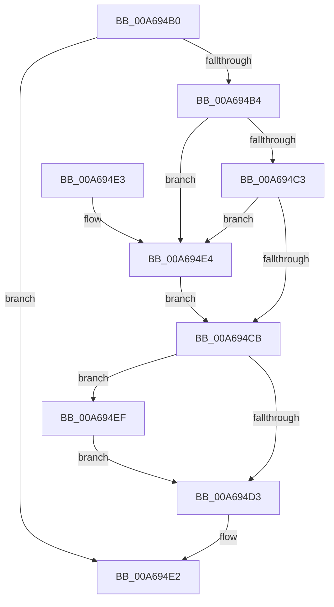

# UpdateInternalStatsOnFlush

- RVA: `0x00A694B0`–`0x00A694F7` (길이 `71` bytes)
- VA: `0x0000000140A694B0`
- 실행 섹션: `PAGE`
- PDB 이름 있음: `예`; PDB Function 태그: `예`
- unwind 정보 RVA: `0x000DB714`
- 디코드: `21`개 명령, `71/71` bytes 표시
- 미해석 바이트: `0` (있으면 어셈블리에 `.byte`로 보존)

> 이 문서는 커널 이미지의 기계어와 PDB 기호를 분석해 생성했습니다. 4번과 5번은 함수 원형과 자료형을 바이너리 사용 방식에서 추정한 C 해석이며 원본 소스 복구 결과는 아닙니다.

## 1. Dependencies

- 직접 호출 지점: **0**; 고유 호출 대상: **0**
- 직접 호출자로 확인된 함수: **2**
- RIP 상대 이미지 참조: **0**

### Outgoing calls
- 직접 디코드된 call 명령이 없습니다.

### Direct callers
- [LookUpTableFlushPartial](LookUpTableFlushPartial_function_00A69438.md) at `0x00A6948F`
- [LookUpTableFlushComplete](LookUpTableFlushComplete_function_00A6957C.md) at `0x00A695E3`

### Static image references
- 디코드된 RIP-relative 메모리 참조가 없습니다.

## 2. Other-region calls and transfers

- 다른 실행 섹션으로 향하는 call: **0**
- 별도 외부 분기/꼬리 이동을 확인하지 못했습니다.

## 3. Assembly (complete function range)

```asm
00A694B0  85 D2                           test edx, edx
00A694B2  74 2E                           je 0x140a694e2
00A694B4  4C 8D 81 28 01 00 00            lea r8, [rcx + 0x128]
00A694BB  39 91 38 01 00 00               cmp dword ptr [rcx + 0x138], edx
00A694C1  77 21                           ja 0x140a694e4
00A694C3  49 8B 00                        mov rax, qword ptr [r8]
00A694C6  48 85 C0                        test rax, rax
00A694C9  74 19                           je 0x140a694e4
00A694CB  39 91 34 01 00 00               cmp dword ptr [rcx + 0x134], edx
00A694D1  72 1C                           jb 0x140a694ef
00A694D3  48 FF C0                        inc rax
00A694D6  49 89 00                        mov qword ptr [r8], rax
00A694D9  8B C2                           mov eax, edx
00A694DB  48 01 81 20 01 00 00            add qword ptr [rcx + 0x120], rax
00A694E2  C3                              ret
00A694E3  CC                              int3
00A694E4  49 8B 00                        mov rax, qword ptr [r8]
00A694E7  89 91 38 01 00 00               mov dword ptr [rcx + 0x138], edx
00A694ED  EB DC                           jmp 0x140a694cb
00A694EF  89 91 34 01 00 00               mov dword ptr [rcx + 0x134], edx
00A694F5  EB DC                           jmp 0x140a694d3
```

## 4. C-style interpretation (structured pseudocode)

```c
__int64 __fastcall UpdateInternalStatsOnFlush(__int64 a1, int a2)
{
    __int64 result;

    if (a2 == 0) goto loc_00A694E2;
    if ((*(unsigned int *)(a1 + 312)) > a2) goto loc_00A694E4;
    if (*(unsigned __int64 *)(a1 + 296) == 0) goto loc_00A694E4;
loc_00A694CB:
    if ((*(unsigned int *)(a1 + 308)) < a2) goto loc_00A694EF;
loc_00A694D3:
    result = (*(unsigned __int64 *)(a1 + 296)) + 1;
    *(unsigned __int64 *)(a1 + 296) = result;
loc_00A694E2:
    return (unsigned int)(a2);
loc_00A694E4:
    *(unsigned int *)(a1 + 312) = a2;
    goto loc_00A694CB;
loc_00A694EF:
    *(unsigned int *)(a1 + 308) = a2;
    goto loc_00A694D3;
}
```

## 5. (Beta) C Style

```c
int64_t UpdateInternalStatsOnFlush(void *Arg1, int32_t Arg2)
{
    uint8_t *arg1 = (uint8_t *)Arg1;

    int64_t result;

    if (Arg2 == 0) goto loc_00A694E2;
    if ((*(uint32_t *)(arg1 + 0x138)) > Arg2) goto loc_00A694E4;
    if (*(uint64_t *)(arg1 + 0x128) == 0) goto loc_00A694E4;
loc_00A694CB:
    if ((*(uint32_t *)(arg1 + 0x134)) < Arg2) goto loc_00A694EF;
loc_00A694D3:
    result = (*(uint64_t *)(arg1 + 0x128)) + 1;
    *(uint64_t *)(arg1 + 0x128) = result;
loc_00A694E2:
    return (uint32_t)(Arg2);
loc_00A694E4:
    *(uint32_t *)(arg1 + 0x138) = Arg2;
    goto loc_00A694CB;
loc_00A694EF:
    *(uint32_t *)(arg1 + 0x134) = Arg2;
    goto loc_00A694D3;
}
```

### 관측된 메모리 오프셋

구조체 형식이 확인되지 않은 접근은 인자 기준의 오프셋으로만 기록했습니다.

| 기준 인자 | 오프셋 표현 | 폭 (bit) | 접근 |
|---|---:|---:|---|
| `Arg1` | `+ 0x0` | `64` | `R` |
| `Arg1` | `+ 0x0` | `64` | `W` |
| `Arg1` | `+ 0x120` | `64` | `R/W` |
| `Arg1` | `+ 0x128` | `64` | `R` |
| `Arg1` | `+ 0x134` | `32` | `R` |
| `Arg1` | `+ 0x134` | `32` | `W` |
| `Arg1` | `+ 0x138` | `32` | `R` |
| `Arg1` | `+ 0x138` | `32` | `W` |

## 6. Execution-region graph

[열기: 2D/3D 그래프와 함수 탐색 컨트롤 패널](../../../control-panel.html?section=page&rva=0x00A694B0&view=graph)

- 2D 그래프는 위에서 아래로 흐르고, 3D 그래프는 빈 공간을 드래그해 회전합니다. Shift+드래그는 이동, 휠은 확대·축소, 함수 노드 선택은 대상 보고서 이동입니다.

### Static fallback


