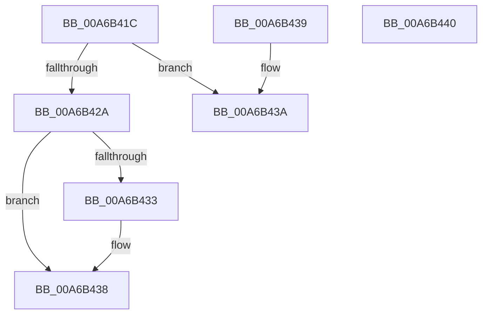

# VmCheckPageCombine

- RVA: `0x00A6B41C`–`0x00A6B441` (길이 `37` bytes)
- VA: `0x0000000140A6B41C`
- 실행 섹션: `PAGE`
- PDB 이름 있음: `예`; PDB Function 태그: `아니요`
- unwind 정보 RVA: `0x000DB714`
- 디코드: `13`개 명령, `37/37` bytes 표시
- 미해석 바이트: `0` (있으면 어셈블리에 `.byte`로 보존)

> 이 문서는 커널 이미지의 기계어와 PDB 기호를 분석해 생성했습니다. 4번과 5번은 함수 원형과 자료형을 바이너리 사용 방식에서 추정한 C 해석이며 원본 소스 복구 결과는 아닙니다.

## 1. Dependencies

- 직접 호출 지점: **0**; 고유 호출 대상: **0**
- 직접 호출자로 확인된 함수: **1**
- RIP 상대 이미지 참조: **0**

### Outgoing calls
- 직접 디코드된 call 명령이 없습니다.

### Direct callers
- [MiCapturePfnVm](../../text/46/MiCapturePfnVm_function_00465570.md) at `0x0046576F`

### Static image references
- 디코드된 RIP-relative 메모리 참조가 없습니다.

## 2. Other-region calls and transfers

- 다른 실행 섹션으로 향하는 call: **0**
- 별도 외부 분기/꼬리 이동을 확인하지 못했습니다.

## 3. Assembly (complete function range)

```asm
00A6B41C  48 8B 89 70 06 00 00            mov rcx, qword ptr [rcx + 0x670]
00A6B423  33 C0                           xor eax, eax
00A6B425  48 85 C9                        test rcx, rcx
00A6B428  74 10                           je 0x140a6b43a
00A6B42A  F6 81 88 00 00 00 01            test byte ptr [rcx + 0x88], 1
00A6B431  75 05                           jne 0x140a6b438
00A6B433  85 D2                           test edx, edx
00A6B435  0F 95 C0                        setne al
00A6B438  C3                              ret
00A6B439  CC                              int3
00A6B43A  B8 01 00 00 00                  mov eax, 1
00A6B43F  C3                              ret
00A6B440  CC                              int3
```

## 4. C-style interpretation (structured pseudocode)

```c
__int64 __fastcall VmCheckPageCombine(__int64 a1, int a2)
{
    __int64 result;

    result = 0;
    if (*(unsigned __int64 *)(a1 + 1648) == 0) goto loc_00A6B43A;
    if (((*(unsigned __int8 *)(*(unsigned __int64 *)(a1 + 1648) + 136)) & (1)) == 0) {
        result = (a2 != 0) ? 1 : 0;
    }
    return result;
loc_00A6B43A:
    return 1;
}
```

## 5. (Beta) C Style

```c
int64_t VmCheckPageCombine(void *Arg1, int32_t Arg2)
{
    uint8_t *arg1 = (uint8_t *)Arg1;

    int64_t result;

    result = 0;
    if (*(uint64_t *)(arg1 + 0x670) == 0) goto loc_00A6B43A;
    if (((*(uint8_t *)(*(uint64_t *)(arg1 + 0x670) + 0x88)) & (1)) == 0) {
        result = (Arg2 != 0) ? 1 : 0;
    }
    return result;
loc_00A6B43A:
    return 1;
}
```

### 관측된 메모리 오프셋

구조체 형식이 확인되지 않은 접근은 인자 기준의 오프셋으로만 기록했습니다.

| 기준 인자 | 오프셋 표현 | 폭 (bit) | 접근 |
|---|---:|---:|---|
| `Arg1` | `+ 0x670` | `64` | `R` |

## 6. Execution-region graph

[열기: 2D/3D 그래프와 함수 탐색 컨트롤 패널](../../../control-panel.html?section=page&rva=0x00A6B41C&view=graph)

- 2D 그래프는 위에서 아래로 흐르고, 3D 그래프는 빈 공간을 드래그해 회전합니다. Shift+드래그는 이동, 휠은 확대·축소, 함수 노드 선택은 대상 보고서 이동입니다.

### Static fallback


