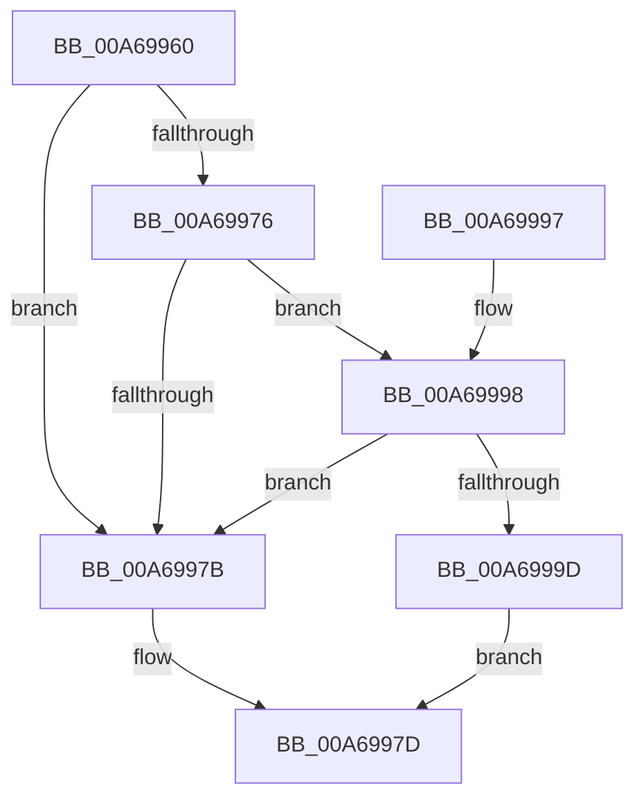

# VrpRegistryDispatch

- RVA: `0x00A69960`–`0x00A699A4` (길이 `68` bytes)
- VA: `0x0000000140A69960`
- 실행 섹션: `PAGE`
- PDB 이름 있음: `예`; PDB Function 태그: `아니요`
- unwind 정보 RVA: `0x0007EE6C`
- 디코드: `24`개 명령, `68/68` bytes 표시
- 미해석 바이트: `0` (있으면 어셈블리에 `.byte`로 보존)

> 이 문서는 커널 이미지의 기계어와 PDB 기호를 분석해 생성했습니다. 4번과 5번은 함수 원형과 자료형을 바이너리 사용 방식에서 추정한 C 해석이며 원본 소스 복구 결과는 아닙니다.

## 1. Dependencies

- 직접 호출 지점: **1**; 고유 호출 대상: **1**
- 직접 호출자로 확인된 함수: **0**
- RIP 상대 이미지 참조: **0**

### Outgoing calls
- `0x00A6998A` → [IofCompleteRequest](../../text/29/IofCompleteRequest_function_0029B5C0.md) (function, `0x0029B5C0`)

### Direct callers
- 이 함수 시작 RVA로 연결되는 직접 call은 확인되지 않았습니다. 간접 호출은 완전히 역산할 수 없습니다.

### Static image references
- 디코드된 RIP-relative 메모리 참조가 없습니다.

## 2. Other-region calls and transfers

- 다른 실행 섹션으로 향하는 call: **1**
  - `0x00A6998A` → [IofCompleteRequest](../../text/29/IofCompleteRequest_function_0029B5C0.md) (`PAGE` → `.text`)
- 별도 외부 분기/꼬리 이동을 확인하지 못했습니다.

## 3. Assembly (complete function range)

```asm
00A69960  40 53                           push rbx
00A69962  48 83 EC 20                     sub rsp, 0x20
00A69966  48 8B 82 B8 00 00 00            mov rax, qword ptr [rdx + 0xb8]
00A6996D  4C 8B C2                        mov r8, rdx
00A69970  8A 08                           mov cl, byte ptr [rax]
00A69972  84 C9                           test cl, cl
00A69974  74 05                           je 0x140a6997b
00A69976  80 F9 02                        cmp cl, 2
00A69979  75 1D                           jne 0x140a69998
00A6997B  33 DB                           xor ebx, ebx
00A6997D  48 83 62 38 00                  and qword ptr [rdx + 0x38], 0
00A69982  49 8B C8                        mov rcx, r8
00A69985  89 5A 30                        mov dword ptr [rdx + 0x30], ebx
00A69988  33 D2                           xor edx, edx
00A6998A  E8 31 1C 83 FF                  call 0x14029b5c0
00A6998F  8B C3                           mov eax, ebx
00A69991  48 83 C4 20                     add rsp, 0x20
00A69995  5B                              pop rbx
00A69996  C3                              ret
00A69997  CC                              int3
00A69998  80 F9 12                        cmp cl, 0x12
00A6999B  74 DE                           je 0x140a6997b
00A6999D  BB 10 00 00 C0                  mov ebx, 0xc0000010
00A699A2  EB D9                           jmp 0x140a6997d
```

## 4. C-style interpretation (structured pseudocode)

```c
__int64 __fastcall VrpRegistryDispatch(__int64 a1, __int64 a2)
{
    __int64 result;
    __int64 v_rbx;
    __int64 v_rsp;

    v_rsp = (v_rsp) - (32);
    if ((unsigned __int8)(*(unsigned __int8 *)(*(unsigned __int64 *)(a2 + 184))) == 0) goto loc_00A6997B;
    if (((unsigned __int8)(*(unsigned __int8 *)(*(unsigned __int64 *)(a2 + 184)))) != 2) goto loc_00A69998;
loc_00A6997B:
    v_rbx = 0;
loc_00A6997D:
    *(unsigned int *)(a2 + 48) = 0;
    a2 = 0;
    result = IofCompleteRequest(a2, a2, a2, a4);
    v_rsp = (v_rsp) + (32);
    return 0;
loc_00A69998:
    if (0 == 18) goto loc_00A6997B;
    goto loc_00A6997D;
}
```

## 5. (Beta) C Style

```c
int64_t VrpRegistryDispatch(int64_t Arg1, void *Arg2)
{
    uint8_t *arg2 = (uint8_t *)Arg2;

    int64_t result;
    int64_t local_rbx;
    int64_t local_rsp;

    local_rsp = (local_rsp) - (32);
    if ((uint8_t)(*(uint8_t *)(*(uint64_t *)(arg2 + 0xB8))) == 0) goto loc_00A6997B;
    if (((uint8_t)(*(uint8_t *)(*(uint64_t *)(arg2 + 0xB8)))) != 2) goto loc_00A69998;
loc_00A6997B:
    local_rbx = 0;
loc_00A6997D:
    *(uint32_t *)(arg2 + 0x30) = 0;
    Arg2 = 0;
    result = IofCompleteRequest(Arg2, Arg2, Arg2, a4);
    local_rsp = (local_rsp) + (32);
    return 0;
loc_00A69998:
    if (0 == 18) goto loc_00A6997B;
    goto loc_00A6997D;
}
```

### 관측된 메모리 오프셋

구조체 형식이 확인되지 않은 접근은 인자 기준의 오프셋으로만 기록했습니다.

| 기준 인자 | 오프셋 표현 | 폭 (bit) | 접근 |
|---|---:|---:|---|
| `Arg2` | `+ 0x30` | `32` | `W` |
| `Arg2` | `+ 0x38` | `64` | `R/W` |
| `Arg2` | `+ 0xB8` | `64` | `R` |

## 6. Execution-region graph

[열기: 2D/3D 그래프와 함수 탐색 컨트롤 패널](../../../control-panel.html?section=page&rva=0x00A69960&view=graph)

- 2D 그래프는 위에서 아래로 흐르고, 3D 그래프는 빈 공간을 드래그해 회전합니다. Shift+드래그는 이동, 휠은 확대·축소, 함수 노드 선택은 대상 보고서 이동입니다.

### Static fallback


