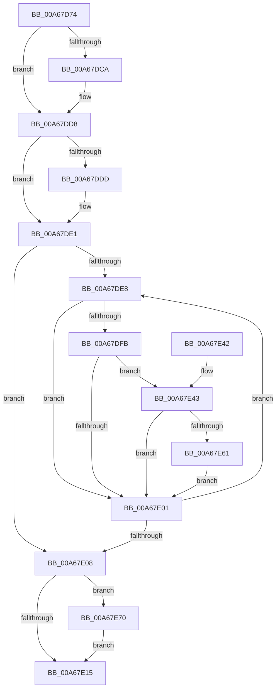

# WbHeapExecutionUnloadModule

- RVA: `0x00A67D74`–`0x00A67E7A` (길이 `262` bytes)
- VA: `0x0000000140A67D74`
- 실행 섹션: `PAGE`
- PDB 이름 있음: `예`; PDB Function 태그: `아니요`
- unwind 정보 RVA: `0x000B3D60`
- 디코드: `81`개 명령, `262/262` bytes 표시
- 미해석 바이트: `0` (있으면 어셈블리에 `.byte`로 보존)

> 이 문서는 커널 이미지의 기계어와 PDB 기호를 분석해 생성했습니다. 4번과 5번은 함수 원형과 자료형을 바이너리 사용 방식에서 추정한 C 해석이며 원본 소스 복구 결과는 아닙니다.

## 1. Dependencies

- 직접 호출 지점: **7**; 고유 호출 대상: **7**
- 직접 호출자로 확인된 함수: **1**
- RIP 상대 이미지 참조: **0**

### Outgoing calls
- `0x00A67DBA` → [KeAbPreAcquire](../../text/21/KeAbPreAcquire_function_00210230.md) (function, `0x00210230`)
- `0x00A67DD3` → [ExfAcquirePushLockExclusiveEx](../../text/20/ExfAcquirePushLockExclusiveEx_function_0020FC90.md) (function, `0x0020FC90`)
- `0x00A67E18` → [KeAbPostRelease](../../text/2E/KeAbPostRelease_function_002E1600.md) (function, `0x002E1600`)
- `0x00A67E1D` → [KeLeaveGuardedRegion](../../text/2E/KeLeaveGuardedRegion_function_002E2C40.md) (function, `0x002E2C40`)
- `0x00A67E55` → [sub_00A67F9C](Unknown_function_00A67F9C.md) (function, `0x00A67F9C`)
- `0x00A67E67` → [sub_008D23A4](../8D/Unknown_function_008D23A4.md) (function, `0x008D23A4`)
- `0x00A67E73` → [ExfTryToWakePushLock](../../text/26/ExfTryToWakePushLock_function_00265DD0.md) (function, `0x00265DD0`)

### Direct callers
- [sub_00A67C68](Unknown_function_00A67C68.md) at `0x00A67D2B`

### Static image references
- 디코드된 RIP-relative 메모리 참조가 없습니다.

## 2. Other-region calls and transfers

- 다른 실행 섹션으로 향하는 call: **5**
  - `0x00A67DBA` → [KeAbPreAcquire](../../text/21/KeAbPreAcquire_function_00210230.md) (`PAGE` → `.text`)
  - `0x00A67DD3` → [ExfAcquirePushLockExclusiveEx](../../text/20/ExfAcquirePushLockExclusiveEx_function_0020FC90.md) (`PAGE` → `.text`)
  - `0x00A67E18` → [KeAbPostRelease](../../text/2E/KeAbPostRelease_function_002E1600.md) (`PAGE` → `.text`)
  - `0x00A67E1D` → [KeLeaveGuardedRegion](../../text/2E/KeLeaveGuardedRegion_function_002E2C40.md) (`PAGE` → `.text`)
  - `0x00A67E73` → [ExfTryToWakePushLock](../../text/26/ExfTryToWakePushLock_function_00265DD0.md) (`PAGE` → `.text`)
- 별도 외부 분기/꼬리 이동을 확인하지 못했습니다.

## 3. Assembly (complete function range)

```asm
00A67D74  48 89 5C 24 08                  mov qword ptr [rsp + 8], rbx
00A67D79  48 89 6C 24 10                  mov qword ptr [rsp + 0x10], rbp
00A67D7E  48 89 74 24 18                  mov qword ptr [rsp + 0x18], rsi
00A67D83  57                              push rdi
00A67D84  41 54                           push r12
00A67D86  41 55                           push r13
00A67D88  41 56                           push r14
00A67D8A  41 57                           push r15
00A67D8C  48 83 EC 30                     sub rsp, 0x30
00A67D90  65 48 8B 04 25 88 01 00 00      mov rax, qword ptr gs:[0x188]
00A67D99  48 8D 79 30                     lea rdi, [rcx + 0x30]
00A67D9D  4C 8B EA                        mov r13, rdx
00A67DA0  48 8B E9                        mov rbp, rcx
00A67DA3  48 83 CB FF                     or rbx, 0xffffffffffffffff
00A67DA7  45 33 C0                        xor r8d, r8d
00A67DAA  33 D2                           xor edx, edx
00A67DAC  48 8B CF                        mov rcx, rdi
00A67DAF  66 01 98 E6 01 00 00            add word ptr [rax + 0x1e6], bx
00A67DB6  45 33 E4                        xor r12d, r12d
00A67DB9  90                              nop
00A67DBA  E8 71 84 7A FF                  call 0x140210230
00A67DBF  F0 48 0F BA 2F 00               lock bts qword ptr [rdi], 0
00A67DC5  48 8B F0                        mov rsi, rax
00A67DC8  73 0E                           jae 0x140a67dd8
00A67DCA  4C 8B C7                        mov r8, rdi
00A67DCD  48 8B D0                        mov rdx, rax
00A67DD0  48 8B CF                        mov rcx, rdi
00A67DD3  E8 B8 7E 7A FF                  call 0x14020fc90
00A67DD8  48 85 F6                        test rsi, rsi
00A67DDB  74 04                           je 0x140a67de1
00A67DDD  C6 46 0A 01                     mov byte ptr [rsi + 0xa], 1
00A67DE1  33 F6                           xor esi, esi
00A67DE3  39 75 0C                        cmp dword ptr [rbp + 0xc], esi
00A67DE6  76 20                           jbe 0x140a67e08
00A67DE8  48 8B 45 18                     mov rax, qword ptr [rbp + 0x18]
00A67DEC  8B CE                           mov ecx, esi
00A67DEE  0F AF 4D 08                     imul ecx, dword ptr [rbp + 8]
00A67DF2  4C 8B 34 01                     mov r14, qword ptr [rcx + rax]
00A67DF6  4D 85 F6                        test r14, r14
00A67DF9  74 06                           je 0x140a67e01
00A67DFB  4D 39 6E 40                     cmp qword ptr [r14 + 0x40], r13
00A67DFF  74 42                           je 0x140a67e43
00A67E01  FF C6                           inc esi
00A67E03  3B 75 0C                        cmp esi, dword ptr [rbp + 0xc]
00A67E06  72 E0                           jb 0x140a67de8
00A67E08  F0 48 0F C1 1F                  lock xadd qword ptr [rdi], rbx
00A67E0D  80 E3 06                        and bl, 6
00A67E10  80 FB 02                        cmp bl, 2
00A67E13  74 5B                           je 0x140a67e70
00A67E15  48 8B CF                        mov rcx, rdi
00A67E18  E8 E3 97 87 FF                  call 0x1402e1600
00A67E1D  E8 1E AE 87 FF                  call 0x1402e2c40
00A67E22  48 8B 5C 24 60                  mov rbx, qword ptr [rsp + 0x60]
00A67E27  41 8B C4                        mov eax, r12d
00A67E2A  48 8B 6C 24 68                  mov rbp, qword ptr [rsp + 0x68]
00A67E2F  48 8B 74 24 70                  mov rsi, qword ptr [rsp + 0x70]
00A67E34  48 83 C4 30                     add rsp, 0x30
00A67E38  41 5F                           pop r15
00A67E3A  41 5E                           pop r14
00A67E3C  41 5D                           pop r13
00A67E3E  41 5C                           pop r12
00A67E40  5F                              pop rdi
00A67E41  C3                              ret
00A67E42  CC                              int3
00A67E43  48 83 64 24 20 00               and qword ptr [rsp + 0x20], 0
00A67E49  48 8D 4D 08                     lea rcx, [rbp + 8]
00A67E4D  44 8B CE                        mov r9d, esi
00A67E50  45 33 C0                        xor r8d, r8d
00A67E53  33 D2                           xor edx, edx
00A67E55  E8 42 01 00 00                  call 0x140a67f9c
00A67E5A  44 8B E0                        mov r12d, eax
00A67E5D  85 C0                           test eax, eax
00A67E5F  78 A0                           js 0x140a67e01
00A67E61  49 8B D6                        mov rdx, r14
00A67E64  48 8B CD                        mov rcx, rbp
00A67E67  E8 38 A5 E6 FF                  call 0x1408d23a4
00A67E6C  FF CE                           dec esi
00A67E6E  EB 91                           jmp 0x140a67e01
00A67E70  48 8B CF                        mov rcx, rdi
00A67E73  E8 58 DF 7F FF                  call 0x140265dd0
00A67E78  EB 9B                           jmp 0x140a67e15
```

## 4. C-style interpretation (structured pseudocode)

```c
__int64 __fastcall WbHeapExecutionUnloadModule(__int64 a1, __int64 a2, int a3)
{
    __int64 result;
    __int64 v_r12;
    __int64 v_rbx;
    __int64 v_rsi;
    __int64 v_rsp;
    unsigned __int64 v_stack_p10;
    unsigned __int64 v_stack_p18;
    unsigned __int64 v_stack_p20;
    unsigned __int64 v_stack_p8;

    v_stack_p8 = v_rbx;
    v_stack_p10 = v_rbp;
    v_stack_p18 = v_rsi;
    v_rsp = (v_rsp) - (48);
    v_rbx = (v_rbx) | (-1);
    a3 = 0;
    a2 = 0;
    v_r12 = 0;
    result = KeAbPreAcquire(a1 + 48, a2, a3, a4);
    if (!(condition_is_above_or_equal)) {
        a3 = a1 + 48;
        a2 = result;
        a1 = a1 + 48;
        result = ExfAcquirePushLockExclusiveEx(a1, a2, a3, a4);
    }
    if (result != 0) {
        *(unsigned __int8 *)(result + 10) = 1;
    }
    v_rsi = 0;
    if ((*(unsigned int *)(a1 + 12)) <= 0) goto loc_00A67E08;
loc_00A67DE8:
    a1 = (unsigned int)((0) * (*(unsigned int *)(a1 + 8)));
    if (*(unsigned __int64 *)(a1 + *(unsigned __int64 *)(a1 + 24) * 1) == 0) goto loc_00A67E01;
    if ((*(unsigned __int64 *)(*(unsigned __int64 *)(a1 + *(unsigned __int64 *)(a1 + 24) * 1) + 64)) == a2) goto loc_00A67E43;
loc_00A67E01:
    v_rsi = (unsigned int)((v_rsi) + 1);
    if (((unsigned int)(v_rsi)) < (*(unsigned int *)(a1 + 12))) goto loc_00A67DE8;
loc_00A67E08:
    v_rbx = (unsigned __int8)((v_rbx) & (6));
    if (((unsigned __int8)(v_rbx)) == 2) goto loc_00A67E70;
loc_00A67E15:
    result = KeAbPostRelease(a1 + 48, a2, a3, a4);
    result = KeLeaveGuardedRegion(a1 + 48, a2, a3, a4);
    v_rsp = (v_rsp) + (48);
    return 0;
loc_00A67E43:
    a3 = 0;
    a2 = 0;
    result = sub_00A67F9C(v_stack_p10 + 8, a2, a3, (unsigned int)((unsigned int)(v_stack_p18)));
    if (sign_flag) goto loc_00A67E01;
    result = sub_008D23A4(v_stack_p10, *(unsigned __int64 *)(a1 + *(unsigned __int64 *)(a1 + 24) * 1), a3, (unsigned int)((unsigned int)(v_stack_p18)));
    v_rsi = (unsigned int)((v_stack_p18) - 1);
    goto loc_00A67E01;
loc_00A67E70:
    result = ExfTryToWakePushLock(a1 + 48, *(unsigned __int64 *)(a1 + *(unsigned __int64 *)(a1 + 24) * 1), a3, (unsigned int)((unsigned int)(v_stack_p18)));
    goto loc_00A67E15;
}
```

## 5. (Beta) C Style

```c
int64_t WbHeapExecutionUnloadModule(void *Arg1, int64_t Arg2, int32_t Arg3)
{
    uint8_t *arg1 = (uint8_t *)Arg1;

    int64_t result;
    int64_t local_r12;
    int64_t local_rbx;
    int64_t local_rsi;
    int64_t local_rsp;
    uint64_t v_stack_p10;
    uint64_t v_stack_p18;
    uint64_t v_stack_p20;
    uint64_t v_stack_p8;

    v_stack_p8 = local_rbx;
    v_stack_p10 = local_rbp;
    v_stack_p18 = local_rsi;
    local_rsp = (local_rsp) - (48);
    local_rbx = (local_rbx) | (-1);
    Arg3 = 0;
    Arg2 = 0;
    local_r12 = 0;
    result = KeAbPreAcquire(Arg1 + 48, Arg2, Arg3, a4);
    if (!(condition_is_above_or_equal)) {
        Arg3 = Arg1 + 48;
        Arg2 = result;
        Arg1 = Arg1 + 48;
        result = ExfAcquirePushLockExclusiveEx(Arg1, Arg2, Arg3, a4);
    }
    if (result != 0) {
        *(uint8_t *)(result + 0xA) = 1;
    }
    local_rsi = 0;
    if ((*(uint32_t *)(arg1 + 0xC)) <= 0) goto loc_00A67E08;
loc_00A67DE8:
    Arg1 = (uint32_t)((0) * (*(uint32_t *)(arg1 + 0x8)));
    if (*(uint64_t *)(arg1 + *(uint64_t *)(arg1 + 0x18) * 1) == 0) goto loc_00A67E01;
    if ((*(uint64_t *)(*(uint64_t *)(arg1 + *(uint64_t *)(arg1 + 0x18) * 1) + 0x40)) == Arg2) goto loc_00A67E43;
loc_00A67E01:
    local_rsi = (uint32_t)((local_rsi) + 1);
    if (((uint32_t)(local_rsi)) < (*(uint32_t *)(arg1 + 0xC))) goto loc_00A67DE8;
loc_00A67E08:
    local_rbx = (uint8_t)((local_rbx) & (6));
    if (((uint8_t)(local_rbx)) == 2) goto loc_00A67E70;
loc_00A67E15:
    result = KeAbPostRelease(Arg1 + 48, Arg2, Arg3, a4);
    result = KeLeaveGuardedRegion(Arg1 + 48, Arg2, Arg3, a4);
    local_rsp = (local_rsp) + (48);
    return 0;
loc_00A67E43:
    Arg3 = 0;
    Arg2 = 0;
    result = sub_00A67F9C(v_stack_p10 + 8, Arg2, Arg3, (uint32_t)((uint32_t)(v_stack_p18)));
    if (sign_flag) goto loc_00A67E01;
    result = sub_008D23A4(v_stack_p10, *(uint64_t *)(arg1 + *(uint64_t *)(arg1 + 0x18) * 1), Arg3, (uint32_t)((uint32_t)(v_stack_p18)));
    local_rsi = (uint32_t)((v_stack_p18) - 1);
    goto loc_00A67E01;
loc_00A67E70:
    result = ExfTryToWakePushLock(Arg1 + 48, *(uint64_t *)(arg1 + *(uint64_t *)(arg1 + 0x18) * 1), Arg3, (uint32_t)((uint32_t)(v_stack_p18)));
    goto loc_00A67E15;
}
```

### 관측된 메모리 오프셋

구조체 형식이 확인되지 않은 접근은 인자 기준의 오프셋으로만 기록했습니다.

| 기준 인자 | 오프셋 표현 | 폭 (bit) | 접근 |
|---|---:|---:|---|
| `Arg1` | `+ 0x0` | `64` | `R/W` |
| `Arg1` | `+ 0x8` | `32` | `R` |
| `Arg1` | `+ 0x8` | `64` | `R` |
| `Arg1` | `+ 0xC` | `32` | `R` |
| `Arg1` | `+ 0x18` | `64` | `R` |
| `Arg1` | `+ 0x30` | `64` | `R` |

## 6. Execution-region graph

[열기: 2D/3D 그래프와 함수 탐색 컨트롤 패널](../../../control-panel.html?section=page&rva=0x00A67D74&view=graph)

- 2D 그래프는 위에서 아래로 흐르고, 3D 그래프는 빈 공간을 드래그해 회전합니다. Shift+드래그는 이동, 휠은 확대·축소, 함수 노드 선택은 대상 보고서 이동입니다.

### Static fallback


