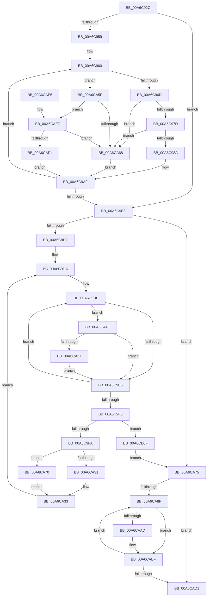

# WmipCopyFromEventQueues

- RVA: `0x00A6C92C`–`0x00A6CB1C` (길이 `496` bytes)
- VA: `0x0000000140A6C92C`
- 실행 섹션: `PAGE`
- PDB 이름 있음: `예`; PDB Function 태그: `아니요`
- unwind 정보 RVA: `0x000B455C`
- 디코드: `140`개 명령, `496/496` bytes 표시
- 미해석 바이트: `0` (있으면 어셈블리에 `.byte`로 보존)

> 이 문서는 커널 이미지의 기계어와 PDB 기호를 분석해 생성했습니다. 4번과 5번은 함수 원형과 자료형을 바이너리 사용 방식에서 추정한 C 해석이며 원본 소스 복구 결과는 아닙니다.

## 1. Dependencies

- 직접 호출 지점: **3**; 고유 호출 대상: **3**
- 직접 호출자로 확인된 함수: **1**
- RIP 상대 이미지 참조: **0**

### Outgoing calls
- `0x00A6CA19` → [memcpy](../../text/6C/memcpy_function_006C6840.md) (function, `0x006C6840`)
- `0x00A6CAAF` → [ExFreePoolWithTag](../../poolcode/B8/ExFreePoolWithTag_function_00B82870.md) (function, `0x00B82870`)
- `0x00A6CAC2` → [KeResetEvent](../../text/24/KeResetEvent_function_00248350.md) (function, `0x00248350`)

### Direct callers
- [WmipReceiveNotifications](../../text/4E/WmipReceiveNotifications_function_004EC280.md) at `0x004EC59A`
- [WmipReceiveNotifications](../../text/4E/WmipReceiveNotifications_function_004EC280.md) at `0x004EC5D8`

### Static image references
- 디코드된 RIP-relative 메모리 참조가 없습니다.

## 2. Other-region calls and transfers

- 다른 실행 섹션으로 향하는 call: **3**
  - `0x00A6CA19` → [memcpy](../../text/6C/memcpy_function_006C6840.md) (`PAGE` → `.text`)
  - `0x00A6CAAF` → [ExFreePoolWithTag](../../poolcode/B8/ExFreePoolWithTag_function_00B82870.md) (`PAGE` → `POOLCODE`)
  - `0x00A6CAC2` → [KeResetEvent](../../text/24/KeResetEvent_function_00248350.md) (`PAGE` → `.text`)
- 별도 외부 분기/꼬리 이동을 확인하지 못했습니다.

## 3. Assembly (complete function range)

```asm
00A6C92C  48 89 5C 24 08                  mov qword ptr [rsp + 8], rbx
00A6C931  4C 89 44 24 18                  mov qword ptr [rsp + 0x18], r8
00A6C936  55                              push rbp
00A6C937  56                              push rsi
00A6C938  57                              push rdi
00A6C939  41 54                           push r12
00A6C93B  41 55                           push r13
00A6C93D  41 56                           push r14
00A6C93F  41 57                           push r15
00A6C941  48 83 EC 30                     sub rsp, 0x30
00A6C945  44 8A AC 24 A0 00 00 00         mov r13b, byte ptr [rsp + 0xa0]
00A6C94D  45 33 F6                        xor r14d, r14d
00A6C950  8B F2                           mov esi, edx
00A6C952  48 8B F9                        mov rdi, rcx
00A6C955  85 D2                           test edx, edx
00A6C957  74 5A                           je 0x140a6c9b3
00A6C959  4C 8D 49 08                     lea r9, [rcx + 8]
00A6C95D  44 8B D6                        mov r10d, esi
00A6C960  49 8B 51 F8                     mov rdx, qword ptr [r9 - 8]
00A6C964  45 84 ED                        test r13b, r13b
00A6C967  0F 85 F2 00 00 00               jne 0x140a6ca5f
00A6C96D  48 8B 82 80 00 00 00            mov rax, qword ptr [rdx + 0x80]
00A6C974  48 85 C0                        test rax, rax
00A6C977  0F 84 EB 00 00 00               je 0x140a6ca68
00A6C97D  44 39 B2 94 00 00 00            cmp dword ptr [rdx + 0x94], r14d
00A6C984  0F 84 DE 00 00 00               je 0x140a6ca68
00A6C98A  49 89 01                        mov qword ptr [r9], rax
00A6C98D  66 44 89 70 0A                  mov word ptr [rax + 0xa], r14w
00A6C992  0F B7 82 98 00 00 00            movzx eax, word ptr [rdx + 0x98]
00A6C999  49 8B 09                        mov rcx, qword ptr [r9]
00A6C99C  C1 E0 10                        shl eax, 0x10
00A6C99F  09 41 08                        or dword ptr [rcx + 8], eax
00A6C9A2  44 89 B2 98 00 00 00            mov dword ptr [rdx + 0x98], r14d
00A6C9A9  49 83 C1 10                     add r9, 0x10
00A6C9AD  49 83 EA 01                     sub r10, 1
00A6C9B1  75 AD                           jne 0x140a6c960
00A6C9B3  41 83 C8 FF                     or r8d, 0xffffffff
00A6C9B7  48 B8 FF FF FF FF FF FF FF 7F   movabs rax, 0x7fffffffffffffff
00A6C9C1  41 8B CE                        mov ecx, r14d
00A6C9C4  45 8B FE                        mov r15d, r14d
00A6C9C7  4D 8B E6                        mov r12, r14
00A6C9CA  85 F6                           test esi, esi
00A6C9CC  0F 84 A3 00 00 00               je 0x140a6ca75
00A6C9D2  4C 8B AC 24 80 00 00 00         mov r13, qword ptr [rsp + 0x80]
00A6C9DA  48 8D 57 08                     lea rdx, [rdi + 8]
00A6C9DE  4C 8B 0A                        mov r9, qword ptr [rdx]
00A6C9E1  4D 85 C9                        test r9, r9
00A6C9E4  75 68                           jne 0x140a6ca4e
00A6C9E6  FF C1                           inc ecx
00A6C9E8  48 83 C2 10                     add rdx, 0x10
00A6C9EC  3B CE                           cmp ecx, esi
00A6C9EE  72 EE                           jb 0x140a6c9de
00A6C9F0  41 83 F8 FF                     cmp r8d, -1
00A6C9F4  0F 84 15 01 00 00               je 0x140a6cb0f
00A6C9FA  45 8B F0                        mov r14d, r8d
00A6C9FD  49 8B CD                        mov rcx, r13
00A6CA00  4D 03 F6                        add r14, r14
00A6CA03  4D 8B E5                        mov r12, r13
00A6CA06  4A 8B 6C F7 08                  mov rbp, qword ptr [rdi + r14*8 + 8]
00A6CA0B  48 8B D5                        mov rdx, rbp
00A6CA0E  44 8B 45 00                     mov r8d, dword ptr [rbp]
00A6CA12  41 8D 58 07                     lea ebx, [r8 + 7]
00A6CA16  83 E3 F8                        and ebx, 0xfffffff8
00A6CA19  E8 22 9E C5 FF                  call 0x1406c6840
00A6CA1E  8B C3                           mov eax, ebx
00A6CA20  44 03 FB                        add r15d, ebx
00A6CA23  41 89 5D 0C                     mov dword ptr [r13 + 0xc], ebx
00A6CA27  4C 03 E8                        add r13, rax
00A6CA2A  8B 45 0C                        mov eax, dword ptr [rbp + 0xc]
00A6CA2D  85 C0                           test eax, eax
00A6CA2F  75 3F                           jne 0x140a6ca70
00A6CA31  33 ED                           xor ebp, ebp
00A6CA33  41 83 C8 FF                     or r8d, 0xffffffff
00A6CA37  4A 89 6C F7 08                  mov qword ptr [rdi + r14*8 + 8], rbp
00A6CA3C  45 33 F6                        xor r14d, r14d
00A6CA3F  48 B8 FF FF FF FF FF FF FF 7F   movabs rax, 0x7fffffffffffffff
00A6CA49  41 8B CE                        mov ecx, r14d
00A6CA4C  EB 8C                           jmp 0x140a6c9da
00A6CA4E  4D 8B 51 10                     mov r10, qword ptr [r9 + 0x10]
00A6CA52  4C 3B D0                        cmp r10, rax
00A6CA55  7D 8F                           jge 0x140a6c9e6
00A6CA57  49 8B C2                        mov rax, r10
00A6CA5A  44 8B C1                        mov r8d, ecx
00A6CA5D  EB 87                           jmp 0x140a6c9e6
00A6CA5F  48 8B 42 60                     mov rax, qword ptr [rdx + 0x60]
00A6CA63  48 85 C0                        test rax, rax
00A6CA66  75 7F                           jne 0x140a6cae7
00A6CA68  4D 89 31                        mov qword ptr [r9], r14
00A6CA6B  E9 39 FF FF FF                  jmp 0x140a6c9a9
00A6CA70  48 03 E8                        add rbp, rax
00A6CA73  EB BE                           jmp 0x140a6ca33
00A6CA75  48 8B 84 24 98 00 00 00         mov rax, qword ptr [rsp + 0x98]
00A6CA7D  4C 89 20                        mov qword ptr [rax], r12
00A6CA80  48 8B 84 24 90 00 00 00         mov rax, qword ptr [rsp + 0x90]
00A6CA88  44 89 38                        mov dword ptr [rax], r15d
00A6CA8B  85 F6                           test esi, esi
00A6CA8D  74 42                           je 0x140a6cad1
00A6CA8F  48 8B 2F                        mov rbp, qword ptr [rdi]
00A6CA92  41 8A C5                        mov al, r13b
00A6CA95  F6 D8                           neg al
00A6CA97  48 1B DB                        sbb rbx, rbx
00A6CA9A  48 83 E3 E0                     and rbx, 0xffffffffffffffe0
00A6CA9E  48 83 EB 80                     sub rbx, -0x80
00A6CAA2  48 03 DD                        add rbx, rbp
00A6CAA5  48 8B 0B                        mov rcx, qword ptr [rbx]
00A6CAA8  48 85 C9                        test rcx, rcx
00A6CAAB  74 12                           je 0x140a6cabf
00A6CAAD  33 D2                           xor edx, edx
00A6CAAF  E8 BC 5D 11 00                  call 0x140b82870
00A6CAB4  4C 89 33                        mov qword ptr [rbx], r14
00A6CAB7  44 89 73 14                     mov dword ptr [rbx + 0x14], r14d
00A6CABB  4C 89 73 08                     mov qword ptr [rbx + 8], r14
00A6CABF  48 8B CD                        mov rcx, rbp
00A6CAC2  E8 89 B8 7D FF                  call 0x140248350
00A6CAC7  48 83 C7 10                     add rdi, 0x10
00A6CACB  48 83 EE 01                     sub rsi, 1
00A6CACF  75 BE                           jne 0x140a6ca8f
00A6CAD1  48 8B 5C 24 70                  mov rbx, qword ptr [rsp + 0x70]
00A6CAD6  48 83 C4 30                     add rsp, 0x30
00A6CADA  41 5F                           pop r15
00A6CADC  41 5E                           pop r14
00A6CADE  41 5D                           pop r13
00A6CAE0  41 5C                           pop r12
00A6CAE2  5F                              pop rdi
00A6CAE3  5E                              pop rsi
00A6CAE4  5D                              pop rbp
00A6CAE5  C3                              ret
00A6CAE6  CC                              int3
00A6CAE7  44 39 72 74                     cmp dword ptr [rdx + 0x74], r14d
00A6CAEB  0F 84 77 FF FF FF               je 0x140a6ca68
00A6CAF1  49 89 01                        mov qword ptr [r9], rax
00A6CAF4  66 44 89 70 0A                  mov word ptr [rax + 0xa], r14w
00A6CAF9  0F B7 42 78                     movzx eax, word ptr [rdx + 0x78]
00A6CAFD  49 8B 09                        mov rcx, qword ptr [r9]
00A6CB00  C1 E0 10                        shl eax, 0x10
00A6CB03  09 41 08                        or dword ptr [rcx + 8], eax
00A6CB06  44 89 72 78                     mov dword ptr [rdx + 0x78], r14d
00A6CB0A  E9 9A FE FF FF                  jmp 0x140a6c9a9
00A6CB0F  44 8A AC 24 A0 00 00 00         mov r13b, byte ptr [rsp + 0xa0]
00A6CB17  E9 59 FF FF FF                  jmp 0x140a6ca75
```

## 4. C-style interpretation (structured pseudocode)

```c
__int64 __fastcall WmipCopyFromEventQueues(__int64 a1, int a2, __int64 a3, __int64 a4, __int64 a5, __int64 a6, unsigned __int8 a7)
{
    __int64 result;
    __int64 v_r10;
    __int64 v_r13;
    __int64 v_r14;
    __int64 v_r15;
    __int64 v_rbp;
    __int64 v_rbx;
    __int64 v_rdi;
    __int64 v_rsi;
    __int64 v_rsp;
    unsigned __int64 v_stack_p18;
    unsigned __int64 v_stack_p8;

    v_stack_p8 = v_rbx;
    v_stack_p18 = a3;
    v_rsp = (v_rsp) - (48);
    v_r14 = 0;
    if (a2 == 0) goto loc_00A6C9B3;
loc_00A6C960:
    if (a7 != 0) goto loc_00A6CA5F;
    if (*(unsigned __int64 *)(*(unsigned __int64 *)(a1 + 8 - 8) + 128) == 0) goto loc_00A6CA68;
    if ((*(unsigned int *)(*(unsigned __int64 *)(a1 + 8 - 8) + 148)) == 0) goto loc_00A6CA68;
    *(unsigned __int64 *)(a1 + 8) = *(unsigned __int64 *)(*(unsigned __int64 *)(a1 + 8 - 8) + 128);
    *(unsigned __int16 *)(*(unsigned __int64 *)(*(unsigned __int64 *)(a1 + 8 - 8) + 128) + 10) = 0;
    result = (unsigned int)((*(unsigned __int16 *)(*(unsigned __int64 *)(a1 + 8 - 8) + 152)) << (16));
    *(unsigned int *)(*(unsigned __int64 *)(a1 + 8 - 8) + 152) = 0;
loc_00A6C9A9:
    a4 = (a1 + 8) + (16);
    v_r10 = ((unsigned int)((unsigned int)((unsigned int)(a2)))) - (1);
    if (condition_is_not_equal) goto loc_00A6C960;
loc_00A6C9B3:
    a3 = (unsigned int)((a3) | (0xFFFFFFFFULL));
    if ((unsigned int)((unsigned int)(a2)) == 0) goto loc_00A6CA75;
loc_00A6C9DA:
loc_00A6C9DE:
    if (*(unsigned __int64 *)(a1 + 8) != 0) goto loc_00A6CA4E;
loc_00A6C9E6:
    a1 = (unsigned int)((0) + 1);
    a2 = (a1 + 8) + (16);
    if (((unsigned int)(a1)) < ((unsigned int)((unsigned int)(a2)))) goto loc_00A6C9DE;
    if (((unsigned int)(a3)) == -1) goto loc_00A6CB0F;
    v_r14 = ((unsigned int)((unsigned int)(a3))) + ((unsigned int)((unsigned int)(a3)));
    v_rbx = (unsigned int)(((unsigned int)(*(unsigned int *)(*(unsigned __int64 *)(a1 + v_r14 * 8 + 8))) + 7) & (0xFFFFFFF8ULL));
    result = memcpy(v_stack_p18, *(unsigned __int64 *)(a1 + v_r14 * 8 + 8), (unsigned int)(*(unsigned int *)(*(unsigned __int64 *)(a1 + v_r14 * 8 + 8))), *(unsigned __int64 *)(a1 + 8));
    v_r15 = (unsigned int)((0) + ((unsigned int)(v_rbx)));
    *(unsigned int *)(v_stack_p18 + 12) = (unsigned int)(v_rbx);
    v_r13 = (v_stack_p18) + ((unsigned int)((unsigned int)(v_rbx)));
    if ((unsigned int)((unsigned int)(*(unsigned int *)(*(unsigned __int64 *)(a1 + v_r14 * 8 + 8) + 12))) != 0) goto loc_00A6CA70;
    v_rbp = 0;
loc_00A6CA33:
    a3 = (unsigned int)(((unsigned int)(*(unsigned int *)(*(unsigned __int64 *)(a1 + v_r14 * 8 + 8)))) | (0xFFFFFFFFULL));
    *(unsigned __int64 *)(a1 + v_r14 * 8 + 8) = 0;
    v_r14 = 0;
    goto loc_00A6C9DA;
loc_00A6CA4E:
    if ((*(unsigned __int64 *)(*(unsigned __int64 *)(a1 + 8) + 16)) >= ((unsigned int)(*(unsigned int *)(*(unsigned __int64 *)(a1 + v_r14 * 8 + 8) + 12)))) goto loc_00A6C9E6;
    goto loc_00A6C9E6;
loc_00A6CA5F:
    if (*(unsigned __int64 *)(*(unsigned __int64 *)(a1 + v_r14 * 8 + 8) + 96) != 0) goto loc_00A6CAE7;
loc_00A6CA68:
    *(unsigned __int64 *)(*(unsigned __int64 *)(a1 + 8)) = 0;
    goto loc_00A6C9A9;
loc_00A6CA70:
    v_rbp = (v_rbp) + (*(unsigned __int64 *)(*(unsigned __int64 *)(a1 + v_r14 * 8 + 8) + 96));
    goto loc_00A6CA33;
loc_00A6CA75:
    *(unsigned __int64 *)(a6) = v_stack_p18;
    *(unsigned int *)(a5) = (unsigned int)(v_r15);
    if ((unsigned int)((unsigned int)(a2)) == 0) goto loc_00A6CAD1;
loc_00A6CA8F:
    result = (unsigned __int8)(-((unsigned __int8)(v_r13)));
    v_rbx = (v_rbx) & (-32);
    v_rbx = (v_rbx) - (-128);
    v_rbx = (v_rbx) + (*(unsigned __int64 *)(a1));
    if (*(unsigned __int64 *)(v_rbx) != 0) {
        a2 = 0;
        result = ExFreePoolWithTag(*(unsigned __int64 *)(v_rbx), a2, 0, *(unsigned __int64 *)(a1 + 8));
        *(unsigned __int64 *)(v_rbx) = 0;
        *(unsigned int *)(v_rbx + 20) = 0;
        *(unsigned __int64 *)(v_rbx + 8) = 0;
    }
    result = KeResetEvent(*(unsigned __int64 *)(a1), a2, 0, *(unsigned __int64 *)(a1 + 8));
    v_rdi = (a1) + (16);
    v_rsi = ((unsigned int)(a2)) - (1);
    if (condition_is_not_equal) goto loc_00A6CA8F;
loc_00A6CAD1:
    v_rsp = (v_rsp) + (48);
    return result;
loc_00A6CAE7:
    if ((*(unsigned int *)(a2 + 116)) == 0) goto loc_00A6CA68;
    *(unsigned __int64 *)(*(unsigned __int64 *)(a1 + 8)) = result;
    *(unsigned __int16 *)(result + 10) = 0;
    result = (unsigned int)((*(unsigned __int16 *)(a2 + 120)) << (16));
    *(unsigned int *)(a2 + 120) = 0;
    goto loc_00A6C9A9;
loc_00A6CB0F:
    goto loc_00A6CA75;
}
```

## 5. (Beta) C Style

```c
int64_t WmipCopyFromEventQueues(void *Arg1, int32_t Arg2, int64_t Arg3, int64_t Arg4, void *Arg5, void *Arg6, uint8_t Arg7)
{
    uint8_t *arg1 = (uint8_t *)Arg1;
    uint8_t *arg5 = (uint8_t *)Arg5;
    uint8_t *arg6 = (uint8_t *)Arg6;

    int64_t result;
    int64_t local_r10;
    int64_t local_r13;
    int64_t local_r14;
    int64_t local_r15;
    int64_t local_rbp;
    int64_t local_rbx;
    int64_t local_rdi;
    int64_t local_rsi;
    int64_t local_rsp;
    uint64_t v_stack_p18;
    uint64_t v_stack_p8;

    v_stack_p8 = local_rbx;
    v_stack_p18 = Arg3;
    local_rsp = (local_rsp) - (48);
    local_r14 = 0;
    if (Arg2 == 0) goto loc_00A6C9B3;
loc_00A6C960:
    if (Arg7 != 0) goto loc_00A6CA5F;
    if (*(uint64_t *)(*(uint64_t *)(arg1 + 0x8 - 0x8) + 0x80) == 0) goto loc_00A6CA68;
    if ((*(uint32_t *)(*(uint64_t *)(arg1 + 0x8 - 0x8) + 0x94)) == 0) goto loc_00A6CA68;
    *(uint64_t *)(arg1 + 0x8) = *(uint64_t *)(*(uint64_t *)(arg1 + 0x8 - 0x8) + 0x80);
    *(uint16_t *)(*(uint64_t *)(*(uint64_t *)(arg1 + 0x8 - 0x8) + 0x80) + 0xA) = 0;
    result = (uint32_t)((*(uint16_t *)(*(uint64_t *)(arg1 + 0x8 - 0x8) + 0x98)) << (16));
    *(uint32_t *)(*(uint64_t *)(arg1 + 0x8 - 0x8) + 0x98) = 0;
loc_00A6C9A9:
    Arg4 = (Arg1 + 8) + (16);
    local_r10 = ((uint32_t)((uint32_t)((uint32_t)(Arg2)))) - (1);
    if (condition_is_not_equal) goto loc_00A6C960;
loc_00A6C9B3:
    Arg3 = (uint32_t)((Arg3) | (0xFFFFFFFFULL));
    if ((uint32_t)((uint32_t)(Arg2)) == 0) goto loc_00A6CA75;
loc_00A6C9DA:
loc_00A6C9DE:
    if (*(uint64_t *)(arg1 + 0x8) != 0) goto loc_00A6CA4E;
loc_00A6C9E6:
    Arg1 = (uint32_t)((0) + 1);
    Arg2 = (Arg1 + 8) + (16);
    if (((uint32_t)(Arg1)) < ((uint32_t)((uint32_t)(Arg2)))) goto loc_00A6C9DE;
    if (((uint32_t)(Arg3)) == -1) goto loc_00A6CB0F;
    local_r14 = ((uint32_t)((uint32_t)(Arg3))) + ((uint32_t)((uint32_t)(Arg3)));
    local_rbx = (uint32_t)(((uint32_t)(*(uint32_t *)(*(uint64_t *)(arg1 + local_r14 * 8 + 0x8))) + 7) & (0xFFFFFFF8ULL));
    result = memcpy(v_stack_p18, *(uint64_t *)(arg1 + local_r14 * 8 + 0x8), (uint32_t)(*(uint32_t *)(*(uint64_t *)(arg1 + local_r14 * 8 + 0x8))), *(uint64_t *)(arg1 + 0x8));
    local_r15 = (uint32_t)((0) + ((uint32_t)(local_rbx)));
    *(uint32_t *)(v_stack_p18 + 0xC) = (uint32_t)(local_rbx);
    local_r13 = (v_stack_p18) + ((uint32_t)((uint32_t)(local_rbx)));
    if ((uint32_t)((uint32_t)(*(uint32_t *)(*(uint64_t *)(arg1 + local_r14 * 8 + 0x8) + 0xC))) != 0) goto loc_00A6CA70;
    local_rbp = 0;
loc_00A6CA33:
    Arg3 = (uint32_t)(((uint32_t)(*(uint32_t *)(*(uint64_t *)(arg1 + local_r14 * 8 + 0x8)))) | (0xFFFFFFFFULL));
    *(uint64_t *)(arg1 + local_r14 * 8 + 0x8) = 0;
    local_r14 = 0;
    goto loc_00A6C9DA;
loc_00A6CA4E:
    if ((*(uint64_t *)(*(uint64_t *)(arg1 + 0x8) + 0x10)) >= ((uint32_t)(*(uint32_t *)(*(uint64_t *)(arg1 + local_r14 * 8 + 0x8) + 0xC)))) goto loc_00A6C9E6;
    goto loc_00A6C9E6;
loc_00A6CA5F:
    if (*(uint64_t *)(*(uint64_t *)(arg1 + local_r14 * 8 + 0x8) + 0x60) != 0) goto loc_00A6CAE7;
loc_00A6CA68:
    *(uint64_t *)(*(uint64_t *)(arg1 + 0x8)) = 0;
    goto loc_00A6C9A9;
loc_00A6CA70:
    local_rbp = (local_rbp) + (*(uint64_t *)(*(uint64_t *)(arg1 + local_r14 * 8 + 0x8) + 0x60));
    goto loc_00A6CA33;
loc_00A6CA75:
    *(uint64_t *)(arg6) = v_stack_p18;
    *(uint32_t *)(arg5) = (uint32_t)(local_r15);
    if ((uint32_t)((uint32_t)(Arg2)) == 0) goto loc_00A6CAD1;
loc_00A6CA8F:
    result = (uint8_t)(-((uint8_t)(local_r13)));
    local_rbx = (local_rbx) & (-32);
    local_rbx = (local_rbx) - (-128);
    local_rbx = (local_rbx) + (*(uint64_t *)(arg1));
    if (*(uint64_t *)(local_rbx) != 0) {
        Arg2 = 0;
        result = ExFreePoolWithTag(*(uint64_t *)(local_rbx), Arg2, 0, *(uint64_t *)(arg1 + 0x8));
        *(uint64_t *)(local_rbx) = 0;
        *(uint32_t *)(local_rbx + 0x14) = 0;
        *(uint64_t *)(local_rbx + 0x8) = 0;
    }
    result = KeResetEvent(*(uint64_t *)(arg1), Arg2, 0, *(uint64_t *)(arg1 + 0x8));
    local_rdi = (Arg1) + (16);
    local_rsi = ((uint32_t)(Arg2)) - (1);
    if (condition_is_not_equal) goto loc_00A6CA8F;
loc_00A6CAD1:
    local_rsp = (local_rsp) + (48);
    return result;
loc_00A6CAE7:
    if ((*(uint32_t *)(Arg2 + 0x74)) == 0) goto loc_00A6CA68;
    *(uint64_t *)(*(uint64_t *)(arg1 + 0x8)) = result;
    *(uint16_t *)(result + 0xA) = 0;
    result = (uint32_t)((*(uint16_t *)(Arg2 + 0x78)) << (16));
    *(uint32_t *)(Arg2 + 0x78) = 0;
    goto loc_00A6C9A9;
loc_00A6CB0F:
    goto loc_00A6CA75;
}
```

### 관측된 메모리 오프셋

구조체 형식이 확인되지 않은 접근은 인자 기준의 오프셋으로만 기록했습니다.

| 기준 인자 | 오프셋 표현 | 폭 (bit) | 접근 |
|---|---:|---:|---|
| `Arg1` | `- 0x8` | `64` | `R` |
| `Arg1` | `+ 0x0` | `64` | `R` |
| `Arg1` | `+ 0x0` | `64` | `W` |
| `Arg1` | `+ 0x8` | `64` | `R` |
| `Arg1` | `+ 0x8 + r14*8` | `64` | `R` |
| `Arg1` | `+ 0x8 + r14*8` | `64` | `W` |
| `Arg5` | `+ 0x0` | `32` | `W` |
| `Arg6` | `+ 0x0` | `64` | `W` |

## 6. Execution-region graph

[열기: 2D/3D 그래프와 함수 탐색 컨트롤 패널](../../../control-panel.html?section=page&rva=0x00A6C92C&view=graph)

- 2D 그래프는 위에서 아래로 흐르고, 3D 그래프는 빈 공간을 드래그해 회전합니다. Shift+드래그는 이동, 휠은 확대·축소, 함수 노드 선택은 대상 보고서 이동입니다.

### Static fallback


