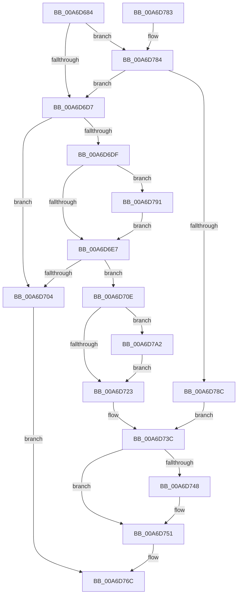

# WmipQueueNotification

- RVA: `0x00A6D684`–`0x00A6D7CA` (길이 `326` bytes)
- VA: `0x0000000140A6D684`
- 실행 섹션: `PAGE`
- PDB 이름 있음: `예`; PDB Function 태그: `아니요`
- unwind 정보 RVA: `0x000B46DC`
- 디코드: `99`개 명령, `326/326` bytes 표시
- 미해석 바이트: `0` (있으면 어셈블리에 `.byte`로 보존)

> 이 문서는 커널 이미지의 기계어와 PDB 기호를 분석해 생성했습니다. 4번과 5번은 함수 원형과 자료형을 바이너리 사용 방식에서 추정한 C 해석이며 원본 소스 복구 결과는 아닙니다.

## 1. Dependencies

- 직접 호출 지점: **6**; 고유 호출 대상: **5**
- 직접 호출자로 확인된 함수: **1**
- RIP 상대 이미지 참조: **0**

### Outgoing calls
- `0x00A6D6F7` → [ExAllocatePool2](../../poolcode/B8/ExAllocatePool2_function_00B820F0.md) (function, `0x00B820F0`)
- `0x00A6D716` → [memset](../../text/6C/memset_function_006C6C40.md) (function, `0x006C6C40`)
- `0x00A6D75A` → [memcpy](../../text/6C/memcpy_function_006C6840.md) (function, `0x006C6840`)
- `0x00A6D767` → [KeSetEvent](../../text/33/KeSetEvent_function_0033F310.md) (function, `0x0033F310`)
- `0x00A6D7A9` → [memcpy](../../text/6C/memcpy_function_006C6840.md) (function, `0x006C6840`)
- `0x00A6D7C0` → [ExFreePoolWithTag](../../poolcode/B8/ExFreePoolWithTag_function_00B82870.md) (function, `0x00B82870`)

### Direct callers
- [WmipWriteWnodeToObject](../../text/49/WmipWriteWnodeToObject_function_00491C0C.md) at `0x00491CAF`

### Static image references
- 디코드된 RIP-relative 메모리 참조가 없습니다.

## 2. Other-region calls and transfers

- 다른 실행 섹션으로 향하는 call: **6**
  - `0x00A6D6F7` → [ExAllocatePool2](../../poolcode/B8/ExAllocatePool2_function_00B820F0.md) (`PAGE` → `POOLCODE`)
  - `0x00A6D716` → [memset](../../text/6C/memset_function_006C6C40.md) (`PAGE` → `.text`)
  - `0x00A6D75A` → [memcpy](../../text/6C/memcpy_function_006C6840.md) (`PAGE` → `.text`)
  - `0x00A6D767` → [KeSetEvent](../../text/33/KeSetEvent_function_0033F310.md) (`PAGE` → `.text`)
  - `0x00A6D7A9` → [memcpy](../../text/6C/memcpy_function_006C6840.md) (`PAGE` → `.text`)
  - `0x00A6D7C0` → [ExFreePoolWithTag](../../poolcode/B8/ExFreePoolWithTag_function_00B82870.md) (`PAGE` → `POOLCODE`)
- 별도 외부 분기/꼬리 이동을 확인하지 못했습니다.

## 3. Assembly (complete function range)

```asm
00A6D684  48 89 5C 24 20                  mov qword ptr [rsp + 0x20], rbx
00A6D689  4C 89 44 24 18                  mov qword ptr [rsp + 0x18], r8
00A6D68E  48 89 4C 24 08                  mov qword ptr [rsp + 8], rcx
00A6D693  55                              push rbp
00A6D694  56                              push rsi
00A6D695  57                              push rdi
00A6D696  41 54                           push r12
00A6D698  41 55                           push r13
00A6D69A  41 56                           push r14
00A6D69C  41 57                           push r15
00A6D69E  48 83 EC 20                     sub rsp, 0x20
00A6D6A2  4C 8B 32                        mov r14, qword ptr [rdx]
00A6D6A5  4C 8D 62 14                     lea r12, [rdx + 0x14]
00A6D6A9  8B 72 10                        mov esi, dword ptr [rdx + 0x10]
00A6D6AC  4D 8B C8                        mov r9, r8
00A6D6AF  45 8B 00                        mov r8d, dword ptr [r8]
00A6D6B2  33 DB                           xor ebx, ebx
00A6D6B4  4C 8B 7A 08                     mov r15, qword ptr [rdx + 8]
00A6D6B8  48 8B FA                        mov rdi, rdx
00A6D6BB  4C 8B E9                        mov r13, rcx
00A6D6BE  44 89 44 24 68                  mov dword ptr [rsp + 0x68], r8d
00A6D6C3  41 8D 68 07                     lea ebp, [r8 + 7]
00A6D6C7  41 03 2C 24                     add ebp, dword ptr [r12]
00A6D6CB  83 E5 F8                        and ebp, 0xfffffff8
00A6D6CE  4D 85 F6                        test r14, r14
00A6D6D1  0F 85 AD 00 00 00               jne 0x140a6d784
00A6D6D7  81 FD 00 00 08 00               cmp ebp, 0x80000
00A6D6DD  77 25                           ja 0x140a6d704
00A6D6DF  3B EE                           cmp ebp, esi
00A6D6E1  0F 87 AA 00 00 00               ja 0x140a6d791
00A6D6E7  41 B8 57 6D 69 70               mov r8d, 0x70696d57
00A6D6ED  8B D6                           mov edx, esi
00A6D6EF  B9 00 01 00 00                  mov ecx, 0x100
00A6D6F4  44 8B EE                        mov r13d, esi
00A6D6F7  E8 F4 49 11 00                  call 0x140b820f0
00A6D6FC  4C 8B F0                        mov r14, rax
00A6D6FF  48 85 C0                        test rax, rax
00A6D702  75 0A                           jne 0x140a6d70e
00A6D704  FF 47 18                        inc dword ptr [rdi + 0x18]
00A6D707  BB 9A 00 00 C0                  mov ebx, 0xc000009a
00A6D70C  EB 5E                           jmp 0x140a6d76c
00A6D70E  4D 8B C5                        mov r8, r13
00A6D711  33 D2                           xor edx, edx
00A6D713  49 8B CE                        mov rcx, r14
00A6D716  E8 25 95 C5 FF                  call 0x1406c6c40
00A6D71B  48 8B 17                        mov rdx, qword ptr [rdi]
00A6D71E  48 85 D2                        test rdx, rdx
00A6D721  75 7F                           jne 0x140a6d7a2
00A6D723  4C 8B 4C 24 70                  mov r9, qword ptr [rsp + 0x70]
00A6D728  48 8D 57 14                     lea rdx, [rdi + 0x14]
00A6D72C  44 8B 44 24 68                  mov r8d, dword ptr [rsp + 0x68]
00A6D731  4C 8B 6C 24 60                  mov r13, qword ptr [rsp + 0x60]
00A6D736  4C 89 37                        mov qword ptr [rdi], r14
00A6D739  89 77 10                        mov dword ptr [rdi + 0x10], esi
00A6D73C  41 8B 0C 24                     mov ecx, dword ptr [r12]
00A6D740  49 03 CE                        add rcx, r14
00A6D743  4D 85 FF                        test r15, r15
00A6D746  74 09                           je 0x140a6d751
00A6D748  8B C1                           mov eax, ecx
00A6D74A  41 2B C7                        sub eax, r15d
00A6D74D  41 89 47 0C                     mov dword ptr [r15 + 0xc], eax
00A6D751  89 2A                           mov dword ptr [rdx], ebp
00A6D753  49 8B D1                        mov rdx, r9
00A6D756  48 89 4F 08                     mov qword ptr [rdi + 8], rcx
00A6D75A  E8 E1 90 C5 FF                  call 0x1406c6840
00A6D75F  45 33 C0                        xor r8d, r8d
00A6D762  33 D2                           xor edx, edx
00A6D764  49 8B CD                        mov rcx, r13
00A6D767  E8 A4 1B 8D FF                  call 0x14033f310
00A6D76C  8B C3                           mov eax, ebx
00A6D76E  48 8B 5C 24 78                  mov rbx, qword ptr [rsp + 0x78]
00A6D773  48 83 C4 20                     add rsp, 0x20
00A6D777  41 5F                           pop r15
00A6D779  41 5E                           pop r14
00A6D77B  41 5D                           pop r13
00A6D77D  41 5C                           pop r12
00A6D77F  5F                              pop rdi
00A6D780  5E                              pop rsi
00A6D781  5D                              pop rbp
00A6D782  C3                              ret
00A6D783  CC                              int3
00A6D784  3B EE                           cmp ebp, esi
00A6D786  0F 87 4B FF FF FF               ja 0x140a6d6d7
00A6D78C  49 8B D4                        mov rdx, r12
00A6D78F  EB AB                           jmp 0x140a6d73c
00A6D791  8D B5 FF 3F 00 00               lea esi, [rbp + 0x3fff]
00A6D797  81 E6 00 C0 FF FF               and esi, 0xffffc000
00A6D79D  E9 45 FF FF FF                  jmp 0x140a6d6e7
00A6D7A2  45 8B 04 24                     mov r8d, dword ptr [r12]
00A6D7A6  49 8B CE                        mov rcx, r14
00A6D7A9  E8 92 90 C5 FF                  call 0x1406c6840
00A6D7AE  48 8B 0F                        mov rcx, qword ptr [rdi]
00A6D7B1  49 8B C6                        mov rax, r14
00A6D7B4  48 2B C1                        sub rax, rcx
00A6D7B7  33 D2                           xor edx, edx
00A6D7B9  4C 03 F8                        add r15, rax
00A6D7BC  4C 89 7F 08                     mov qword ptr [rdi + 8], r15
00A6D7C0  E8 AB 50 11 00                  call 0x140b82870
00A6D7C5  E9 59 FF FF FF                  jmp 0x140a6d723
```

## 4. C-style interpretation (structured pseudocode)

```c
__int64 __fastcall WmipQueueNotification(__int64 a1, __int64 a2, __int64 a3)
{
    __int64 result;
    __int64 v_r15;
    __int64 v_rbp;
    __int64 v_rbx;
    __int64 v_rsi;
    __int64 v_rsp;
    unsigned int v_stack_p10;
    unsigned __int64 v_stack_p18;
    unsigned __int64 v_stack_p20;
    unsigned __int64 v_stack_p8;

    v_stack_p20 = v_rbx;
    v_stack_p18 = a3;
    v_stack_p8 = a1;
    v_rsp = (v_rsp) - (32);
    v_rbx = 0;
    v_stack_p10 = (unsigned int)((unsigned int)(*(unsigned int *)(a3)));
    v_rbp = (unsigned int)(((unsigned int)(*(unsigned int *)(a3)) + 7) + (*(unsigned int *)(a2 + 20)));
    v_rbp = (unsigned int)((v_rbp) & (0xFFFFFFF8ULL));
    if (*(unsigned __int64 *)(a2) != 0) goto loc_00A6D784;
loc_00A6D6D7:
    if (((unsigned int)(v_rbp)) > 0x80000ULL) goto loc_00A6D704;
    if (((unsigned int)(v_rbp)) > ((unsigned int)((unsigned int)(*(unsigned int *)(a2 + 16))))) goto loc_00A6D791;
loc_00A6D6E7:
    result = ExAllocatePool2(256, (unsigned int)((unsigned int)((unsigned int)(*(unsigned int *)(a2 + 16)))), (unsigned int)(0x70696D57ULL), a3);
    if (result != 0) goto loc_00A6D70E;
loc_00A6D704:
    goto loc_00A6D76C;
loc_00A6D70E:
    a2 = 0;
    result = memset(result, a2, (unsigned int)((unsigned int)((unsigned int)(*(unsigned int *)(a2 + 16)))), a3);
    if (*(unsigned __int64 *)(a2) != 0) goto loc_00A6D7A2;
loc_00A6D723:
    *(unsigned __int64 *)(a2) = result;
    *(unsigned int *)(a2 + 16) = (unsigned int)((unsigned int)(*(unsigned int *)(a2 + 16)));
loc_00A6D73C:
    a1 = ((unsigned int)(*(unsigned int *)(a2 + 20))) + (result);
    if (*(unsigned __int64 *)(a2 + 8) != 0) {
        result = (unsigned int)(a1);
        result = (unsigned int)((result) - ((unsigned int)(*(unsigned __int64 *)(a2 + 8))));
        *(unsigned int *)(*(unsigned __int64 *)(a2 + 8) + 12) = (unsigned int)(result);
    }
    *(unsigned int *)(a2 + 20) = (unsigned int)(v_rbp);
    *(unsigned __int64 *)(a2 + 8) = a1;
    result = memcpy(a1, v_stack_p18, (unsigned int)(v_stack_p10), v_stack_p18);
    a3 = 0;
    a2 = 0;
    result = KeSetEvent(v_stack_p8, a2, a3, v_stack_p18);
loc_00A6D76C:
    v_rsp = (v_rsp) + (32);
    return (unsigned int)((unsigned int)((unsigned int)(0xC000009AULL)));
loc_00A6D784:
    if (((unsigned int)(v_rbp)) > ((unsigned int)((unsigned int)(*(unsigned int *)(a2 + 16))))) goto loc_00A6D6D7;
    goto loc_00A6D73C;
loc_00A6D791:
    v_rsi = (unsigned int)((v_rbp + 16383) & (0xFFFFC000ULL));
    goto loc_00A6D6E7;
loc_00A6D7A2:
    result = memcpy(result, a2 + 20, (unsigned int)(*(unsigned int *)(a2 + 20)), v_stack_p18);
    result = (result) - (*(unsigned __int64 *)(a2));
    a2 = 0;
    v_r15 = (*(unsigned __int64 *)(a2 + 8)) + (result);
    *(unsigned __int64 *)(a2 + 8) = v_r15;
    result = ExFreePoolWithTag(*(unsigned __int64 *)(a2), a2, (unsigned int)(*(unsigned int *)(a2 + 20)), v_stack_p18);
    goto loc_00A6D723;
}
```

## 5. (Beta) C Style

```c
int64_t WmipQueueNotification(int64_t Arg1, void *Arg2, void *Arg3)
{
    uint8_t *arg2 = (uint8_t *)Arg2;
    uint8_t *arg3 = (uint8_t *)Arg3;

    int64_t result;
    int64_t local_r15;
    int64_t local_rbp;
    int64_t local_rbx;
    int64_t local_rsi;
    int64_t local_rsp;
    uint32_t v_stack_p10;
    uint64_t v_stack_p18;
    uint64_t v_stack_p20;
    uint64_t v_stack_p8;

    v_stack_p20 = local_rbx;
    v_stack_p18 = Arg3;
    v_stack_p8 = Arg1;
    local_rsp = (local_rsp) - (32);
    local_rbx = 0;
    v_stack_p10 = (uint32_t)((uint32_t)(*(uint32_t *)(arg3)));
    local_rbp = (uint32_t)(((uint32_t)(*(uint32_t *)(arg3)) + 7) + (*(uint32_t *)(arg2 + 0x14)));
    local_rbp = (uint32_t)((local_rbp) & (0xFFFFFFF8ULL));
    if (*(uint64_t *)(arg2) != 0) goto loc_00A6D784;
loc_00A6D6D7:
    if (((uint32_t)(local_rbp)) > 0x80000ULL) goto loc_00A6D704;
    if (((uint32_t)(local_rbp)) > ((uint32_t)((uint32_t)(*(uint32_t *)(arg2 + 0x10))))) goto loc_00A6D791;
loc_00A6D6E7:
    result = ExAllocatePool2(256, (uint32_t)((uint32_t)((uint32_t)(*(uint32_t *)(arg2 + 0x10)))), (uint32_t)(0x70696D57ULL), Arg3);
    if (result != 0) goto loc_00A6D70E;
loc_00A6D704:
    goto loc_00A6D76C;
loc_00A6D70E:
    Arg2 = 0;
    result = memset(result, Arg2, (uint32_t)((uint32_t)((uint32_t)(*(uint32_t *)(arg2 + 0x10)))), Arg3);
    if (*(uint64_t *)(arg2) != 0) goto loc_00A6D7A2;
loc_00A6D723:
    *(uint64_t *)(arg2) = result;
    *(uint32_t *)(arg2 + 0x10) = (uint32_t)((uint32_t)(*(uint32_t *)(arg2 + 0x10)));
loc_00A6D73C:
    Arg1 = ((uint32_t)(*(uint32_t *)(arg2 + 0x14))) + (result);
    if (*(uint64_t *)(arg2 + 0x8) != 0) {
        result = (uint32_t)(Arg1);
        result = (uint32_t)((result) - ((uint32_t)(*(uint64_t *)(arg2 + 0x8))));
        *(uint32_t *)(*(uint64_t *)(arg2 + 0x8) + 0xC) = (uint32_t)(result);
    }
    *(uint32_t *)(arg2 + 0x14) = (uint32_t)(local_rbp);
    *(uint64_t *)(arg2 + 0x8) = Arg1;
    result = memcpy(Arg1, v_stack_p18, (uint32_t)(v_stack_p10), v_stack_p18);
    Arg3 = 0;
    Arg2 = 0;
    result = KeSetEvent(v_stack_p8, Arg2, Arg3, v_stack_p18);
loc_00A6D76C:
    local_rsp = (local_rsp) + (32);
    return (uint32_t)((uint32_t)((uint32_t)(0xC000009AULL)));
loc_00A6D784:
    if (((uint32_t)(local_rbp)) > ((uint32_t)((uint32_t)(*(uint32_t *)(arg2 + 0x10))))) goto loc_00A6D6D7;
    goto loc_00A6D73C;
loc_00A6D791:
    local_rsi = (uint32_t)((local_rbp + 16383) & (0xFFFFC000ULL));
    goto loc_00A6D6E7;
loc_00A6D7A2:
    result = memcpy(result, Arg2 + 20, (uint32_t)(*(uint32_t *)(arg2 + 0x14)), v_stack_p18);
    result = (result) - (*(uint64_t *)(arg2));
    Arg2 = 0;
    local_r15 = (*(uint64_t *)(arg2 + 0x8)) + (result);
    *(uint64_t *)(arg2 + 0x8) = local_r15;
    result = ExFreePoolWithTag(*(uint64_t *)(arg2), Arg2, (uint32_t)(*(uint32_t *)(arg2 + 0x14)), v_stack_p18);
    goto loc_00A6D723;
}
```

### 관측된 메모리 오프셋

구조체 형식이 확인되지 않은 접근은 인자 기준의 오프셋으로만 기록했습니다.

| 기준 인자 | 오프셋 표현 | 폭 (bit) | 접근 |
|---|---:|---:|---|
| `Arg2` | `+ 0x0` | `32` | `R` |
| `Arg2` | `+ 0x0` | `32` | `W` |
| `Arg2` | `+ 0x0` | `64` | `R` |
| `Arg2` | `+ 0x0` | `64` | `W` |
| `Arg2` | `+ 0x8` | `64` | `R` |
| `Arg2` | `+ 0x8` | `64` | `W` |
| `Arg2` | `+ 0x10` | `32` | `R` |
| `Arg2` | `+ 0x10` | `32` | `W` |
| `Arg2` | `+ 0x14` | `64` | `R` |
| `Arg2` | `+ 0x18` | `32` | `R/W` |
| `Arg3` | `+ 0x0` | `32` | `R` |

## 6. Execution-region graph

[열기: 2D/3D 그래프와 함수 탐색 컨트롤 패널](../../../control-panel.html?section=page&rva=0x00A6D684&view=graph)

- 2D 그래프는 위에서 아래로 흐르고, 3D 그래프는 빈 공간을 드래그해 회전합니다. Shift+드래그는 이동, 휠은 확대·축소, 함수 노드 선택은 대상 보고서 이동입니다.

### Static fallback


