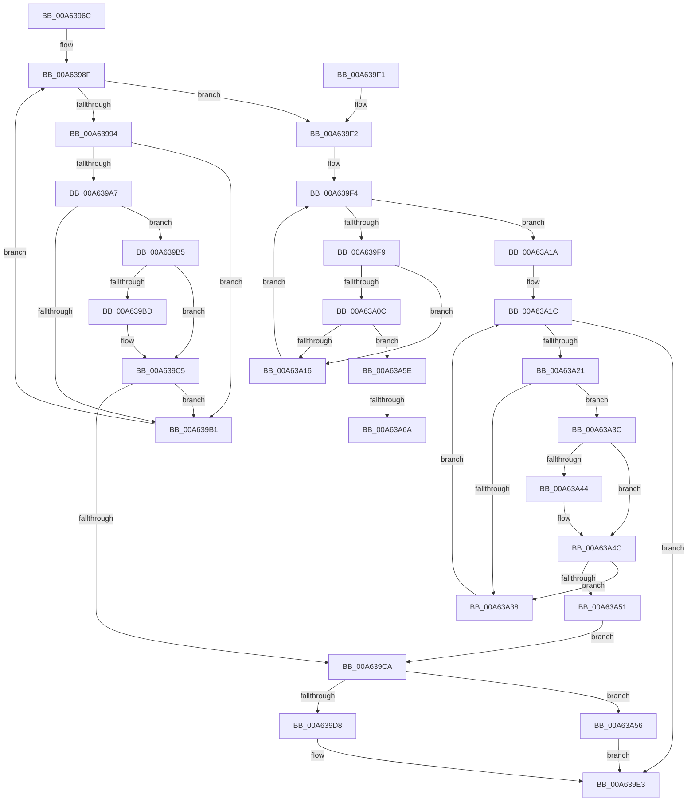

# _CmGetDeviceMappedPropertyLocales

- RVA: `0x00A6396C`–`0x00A63A77` (길이 `267` bytes)
- VA: `0x0000000140A6396C`
- 실행 섹션: `PAGE`
- PDB 이름 있음: `예`; PDB Function 태그: `예`
- unwind 정보 RVA: `0x000B3620`
- 디코드: `78`개 명령, `267/267` bytes 표시
- 미해석 바이트: `0` (있으면 어셈블리에 `.byte`로 보존)

> 이 문서는 커널 이미지의 기계어와 PDB 기호를 분석해 생성했습니다. 4번과 5번은 함수 원형과 자료형을 바이너리 사용 방식에서 추정한 C 해석이며 원본 소스 복구 결과는 아닙니다.

## 1. Dependencies

- 직접 호출 지점: **0**; 고유 호출 대상: **0**
- 직접 호출자로 확인된 함수: **1**
- RIP 상대 이미지 참조: **1**

### Outgoing calls
- 직접 디코드된 call 명령이 없습니다.

### Direct callers
- [sub_008E200E](../8E/Unknown_function_008E200E.md) at `0x008E2072`

### Static image references
- `0x00A6397B` → RVA `0x00000000` (`image boundary/outside`; read)

## 2. Other-region calls and transfers

- 다른 실행 섹션으로 향하는 call: **0**
- call이 아닌 외부 분기/꼬리 이동: **2**
  - `0x00A63A64` → [sub_00B3E472](../B3/Unknown_function_00B3E472.md) (`tail-transfer`)
  - `0x00A63A72` → [sub_00B3E472](../B3/Unknown_function_00B3E472.md) (`tail-transfer`)

## 3. Assembly (complete function range)

```asm
00A6396C  48 89 5C 24 08                  mov qword ptr [rsp + 8], rbx
00A63971  48 89 74 24 10                  mov qword ptr [rsp + 0x10], rsi
00A63976  4C 8B 5C 24 38                  mov r11, qword ptr [rsp + 0x38]
00A6397B  48 8D 35 7E C6 59 FF            lea rsi, [rip - 0xa63982]
00A63982  33 DB                           xor ebx, ebx
00A63984  41 BA 16 00 00 C0               mov r10d, 0xc0000016
00A6398A  8B D3                           mov edx, ebx
00A6398C  41 89 1B                        mov dword ptr [r11], ebx
00A6398F  83 FA 21                        cmp edx, 0x21
00A63992  73 5E                           jae 0x140a639f2
00A63994  8B C2                           mov eax, edx
00A63996  48 8D 0C 40                     lea rcx, [rax + rax*2]
00A6399A  4C 8B 84 CE A0 DE B4 00         mov r8, qword ptr [rsi + rcx*8 + 0xb4dea0]
00A639A2  4D 85 C0                        test r8, r8
00A639A5  74 0A                           je 0x140a639b1
00A639A7  41 8B 40 10                     mov eax, dword ptr [r8 + 0x10]
00A639AB  41 39 41 10                     cmp dword ptr [r9 + 0x10], eax
00A639AF  74 04                           je 0x140a639b5
00A639B1  FF C2                           inc edx
00A639B3  EB DA                           jmp 0x140a6398f
00A639B5  49 8B 09                        mov rcx, qword ptr [r9]
00A639B8  49 2B 08                        sub rcx, qword ptr [r8]
00A639BB  75 08                           jne 0x140a639c5
00A639BD  49 8B 49 08                     mov rcx, qword ptr [r9 + 8]
00A639C1  49 2B 48 08                     sub rcx, qword ptr [r8 + 8]
00A639C5  48 85 C9                        test rcx, rcx
00A639C8  75 E7                           jne 0x140a639b1
00A639CA  83 7C 24 30 01                  cmp dword ptr [rsp + 0x30], 1
00A639CF  41 C7 03 01 00 00 00            mov dword ptr [r11], 1
00A639D6  72 7E                           jb 0x140a63a56
00A639D8  48 8B 44 24 28                  mov rax, qword ptr [rsp + 0x28]
00A639DD  44 8B D3                        mov r10d, ebx
00A639E0  66 89 18                        mov word ptr [rax], bx
00A639E3  48 8B 5C 24 08                  mov rbx, qword ptr [rsp + 8]
00A639E8  41 8B C2                        mov eax, r10d
00A639EB  48 8B 74 24 10                  mov rsi, qword ptr [rsp + 0x10]
00A639F0  C3                              ret
00A639F1  CC                              int3
00A639F2  8B D3                           mov edx, ebx
00A639F4  83 FA 02                        cmp edx, 2
00A639F7  73 21                           jae 0x140a63a1a
00A639F9  8B C2                           mov eax, edx
00A639FB  48 C1 E0 05                     shl rax, 5
00A639FF  4C 8B 84 30 20 B7 B4 00         mov r8, qword ptr [rax + rsi + 0xb4b720]
00A63A07  4D 85 C0                        test r8, r8
00A63A0A  74 0A                           je 0x140a63a16
00A63A0C  41 8B 40 10                     mov eax, dword ptr [r8 + 0x10]
00A63A10  41 39 41 10                     cmp dword ptr [r9 + 0x10], eax
00A63A14  74 48                           je 0x140a63a5e
00A63A16  FF C2                           inc edx
00A63A18  EB DA                           jmp 0x140a639f4
00A63A1A  8B D3                           mov edx, ebx
00A63A1C  83 FA 1C                        cmp edx, 0x1c
00A63A1F  73 C2                           jae 0x140a639e3
00A63A21  8B C2                           mov eax, edx
00A63A23  48 03 C0                        add rax, rax
00A63A26  4C 8B 84 C6 A0 DB B4 00         mov r8, qword ptr [rsi + rax*8 + 0xb4dba0]
00A63A2E  41 8B 40 10                     mov eax, dword ptr [r8 + 0x10]
00A63A32  41 39 41 10                     cmp dword ptr [r9 + 0x10], eax
00A63A36  74 04                           je 0x140a63a3c
00A63A38  FF C2                           inc edx
00A63A3A  EB E0                           jmp 0x140a63a1c
00A63A3C  49 8B 09                        mov rcx, qword ptr [r9]
00A63A3F  49 2B 08                        sub rcx, qword ptr [r8]
00A63A42  75 08                           jne 0x140a63a4c
00A63A44  49 8B 49 08                     mov rcx, qword ptr [r9 + 8]
00A63A48  49 2B 48 08                     sub rcx, qword ptr [r8 + 8]
00A63A4C  48 85 C9                        test rcx, rcx
00A63A4F  75 E7                           jne 0x140a63a38
00A63A51  E9 74 FF FF FF                  jmp 0x140a639ca
00A63A56  41 BA 23 00 00 C0               mov r10d, 0xc0000023
00A63A5C  EB 85                           jmp 0x140a639e3
00A63A5E  49 8B 09                        mov rcx, qword ptr [r9]
00A63A61  49 2B 08                        sub rcx, qword ptr [r8]
00A63A64  0F 85 08 AA 0D 00               jne 0x140b3e472
00A63A6A  49 8B 49 08                     mov rcx, qword ptr [r9 + 8]
00A63A6E  49 2B 48 08                     sub rcx, qword ptr [r8 + 8]
00A63A72  E9 FB A9 0D 00                  jmp 0x140b3e472
```

## 4. C-style interpretation (structured pseudocode)

```c
__int64 __fastcall _CmGetDeviceMappedPropertyLocales(__int64 a1, __int64 a2, __int64 a3, __int64 a4, __int64 a5, unsigned int a6, __int64 a7)
{
    __int64 result;
    __int64 v_rbx;
    unsigned __int64 v_stack_p10;
    unsigned __int64 v_stack_p8;

    v_stack_p8 = v_rbx;
    v_stack_p10 = v_rsi;
    v_rbx = 0;
    *(unsigned int *)(a7) = 0;
loc_00A6398F:
    if (0 >= 33) goto loc_00A639F2;
    if (*(unsigned __int64 *)(v_rip - 10893698 + 0 + 0 * 2 * 8 + 11853472) == 0) goto loc_00A639B1;
    if ((*(unsigned int *)(a4 + 16)) == ((unsigned int)((unsigned int)(*(unsigned int *)(*(unsigned __int64 *)(v_rip - 10893698 + 0 + 0 * 2 * 8 + 11853472) + 16))))) goto loc_00A639B5;
loc_00A639B1:
    a2 = (unsigned int)((0) + 1);
    goto loc_00A6398F;
loc_00A639B5:
    a1 = (*(unsigned __int64 *)(a4)) - (*(unsigned __int64 *)(*(unsigned __int64 *)(v_rip - 10893698 + 0 + 0 * 2 * 8 + 11853472)));
    if (!(condition_is_not_equal)) {
        a1 = *(unsigned __int64 *)(a4 + 8);
        a1 = (a1) - (*(unsigned __int64 *)(*(unsigned __int64 *)(v_rip - 10893698 + 0 + 0 * 2 * 8 + 11853472) + 8));
    }
    if (a1 != 0) goto loc_00A639B1;
loc_00A639CA:
    *(unsigned int *)(a7) = 1;
    if (a6 < 1) goto loc_00A63A56;
    *(unsigned __int16 *)(a5) = 0;
loc_00A639E3:
    return 0;
loc_00A639F2:
loc_00A639F4:
    if (((unsigned int)((unsigned int)((unsigned int)(v_stack_p8)))) >= 2) goto loc_00A63A1A;
    result = ((unsigned int)((unsigned int)((unsigned int)((unsigned int)(v_stack_p8))))) << (5);
    if (*(unsigned __int64 *)(result + v_stack_p10 * 1 + 11843360) == 0) goto loc_00A63A16;
    if ((*(unsigned int *)(a4 + 16)) == ((unsigned int)((unsigned int)(*(unsigned int *)(*(unsigned __int64 *)(result + v_stack_p10 * 1 + 11843360) + 16))))) goto loc_00A63A5E;
loc_00A63A16:
    a2 = (unsigned int)(((unsigned int)((unsigned int)(v_stack_p8))) + 1);
    goto loc_00A639F4;
loc_00A63A1A:
loc_00A63A1C:
    if (((unsigned int)((unsigned int)((unsigned int)(v_stack_p8)))) >= 28) goto loc_00A639E3;
    result = ((unsigned int)((unsigned int)((unsigned int)((unsigned int)(v_stack_p8))))) + ((unsigned int)((unsigned int)((unsigned int)((unsigned int)(v_stack_p8)))));
    if ((*(unsigned int *)(a4 + 16)) == ((unsigned int)((unsigned int)(*(unsigned int *)(*(unsigned __int64 *)(v_stack_p10 + result * 8 + 11852704) + 16))))) goto loc_00A63A3C;
loc_00A63A38:
    a2 = (unsigned int)(((unsigned int)((unsigned int)(v_stack_p8))) + 1);
    goto loc_00A63A1C;
loc_00A63A3C:
    a1 = (*(unsigned __int64 *)(a4)) - (*(unsigned __int64 *)(*(unsigned __int64 *)(v_stack_p10 + result * 8 + 11852704)));
    if (!(condition_is_not_equal)) {
        a1 = *(unsigned __int64 *)(a4 + 8);
        a1 = (a1) - (*(unsigned __int64 *)(*(unsigned __int64 *)(v_stack_p10 + result * 8 + 11852704) + 8));
    }
    if (a1 != 0) goto loc_00A63A38;
    goto loc_00A639CA;
loc_00A63A56:
    goto loc_00A639E3;
loc_00A63A5E:
    a1 = (*(unsigned __int64 *)(a4)) - (*(unsigned __int64 *)(*(unsigned __int64 *)(v_stack_p10 + result * 8 + 11852704)));
    a1 = (*(unsigned __int64 *)(a4 + 8)) - (*(unsigned __int64 *)(*(unsigned __int64 *)(v_stack_p10 + result * 8 + 11852704) + 8));
}
```

## 5. (Beta) C Style

```c
int64_t _CmGetDeviceMappedPropertyLocales(int64_t Arg1, int64_t Arg2, int64_t Arg3, void *Arg4, void *Arg5, uint32_t Arg6, void *Arg7)
{
    uint8_t *arg4 = (uint8_t *)Arg4;
    uint8_t *arg5 = (uint8_t *)Arg5;
    uint8_t *arg7 = (uint8_t *)Arg7;

    int64_t result;
    int64_t local_rbx;
    uint64_t v_stack_p10;
    uint64_t v_stack_p8;

    v_stack_p8 = local_rbx;
    v_stack_p10 = local_rsi;
    local_rbx = 0;
    *(uint32_t *)(arg7) = 0;
loc_00A6398F:
    if (0 >= 33) goto loc_00A639F2;
    if (*(uint64_t *)(v_rip - 0xA63982 + 0x0 + 0x0 * 2 * 8 + 0xB4DEA0) == 0) goto loc_00A639B1;
    if ((*(uint32_t *)(arg4 + 0x10)) == ((uint32_t)((uint32_t)(*(uint32_t *)(*(uint64_t *)(v_rip - 0xA63982 + 0x0 + 0x0 * 2 * 8 + 0xB4DEA0) + 0x10))))) goto loc_00A639B5;
loc_00A639B1:
    Arg2 = (uint32_t)((0) + 1);
    goto loc_00A6398F;
loc_00A639B5:
    Arg1 = (*(uint64_t *)(arg4)) - (*(uint64_t *)(*(uint64_t *)(v_rip - 0xA63982 + 0x0 + 0x0 * 2 * 8 + 0xB4DEA0)));
    if (!(condition_is_not_equal)) {
        Arg1 = *(uint64_t *)(arg4 + 0x8);
        Arg1 = (Arg1) - (*(uint64_t *)(*(uint64_t *)(v_rip - 0xA63982 + 0x0 + 0x0 * 2 * 8 + 0xB4DEA0) + 0x8));
    }
    if (Arg1 != 0) goto loc_00A639B1;
loc_00A639CA:
    *(uint32_t *)(arg7) = 1;
    if (Arg6 < 1) goto loc_00A63A56;
    *(uint16_t *)(arg5) = 0;
loc_00A639E3:
    return 0;
loc_00A639F2:
loc_00A639F4:
    if (((uint32_t)((uint32_t)((uint32_t)(v_stack_p8)))) >= 2) goto loc_00A63A1A;
    result = ((uint32_t)((uint32_t)((uint32_t)((uint32_t)(v_stack_p8))))) << (5);
    if (*(uint64_t *)(result + v_stack_p10 * 1 + 0xB4B720) == 0) goto loc_00A63A16;
    if ((*(uint32_t *)(arg4 + 0x10)) == ((uint32_t)((uint32_t)(*(uint32_t *)(*(uint64_t *)(result + v_stack_p10 * 1 + 0xB4B720) + 0x10))))) goto loc_00A63A5E;
loc_00A63A16:
    Arg2 = (uint32_t)(((uint32_t)((uint32_t)(v_stack_p8))) + 1);
    goto loc_00A639F4;
loc_00A63A1A:
loc_00A63A1C:
    if (((uint32_t)((uint32_t)((uint32_t)(v_stack_p8)))) >= 28) goto loc_00A639E3;
    result = ((uint32_t)((uint32_t)((uint32_t)((uint32_t)(v_stack_p8))))) + ((uint32_t)((uint32_t)((uint32_t)((uint32_t)(v_stack_p8)))));
    if ((*(uint32_t *)(arg4 + 0x10)) == ((uint32_t)((uint32_t)(*(uint32_t *)(*(uint64_t *)(v_stack_p10 + result * 8 + 0xB4DBA0) + 0x10))))) goto loc_00A63A3C;
loc_00A63A38:
    Arg2 = (uint32_t)(((uint32_t)((uint32_t)(v_stack_p8))) + 1);
    goto loc_00A63A1C;
loc_00A63A3C:
    Arg1 = (*(uint64_t *)(arg4)) - (*(uint64_t *)(*(uint64_t *)(v_stack_p10 + result * 8 + 0xB4DBA0)));
    if (!(condition_is_not_equal)) {
        Arg1 = *(uint64_t *)(arg4 + 0x8);
        Arg1 = (Arg1) - (*(uint64_t *)(*(uint64_t *)(v_stack_p10 + result * 8 + 0xB4DBA0) + 0x8));
    }
    if (Arg1 != 0) goto loc_00A63A38;
    goto loc_00A639CA;
loc_00A63A56:
    goto loc_00A639E3;
loc_00A63A5E:
    Arg1 = (*(uint64_t *)(arg4)) - (*(uint64_t *)(*(uint64_t *)(v_stack_p10 + result * 8 + 0xB4DBA0)));
    Arg1 = (*(uint64_t *)(arg4 + 0x8)) - (*(uint64_t *)(*(uint64_t *)(v_stack_p10 + result * 8 + 0xB4DBA0) + 0x8));
}
```

### 관측된 메모리 오프셋

구조체 형식이 확인되지 않은 접근은 인자 기준의 오프셋으로만 기록했습니다.

| 기준 인자 | 오프셋 표현 | 폭 (bit) | 접근 |
|---|---:|---:|---|
| `Arg4` | `+ 0x0` | `64` | `R` |
| `Arg4` | `+ 0x8` | `64` | `R` |
| `Arg4` | `+ 0x10` | `32` | `R` |
| `Arg5` | `+ 0x0` | `16` | `W` |
| `Arg7` | `+ 0x0` | `32` | `W` |

## 6. Execution-region graph

[열기: 2D/3D 그래프와 함수 탐색 컨트롤 패널](../../../control-panel.html?section=page&rva=0x00A6396C&view=graph)

- 2D 그래프는 위에서 아래로 흐르고, 3D 그래프는 빈 공간을 드래그해 회전합니다. Shift+드래그는 이동, 휠은 확대·축소, 함수 노드 선택은 대상 보고서 이동입니다.

### Static fallback


