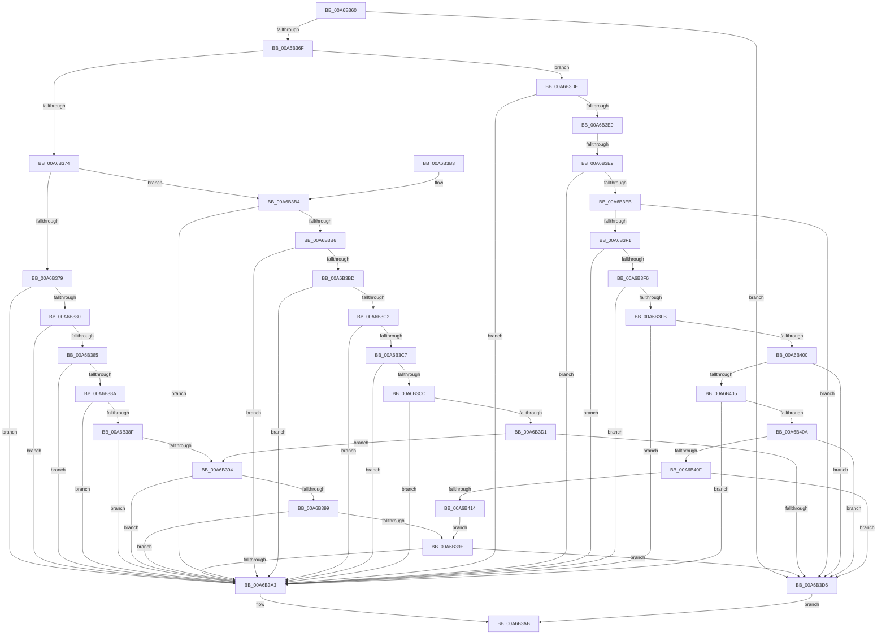

# _CmIsDeviceRegPropWritable

- RVA: `0x00A6B360`–`0x00A6B416` (길이 `182` bytes)
- VA: `0x0000000140A6B360`
- 실행 섹션: `PAGE`
- PDB 이름 있음: `예`; PDB Function 태그: `예`
- unwind 정보 RVA: `0x000B4308`
- 디코드: `70`개 명령, `182/182` bytes 표시
- 미해석 바이트: `0` (있으면 어셈블리에 `.byte`로 보존)

> 이 문서는 커널 이미지의 기계어와 PDB 기호를 분석해 생성했습니다. 4번과 5번은 함수 원형과 자료형을 바이너리 사용 방식에서 추정한 C 해석이며 원본 소스 복구 결과는 아닙니다.

## 1. Dependencies

- 직접 호출 지점: **1**; 고유 호출 대상: **1**
- 직접 호출자로 확인된 함수: **1**
- RIP 상대 이미지 참조: **0**

### Outgoing calls
- `0x00A6B3A3` → [_CmDevicePropertyWrite](../../text/49/_CmDevicePropertyWrite_function_004941AC.md) (function, `0x004941AC`)

### Direct callers
- [PiPnpRtlCmActionCallback](../8E/PiPnpRtlCmActionCallback_function_008EF110.md) at `0x008EF482`

### Static image references
- 디코드된 RIP-relative 메모리 참조가 없습니다.

## 2. Other-region calls and transfers

- 다른 실행 섹션으로 향하는 call: **1**
  - `0x00A6B3A3` → [_CmDevicePropertyWrite](../../text/49/_CmDevicePropertyWrite_function_004941AC.md) (`PAGE` → `.text`)
- call이 아닌 외부 분기/꼬리 이동: **1**
  - `0x00A6B3E3` → [sub_00B3F298](../B3/Unknown_function_00B3F298.md) (`tail-transfer`)

## 3. Assembly (complete function range)

```asm
00A6B360  48 83 EC 28                     sub rsp, 0x28
00A6B364  45 33 C9                        xor r9d, r9d
00A6B367  8D 42 FF                        lea eax, [rdx - 1]
00A6B36A  83 F8 24                        cmp eax, 0x24
00A6B36D  77 67                           ja 0x140a6b3d6
00A6B36F  83 FA 13                        cmp edx, 0x13
00A6B372  7E 6A                           jle 0x140a6b3de
00A6B374  83 FA 1D                        cmp edx, 0x1d
00A6B377  7E 3B                           jle 0x140a6b3b4
00A6B379  8B CA                           mov ecx, edx
00A6B37B  83 E9 1E                        sub ecx, 0x1e
00A6B37E  74 23                           je 0x140a6b3a3
00A6B380  83 E9 01                        sub ecx, 1
00A6B383  74 1E                           je 0x140a6b3a3
00A6B385  83 E9 01                        sub ecx, 1
00A6B388  74 19                           je 0x140a6b3a3
00A6B38A  83 E9 01                        sub ecx, 1
00A6B38D  74 14                           je 0x140a6b3a3
00A6B38F  83 E9 01                        sub ecx, 1
00A6B392  74 0F                           je 0x140a6b3a3
00A6B394  83 E9 01                        sub ecx, 1
00A6B397  74 0A                           je 0x140a6b3a3
00A6B399  83 E9 01                        sub ecx, 1
00A6B39C  74 05                           je 0x140a6b3a3
00A6B39E  83 F9 01                        cmp ecx, 1
00A6B3A1  75 33                           jne 0x140a6b3d6
00A6B3A3  E8 04 8E A2 FF                  call 0x1404941ac
00A6B3A8  41 88 00                        mov byte ptr [r8], al
00A6B3AB  41 8B C1                        mov eax, r9d
00A6B3AE  48 83 C4 28                     add rsp, 0x28
00A6B3B2  C3                              ret
00A6B3B3  CC                              int3
00A6B3B4  74 ED                           je 0x140a6b3a3
00A6B3B6  8B CA                           mov ecx, edx
00A6B3B8  83 E9 14                        sub ecx, 0x14
00A6B3BB  74 E6                           je 0x140a6b3a3
00A6B3BD  83 E9 01                        sub ecx, 1
00A6B3C0  74 E1                           je 0x140a6b3a3
00A6B3C2  83 E9 01                        sub ecx, 1
00A6B3C5  74 DC                           je 0x140a6b3a3
00A6B3C7  83 E9 01                        sub ecx, 1
00A6B3CA  74 D7                           je 0x140a6b3a3
00A6B3CC  83 E9 01                        sub ecx, 1
00A6B3CF  74 D2                           je 0x140a6b3a3
00A6B3D1  83 E9 01                        sub ecx, 1
00A6B3D4  75 BE                           jne 0x140a6b394
00A6B3D6  41 B9 30 02 00 C0               mov r9d, 0xc0000230
00A6B3DC  EB CD                           jmp 0x140a6b3ab
00A6B3DE  74 C3                           je 0x140a6b3a3
00A6B3E0  83 FA 09                        cmp edx, 9
00A6B3E3  0F 8F AF 3E 0D 00               jg 0x140b3f298
00A6B3E9  74 B8                           je 0x140a6b3a3
00A6B3EB  8B CA                           mov ecx, edx
00A6B3ED  85 D2                           test edx, edx
00A6B3EF  74 E5                           je 0x140a6b3d6
00A6B3F1  83 E9 01                        sub ecx, 1
00A6B3F4  74 AD                           je 0x140a6b3a3
00A6B3F6  83 E9 01                        sub ecx, 1
00A6B3F9  74 A8                           je 0x140a6b3a3
00A6B3FB  83 E9 01                        sub ecx, 1
00A6B3FE  74 A3                           je 0x140a6b3a3
00A6B400  83 E9 01                        sub ecx, 1
00A6B403  74 D1                           je 0x140a6b3d6
00A6B405  83 E9 01                        sub ecx, 1
00A6B408  74 99                           je 0x140a6b3a3
00A6B40A  83 E9 01                        sub ecx, 1
00A6B40D  74 C7                           je 0x140a6b3d6
00A6B40F  83 E9 01                        sub ecx, 1
00A6B412  74 C2                           je 0x140a6b3d6
00A6B414  EB 88                           jmp 0x140a6b39e
```

## 4. C-style interpretation (structured pseudocode)

```c
__int64 __fastcall _CmIsDeviceRegPropWritable(__int64 a1, __int64 a2, __int64 a3, int a4)
{
    __int64 result;
    __int64 v_rsp;

    v_rsp = (v_rsp) - (40);
    a4 = 0;
    if (((unsigned int)(a2 - 1)) > 36) goto loc_00A6B3D6;
    if (((unsigned int)(a2)) <= 19) goto loc_00A6B3DE;
    if (((unsigned int)(a2)) <= 29) goto loc_00A6B3B4;
    a1 = (unsigned int)(((unsigned int)((unsigned int)(a2))) - (30));
    if (condition_is_equal) goto loc_00A6B3A3;
    a1 = (unsigned int)((a1) - (1));
    if (condition_is_equal) goto loc_00A6B3A3;
    a1 = (unsigned int)((a1) - (1));
    if (condition_is_equal) goto loc_00A6B3A3;
    a1 = (unsigned int)((a1) - (1));
    if (condition_is_equal) goto loc_00A6B3A3;
    a1 = (unsigned int)((a1) - (1));
    if (condition_is_equal) goto loc_00A6B3A3;
loc_00A6B394:
    a1 = (unsigned int)((a1) - (1));
    if (condition_is_equal) goto loc_00A6B3A3;
    a1 = (unsigned int)((a1) - (1));
    if (condition_is_equal) goto loc_00A6B3A3;
loc_00A6B39E:
    if (((unsigned int)(a1)) != 1) goto loc_00A6B3D6;
loc_00A6B3A3:
    result = _CmDevicePropertyWrite(a1, a2, a3, a4);
    *(unsigned __int8 *)(a3) = (unsigned __int8)(result);
loc_00A6B3AB:
    v_rsp = (v_rsp) + (40);
    return 0;
loc_00A6B3B4:
    if (condition_is_equal) goto loc_00A6B3A3;
    a1 = (unsigned int)(((unsigned int)((unsigned int)(a2))) - (20));
    if (condition_is_equal) goto loc_00A6B3A3;
    a1 = (unsigned int)((a1) - (1));
    if (condition_is_equal) goto loc_00A6B3A3;
    a1 = (unsigned int)((a1) - (1));
    if (condition_is_equal) goto loc_00A6B3A3;
    a1 = (unsigned int)((a1) - (1));
    if (condition_is_equal) goto loc_00A6B3A3;
    a1 = (unsigned int)((a1) - (1));
    if (condition_is_equal) goto loc_00A6B3A3;
    a1 = (unsigned int)((a1) - (1));
    if (condition_is_not_equal) goto loc_00A6B394;
loc_00A6B3D6:
    goto loc_00A6B3AB;
loc_00A6B3DE:
    if (condition_is_equal) goto loc_00A6B3A3;
    if (((unsigned int)(a2)) == 9) goto loc_00A6B3A3;
    if ((unsigned int)(a2) == 0) goto loc_00A6B3D6;
    a1 = (unsigned int)(((unsigned int)((unsigned int)(a2))) - (1));
    if (condition_is_equal) goto loc_00A6B3A3;
    a1 = (unsigned int)((a1) - (1));
    if (condition_is_equal) goto loc_00A6B3A3;
    a1 = (unsigned int)((a1) - (1));
    if (condition_is_equal) goto loc_00A6B3A3;
    a1 = (unsigned int)((a1) - (1));
    if (condition_is_equal) goto loc_00A6B3D6;
    a1 = (unsigned int)((a1) - (1));
    if (condition_is_equal) goto loc_00A6B3A3;
    a1 = (unsigned int)((a1) - (1));
    if (condition_is_equal) goto loc_00A6B3D6;
    a1 = (unsigned int)((a1) - (1));
    if (condition_is_equal) goto loc_00A6B3D6;
    goto loc_00A6B39E;
}
```

## 5. (Beta) C Style

```c
int64_t _CmIsDeviceRegPropWritable(int64_t Arg1, void *Arg2, int64_t Arg3, int32_t Arg4)
{
    uint8_t *arg2 = (uint8_t *)Arg2;

    int64_t result;
    int64_t local_rsp;

    local_rsp = (local_rsp) - (40);
    Arg4 = 0;
    if (((uint32_t)(Arg2 - 1)) > 36) goto loc_00A6B3D6;
    if (((uint32_t)(Arg2)) <= 19) goto loc_00A6B3DE;
    if (((uint32_t)(Arg2)) <= 29) goto loc_00A6B3B4;
    Arg1 = (uint32_t)(((uint32_t)((uint32_t)(Arg2))) - (30));
    if (condition_is_equal) goto loc_00A6B3A3;
    Arg1 = (uint32_t)((Arg1) - (1));
    if (condition_is_equal) goto loc_00A6B3A3;
    Arg1 = (uint32_t)((Arg1) - (1));
    if (condition_is_equal) goto loc_00A6B3A3;
    Arg1 = (uint32_t)((Arg1) - (1));
    if (condition_is_equal) goto loc_00A6B3A3;
    Arg1 = (uint32_t)((Arg1) - (1));
    if (condition_is_equal) goto loc_00A6B3A3;
loc_00A6B394:
    Arg1 = (uint32_t)((Arg1) - (1));
    if (condition_is_equal) goto loc_00A6B3A3;
    Arg1 = (uint32_t)((Arg1) - (1));
    if (condition_is_equal) goto loc_00A6B3A3;
loc_00A6B39E:
    if (((uint32_t)(Arg1)) != 1) goto loc_00A6B3D6;
loc_00A6B3A3:
    result = _CmDevicePropertyWrite(Arg1, Arg2, Arg3, Arg4);
    *(uint8_t *)(Arg3) = (uint8_t)(result);
loc_00A6B3AB:
    local_rsp = (local_rsp) + (40);
    return 0;
loc_00A6B3B4:
    if (condition_is_equal) goto loc_00A6B3A3;
    Arg1 = (uint32_t)(((uint32_t)((uint32_t)(Arg2))) - (20));
    if (condition_is_equal) goto loc_00A6B3A3;
    Arg1 = (uint32_t)((Arg1) - (1));
    if (condition_is_equal) goto loc_00A6B3A3;
    Arg1 = (uint32_t)((Arg1) - (1));
    if (condition_is_equal) goto loc_00A6B3A3;
    Arg1 = (uint32_t)((Arg1) - (1));
    if (condition_is_equal) goto loc_00A6B3A3;
    Arg1 = (uint32_t)((Arg1) - (1));
    if (condition_is_equal) goto loc_00A6B3A3;
    Arg1 = (uint32_t)((Arg1) - (1));
    if (condition_is_not_equal) goto loc_00A6B394;
loc_00A6B3D6:
    goto loc_00A6B3AB;
loc_00A6B3DE:
    if (condition_is_equal) goto loc_00A6B3A3;
    if (((uint32_t)(Arg2)) == 9) goto loc_00A6B3A3;
    if ((uint32_t)(Arg2) == 0) goto loc_00A6B3D6;
    Arg1 = (uint32_t)(((uint32_t)((uint32_t)(Arg2))) - (1));
    if (condition_is_equal) goto loc_00A6B3A3;
    Arg1 = (uint32_t)((Arg1) - (1));
    if (condition_is_equal) goto loc_00A6B3A3;
    Arg1 = (uint32_t)((Arg1) - (1));
    if (condition_is_equal) goto loc_00A6B3A3;
    Arg1 = (uint32_t)((Arg1) - (1));
    if (condition_is_equal) goto loc_00A6B3D6;
    Arg1 = (uint32_t)((Arg1) - (1));
    if (condition_is_equal) goto loc_00A6B3A3;
    Arg1 = (uint32_t)((Arg1) - (1));
    if (condition_is_equal) goto loc_00A6B3D6;
    Arg1 = (uint32_t)((Arg1) - (1));
    if (condition_is_equal) goto loc_00A6B3D6;
    goto loc_00A6B39E;
}
```

### 관측된 메모리 오프셋

구조체 형식이 확인되지 않은 접근은 인자 기준의 오프셋으로만 기록했습니다.

| 기준 인자 | 오프셋 표현 | 폭 (bit) | 접근 |
|---|---:|---:|---|
| `Arg2` | `- 0x1` | `32` | `R` |

## 6. Execution-region graph

[열기: 2D/3D 그래프와 함수 탐색 컨트롤 패널](../../../control-panel.html?section=page&rva=0x00A6B360&view=graph)

- 2D 그래프는 위에서 아래로 흐르고, 3D 그래프는 빈 공간을 드래그해 회전합니다. Shift+드래그는 이동, 휠은 확대·축소, 함수 노드 선택은 대상 보고서 이동입니다.

### Static fallback


