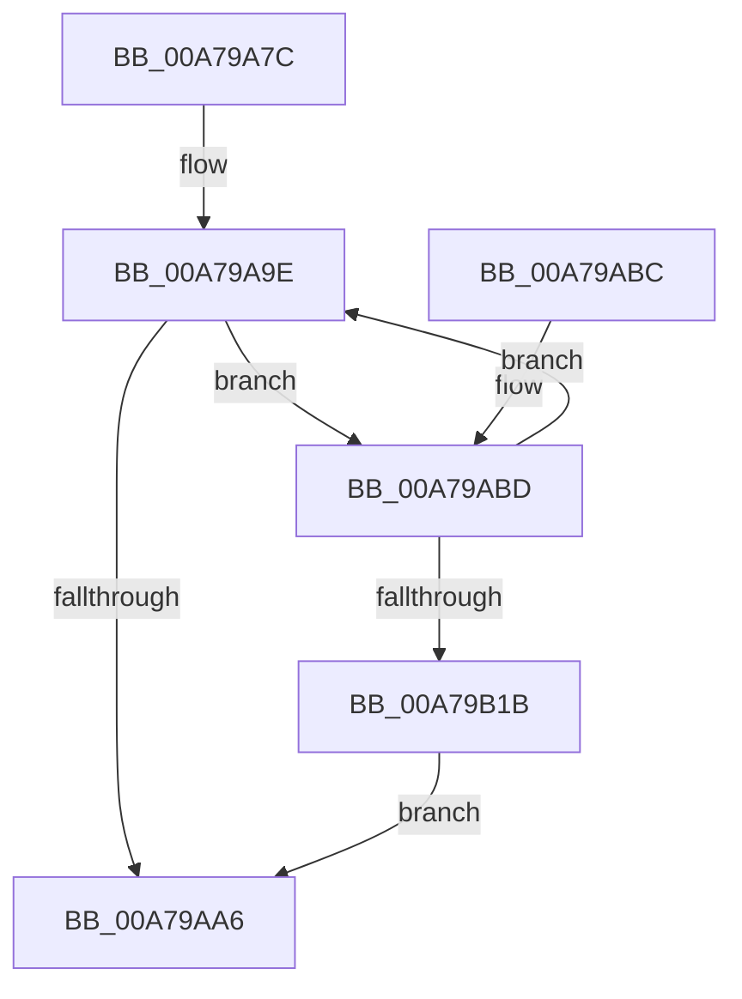

# AddDecodeGuidToSessions

- RVA: `0x00A79A7C`–`0x00A79B1D` (길이 `161` bytes)
- VA: `0x0000000140A79A7C`
- 실행 섹션: `PAGE`
- PDB 이름 있음: `예`; PDB Function 태그: `예`
- unwind 정보 RVA: `0x000B62BC`
- 디코드: `46`개 명령, `161/161` bytes 표시
- 미해석 바이트: `0` (있으면 어셈블리에 `.byte`로 보존)

> 이 문서는 커널 이미지의 기계어와 PDB 기호를 분석해 생성했습니다. 4번과 5번은 함수 원형과 자료형을 바이너리 사용 방식에서 추정한 C 해석이며 원본 소스 복구 결과는 아닙니다.

## 1. Dependencies

- 직접 호출 지점: **3**; 고유 호출 대상: **3**
- 직접 호출자로 확인된 함수: **1**
- RIP 상대 이미지 참조: **0**

### Outgoing calls
- `0x00A79AE3` → [EtwpAcquireLoggerContextByLoggerId](../93/EtwpAcquireLoggerContextByLoggerId_function_00932920.md) (function, `0x00932920`)
- `0x00A79AF1` → [EtwpTrackDecodeGuidForSession](EtwpTrackDecodeGuidForSession_function_00A79B24.md) (function, `0x00A79B24`)
- `0x00A79B11` → [ExReleaseRundownProtectionCacheAwareEx](../../text/25/ExReleaseRundownProtectionCacheAwareEx_function_0025F050.md) (function, `0x0025F050`)

### Direct callers
- [EtwpSetProviderTraitsCommon](../9F/EtwpSetProviderTraitsCommon_function_009F36EC.md) at `0x009F395E`

### Static image references
- 디코드된 RIP-relative 메모리 참조가 없습니다.

## 2. Other-region calls and transfers

- 다른 실행 섹션으로 향하는 call: **1**
  - `0x00A79B11` → [ExReleaseRundownProtectionCacheAwareEx](../../text/25/ExReleaseRundownProtectionCacheAwareEx_function_0025F050.md) (`PAGE` → `.text`)
- 별도 외부 분기/꼬리 이동을 확인하지 못했습니다.

## 3. Assembly (complete function range)

```asm
00A79A7C  48 89 5C 24 10                  mov qword ptr [rsp + 0x10], rbx
00A79A81  48 89 6C 24 18                  mov qword ptr [rsp + 0x18], rbp
00A79A86  56                              push rsi
00A79A87  57                              push rdi
00A79A88  41 56                           push r14
00A79A8A  48 83 EC 20                     sub rsp, 0x20
00A79A8E  0F B7 71 64                     movzx esi, word ptr [rcx + 0x64]
00A79A92  41 BE 01 00 00 00               mov r14d, 1
00A79A98  41 8A FE                        mov dil, r14b
00A79A9B  48 8B E9                        mov rbp, rcx
00A79A9E  0F B7 C6                        movzx eax, si
00A79AA1  0F BC D0                        bsf edx, eax
00A79AA4  75 17                           jne 0x140a79abd
00A79AA6  48 8B 5C 24 48                  mov rbx, qword ptr [rsp + 0x48]
00A79AAB  40 8A C7                        mov al, dil
00A79AAE  48 8B 6C 24 50                  mov rbp, qword ptr [rsp + 0x50]
00A79AB3  48 83 C4 20                     add rsp, 0x20
00A79AB7  41 5E                           pop r14
00A79AB9  5F                              pop rdi
00A79ABA  5E                              pop rsi
00A79ABB  C3                              ret
00A79ABC  CC                              int3
00A79ABD  48 8B 4D 20                     mov rcx, qword ptr [rbp + 0x20]
00A79AC1  0F B7 C6                        movzx eax, si
00A79AC4  66 41 2B C6                     sub ax, r14w
00A79AC8  45 33 C0                        xor r8d, r8d
00A79ACB  66 23 F0                        and si, ax
00A79ACE  8B C2                           mov eax, edx
00A79AD0  48 C1 E0 05                     shl rax, 5
00A79AD4  0F B7 94 08 86 00 00 00         movzx edx, word ptr [rax + rcx + 0x86]
00A79ADC  48 8B 89 88 02 00 00            mov rcx, qword ptr [rcx + 0x288]
00A79AE3  E8 38 8E EB FF                  call 0x140932920
00A79AE8  48 8B D5                        mov rdx, rbp
00A79AEB  48 8B C8                        mov rcx, rax
00A79AEE  48 8B D8                        mov rbx, rax
00A79AF1  E8 2E 00 00 00                  call 0x140a79b24
00A79AF6  48 8B 93 50 05 00 00            mov rdx, qword ptr [rbx + 0x550]
00A79AFD  40 8A F8                        mov dil, al
00A79B00  44 8B 03                        mov r8d, dword ptr [rbx]
00A79B03  48 8B 8A C0 02 00 00            mov rcx, qword ptr [rdx + 0x2c0]
00A79B0A  41 8B D6                        mov edx, r14d
00A79B0D  4A 8B 0C C1                     mov rcx, qword ptr [rcx + r8*8]
00A79B11  E8 3A 55 7E FF                  call 0x14025f050
00A79B16  40 84 FF                        test dil, dil
00A79B19  75 83                           jne 0x140a79a9e
00A79B1B  EB 89                           jmp 0x140a79aa6
```

## 4. C-style interpretation (structured pseudocode)

```c
__int64 __fastcall AddDecodeGuidToSessions(__int64 a1, __int64 a2, int a3)
{
    __int64 result;
    __int64 v_rsi;
    __int64 v_rsp;
    unsigned __int64 v_stack_p10;
    unsigned __int64 v_stack_p18;

    v_stack_p10 = v_rbx;
    v_stack_p18 = v_rbp;
    v_rsp = (v_rsp) - (32);
loc_00A79A9E:
    if (condition_is_not_equal) goto loc_00A79ABD;
loc_00A79AA6:
    v_rsp = (v_rsp) + (32);
    return 1;
loc_00A79ABD:
    result = (unsigned __int16)(((unsigned __int16)(*(unsigned __int16 *)(a1 + 100))) - (1));
    a3 = 0;
    v_rsi = (unsigned __int16)((*(unsigned __int16 *)(a1 + 100)) & ((unsigned __int16)(result)));
    result = ((unsigned int)((unsigned int)(a2))) << (5);
    result = EtwpAcquireLoggerContextByLoggerId(*(unsigned __int64 *)(*(unsigned __int64 *)(v_stack_p18 + 32) + 648), *(unsigned __int16 *)(result + *(unsigned __int64 *)(v_stack_p18 + 32) * 1 + 134), a3, a4);
    result = EtwpTrackDecodeGuidForSession(result, v_stack_p18, a3, a4);
    result = ExReleaseRundownProtectionCacheAwareEx(*(unsigned __int64 *)(*(unsigned __int64 *)(*(unsigned __int64 *)(result + 1360) + 704) + (unsigned int)(*(unsigned int *)(result)) * 8), 1, (unsigned int)(*(unsigned int *)(result)), a4);
    if ((unsigned __int8)((unsigned __int8)(result)) != 0) goto loc_00A79A9E;
    goto loc_00A79AA6;
}
```

## 5. (Beta) C Style

```c
int64_t AddDecodeGuidToSessions(void *Arg1, int64_t Arg2, int32_t Arg3)
{
    uint8_t *arg1 = (uint8_t *)Arg1;

    int64_t result;
    int64_t local_rsi;
    int64_t local_rsp;
    uint64_t v_stack_p10;
    uint64_t v_stack_p18;

    v_stack_p10 = local_rbx;
    v_stack_p18 = local_rbp;
    local_rsp = (local_rsp) - (32);
loc_00A79A9E:
    if (condition_is_not_equal) goto loc_00A79ABD;
loc_00A79AA6:
    local_rsp = (local_rsp) + (32);
    return 1;
loc_00A79ABD:
    result = (uint16_t)(((uint16_t)(*(uint16_t *)(arg1 + 0x64))) - (1));
    Arg3 = 0;
    local_rsi = (uint16_t)((*(uint16_t *)(arg1 + 0x64)) & ((uint16_t)(result)));
    result = ((uint32_t)((uint32_t)(Arg2))) << (5);
    result = EtwpAcquireLoggerContextByLoggerId(*(uint64_t *)(*(uint64_t *)(v_stack_p18 + 0x20) + 0x288), *(uint16_t *)(result + *(uint64_t *)(v_stack_p18 + 0x20) * 1 + 0x86), Arg3, a4);
    result = EtwpTrackDecodeGuidForSession(result, v_stack_p18, Arg3, a4);
    result = ExReleaseRundownProtectionCacheAwareEx(*(uint64_t *)(*(uint64_t *)(*(uint64_t *)(result + 0x550) + 0x2C0) + (uint32_t)(*(uint32_t *)(result)) * 8), 1, (uint32_t)(*(uint32_t *)(result)), a4);
    if ((uint8_t)((uint8_t)(result)) != 0) goto loc_00A79A9E;
    goto loc_00A79AA6;
}
```

### 관측된 메모리 오프셋

구조체 형식이 확인되지 않은 접근은 인자 기준의 오프셋으로만 기록했습니다.

| 기준 인자 | 오프셋 표현 | 폭 (bit) | 접근 |
|---|---:|---:|---|
| `Arg1` | `+ 0x20` | `64` | `R` |
| `Arg1` | `+ 0x64` | `16` | `R` |

## 6. Execution-region graph

[열기: 2D/3D 그래프와 함수 탐색 컨트롤 패널](../../../control-panel.html?section=page&rva=0x00A79A7C&view=graph)

- 2D 그래프는 위에서 아래로 흐르고, 3D 그래프는 빈 공간을 드래그해 회전합니다. Shift+드래그는 이동, 휠은 확대·축소, 함수 노드 선택은 대상 보고서 이동입니다.

### Static fallback


