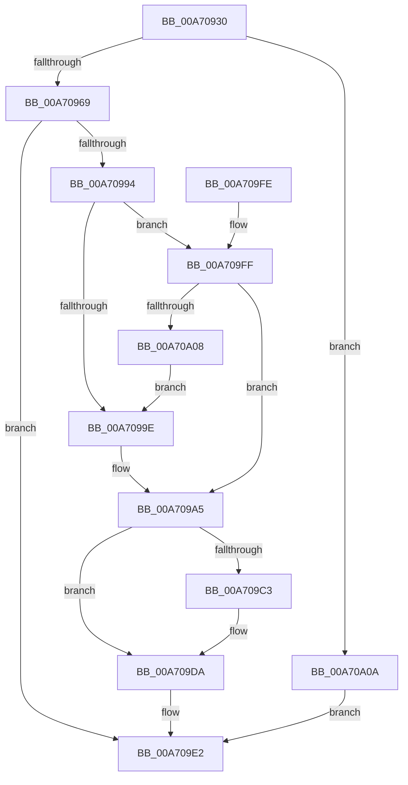

# AlpcCreateSecurityContext

- RVA: `0x00A70930`–`0x00A70A11` (길이 `225` bytes)
- VA: `0x0000000140A70930`
- 실행 섹션: `PAGE`
- PDB 이름 있음: `예`; PDB Function 태그: `아니요`
- unwind 정보 RVA: `0x000B50CC`
- 디코드: `60`개 명령, `225/225` bytes 표시
- 미해석 바이트: `0` (있으면 어셈블리에 `.byte`로 보존)

> 이 문서는 커널 이미지의 기계어와 PDB 기호를 분석해 생성했습니다. 4번과 5번은 함수 원형과 자료형을 바이너리 사용 방식에서 추정한 C 해석이며 원본 소스 복구 결과는 아닙니다.

## 1. Dependencies

- 직접 호출 지점: **5**; 고유 호출 대상: **5**
- 직접 호출자로 확인된 함수: **0**
- RIP 상대 이미지 참조: **1**

### Outgoing calls
- `0x00A70989` → [ObReferenceObjectByHandle](../86/ObReferenceObjectByHandle_function_00868DB0.md) (function, `0x00868DB0`)
- `0x00A709B8` → [AlpcpCreateSecurityContext](../89/AlpcpCreateSecurityContext_function_00890D94.md) (function, `0x00890D94`)
- `0x00A709D5` → [AlpcpDereferenceBlobEx](../88/AlpcpDereferenceBlobEx_function_0088AF00.md) (function, `0x0088AF00`)
- `0x00A709DD` → [ObfDereferenceObject](../../text/2F/ObfDereferenceObject_function_002F9350.md) (function, `0x002F9350`)
- `0x00A709E2` → [KeLeaveCriticalRegion](../../text/25/KeLeaveCriticalRegion_function_0025D8B0.md) (function, `0x0025D8B0`)

### Direct callers
- 이 함수 시작 RVA로 연결되는 직접 call은 확인되지 않았습니다. 간접 호출은 완전히 역산할 수 없습니다.

### Static image references
- `0x00A70972` → RVA `0x00FC6C18` (`ALMOSTRO`; read)

## 2. Other-region calls and transfers

- 다른 실행 섹션으로 향하는 call: **2**
  - `0x00A709DD` → [ObfDereferenceObject](../../text/2F/ObfDereferenceObject_function_002F9350.md) (`PAGE` → `.text`)
  - `0x00A709E2` → [KeLeaveCriticalRegion](../../text/25/KeLeaveCriticalRegion_function_0025D8B0.md) (`PAGE` → `.text`)
- 별도 외부 분기/꼬리 이동을 확인하지 못했습니다.

## 3. Assembly (complete function range)

```asm
00A70930  4C 8B DC                        mov r11, rsp
00A70933  49 89 5B 08                     mov qword ptr [r11 + 8], rbx
00A70937  49 89 6B 10                     mov qword ptr [r11 + 0x10], rbp
00A7093B  49 89 73 18                     mov qword ptr [r11 + 0x18], rsi
00A7093F  57                              push rdi
00A70940  48 83 EC 40                     sub rsp, 0x40
00A70944  65 48 8B 04 25 88 01 00 00      mov rax, qword ptr gs:[0x188]
00A7094D  49 8B F1                        mov rsi, r9
00A70950  49 83 63 F0 00                  and qword ptr [r11 - 0x10], 0
00A70955  48 8B EA                        mov rbp, rdx
00A70958  66 FF 88 E4 01 00 00            dec word ptr [rax + 0x1e4]
00A7095F  90                              nop
00A70960  45 85 C0                        test r8d, r8d
00A70963  0F 85 A1 00 00 00               jne 0x140a70a0a
00A70969  49 83 63 E0 00                  and qword ptr [r11 - 0x20], 0
00A7096E  49 8D 43 E8                     lea rax, [r11 - 0x18]
00A70972  4C 8B 05 9F 62 55 00            mov r8, qword ptr [rip + 0x55629f]
00A70979  45 33 C9                        xor r9d, r9d
00A7097C  49 83 63 E8 00                  and qword ptr [r11 - 0x18], 0
00A70981  49 89 43 D8                     mov qword ptr [r11 - 0x28], rax
00A70985  41 8D 51 01                     lea edx, [r9 + 1]
00A70989  E8 22 84 DF FF                  call 0x140868db0
00A7098E  8B D8                           mov ebx, eax
00A70990  85 C0                           test eax, eax
00A70992  78 4E                           js 0x140a709e2
00A70994  48 8B 7C 24 30                  mov rdi, qword ptr [rsp + 0x30]
00A70999  48 85 F6                        test rsi, rsi
00A7099C  75 61                           jne 0x140a709ff
00A7099E  4C 8D 8F 04 01 00 00            lea r9, [rdi + 0x104]
00A709A5  48 8D 44 24 38                  lea rax, [rsp + 0x38]
00A709AA  41 B0 01                        mov r8b, 1
00A709AD  48 8B D5                        mov rdx, rbp
00A709B0  48 89 44 24 20                  mov qword ptr [rsp + 0x20], rax
00A709B5  48 8B CF                        mov rcx, rdi
00A709B8  E8 D7 03 E2 FF                  call 0x140890d94
00A709BD  8B D8                           mov ebx, eax
00A709BF  85 C0                           test eax, eax
00A709C1  78 17                           js 0x140a709da
00A709C3  48 8B 4C 24 38                  mov rcx, qword ptr [rsp + 0x38]
00A709C8  BA 01 00 00 00                  mov edx, 1
00A709CD  4C 8B 41 08                     mov r8, qword ptr [rcx + 8]
00A709D1  4C 89 46 10                     mov qword ptr [rsi + 0x10], r8
00A709D5  E8 26 A5 E1 FF                  call 0x14088af00
00A709DA  48 8B CF                        mov rcx, rdi
00A709DD  E8 6E 89 88 FF                  call 0x1402f9350
00A709E2  E8 C9 CE 7E FF                  call 0x14025d8b0
00A709E7  48 8B 6C 24 58                  mov rbp, qword ptr [rsp + 0x58]
00A709EC  8B C3                           mov eax, ebx
00A709EE  48 8B 5C 24 50                  mov rbx, qword ptr [rsp + 0x50]
00A709F3  48 8B 74 24 60                  mov rsi, qword ptr [rsp + 0x60]
00A709F8  48 83 C4 40                     add rsp, 0x40
00A709FC  5F                              pop rdi
00A709FD  C3                              ret
00A709FE  CC                              int3
00A709FF  4C 8B 4E 08                     mov r9, qword ptr [rsi + 8]
00A70A03  4D 85 C9                        test r9, r9
00A70A06  75 9D                           jne 0x140a709a5
00A70A08  EB 94                           jmp 0x140a7099e
00A70A0A  BB 0D 00 00 C0                  mov ebx, 0xc000000d
00A70A0F  EB D1                           jmp 0x140a709e2
```

## 4. C-style interpretation (structured pseudocode)

```c
__int64 __fastcall AlpcCreateSecurityContext(__int64 a1, __int64 a2, int a3, __int64 a4)
{
    __int64 result;
    __int64 v_rsp;
    unsigned __int64 v_stack_m10;
    unsigned __int64 v_stack_m18;
    unsigned __int64 v_stack_m28;
    unsigned __int64 v_stack_p10;
    unsigned __int64 v_stack_p18;
    unsigned __int64 v_stack_p8;

    *(unsigned __int64 *)(v_rsp + 8) = v_rbx;
    *(unsigned __int64 *)(v_rsp + 16) = v_rbp;
    *(unsigned __int64 *)(v_rsp + 24) = v_rsi;
    v_rsp = (v_rsp) - (64);
    if (a3 != 0) goto loc_00A70A0A;
    a4 = 0;
    *(unsigned __int64 *)(v_rsp - 40) = v_rsp - 24;
    result = ObReferenceObjectByHandle(a1, a4 + 1, *(unsigned __int64 *)(v_rip + 5595807), a4);
    if (sign_flag) goto loc_00A709E2;
    if (0 != 0) goto loc_00A709FF;
loc_00A7099E:
loc_00A709A5:
    v_stack_m28 = v_stack_m10;
    result = AlpcpCreateSecurityContext(v_stack_m18, a2, 1, v_stack_m18 + 260);
    if (!(sign_flag)) {
        a1 = v_stack_m10;
        a2 = 1;
        a3 = *(unsigned __int64 *)(a1 + 8);
        *(unsigned __int64 *)(a4 + 16) = a3;
        result = AlpcpDereferenceBlobEx(a1, a2, a3, v_stack_m18 + 260);
    }
    result = ObfDereferenceObject(v_stack_m18, a2, a3, v_stack_m18 + 260);
loc_00A709E2:
    result = KeLeaveCriticalRegion(v_stack_m18, a2, a3, v_stack_m18 + 260);
    v_rsp = (v_rsp) + (64);
    return (unsigned int)((unsigned int)((unsigned int)((unsigned int)(result))));
loc_00A709FF:
    if (*(unsigned __int64 *)(v_stack_p18 + 8) != 0) goto loc_00A709A5;
    goto loc_00A7099E;
loc_00A70A0A:
    goto loc_00A709E2;
}
```

## 5. (Beta) C Style

```c
int64_t AlpcCreateSecurityContext(int64_t Arg1, int64_t Arg2, int32_t Arg3, int64_t Arg4)
{
    int64_t result;
    int64_t local_rsp;
    uint64_t v_stack_m10;
    uint64_t v_stack_m18;
    uint64_t v_stack_m28;
    uint64_t v_stack_p10;
    uint64_t v_stack_p18;
    uint64_t v_stack_p8;

    *(uint64_t *)(local_rsp + 0x8) = local_rbx;
    *(uint64_t *)(local_rsp + 0x10) = local_rbp;
    *(uint64_t *)(local_rsp + 0x18) = local_rsi;
    local_rsp = (local_rsp) - (64);
    if (Arg3 != 0) goto loc_00A70A0A;
    Arg4 = 0;
    *(uint64_t *)(local_rsp - 0x28) = local_rsp - 24;
    result = ObReferenceObjectByHandle(Arg1, Arg4 + 1, *(uint64_t *)(v_rip + 0x55629F), Arg4);
    if (sign_flag) goto loc_00A709E2;
    if (0 != 0) goto loc_00A709FF;
loc_00A7099E:
loc_00A709A5:
    v_stack_m28 = v_stack_m10;
    result = AlpcpCreateSecurityContext(v_stack_m18, Arg2, 1, v_stack_m18 + 260);
    if (!(sign_flag)) {
        Arg1 = v_stack_m10;
        Arg2 = 1;
        Arg3 = *(uint64_t *)(Arg1 + 0x8);
        *(uint64_t *)(Arg4 + 0x10) = Arg3;
        result = AlpcpDereferenceBlobEx(Arg1, Arg2, Arg3, v_stack_m18 + 260);
    }
    result = ObfDereferenceObject(v_stack_m18, Arg2, Arg3, v_stack_m18 + 260);
loc_00A709E2:
    result = KeLeaveCriticalRegion(v_stack_m18, Arg2, Arg3, v_stack_m18 + 260);
    local_rsp = (local_rsp) + (64);
    return (uint32_t)((uint32_t)((uint32_t)((uint32_t)(result))));
loc_00A709FF:
    if (*(uint64_t *)(v_stack_p18 + 0x8) != 0) goto loc_00A709A5;
    goto loc_00A7099E;
loc_00A70A0A:
    goto loc_00A709E2;
}
```

## 6. Execution-region graph

[열기: 2D/3D 그래프와 함수 탐색 컨트롤 패널](../../../control-panel.html?section=page&rva=0x00A70930&view=graph)

- 2D 그래프는 위에서 아래로 흐르고, 3D 그래프는 빈 공간을 드래그해 회전합니다. Shift+드래그는 이동, 휠은 확대·축소, 함수 노드 선택은 대상 보고서 이동입니다.

### Static fallback


