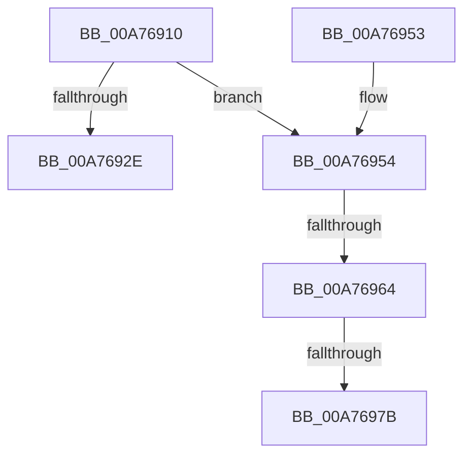

# AlpcpSignalPortAndUnlock

- RVA: `0x00A76910`–`0x00A76989` (길이 `121` bytes)
- VA: `0x0000000140A76910`
- 실행 섹션: `PAGE`
- PDB 이름 있음: `예`; PDB Function 태그: `예`
- unwind 정보 RVA: `0x000B5C5C`
- 디코드: `33`개 명령, `121/121` bytes 표시
- 미해석 바이트: `0` (있으면 어셈블리에 `.byte`로 보존)

> 이 문서는 커널 이미지의 기계어와 PDB 기호를 분석해 생성했습니다. 4번과 5번은 함수 원형과 자료형을 바이너리 사용 방식에서 추정한 C 해석이며 원본 소스 복구 결과는 아닙니다.

## 1. Dependencies

- 직접 호출 지점: **2**; 고유 호출 대상: **2**
- 직접 호출자로 확인된 함수: **2**
- RIP 상대 이미지 참조: **0**

### Outgoing calls
- `0x00A7693B` → [AlpcpQueueIoCompletionPort](../../text/3F/AlpcpQueueIoCompletionPort_function_003FF760.md) (function, `0x003FF760`)
- `0x00A7697E` → [ExfReleasePushLockShared](../../text/26/ExfReleasePushLockShared_function_00263440.md) (function, `0x00263440`)

### Direct callers
- [AlpcpCancelMessage](../89/AlpcpCancelMessage_function_00894120.md) at `0x008945D6`
- [AlpcpDisconnectPort](../92/AlpcpDisconnectPort_function_00924A68.md) at `0x00924D49`

### Static image references
- 디코드된 RIP-relative 메모리 참조가 없습니다.

## 2. Other-region calls and transfers

- 다른 실행 섹션으로 향하는 call: **2**
  - `0x00A7693B` → [AlpcpQueueIoCompletionPort](../../text/3F/AlpcpQueueIoCompletionPort_function_003FF760.md) (`PAGE` → `.text`)
  - `0x00A7697E` → [ExfReleasePushLockShared](../../text/26/ExfReleasePushLockShared_function_00263440.md) (`PAGE` → `.text`)
- call이 아닌 외부 분기/꼬리 이동: **3**
  - `0x00A7695E` → [sub_00B414D2 + 0x4D](../B4/Unknown_function_00B414D2.md) (`tail-transfer`)
  - `0x00A76975` → [sub_00B414D2](../B4/Unknown_function_00B414D2.md) (`tail-transfer`)
  - `0x00A76984` → [sub_00B414D2](../B4/Unknown_function_00B414D2.md) (`tail-transfer`)

## 3. Assembly (complete function range)

```asm
00A76910  48 89 5C 24 10                  mov qword ptr [rsp + 0x10], rbx
00A76915  48 89 6C 24 18                  mov qword ptr [rsp + 0x18], rbp
00A7691A  56                              push rsi
00A7691B  57                              push rdi
00A7691C  41 56                           push r14
00A7691E  48 83 EC 30                     sub rsp, 0x30
00A76922  45 33 F6                        xor r14d, r14d
00A76925  48 8B D9                        mov rbx, rcx
00A76928  4C 39 71 20                     cmp qword ptr [rcx + 0x20], r14
00A7692C  74 26                           je 0x140a76954
00A7692E  45 33 C9                        xor r9d, r9d
00A76931  44 89 74 24 20                  mov dword ptr [rsp + 0x20], r14d
00A76936  41 B0 01                        mov r8b, 1
00A76939  33 D2                           xor edx, edx
00A7693B  E8 20 8E 98 FF                  call 0x1403ff760
00A76940  48 8B 5C 24 58                  mov rbx, qword ptr [rsp + 0x58]
00A76945  48 8B 6C 24 60                  mov rbp, qword ptr [rsp + 0x60]
00A7694A  48 83 C4 30                     add rsp, 0x30
00A7694E  41 5E                           pop r14
00A76950  5F                              pop rdi
00A76951  5E                              pop rsi
00A76952  C3                              ret
00A76953  CC                              int3
00A76954  F7 81 A0 01 00 00 00 02 00 00   test dword ptr [rcx + 0x1a0], 0x200
00A7695E  0F 84 BB AB 0C 00               je 0x140b4151f
00A76964  48 8D B9 60 01 00 00            lea rdi, [rcx + 0x160]
00A7696B  B8 11 00 00 00                  mov eax, 0x11
00A76970  F0 4C 0F B1 37                  lock cmpxchg qword ptr [rdi], r14
00A76975  0F 84 57 AB 0C 00               je 0x140b414d2
00A7697B  48 8B CF                        mov rcx, rdi
00A7697E  E8 BD CA 7E FF                  call 0x140263440
00A76983  90                              nop
00A76984  E9 49 AB 0C 00                  jmp 0x140b414d2
```

## 4. C-style interpretation (structured pseudocode)

```c
__int64 __fastcall AlpcpSignalPortAndUnlock(__int64 a1, int a2, __int64 a3, int a4)
{
    __int64 result;
    __int64 v_r14;
    __int64 v_rsp;
    unsigned int v_stack_m28;
    unsigned __int64 v_stack_p10;
    unsigned __int64 v_stack_p18;

    v_stack_p10 = v_rbx;
    v_stack_p18 = v_rbp;
    v_rsp = (v_rsp) - (48);
    v_r14 = 0;
    if ((*(unsigned __int64 *)(a1 + 32)) == 0) goto loc_00A76954;
    a4 = 0;
    v_stack_m28 = 0;
    a2 = 0;
    result = AlpcpQueueIoCompletionPort(a1, a2, 1, a4);
    v_rsp = (v_rsp) + (48);
    return result;
loc_00A76954:
    result = ExfReleasePushLockShared(a1 + 352, a2, 1, a4);
}
```

## 5. (Beta) C Style

```c
int64_t AlpcpSignalPortAndUnlock(void *Arg1, int32_t Arg2, int64_t Arg3, int32_t Arg4)
{
    uint8_t *arg1 = (uint8_t *)Arg1;

    int64_t result;
    int64_t local_r14;
    int64_t local_rsp;
    uint32_t v_stack_m28;
    uint64_t v_stack_p10;
    uint64_t v_stack_p18;

    v_stack_p10 = local_rbx;
    v_stack_p18 = local_rbp;
    local_rsp = (local_rsp) - (48);
    local_r14 = 0;
    if ((*(uint64_t *)(arg1 + 0x20)) == 0) goto loc_00A76954;
    Arg4 = 0;
    v_stack_m28 = 0;
    Arg2 = 0;
    result = AlpcpQueueIoCompletionPort(Arg1, Arg2, 1, Arg4);
    local_rsp = (local_rsp) + (48);
    return result;
loc_00A76954:
    result = ExfReleasePushLockShared(Arg1 + 352, Arg2, 1, Arg4);
}
```

### 관측된 메모리 오프셋

구조체 형식이 확인되지 않은 접근은 인자 기준의 오프셋으로만 기록했습니다.

| 기준 인자 | 오프셋 표현 | 폭 (bit) | 접근 |
|---|---:|---:|---|
| `Arg1` | `+ 0x0` | `64` | `R` |
| `Arg1` | `+ 0x20` | `64` | `R` |
| `Arg1` | `+ 0x160` | `64` | `R` |
| `Arg1` | `+ 0x1A0` | `32` | `R` |

## 6. Execution-region graph

[열기: 2D/3D 그래프와 함수 탐색 컨트롤 패널](../../../control-panel.html?section=page&rva=0x00A76910&view=graph)

- 2D 그래프는 위에서 아래로 흐르고, 3D 그래프는 빈 공간을 드래그해 회전합니다. Shift+드래그는 이동, 휠은 확대·축소, 함수 노드 선택은 대상 보고서 이동입니다.

### Static fallback


