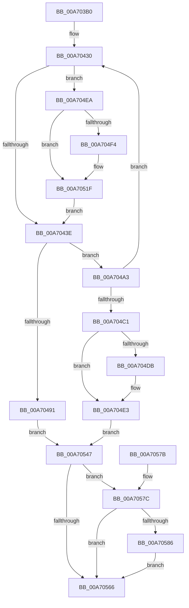

# CcPinRead

- RVA: `0x00A703B0`–`0x00A7058D` (길이 `477` bytes)
- VA: `0x0000000140A703B0`
- 실행 섹션: `PAGE`
- PDB 이름 있음: `예`; PDB Function 태그: `아니요`
- unwind 정보 RVA: `0x000B4FA4`
- 디코드: `117`개 명령, `477/477` bytes 표시
- 미해석 바이트: `0` (있으면 어셈블리에 `.byte`로 보존)

> 이 문서는 커널 이미지의 기계어와 PDB 기호를 분석해 생성했습니다. 4번과 5번은 함수 원형과 자료형을 바이너리 사용 방식에서 추정한 C 해석이며 원본 소스 복구 결과는 아닙니다.

## 1. Dependencies

- 직접 호출 지점: **3**; 고유 호출 대상: **3**
- 직접 호출자로 확인된 함수: **0**
- RIP 상대 이미지 참조: **0**

### Outgoing calls
- `0x00A70485` → [CcPinFileData](../../text/33/CcPinFileData_function_0033FB40.md) (function, `0x0033FB40`)
- `0x00A704F9` → [CcAllocateObcb](../71/CcAllocateObcb_function_0071031C.md) (function, `0x0071031C`)
- `0x00A70586` → [CcUnpinData](../9A/CcUnpinData_function_009A7A80.md) (function, `0x009A7A80`)

### Direct callers
- 이 함수 시작 RVA로 연결되는 직접 call은 확인되지 않았습니다. 간접 호출은 완전히 역산할 수 없습니다.

### Static image references
- 디코드된 RIP-relative 메모리 참조가 없습니다.

## 2. Other-region calls and transfers

- 다른 실행 섹션으로 향하는 call: **1**
  - `0x00A70485` → [CcPinFileData](../../text/33/CcPinFileData_function_0033FB40.md) (`PAGE` → `.text`)
- 별도 외부 분기/꼬리 이동을 확인하지 못했습니다.

## 3. Assembly (complete function range)

```asm
00A703B0  4C 8B DC                        mov r11, rsp
00A703B3  45 89 43 18                     mov dword ptr [r11 + 0x18], r8d
00A703B7  53                              push rbx
00A703B8  56                              push rsi
00A703B9  57                              push rdi
00A703BA  41 54                           push r12
00A703BC  41 55                           push r13
00A703BE  41 56                           push r14
00A703C0  41 57                           push r15
00A703C2  48 81 EC 80 00 00 00            sub rsp, 0x80
00A703C9  45 8B F9                        mov r15d, r9d
00A703CC  4C 8B F2                        mov r14, rdx
00A703CF  4C 8B E9                        mov r13, rcx
00A703D2  45 33 D2                        xor r10d, r10d
00A703D5  4D 89 53 B0                     mov qword ptr [r11 - 0x50], r10
00A703D9  4D 89 53 08                     mov qword ptr [r11 + 8], r10
00A703DD  48 8B 02                        mov rax, qword ptr [rdx]
00A703E0  49 89 43 10                     mov qword ptr [r11 + 0x10], rax
00A703E4  4D 89 53 A0                     mov qword ptr [r11 - 0x60], r10
00A703E8  49 8D 43 A0                     lea rax, [r11 - 0x60]
00A703EC  49 89 43 A8                     mov qword ptr [r11 - 0x58], rax
00A703F0  45 88 53 98                     mov byte ptr [r11 - 0x68], r10b
00A703F4  41 8B C1                        mov eax, r9d
00A703F7  83 E0 01                        and eax, 1
00A703FA  8D 04 85 58 89 00 00            lea eax, [rax*4 + 0x8958]
00A70401  65 FF 00                        inc dword ptr gs:[rax]
00A70404  65 48 8B 04 25 88 01 00 00      mov rax, qword ptr gs:[0x188]
00A7040D  44 89 90 DC 05 00 00            mov dword ptr [rax + 0x5dc], r10d
00A70414  48 8B 41 28                     mov rax, qword ptr [rcx + 0x28]
00A70418  4C 8B 60 08                     mov r12, qword ptr [rax + 8]
00A7041C  48 8B B4 24 E8 00 00 00         mov rsi, qword ptr [rsp + 0xe8]
00A70424  41 8B 7B 18                     mov edi, dword ptr [r11 + 0x18]
00A70428  49 8B 43 08                     mov rax, qword ptr [r11 + 8]
00A7042C  49 8B 5B A8                     mov rbx, qword ptr [r11 - 0x58]
00A70430  4C 8B 44 24 58                  mov r8, qword ptr [rsp + 0x58]
00A70435  4D 85 C0                        test r8, r8
00A70438  0F 85 AC 00 00 00               jne 0x140a704ea
00A7043E  45 8B 8C 24 98 00 00 00         mov r9d, dword ptr [r12 + 0x98]
00A70446  41 C1 E9 09                     shr r9d, 9
00A7044A  41 F6 D1                        not r9b
00A7044D  41 80 E1 01                     and r9b, 1
00A70451  48 8D 84 24 C0 00 00 00         lea rax, [rsp + 0xc0]
00A70459  48 89 44 24 40                  mov qword ptr [rsp + 0x40], rax
00A7045E  48 8D 44 24 68                  lea rax, [rsp + 0x68]
00A70463  48 89 44 24 38                  mov qword ptr [rsp + 0x38], rax
00A70468  48 89 5C 24 30                  mov qword ptr [rsp + 0x30], rbx
00A7046D  44 89 7C 24 28                  mov dword ptr [rsp + 0x28], r15d
00A70472  44 88 54 24 20                  mov byte ptr [rsp + 0x20], r10b
00A70477  44 8B C7                        mov r8d, edi
00A7047A  48 8D 94 24 C8 00 00 00         lea rdx, [rsp + 0xc8]
00A70482  49 8B CD                        mov rcx, r13
00A70485  E8 B6 F6 8C FF                  call 0x14033fb40
00A7048A  45 33 D2                        xor r10d, r10d
00A7048D  84 C0                           test al, al
00A7048F  75 12                           jne 0x140a704a3
00A70491  65 FF 04 25 94 89 00 00         inc dword ptr gs:[0x8994]
00A70499  44 88 54 24 50                  mov byte ptr [rsp + 0x50], r10b
00A7049E  E9 A4 00 00 00                  jmp 0x140a70547
00A704A3  48 8B 84 24 C0 00 00 00         mov rax, qword ptr [rsp + 0xc0]
00A704AB  48 8B D0                        mov rdx, rax
00A704AE  48 2B 94 24 C8 00 00 00         sub rdx, qword ptr [rsp + 0xc8]
00A704B6  8B CF                           mov ecx, edi
00A704B8  48 3B D1                        cmp rdx, rcx
00A704BB  0F 8C 6F FF FF FF               jl 0x140a70430
00A704C1  48 8B 8C 24 E0 00 00 00         mov rcx, qword ptr [rsp + 0xe0]
00A704C9  48 8B 44 24 58                  mov rax, qword ptr [rsp + 0x58]
00A704CE  48 89 01                        mov qword ptr [rcx], rax
00A704D1  48 8D 44 24 58                  lea rax, [rsp + 0x58]
00A704D6  48 3B D8                        cmp rbx, rax
00A704D9  75 08                           jne 0x140a704e3
00A704DB  48 8B 44 24 68                  mov rax, qword ptr [rsp + 0x68]
00A704E0  48 89 06                        mov qword ptr [rsi], rax
00A704E3  C6 44 24 50 01                  mov byte ptr [rsp + 0x50], 1
00A704E8  EB 5D                           jmp 0x140a70547
00A704EA  48 8D 4C 24 58                  lea rcx, [rsp + 0x58]
00A704EF  48 3B D9                        cmp rbx, rcx
00A704F2  75 2B                           jne 0x140a7051f
00A704F4  8B D7                           mov edx, edi
00A704F6  49 8B CE                        mov rcx, r14
00A704F9  E8 1E FE C9 FF                  call 0x14071031c
00A704FE  48 89 44 24 58                  mov qword ptr [rsp + 0x58], rax
00A70503  48 8D 58 10                     lea rbx, [rax + 0x10]
00A70507  48 89 5C 24 60                  mov qword ptr [rsp + 0x60], rbx
00A7050C  48 8B 44 24 68                  mov rax, qword ptr [rsp + 0x68]
00A70511  48 89 06                        mov qword ptr [rsi], rax
00A70514  48 8B 84 24 C0 00 00 00         mov rax, qword ptr [rsp + 0xc0]
00A7051C  45 33 D2                        xor r10d, r10d
00A7051F  8B 8C 24 C8 00 00 00            mov ecx, dword ptr [rsp + 0xc8]
00A70526  2B C8                           sub ecx, eax
00A70528  03 F9                           add edi, ecx
00A7052A  89 BC 24 D0 00 00 00            mov dword ptr [rsp + 0xd0], edi
00A70531  48 89 84 24 C8 00 00 00         mov qword ptr [rsp + 0xc8], rax
00A70539  48 83 C3 08                     add rbx, 8
00A7053D  48 89 5C 24 60                  mov qword ptr [rsp + 0x60], rbx
00A70542  E9 F7 FE FF FF                  jmp 0x140a7043e
00A70547  65 48 8B 04 25 88 01 00 00      mov rax, qword ptr gs:[0x188]
00A70550  8B 88 DC 05 00 00               mov ecx, dword ptr [rax + 0x5dc]
00A70556  65 01 0C 25 98 89 00 00         add dword ptr gs:[0x8998], ecx
00A7055E  8A 5C 24 50                     mov bl, byte ptr [rsp + 0x50]
00A70562  84 DB                           test bl, bl
00A70564  74 16                           je 0x140a7057c
00A70566  8A C3                           mov al, bl
00A70568  48 81 C4 80 00 00 00            add rsp, 0x80
00A7056F  41 5F                           pop r15
00A70571  41 5E                           pop r14
00A70573  41 5D                           pop r13
00A70575  41 5C                           pop r12
00A70577  5F                              pop rdi
00A70578  5E                              pop rsi
00A70579  5B                              pop rbx
00A7057A  C3                              ret
00A7057B  CC                              int3
00A7057C  48 8B 4C 24 58                  mov rcx, qword ptr [rsp + 0x58]
00A70581  48 85 C9                        test rcx, rcx
00A70584  74 E0                           je 0x140a70566
00A70586  E8 F5 74 F3 FF                  call 0x1409a7a80
00A7058B  EB D9                           jmp 0x140a70566
```

## 4. C-style interpretation (structured pseudocode)

```c
__int64 __fastcall CcPinRead(__int64 a1, __int64 a2, int a3, int a4, __int64 a5, __int64 a6)
{
    __int64 result;
    __int64 v_r10;
    __int64 v_rbx;
    __int64 v_rdi;
    __int64 v_rsp;
    unsigned __int64 v_stack_m50;
    unsigned __int64 v_stack_m58;
    unsigned __int64 v_stack_m60;
    unsigned __int8 v_stack_m68;
    unsigned __int64 v_stack_m78;
    unsigned __int64 v_stack_m80;
    unsigned __int64 v_stack_m88;
    unsigned int v_stack_m90;
    unsigned __int8 v_stack_m98;
    unsigned __int64 v_stack_p10;
    unsigned int v_stack_p18;
    unsigned __int64 v_stack_p58;
    unsigned __int64 v_stack_p8;

    *(unsigned int *)(v_rsp + 24) = a3;
    v_rsp = (v_rsp) - (128);
    v_r10 = 0;
    *(unsigned __int64 *)(v_rsp - 80) = 0;
    *(unsigned __int64 *)(v_rsp + 8) = 0;
    *(unsigned __int64 *)(v_rsp + 16) = *(unsigned __int64 *)(a2);
    *(unsigned __int64 *)(v_rsp - 96) = 0;
    *(unsigned __int64 *)(v_rsp - 88) = v_rsp - 96;
    *(unsigned __int8 *)(v_rsp - 104) = 0;
    result = (unsigned int)(((unsigned int)(a4)) & (1));
    *(unsigned int *)(*(unsigned __int64 *)(gs_base + (0 + 392)) + 1500) = 0;
loc_00A70430:
    if (v_stack_m60 != 0) goto loc_00A704EA;
loc_00A7043E:
    a4 = (unsigned int)(((unsigned int)(*(unsigned int *)(*(unsigned __int64 *)(*(unsigned __int64 *)(a1 + 40) + 8) + 152))) >> (9));
    a4 = (unsigned __int8)(~(a4));
    a4 = (unsigned __int8)((a4) & (1));
    v_stack_m78 = v_stack_p8;
    v_stack_m80 = v_stack_m50;
    v_stack_m88 = *(unsigned __int64 *)(v_rsp - 88);
    v_stack_m90 = (unsigned int)((unsigned int)(a4));
    v_stack_m98 = 0;
    result = CcPinFileData(a1, v_stack_p10, (unsigned int)((unsigned int)((unsigned int)(*(unsigned int *)(v_rsp + 24)))), a4);
    v_r10 = 0;
    if ((unsigned __int8)(result) != 0) goto loc_00A704A3;
    v_stack_m68 = 0;
    goto loc_00A70547;
loc_00A704A3:
    a2 = (v_stack_p8) - (v_stack_p10);
    if (a2 < ((unsigned int)((unsigned int)((unsigned int)(*(unsigned int *)(v_rsp + 24)))))) goto loc_00A70430;
    *(unsigned __int64 *)(a5) = v_stack_m60;
    result = v_stack_m60;
    if ((*(unsigned __int64 *)(v_rsp - 88)) == v_stack_m60) {
        result = v_stack_m50;
        *(unsigned __int64 *)(a6) = result;
    }
    v_stack_m68 = 1;
    goto loc_00A70547;
loc_00A704EA:
    v_rbx = *(unsigned __int64 *)(v_rsp - 88);
    if ((*(unsigned __int64 *)(v_rsp - 88)) == v_stack_m60) {
        a2 = (unsigned int)((unsigned int)(*(unsigned int *)(v_rsp + 24)));
        a1 = a2;
        result = CcAllocateObcb(a1, a2, (unsigned int)((unsigned int)((unsigned int)(*(unsigned int *)(v_rsp + 24)))), a4);
        v_stack_m60 = result;
        v_rbx = result + 16;
        v_stack_m58 = v_rbx;
        result = v_stack_m50;
        *(unsigned __int64 *)(a6) = result;
        result = v_stack_p8;
        v_r10 = 0;
    }
    a1 = (unsigned int)(((unsigned int)(v_stack_p10)) - ((unsigned int)(result)));
    v_rdi = (unsigned int)(((unsigned int)(*(unsigned int *)(v_rsp + 24))) + ((unsigned int)(a1)));
    v_stack_p18 = (unsigned int)(v_rdi);
    v_stack_p10 = result;
    v_rbx = (v_rbx) + (8);
    v_stack_m58 = v_rbx;
    goto loc_00A7043E;
loc_00A70547:
    if ((unsigned __int8)(v_stack_m68) == 0) goto loc_00A7057C;
loc_00A70566:
    v_rsp = (v_rsp) + (128);
    return (unsigned __int8)(v_stack_m68);
loc_00A7057C:
    if (v_stack_p58 == 0) goto loc_00A70566;
    result = CcUnpinData(v_stack_p58, a2, (unsigned int)((unsigned int)((unsigned int)(*(unsigned int *)(v_rsp + 24)))), a4);
    goto loc_00A70566;
}
```

## 5. (Beta) C Style

```c
int64_t CcPinRead(void *Arg1, void *Arg2, int32_t Arg3, int32_t Arg4, void *Arg5, void *Arg6)
{
    uint8_t *arg1 = (uint8_t *)Arg1;
    uint8_t *arg2 = (uint8_t *)Arg2;
    uint8_t *arg5 = (uint8_t *)Arg5;
    uint8_t *arg6 = (uint8_t *)Arg6;

    int64_t result;
    int64_t local_r10;
    int64_t local_rbx;
    int64_t local_rdi;
    int64_t local_rsp;
    uint64_t v_stack_m50;
    uint64_t v_stack_m58;
    uint64_t v_stack_m60;
    uint8_t v_stack_m68;
    uint64_t v_stack_m78;
    uint64_t v_stack_m80;
    uint64_t v_stack_m88;
    uint32_t v_stack_m90;
    uint8_t v_stack_m98;
    uint64_t v_stack_p10;
    uint32_t v_stack_p18;
    uint64_t v_stack_p58;
    uint64_t v_stack_p8;

    *(uint32_t *)(local_rsp + 0x18) = Arg3;
    local_rsp = (local_rsp) - (128);
    local_r10 = 0;
    *(uint64_t *)(local_rsp - 0x50) = 0;
    *(uint64_t *)(local_rsp + 0x8) = 0;
    *(uint64_t *)(local_rsp + 0x10) = *(uint64_t *)(arg2);
    *(uint64_t *)(local_rsp - 0x60) = 0;
    *(uint64_t *)(local_rsp - 0x58) = local_rsp - 96;
    *(uint8_t *)(local_rsp - 0x68) = 0;
    result = (uint32_t)(((uint32_t)(Arg4)) & (1));
    *(uint32_t *)(*(uint64_t *)(gs_base + (0 + 0x188)) + 0x5DC) = 0;
loc_00A70430:
    if (v_stack_m60 != 0) goto loc_00A704EA;
loc_00A7043E:
    Arg4 = (uint32_t)(((uint32_t)(*(uint32_t *)(*(uint64_t *)(*(uint64_t *)(arg1 + 0x28) + 0x8) + 0x98))) >> (9));
    Arg4 = (uint8_t)(~(Arg4));
    Arg4 = (uint8_t)((Arg4) & (1));
    v_stack_m78 = v_stack_p8;
    v_stack_m80 = v_stack_m50;
    v_stack_m88 = *(uint64_t *)(local_rsp - 0x58);
    v_stack_m90 = (uint32_t)((uint32_t)(Arg4));
    v_stack_m98 = 0;
    result = CcPinFileData(Arg1, v_stack_p10, (uint32_t)((uint32_t)((uint32_t)(*(uint32_t *)(local_rsp + 0x18)))), Arg4);
    local_r10 = 0;
    if ((uint8_t)(result) != 0) goto loc_00A704A3;
    v_stack_m68 = 0;
    goto loc_00A70547;
loc_00A704A3:
    Arg2 = (v_stack_p8) - (v_stack_p10);
    if (Arg2 < ((uint32_t)((uint32_t)((uint32_t)(*(uint32_t *)(local_rsp + 0x18)))))) goto loc_00A70430;
    *(uint64_t *)(arg5) = v_stack_m60;
    result = v_stack_m60;
    if ((*(uint64_t *)(local_rsp - 0x58)) == v_stack_m60) {
        result = v_stack_m50;
        *(uint64_t *)(arg6) = result;
    }
    v_stack_m68 = 1;
    goto loc_00A70547;
loc_00A704EA:
    local_rbx = *(uint64_t *)(local_rsp - 0x58);
    if ((*(uint64_t *)(local_rsp - 0x58)) == v_stack_m60) {
        Arg2 = (uint32_t)((uint32_t)(*(uint32_t *)(local_rsp + 0x18)));
        Arg1 = Arg2;
        result = CcAllocateObcb(Arg1, Arg2, (uint32_t)((uint32_t)((uint32_t)(*(uint32_t *)(local_rsp + 0x18)))), Arg4);
        v_stack_m60 = result;
        local_rbx = result + 16;
        v_stack_m58 = local_rbx;
        result = v_stack_m50;
        *(uint64_t *)(arg6) = result;
        result = v_stack_p8;
        local_r10 = 0;
    }
    Arg1 = (uint32_t)(((uint32_t)(v_stack_p10)) - ((uint32_t)(result)));
    local_rdi = (uint32_t)(((uint32_t)(*(uint32_t *)(local_rsp + 0x18))) + ((uint32_t)(Arg1)));
    v_stack_p18 = (uint32_t)(local_rdi);
    v_stack_p10 = result;
    local_rbx = (local_rbx) + (8);
    v_stack_m58 = local_rbx;
    goto loc_00A7043E;
loc_00A70547:
    if ((uint8_t)(v_stack_m68) == 0) goto loc_00A7057C;
loc_00A70566:
    local_rsp = (local_rsp) + (128);
    return (uint8_t)(v_stack_m68);
loc_00A7057C:
    if (v_stack_p58 == 0) goto loc_00A70566;
    result = CcUnpinData(v_stack_p58, Arg2, (uint32_t)((uint32_t)((uint32_t)(*(uint32_t *)(local_rsp + 0x18)))), Arg4);
    goto loc_00A70566;
}
```

### 관측된 메모리 오프셋

구조체 형식이 확인되지 않은 접근은 인자 기준의 오프셋으로만 기록했습니다.

| 기준 인자 | 오프셋 표현 | 폭 (bit) | 접근 |
|---|---:|---:|---|
| `Arg1` | `+ 0x28` | `64` | `R` |
| `Arg2` | `+ 0x0` | `64` | `R` |
| `Arg5` | `+ 0x0` | `64` | `W` |
| `Arg6` | `+ 0x0` | `64` | `W` |

## 6. Execution-region graph

[열기: 2D/3D 그래프와 함수 탐색 컨트롤 패널](../../../control-panel.html?section=page&rva=0x00A703B0&view=graph)

- 2D 그래프는 위에서 아래로 흐르고, 3D 그래프는 빈 공간을 드래그해 회전합니다. Shift+드래그는 이동, 휠은 확대·축소, 함수 노드 선택은 대상 보고서 이동입니다.

### Static fallback


