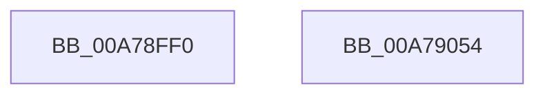

# CcPrivateVolumeCacheMapTelemetryCallback

- RVA: `0x00A78FF0`–`0x00A79055` (길이 `101` bytes)
- VA: `0x0000000140A78FF0`
- 실행 섹션: `PAGE`
- PDB 이름 있음: `예`; PDB Function 태그: `아니요`
- unwind 정보 RVA: `0x0005C788`
- 디코드: `18`개 명령, `101/101` bytes 표시
- 미해석 바이트: `0` (있으면 어셈블리에 `.byte`로 보존)

> 이 문서는 커널 이미지의 기계어와 PDB 기호를 분석해 생성했습니다. 4번과 5번은 함수 원형과 자료형을 바이너리 사용 방식에서 추정한 C 해석이며 원본 소스 복구 결과는 아닙니다.

## 1. Dependencies

- 직접 호출 지점: **1**; 고유 호출 대상: **1**
- 직접 호출자로 확인된 함수: **0**
- RIP 상대 이미지 참조: **7**

### Outgoing calls
- `0x00A79048` → [CcGetActiveWorkerCountInPartition](../../text/3C/CcGetActiveWorkerCountInPartition_function_003CF044.md) (function, `0x003CF044`)

### Direct callers
- 이 함수 시작 RVA로 연결되는 직접 call은 확인되지 않았습니다. 간접 호출은 완전히 역산할 수 없습니다.

### Static image references
- `0x00A78FF4` → RVA `0x00F8F2F0` (`.data`; read/write)
- `0x00A79002` → RVA `0x00F8F2F8` (`.data`; read/write)
- `0x00A79010` → RVA `0x00F8F300` (`.data`; read/write)
- `0x00A7901E` → RVA `0x00F8F318` (`.data`; read/write)
- `0x00A7902C` → RVA `0x00F8F328` (`.data`; read/write)
- `0x00A7903A` → RVA `0x00F8F330` (`.data`; read/write)
- `0x00A79041` → RVA `0x00F8F320` (`.data`; read)

## 2. Other-region calls and transfers

- 다른 실행 섹션으로 향하는 call: **1**
  - `0x00A79048` → [CcGetActiveWorkerCountInPartition](../../text/3C/CcGetActiveWorkerCountInPartition_function_003CF044.md) (`PAGE` → `.text`)
- 별도 외부 분기/꼬리 이동을 확인하지 못했습니다.

## 3. Assembly (complete function range)

```asm
00A78FF0  48 83 EC 28                     sub rsp, 0x28
00A78FF4  48 FF 05 F5 62 51 00            inc qword ptr [rip + 0x5162f5]
00A78FFB  44 8B 82 90 03 00 00            mov r8d, dword ptr [rdx + 0x390]
00A79002  4C 01 05 EF 62 51 00            add qword ptr [rip + 0x5162ef], r8
00A79009  4C 8B 82 E0 03 00 00            mov r8, qword ptr [rdx + 0x3e0]
00A79010  4C 01 05 E9 62 51 00            add qword ptr [rip + 0x5162e9], r8
00A79017  44 8B 82 08 03 00 00            mov r8d, dword ptr [rdx + 0x308]
00A7901E  4C 01 05 F3 62 51 00            add qword ptr [rip + 0x5162f3], r8
00A79025  4C 8B 82 38 04 00 00            mov r8, qword ptr [rdx + 0x438]
00A7902C  4C 01 05 F5 62 51 00            add qword ptr [rip + 0x5162f5], r8
00A79033  4C 8B 82 40 04 00 00            mov r8, qword ptr [rdx + 0x440]
00A7903A  4C 01 05 EF 62 51 00            add qword ptr [rip + 0x5162ef], r8
00A79041  4C 8D 05 D8 62 51 00            lea r8, [rip + 0x5162d8]
00A79048  E8 F7 5F 95 FF                  call 0x1403cf044
00A7904D  B0 01                           mov al, 1
00A7904F  48 83 C4 28                     add rsp, 0x28
00A79053  C3                              ret
00A79054  CC                              int3
```

## 4. C-style interpretation (structured pseudocode)

```c
__int64 __fastcall CcPrivateVolumeCacheMapTelemetryCallback(__int64 a1, __int64 a2)
{
    __int64 result;
    __int64 v_rsp;

    v_rsp = (v_rsp) - (40);
    result = CcGetActiveWorkerCountInPartition(a1, a2, v_rip + 5333720, a4);
    v_rsp = (v_rsp) + (40);
    return 1;
}
```

## 5. (Beta) C Style

```c
int64_t CcPrivateVolumeCacheMapTelemetryCallback(int64_t Arg1, void *Arg2)
{
    uint8_t *arg2 = (uint8_t *)Arg2;

    int64_t result;
    int64_t local_rsp;

    local_rsp = (local_rsp) - (40);
    result = CcGetActiveWorkerCountInPartition(Arg1, Arg2, v_rip + 5333720, a4);
    local_rsp = (local_rsp) + (40);
    return 1;
}
```

### 관측된 메모리 오프셋

구조체 형식이 확인되지 않은 접근은 인자 기준의 오프셋으로만 기록했습니다.

| 기준 인자 | 오프셋 표현 | 폭 (bit) | 접근 |
|---|---:|---:|---|
| `Arg2` | `+ 0x308` | `32` | `R` |
| `Arg2` | `+ 0x390` | `32` | `R` |
| `Arg2` | `+ 0x3E0` | `64` | `R` |
| `Arg2` | `+ 0x438` | `64` | `R` |
| `Arg2` | `+ 0x440` | `64` | `R` |

## 6. Execution-region graph

[열기: 2D/3D 그래프와 함수 탐색 컨트롤 패널](../../../control-panel.html?section=page&rva=0x00A78FF0&view=graph)

- 2D 그래프는 위에서 아래로 흐르고, 3D 그래프는 빈 공간을 드래그해 회전합니다. Shift+드래그는 이동, 휠은 확대·축소, 함수 노드 선택은 대상 보고서 이동입니다.

### Static fallback


