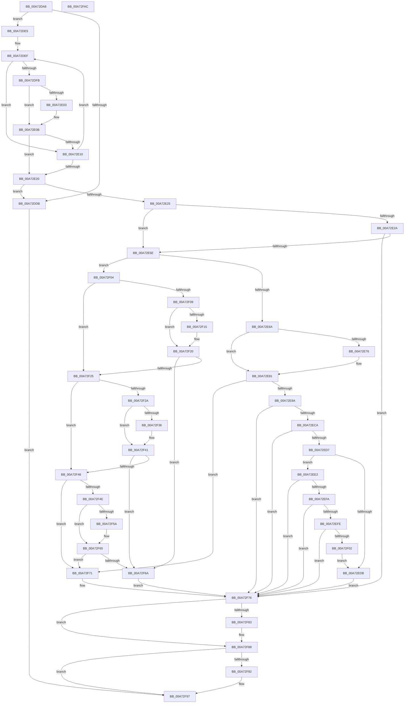

# CmDeleteDeviceInterfaceMappedPropertyFromRegValue

- RVA: `0x00A72DA8`–`0x00A72FAD` (길이 `517` bytes)
- VA: `0x0000000140A72DA8`
- 실행 섹션: `PAGE`
- PDB 이름 있음: `예`; PDB Function 태그: `아니요`
- unwind 정보 RVA: `0x000B5608`
- 디코드: `140`개 명령, `517/517` bytes 표시
- 미해석 바이트: `0` (있으면 어셈블리에 `.byte`로 보존)

> 이 문서는 커널 이미지의 기계어와 PDB 기호를 분석해 생성했습니다. 4번과 5번은 함수 원형과 자료형을 바이너리 사용 방식에서 추정한 C 해석이며 원본 소스 복구 결과는 아닙니다.

## 1. Dependencies

- 직접 호출 지점: **5**; 고유 호출 대상: **4**
- 직접 호출자로 확인된 함수: **1**
- RIP 상대 이미지 참조: **11**

### Outgoing calls
- `0x00A72E4F` → [_CmOpenDeviceInterfaceRegKey](../8F/_CmOpenDeviceInterfaceRegKey_function_008F31F4.md) (function, `0x008F31F4`)
- `0x00A72EB8` → [PnpCtxRegOpenKey](../8E/PnpCtxRegOpenKey_function_008EF7B8.md) (function, `0x008EF7B8`)
- `0x00A72EF1` → [PnpCtxRegDeleteValue](../8F/PnpCtxRegDeleteValue_function_008FE5E0.md) (function, `0x008FE5E0`)
- `0x00A72F83` → [ZwClose](../../text/6A/ZwClose_function_006AD2B0.md) (function, `0x006AD2B0`)
- `0x00A72F92` → [ZwClose](../../text/6A/ZwClose_function_006AD2B0.md) (function, `0x006AD2B0`)

### Direct callers
- [CmSetDeviceInterfaceMappedProperty](CmSetDeviceInterfaceMappedProperty_function_00A7287C.md) at `0x00A7297D`

### Static image references
- `0x00A72DE8` → RVA `0x00B4B1E0` (`PAGE`; read)
- `0x00A72E6D` → RVA `0x000114F8` (`.rdata`; read)
- `0x00A72E7A` → RVA `0x00011500` (`.rdata`; read)
- `0x00A72E9C` → RVA `0x00B0D340` (` ?? ::NNGAKEGL::`string'`; read)
- `0x00A72EEA` → RVA `0x00B09360` (` ?? ::NNGAKEGL::`string'`; read)
- `0x00A72F0C` → RVA `0x000114D0` (`.rdata`; read)
- `0x00A72F19` → RVA `0x000114D8` (`.rdata`; read)
- `0x00A72F2D` → RVA `0x000114B8` (`.rdata`; read)
- `0x00A72F3A` → RVA `0x000114C0` (`.rdata`; read)
- `0x00A72F51` → RVA `0x00011490` (`.rdata`; read)
- `0x00A72F5E` → RVA `0x00011498` (`.rdata`; read)

## 2. Other-region calls and transfers

- 다른 실행 섹션으로 향하는 call: **2**
  - `0x00A72F83` → [ZwClose](../../text/6A/ZwClose_function_006AD2B0.md) (`PAGE` → `.text`)
  - `0x00A72F92` → [ZwClose](../../text/6A/ZwClose_function_006AD2B0.md) (`PAGE` → `.text`)
- 별도 외부 분기/꼬리 이동을 확인하지 못했습니다.

## 3. Assembly (complete function range)

```asm
00A72DA8  48 8B C4                        mov rax, rsp
00A72DAB  48 89 58 08                     mov qword ptr [rax + 8], rbx
00A72DAF  48 89 68 10                     mov qword ptr [rax + 0x10], rbp
00A72DB3  56                              push rsi
00A72DB4  57                              push rdi
00A72DB5  41 56                           push r14
00A72DB7  48 83 EC 50                     sub rsp, 0x50
00A72DBB  45 8B 59 10                     mov r11d, dword ptr [r9 + 0x10]
00A72DBF  33 DB                           xor ebx, ebx
00A72DC1  48 21 58 D8                     and qword ptr [rax - 0x28], rbx
00A72DC5  49 8B F9                        mov rdi, r9
00A72DC8  48 21 58 20                     and qword ptr [rax + 0x20], rbx
00A72DCC  49 8B F0                        mov rsi, r8
00A72DCF  4C 8B F2                        mov r14, rdx
00A72DD2  48 8B E9                        mov rbp, rcx
00A72DD5  41 83 FB 02                     cmp r11d, 2
00A72DD9  73 0A                           jae 0x140a72de5
00A72DDB  BB 30 02 00 C0                  mov ebx, 0xc0000230
00A72DE0  E9 B2 01 00 00                  jmp 0x140a72f97
00A72DE5  45 33 C0                        xor r8d, r8d
00A72DE8  48 8D 0D F1 83 0D 00            lea rcx, [rip + 0xd83f1]
00A72DEF  4C 8B 09                        mov r9, qword ptr [rcx]
00A72DF2  4C 8B D1                        mov r10, rcx
00A72DF5  45 3B 59 10                     cmp r11d, dword ptr [r9 + 0x10]
00A72DF9  75 15                           jne 0x140a72e10
00A72DFB  48 8B 17                        mov rdx, qword ptr [rdi]
00A72DFE  49 2B 11                        sub rdx, qword ptr [r9]
00A72E01  75 08                           jne 0x140a72e0b
00A72E03  48 8B 57 08                     mov rdx, qword ptr [rdi + 8]
00A72E07  49 2B 51 08                     sub rdx, qword ptr [r9 + 8]
00A72E0B  48 85 D2                        test rdx, rdx
00A72E0E  74 10                           je 0x140a72e20
00A72E10  45 33 D2                        xor r10d, r10d
00A72E13  41 FF C0                        inc r8d
00A72E16  48 83 C1 10                     add rcx, 0x10
00A72E1A  41 83 F8 03                     cmp r8d, 3
00A72E1E  72 CF                           jb 0x140a72def
00A72E20  4D 85 D2                        test r10, r10
00A72E23  74 B6                           je 0x140a72ddb
00A72E25  48 85 F6                        test rsi, rsi
00A72E28  75 34                           jne 0x140a72e5e
00A72E2A  48 21 5C 24 38                  and qword ptr [rsp + 0x38], rbx
00A72E2F  48 8D 44 24 40                  lea rax, [rsp + 0x40]
00A72E34  48 89 44 24 30                  mov qword ptr [rsp + 0x30], rax
00A72E39  44 8D 46 30                     lea r8d, [rsi + 0x30]
00A72E3D  88 5C 24 28                     mov byte ptr [rsp + 0x28], bl
00A72E41  49 8B D6                        mov rdx, r14
00A72E44  48 8B CD                        mov rcx, rbp
00A72E47  C7 44 24 20 01 00 00 00         mov dword ptr [rsp + 0x20], 1
00A72E4F  E8 A0 03 E8 FF                  call 0x1408f31f4
00A72E54  8B D8                           mov ebx, eax
00A72E56  85 C0                           test eax, eax
00A72E58  0F 88 18 01 00 00               js 0x140a72f76
00A72E5E  8B 4F 10                        mov ecx, dword ptr [rdi + 0x10]
00A72E61  83 F9 02                        cmp ecx, 2
00A72E64  0F 85 9A 00 00 00               jne 0x140a72f04
00A72E6A  48 8B 07                        mov rax, qword ptr [rdi]
00A72E6D  48 2B 05 84 E6 59 FF            sub rax, qword ptr [rip - 0xa6197c]
00A72E74  75 0B                           jne 0x140a72e81
00A72E76  48 8B 47 08                     mov rax, qword ptr [rdi + 8]
00A72E7A  48 2B 05 7F E6 59 FF            sub rax, qword ptr [rip - 0xa61981]
00A72E81  48 85 C0                        test rax, rax
00A72E84  0F 85 E7 00 00 00               jne 0x140a72f71
00A72E8A  48 8B 54 24 40                  mov rdx, qword ptr [rsp + 0x40]
00A72E8F  48 8D 84 24 88 00 00 00         lea rax, [rsp + 0x88]
00A72E97  48 89 44 24 28                  mov qword ptr [rsp + 0x28], rax
00A72E9C  4C 8D 05 9D A4 09 00            lea r8, [rip + 0x9a49d]
00A72EA3  48 85 F6                        test rsi, rsi
00A72EA6  C7 44 24 20 02 00 00 00         mov dword ptr [rsp + 0x20], 2
00A72EAE  48 8B CD                        mov rcx, rbp
00A72EB1  48 0F 45 D6                     cmovne rdx, rsi
00A72EB5  45 33 C9                        xor r9d, r9d
00A72EB8  E8 FB C8 E7 FF                  call 0x1408ef7b8
00A72EBD  BE 34 00 00 C0                  mov esi, 0xc0000034
00A72EC2  3B C6                           cmp eax, esi
00A72EC4  0F 84 AC 00 00 00               je 0x140a72f76
00A72ECA  BF 7C 01 00 C0                  mov edi, 0xc000017c
00A72ECF  3B C7                           cmp eax, edi
00A72ED1  0F 84 9F 00 00 00               je 0x140a72f76
00A72ED7  85 C0                           test eax, eax
00A72ED9  79 07                           jns 0x140a72ee2
00A72EDB  8B D8                           mov ebx, eax
00A72EDD  E9 94 00 00 00                  jmp 0x140a72f76
00A72EE2  48 8B 94 24 88 00 00 00         mov rdx, qword ptr [rsp + 0x88]
00A72EEA  4C 8D 05 6F 64 09 00            lea r8, [rip + 0x9646f]
00A72EF1  E8 EA B6 E8 FF                  call 0x1408fe5e0
00A72EF6  3B C6                           cmp eax, esi
00A72EF8  74 7C                           je 0x140a72f76
00A72EFA  3B C7                           cmp eax, edi
00A72EFC  74 78                           je 0x140a72f76
00A72EFE  85 C0                           test eax, eax
00A72F00  79 74                           jns 0x140a72f76
00A72F02  EB D7                           jmp 0x140a72edb
00A72F04  83 F9 03                        cmp ecx, 3
00A72F07  75 1C                           jne 0x140a72f25
00A72F09  48 8B 07                        mov rax, qword ptr [rdi]
00A72F0C  48 2B 05 BD E5 59 FF            sub rax, qword ptr [rip - 0xa61a43]
00A72F13  75 0B                           jne 0x140a72f20
00A72F15  48 8B 47 08                     mov rax, qword ptr [rdi + 8]
00A72F19  48 2B 05 B8 E5 59 FF            sub rax, qword ptr [rip - 0xa61a48]
00A72F20  48 85 C0                        test rax, rax
00A72F23  74 45                           je 0x140a72f6a
00A72F25  83 F9 04                        cmp ecx, 4
00A72F28  75 1C                           jne 0x140a72f46
00A72F2A  48 8B 07                        mov rax, qword ptr [rdi]
00A72F2D  48 2B 05 84 E5 59 FF            sub rax, qword ptr [rip - 0xa61a7c]
00A72F34  75 0B                           jne 0x140a72f41
00A72F36  48 8B 47 08                     mov rax, qword ptr [rdi + 8]
00A72F3A  48 2B 05 7F E5 59 FF            sub rax, qword ptr [rip - 0xa61a81]
00A72F41  48 85 C0                        test rax, rax
00A72F44  74 24                           je 0x140a72f6a
00A72F46  81 F9 00 01 00 00               cmp ecx, 0x100
00A72F4C  75 23                           jne 0x140a72f71
00A72F4E  48 8B 07                        mov rax, qword ptr [rdi]
00A72F51  48 2B 05 38 E5 59 FF            sub rax, qword ptr [rip - 0xa61ac8]
00A72F58  75 0B                           jne 0x140a72f65
00A72F5A  48 8B 47 08                     mov rax, qword ptr [rdi + 8]
00A72F5E  48 2B 05 33 E5 59 FF            sub rax, qword ptr [rip - 0xa61acd]
00A72F65  48 85 C0                        test rax, rax
00A72F68  75 07                           jne 0x140a72f71
00A72F6A  BB 22 00 00 C0                  mov ebx, 0xc0000022
00A72F6F  EB 05                           jmp 0x140a72f76
00A72F71  BB 30 02 00 C0                  mov ebx, 0xc0000230
00A72F76  48 8B 8C 24 88 00 00 00         mov rcx, qword ptr [rsp + 0x88]
00A72F7E  48 85 C9                        test rcx, rcx
00A72F81  74 05                           je 0x140a72f88
00A72F83  E8 28 A3 C3 FF                  call 0x1406ad2b0
00A72F88  48 8B 4C 24 40                  mov rcx, qword ptr [rsp + 0x40]
00A72F8D  48 85 C9                        test rcx, rcx
00A72F90  74 05                           je 0x140a72f97
00A72F92  E8 19 A3 C3 FF                  call 0x1406ad2b0
00A72F97  48 8B 6C 24 78                  mov rbp, qword ptr [rsp + 0x78]
00A72F9C  8B C3                           mov eax, ebx
00A72F9E  48 8B 5C 24 70                  mov rbx, qword ptr [rsp + 0x70]
00A72FA3  48 83 C4 50                     add rsp, 0x50
00A72FA7  41 5E                           pop r14
00A72FA9  5F                              pop rdi
00A72FAA  5E                              pop rsi
00A72FAB  C3                              ret
00A72FAC  CC                              int3
```

## 4. C-style interpretation (structured pseudocode)

```c
__int64 __fastcall CmDeleteDeviceInterfaceMappedPropertyFromRegValue(__int64 a1, __int64 a2, __int64 a3, __int64 a4)
{
    __int64 result;
    __int64 v_r10;
    __int64 v_rbx;
    __int64 v_rsp;
    unsigned __int64 v_stack_m28;
    unsigned __int64 v_stack_m30;
    unsigned __int64 v_stack_m38;
    unsigned __int8 v_stack_m40;
    unsigned int v_stack_m48;
    unsigned __int64 v_stack_p10;
    unsigned __int64 v_stack_p20;
    unsigned __int64 v_stack_p8;

    *(unsigned __int64 *)(v_rsp + 8) = v_rbx;
    *(unsigned __int64 *)(v_rsp + 16) = v_rbp;
    v_rsp = (v_rsp) - (80);
    v_rbx = 0;
    if (((unsigned int)((unsigned int)(*(unsigned int *)(a4 + 16)))) >= 2) goto loc_00A72DE5;
loc_00A72DDB:
    goto loc_00A72F97;
loc_00A72DE5:
    a3 = 0;
loc_00A72DEF:
    if (((unsigned int)((unsigned int)(*(unsigned int *)(a4 + 16)))) != (*(unsigned int *)(*(unsigned __int64 *)(v_rip + 885745) + 16))) goto loc_00A72E10;
    a2 = (*(unsigned __int64 *)(a4)) - (*(unsigned __int64 *)(*(unsigned __int64 *)(v_rip + 885745)));
    if (!(condition_is_not_equal)) {
        a2 = *(unsigned __int64 *)(a4 + 8);
        a2 = (a2) - (*(unsigned __int64 *)(*(unsigned __int64 *)(v_rip + 885745) + 8));
    }
    if (a2 == 0) goto loc_00A72E20;
loc_00A72E10:
    v_r10 = 0;
    a3 = (unsigned int)((a3) + 1);
    a1 = (v_rip + 885745) + (16);
    if (((unsigned int)(a3)) < 3) goto loc_00A72DEF;
loc_00A72E20:
    if (0 == 0) goto loc_00A72DDB;
    if (a3 != 0) goto loc_00A72E5E;
    v_stack_m38 = v_stack_m28;
    v_stack_m40 = (unsigned __int8)((unsigned int)(0xC0000230ULL));
    v_stack_m48 = 1;
    result = _CmOpenDeviceInterfaceRegKey(a1, a2, a3 + 48, *(unsigned __int64 *)(v_rip + 885745));
    if (sign_flag) goto loc_00A72F76;
loc_00A72E5E:
    if (((unsigned int)((unsigned int)(*(unsigned int *)(a4 + 16)))) != 2) goto loc_00A72F04;
    result = (*(unsigned __int64 *)(a4)) - (*(unsigned __int64 *)(v_rip - 10885500));
    if (!(condition_is_not_equal)) {
        result = *(unsigned __int64 *)(a4 + 8);
        result = (result) - (*(unsigned __int64 *)(v_rip - 10885505));
    }
    if (result != 0) goto loc_00A72F71;
    v_stack_m40 = v_stack_p20;
    v_stack_m48 = 2;
    a2 = v_stack_m28;
    if (a3 != 0) { a2 = a3; }
    a4 = 0;
    result = PnpCtxRegOpenKey(a1, a2, v_rip + 631965, a4);
    if (((unsigned int)(result)) == ((unsigned int)((unsigned int)(0xC0000034ULL)))) goto loc_00A72F76;
    if (((unsigned int)(result)) == ((unsigned int)((unsigned int)(0xC000017CULL)))) goto loc_00A72F76;
    if (!sign_flag) goto loc_00A72EE2;
loc_00A72EDB:
    goto loc_00A72F76;
loc_00A72EE2:
    result = PnpCtxRegDeleteValue(a1, v_stack_p20, v_rip + 615535, a4);
    if (((unsigned int)(result)) == ((unsigned int)((unsigned int)(0xC0000034ULL)))) goto loc_00A72F76;
    if (((unsigned int)(result)) == ((unsigned int)((unsigned int)(0xC000017CULL)))) goto loc_00A72F76;
    if (!sign_flag) goto loc_00A72F76;
    goto loc_00A72EDB;
loc_00A72F04:
    if (((unsigned int)(a1)) != 3) goto loc_00A72F25;
    result = (*(unsigned __int64 *)((unsigned int)(0xC000017CULL))) - (*(unsigned __int64 *)(v_rip - 10885699));
    if (!(condition_is_not_equal)) {
        result = *(unsigned __int64 *)((unsigned int)(0xC000017CULL) + 8);
        result = (result) - (*(unsigned __int64 *)(v_rip - 10885704));
    }
    if (result == 0) goto loc_00A72F6A;
loc_00A72F25:
    if (((unsigned int)(a1)) != 4) goto loc_00A72F46;
    result = (*(unsigned __int64 *)((unsigned int)(0xC000017CULL))) - (*(unsigned __int64 *)(v_rip - 10885756));
    if (!(condition_is_not_equal)) {
        result = *(unsigned __int64 *)((unsigned int)(0xC000017CULL) + 8);
        result = (result) - (*(unsigned __int64 *)(v_rip - 10885761));
    }
    if (result == 0) goto loc_00A72F6A;
loc_00A72F46:
    if (((unsigned int)(a1)) != 256) goto loc_00A72F71;
    result = (*(unsigned __int64 *)((unsigned int)(0xC000017CULL))) - (*(unsigned __int64 *)(v_rip - 10885832));
    if (!(condition_is_not_equal)) {
        result = *(unsigned __int64 *)((unsigned int)(0xC000017CULL) + 8);
        result = (result) - (*(unsigned __int64 *)(v_rip - 10885837));
    }
    if (result != 0) goto loc_00A72F71;
loc_00A72F6A:
    goto loc_00A72F76;
loc_00A72F71:
loc_00A72F76:
    if (v_stack_p20 != 0) {
        result = ZwClose(v_stack_p20, v_stack_p20, v_rip + 615535, a4);
    }
    if (v_stack_m28 != 0) {
        result = ZwClose(v_stack_m28, v_stack_p20, v_rip + 615535, a4);
    }
    v_rsp = (v_rsp) + (80);
    return (unsigned int)((unsigned int)((unsigned int)(0xC0000230ULL)));
}
```

## 5. (Beta) C Style

```c
int64_t CmDeleteDeviceInterfaceMappedPropertyFromRegValue(int64_t Arg1, int64_t Arg2, int64_t Arg3, void *Arg4)
{
    uint8_t *arg4 = (uint8_t *)Arg4;

    int64_t result;
    int64_t local_r10;
    int64_t local_rbx;
    int64_t local_rsp;
    uint64_t v_stack_m28;
    uint64_t v_stack_m30;
    uint64_t v_stack_m38;
    uint8_t v_stack_m40;
    uint32_t v_stack_m48;
    uint64_t v_stack_p10;
    uint64_t v_stack_p20;
    uint64_t v_stack_p8;

    *(uint64_t *)(local_rsp + 0x8) = local_rbx;
    *(uint64_t *)(local_rsp + 0x10) = local_rbp;
    local_rsp = (local_rsp) - (80);
    local_rbx = 0;
    if (((uint32_t)((uint32_t)(*(uint32_t *)(arg4 + 0x10)))) >= 2) goto loc_00A72DE5;
loc_00A72DDB:
    goto loc_00A72F97;
loc_00A72DE5:
    Arg3 = 0;
loc_00A72DEF:
    if (((uint32_t)((uint32_t)(*(uint32_t *)(arg4 + 0x10)))) != (*(uint32_t *)(*(uint64_t *)(v_rip + 0xD83F1) + 0x10))) goto loc_00A72E10;
    Arg2 = (*(uint64_t *)(arg4)) - (*(uint64_t *)(*(uint64_t *)(v_rip + 0xD83F1)));
    if (!(condition_is_not_equal)) {
        Arg2 = *(uint64_t *)(arg4 + 0x8);
        Arg2 = (Arg2) - (*(uint64_t *)(*(uint64_t *)(v_rip + 0xD83F1) + 0x8));
    }
    if (Arg2 == 0) goto loc_00A72E20;
loc_00A72E10:
    local_r10 = 0;
    Arg3 = (uint32_t)((Arg3) + 1);
    Arg1 = (v_rip + 885745) + (16);
    if (((uint32_t)(Arg3)) < 3) goto loc_00A72DEF;
loc_00A72E20:
    if (0 == 0) goto loc_00A72DDB;
    if (Arg3 != 0) goto loc_00A72E5E;
    v_stack_m38 = v_stack_m28;
    v_stack_m40 = (uint8_t)((uint32_t)(0xC0000230ULL));
    v_stack_m48 = 1;
    result = _CmOpenDeviceInterfaceRegKey(Arg1, Arg2, Arg3 + 48, *(uint64_t *)(v_rip + 0xD83F1));
    if (sign_flag) goto loc_00A72F76;
loc_00A72E5E:
    if (((uint32_t)((uint32_t)(*(uint32_t *)(arg4 + 0x10)))) != 2) goto loc_00A72F04;
    result = (*(uint64_t *)(arg4)) - (*(uint64_t *)(v_rip - 0xA6197C));
    if (!(condition_is_not_equal)) {
        result = *(uint64_t *)(arg4 + 0x8);
        result = (result) - (*(uint64_t *)(v_rip - 0xA61981));
    }
    if (result != 0) goto loc_00A72F71;
    v_stack_m40 = v_stack_p20;
    v_stack_m48 = 2;
    Arg2 = v_stack_m28;
    if (Arg3 != 0) { Arg2 = Arg3; }
    Arg4 = 0;
    result = PnpCtxRegOpenKey(Arg1, Arg2, v_rip + 631965, Arg4);
    if (((uint32_t)(result)) == ((uint32_t)((uint32_t)(0xC0000034ULL)))) goto loc_00A72F76;
    if (((uint32_t)(result)) == ((uint32_t)((uint32_t)(0xC000017CULL)))) goto loc_00A72F76;
    if (!sign_flag) goto loc_00A72EE2;
loc_00A72EDB:
    goto loc_00A72F76;
loc_00A72EE2:
    result = PnpCtxRegDeleteValue(Arg1, v_stack_p20, v_rip + 615535, Arg4);
    if (((uint32_t)(result)) == ((uint32_t)((uint32_t)(0xC0000034ULL)))) goto loc_00A72F76;
    if (((uint32_t)(result)) == ((uint32_t)((uint32_t)(0xC000017CULL)))) goto loc_00A72F76;
    if (!sign_flag) goto loc_00A72F76;
    goto loc_00A72EDB;
loc_00A72F04:
    if (((uint32_t)(Arg1)) != 3) goto loc_00A72F25;
    result = (*(uint64_t *)((uint32_t)(0xC000017CULL))) - (*(uint64_t *)(v_rip - 0xA61A43));
    if (!(condition_is_not_equal)) {
        result = *(uint64_t *)((uint32_t)(0xC000017CULL) + 0x8);
        result = (result) - (*(uint64_t *)(v_rip - 0xA61A48));
    }
    if (result == 0) goto loc_00A72F6A;
loc_00A72F25:
    if (((uint32_t)(Arg1)) != 4) goto loc_00A72F46;
    result = (*(uint64_t *)((uint32_t)(0xC000017CULL))) - (*(uint64_t *)(v_rip - 0xA61A7C));
    if (!(condition_is_not_equal)) {
        result = *(uint64_t *)((uint32_t)(0xC000017CULL) + 0x8);
        result = (result) - (*(uint64_t *)(v_rip - 0xA61A81));
    }
    if (result == 0) goto loc_00A72F6A;
loc_00A72F46:
    if (((uint32_t)(Arg1)) != 256) goto loc_00A72F71;
    result = (*(uint64_t *)((uint32_t)(0xC000017CULL))) - (*(uint64_t *)(v_rip - 0xA61AC8));
    if (!(condition_is_not_equal)) {
        result = *(uint64_t *)((uint32_t)(0xC000017CULL) + 0x8);
        result = (result) - (*(uint64_t *)(v_rip - 0xA61ACD));
    }
    if (result != 0) goto loc_00A72F71;
loc_00A72F6A:
    goto loc_00A72F76;
loc_00A72F71:
loc_00A72F76:
    if (v_stack_p20 != 0) {
        result = ZwClose(v_stack_p20, v_stack_p20, v_rip + 615535, Arg4);
    }
    if (v_stack_m28 != 0) {
        result = ZwClose(v_stack_m28, v_stack_p20, v_rip + 615535, Arg4);
    }
    local_rsp = (local_rsp) + (80);
    return (uint32_t)((uint32_t)((uint32_t)(0xC0000230ULL)));
}
```

### 관측된 메모리 오프셋

구조체 형식이 확인되지 않은 접근은 인자 기준의 오프셋으로만 기록했습니다.

| 기준 인자 | 오프셋 표현 | 폭 (bit) | 접근 |
|---|---:|---:|---|
| `Arg4` | `+ 0x0` | `64` | `R` |
| `Arg4` | `+ 0x8` | `64` | `R` |
| `Arg4` | `+ 0x10` | `32` | `R` |

## 6. Execution-region graph

[열기: 2D/3D 그래프와 함수 탐색 컨트롤 패널](../../../control-panel.html?section=page&rva=0x00A72DA8&view=graph)

- 2D 그래프는 위에서 아래로 흐르고, 3D 그래프는 빈 공간을 드래그해 회전합니다. Shift+드래그는 이동, 휠은 확대·축소, 함수 노드 선택은 대상 보고서 이동입니다.

### Static fallback


