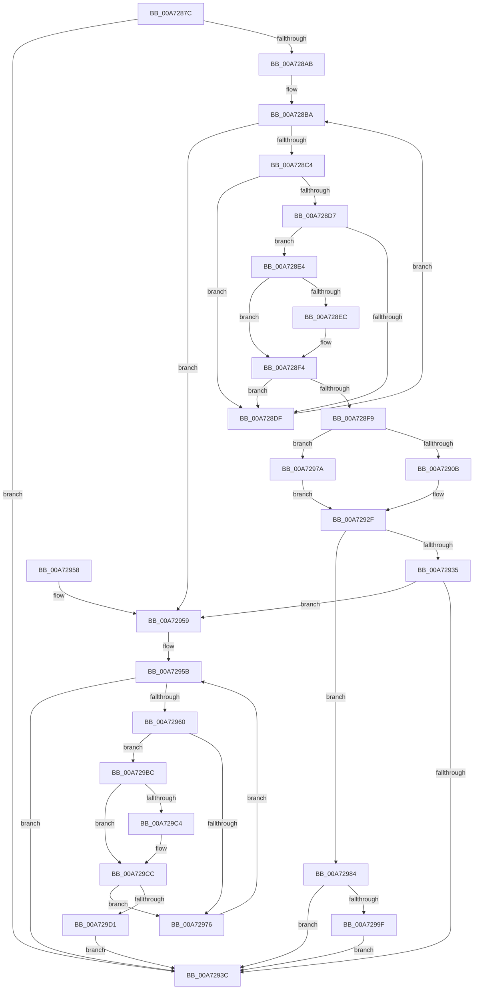

# CmSetDeviceInterfaceMappedProperty

- RVA: `0x00A7287C`–`0x00A729DB` (길이 `351` bytes)
- VA: `0x0000000140A7287C`
- 실행 섹션: `PAGE`
- PDB 이름 있음: `예`; PDB Function 태그: `아니요`
- unwind 정보 RVA: `0x000B55B8`
- 디코드: `100`개 명령, `351/351` bytes 표시
- 미해석 바이트: `0` (있으면 어셈블리에 `.byte`로 보존)

> 이 문서는 커널 이미지의 기계어와 PDB 기호를 분석해 생성했습니다. 4번과 5번은 함수 원형과 자료형을 바이너리 사용 방식에서 추정한 C 해석이며 원본 소스 복구 결과는 아닙니다.

## 1. Dependencies

- 직접 호출 지점: **3**; 고유 호출 대상: **3**
- 직접 호출자로 확인된 함수: **2**
- RIP 상대 이미지 참조: **1**

### Outgoing calls
- `0x00A7292A` → [_CmSetDeviceInterfaceMappedPropertyFromRegValue](_CmSetDeviceInterfaceMappedPropertyFromRegValue_function_00A729E4.md) (function, `0x00A729E4`)
- `0x00A7297D` → [CmDeleteDeviceInterfaceMappedPropertyFromRegValue](CmDeleteDeviceInterfaceMappedPropertyFromRegValue_function_00A72DA8.md) (function, `0x00A72DA8`)
- `0x00A729B5` → [PnpInterfaceRaisePropertyChangeEventWorker](../95/PnpInterfaceRaisePropertyChangeEventWorker_function_00951F88.md) (function, `0x00951F88`)

### Direct callers
- [CmDeleteDeviceInterfaceWorker](../82/CmDeleteDeviceInterfaceWorker_function_0082A0B8.md) at `0x0082A261`
- [_PnpDispatchDeviceInterface](../8E/_PnpDispatchDeviceInterface_function_008E0DB0.md) at `0x008E102F`

### Static image references
- `0x00A728B3` → RVA `0x00000000` (`image boundary/outside`; read)

## 2. Other-region calls and transfers

- 다른 실행 섹션으로 향하는 call: **0**
- 별도 외부 분기/꼬리 이동을 확인하지 못했습니다.

## 3. Assembly (complete function range)

```asm
00A7287C  48 89 5C 24 08                  mov qword ptr [rsp + 8], rbx
00A72881  48 89 6C 24 10                  mov qword ptr [rsp + 0x10], rbp
00A72886  48 89 74 24 18                  mov qword ptr [rsp + 0x18], rsi
00A7288B  57                              push rdi
00A7288C  41 54                           push r12
00A7288E  41 56                           push r14
00A72890  48 83 EC 60                     sub rsp, 0x60
00A72894  49 8B E8                        mov rbp, r8
00A72897  4C 8B F2                        mov r14, rdx
00A7289A  48 8B F1                        mov rsi, rcx
00A7289D  BF 16 00 00 C0                  mov edi, 0xc0000016
00A728A2  4D 85 C9                        test r9, r9
00A728A5  0F 85 91 00 00 00               jne 0x140a7293c
00A728AB  48 8B 9C 24 A0 00 00 00         mov rbx, qword ptr [rsp + 0xa0]
00A728B3  4C 8D 25 46 D7 58 FF            lea r12, [rip - 0xa728ba]
00A728BA  41 83 F9 03                     cmp r9d, 3
00A728BE  0F 83 95 00 00 00               jae 0x140a72959
00A728C4  41 8B C1                        mov eax, r9d
00A728C7  48 03 C0                        add rax, rax
00A728CA  49 8B 94 C4 E0 B1 B4 00         mov rdx, qword ptr [r12 + rax*8 + 0xb4b1e0]
00A728D2  48 85 D2                        test rdx, rdx
00A728D5  74 08                           je 0x140a728df
00A728D7  8B 42 10                        mov eax, dword ptr [rdx + 0x10]
00A728DA  39 43 10                        cmp dword ptr [rbx + 0x10], eax
00A728DD  74 05                           je 0x140a728e4
00A728DF  41 FF C1                        inc r9d
00A728E2  EB D6                           jmp 0x140a728ba
00A728E4  48 8B 0B                        mov rcx, qword ptr [rbx]
00A728E7  48 2B 0A                        sub rcx, qword ptr [rdx]
00A728EA  75 08                           jne 0x140a728f4
00A728EC  48 8B 4B 08                     mov rcx, qword ptr [rbx + 8]
00A728F0  48 2B 4A 08                     sub rcx, qword ptr [rdx + 8]
00A728F4  48 85 C9                        test rcx, rcx
00A728F7  75 E6                           jne 0x140a728df
00A728F9  8B 8C 24 A8 00 00 00            mov ecx, dword ptr [rsp + 0xa8]
00A72900  4C 8B CB                        mov r9, rbx
00A72903  49 8B D6                        mov rdx, r14
00A72906  83 F9 02                        cmp ecx, 2
00A72909  72 6F                           jb 0x140a7297a
00A7290B  8B 84 24 B8 00 00 00            mov eax, dword ptr [rsp + 0xb8]
00A72912  89 44 24 30                     mov dword ptr [rsp + 0x30], eax
00A72916  48 8B 84 24 B0 00 00 00         mov rax, qword ptr [rsp + 0xb0]
00A7291E  48 89 44 24 28                  mov qword ptr [rsp + 0x28], rax
00A72923  89 4C 24 20                     mov dword ptr [rsp + 0x20], ecx
00A72927  48 8B CE                        mov rcx, rsi
00A7292A  E8 B5 00 00 00                  call 0x140a729e4
00A7292F  8B F8                           mov edi, eax
00A72931  85 C0                           test eax, eax
00A72933  79 4F                           jns 0x140a72984
00A72935  3D 16 00 00 C0                  cmp eax, 0xc0000016
00A7293A  74 1D                           je 0x140a72959
00A7293C  4C 8D 5C 24 60                  lea r11, [rsp + 0x60]
00A72941  8B C7                           mov eax, edi
00A72943  49 8B 5B 20                     mov rbx, qword ptr [r11 + 0x20]
00A72947  49 8B 6B 28                     mov rbp, qword ptr [r11 + 0x28]
00A7294B  49 8B 73 30                     mov rsi, qword ptr [r11 + 0x30]
00A7294F  49 8B E3                        mov rsp, r11
00A72952  41 5E                           pop r14
00A72954  41 5C                           pop r12
00A72956  5F                              pop rdi
00A72957  C3                              ret
00A72958  CC                              int3
00A72959  33 D2                           xor edx, edx
00A7295B  83 FA 04                        cmp edx, 4
00A7295E  73 DC                           jae 0x140a7293c
00A72960  8B C2                           mov eax, edx
00A72962  48 03 C0                        add rax, rax
00A72965  4D 8B 84 C4 00 BA B4 00         mov r8, qword ptr [r12 + rax*8 + 0xb4ba00]
00A7296D  41 8B 40 10                     mov eax, dword ptr [r8 + 0x10]
00A72971  39 43 10                        cmp dword ptr [rbx + 0x10], eax
00A72974  74 46                           je 0x140a729bc
00A72976  FF C2                           inc edx
00A72978  EB E1                           jmp 0x140a7295b
00A7297A  48 8B CE                        mov rcx, rsi
00A7297D  E8 26 04 00 00                  call 0x140a72da8
00A72982  EB AB                           jmp 0x140a7292f
00A72984  33 C0                           xor eax, eax
00A72986  0F 57 C0                        xorps xmm0, xmm0
00A72989  48 89 44 24 50                  mov qword ptr [rsp + 0x50], rax
00A7298E  48 8B 86 F0 01 00 00            mov rax, qword ptr [rsi + 0x1f0]
00A72995  0F 11 44 24 40                  movups xmmword ptr [rsp + 0x40], xmm0
00A7299A  48 85 C0                        test rax, rax
00A7299D  74 9D                           je 0x140a7293c
00A7299F  48 89 44 24 28                  mov qword ptr [rsp + 0x28], rax
00A729A4  45 33 C9                        xor r9d, r9d
00A729A7  4C 8B C5                        mov r8, rbp
00A729AA  48 89 5C 24 20                  mov qword ptr [rsp + 0x20], rbx
00A729AF  49 8B D6                        mov rdx, r14
00A729B2  48 8B CE                        mov rcx, rsi
00A729B5  E8 CE F5 ED FF                  call 0x140951f88
00A729BA  EB 80                           jmp 0x140a7293c
00A729BC  48 8B 0B                        mov rcx, qword ptr [rbx]
00A729BF  49 2B 08                        sub rcx, qword ptr [r8]
00A729C2  75 08                           jne 0x140a729cc
00A729C4  48 8B 4B 08                     mov rcx, qword ptr [rbx + 8]
00A729C8  49 2B 48 08                     sub rcx, qword ptr [r8 + 8]
00A729CC  48 85 C9                        test rcx, rcx
00A729CF  75 A5                           jne 0x140a72976
00A729D1  BF 22 00 00 C0                  mov edi, 0xc0000022
00A729D6  E9 61 FF FF FF                  jmp 0x140a7293c
```

## 4. C-style interpretation (structured pseudocode)

```c
__int64 __fastcall CmSetDeviceInterfaceMappedProperty(__int64 a1, __int64 a2, __int64 a3, __int64 a4, __int64 a5, unsigned int a6, __int64 a7, unsigned int a8)
{
    __int64 result;
    __int64 v_rsp;
    unsigned __int64 v_stack_m10;
    unsigned __int64 v_stack_m18;
    unsigned __int64 v_stack_m20;
    unsigned __int64 v_stack_m38;
    unsigned __int64 v_stack_m40;
    unsigned int v_stack_m48;
    unsigned __int64 v_stack_m50;
    unsigned int v_stack_m58;
    unsigned __int64 v_stack_p10;
    unsigned __int64 v_stack_p18;
    unsigned __int64 v_stack_p8;

    v_stack_p8 = v_rbx;
    v_stack_p10 = v_rbp;
    v_stack_p18 = v_rsi;
    v_rsp = (v_rsp) - (96);
    if (a4 != 0) goto loc_00A7293C;
loc_00A728BA:
    if (((unsigned int)(a4)) >= 3) goto loc_00A72959;
    result = ((unsigned int)((unsigned int)(a4))) + ((unsigned int)((unsigned int)(a4)));
    if (*(unsigned __int64 *)(v_rip - 10954938 + result * 8 + 11842016) == 0) goto loc_00A728DF;
    if ((*(unsigned int *)(a5 + 16)) == ((unsigned int)((unsigned int)(*(unsigned int *)(*(unsigned __int64 *)(v_rip - 10954938 + result * 8 + 11842016) + 16))))) goto loc_00A728E4;
loc_00A728DF:
    a4 = (unsigned int)((a4) + 1);
    goto loc_00A728BA;
loc_00A728E4:
    a1 = (*(unsigned __int64 *)(a5)) - (*(unsigned __int64 *)(*(unsigned __int64 *)(v_rip - 10954938 + result * 8 + 11842016)));
    if (!(condition_is_not_equal)) {
        a1 = *(unsigned __int64 *)(a5 + 8);
        a1 = (a1) - (*(unsigned __int64 *)(*(unsigned __int64 *)(v_rip - 10954938 + result * 8 + 11842016) + 8));
    }
    if (a1 != 0) goto loc_00A728DF;
    if (((unsigned int)((unsigned int)(a6))) < 2) goto loc_00A7297A;
    v_stack_m48 = (unsigned int)((unsigned int)(a8));
    v_stack_m50 = a7;
    v_stack_m58 = (unsigned int)((unsigned int)(a6));
    result = _CmSetDeviceInterfaceMappedPropertyFromRegValue(a1, a2, a3, a5);
loc_00A7292F:
    if (!sign_flag) goto loc_00A72984;
    if (((unsigned int)(result)) == 0xC0000016ULL) goto loc_00A72959;
loc_00A7293C:
    return (unsigned int)((unsigned int)((unsigned int)((unsigned int)(result))));
loc_00A72959:
    a2 = 0;
loc_00A7295B:
    if (0 >= 4) goto loc_00A7293C;
    result = (0) + (0);
    if ((*(unsigned int *)(*(unsigned __int64 *)(v_stack_m18 + 32) + 16)) == ((unsigned int)((unsigned int)(*(unsigned int *)(*(unsigned __int64 *)(v_rip - 10954938 + result * 8 + 11844096) + 16))))) goto loc_00A729BC;
loc_00A72976:
    a2 = (unsigned int)((a2) + 1);
    goto loc_00A7295B;
loc_00A7297A:
    result = CmDeleteDeviceInterfaceMappedPropertyFromRegValue(*(unsigned __int64 *)(v_stack_m18 + 48), a2, *(unsigned __int64 *)(v_rip - 10954938 + result * 8 + 11844096), a5);
    goto loc_00A7292F;
loc_00A72984:
    result = 0;
    v_stack_m10 = 0;
    v_stack_m20 = v_xmm0;
    if (*(unsigned __int64 *)(*(unsigned __int64 *)(v_stack_m18 + 48) + 496) == 0) goto loc_00A7293C;
    v_stack_m38 = *(unsigned __int64 *)(*(unsigned __int64 *)(v_stack_m18 + 48) + 496);
    a4 = 0;
    v_stack_m40 = *(unsigned __int64 *)(v_stack_m18 + 32);
    result = PnpInterfaceRaisePropertyChangeEventWorker(*(unsigned __int64 *)(v_stack_m18 + 48), a2, *(unsigned __int64 *)(v_stack_m18 + 40), a4);
    goto loc_00A7293C;
loc_00A729BC:
    a1 = (*(unsigned __int64 *)(*(unsigned __int64 *)(v_stack_m18 + 32))) - (*(unsigned __int64 *)(*(unsigned __int64 *)(v_stack_m18 + 40)));
    if (!(condition_is_not_equal)) {
        a1 = *(unsigned __int64 *)(*(unsigned __int64 *)(v_stack_m18 + 32) + 8);
        a1 = (a1) - (*(unsigned __int64 *)(*(unsigned __int64 *)(v_stack_m18 + 40) + 8));
    }
    if (a1 != 0) goto loc_00A72976;
    goto loc_00A7293C;
}
```

## 5. (Beta) C Style

```c
int64_t CmSetDeviceInterfaceMappedProperty(void *Arg1, int64_t Arg2, int64_t Arg3, int64_t Arg4, void *Arg5, uint32_t Arg6, int64_t Arg7, uint32_t Arg8)
{
    uint8_t *arg1 = (uint8_t *)Arg1;
    uint8_t *arg5 = (uint8_t *)Arg5;

    int64_t result;
    int64_t local_rsp;
    uint64_t v_stack_m10;
    uint64_t v_stack_m18;
    uint64_t v_stack_m20;
    uint64_t v_stack_m38;
    uint64_t v_stack_m40;
    uint32_t v_stack_m48;
    uint64_t v_stack_m50;
    uint32_t v_stack_m58;
    uint64_t v_stack_p10;
    uint64_t v_stack_p18;
    uint64_t v_stack_p8;

    v_stack_p8 = local_rbx;
    v_stack_p10 = local_rbp;
    v_stack_p18 = local_rsi;
    local_rsp = (local_rsp) - (96);
    if (Arg4 != 0) goto loc_00A7293C;
loc_00A728BA:
    if (((uint32_t)(Arg4)) >= 3) goto loc_00A72959;
    result = ((uint32_t)((uint32_t)(Arg4))) + ((uint32_t)((uint32_t)(Arg4)));
    if (*(uint64_t *)(v_rip - 0xA728BA + result * 8 + 0xB4B1E0) == 0) goto loc_00A728DF;
    if ((*(uint32_t *)(arg5 + 0x10)) == ((uint32_t)((uint32_t)(*(uint32_t *)(*(uint64_t *)(v_rip - 0xA728BA + result * 8 + 0xB4B1E0) + 0x10))))) goto loc_00A728E4;
loc_00A728DF:
    Arg4 = (uint32_t)((Arg4) + 1);
    goto loc_00A728BA;
loc_00A728E4:
    Arg1 = (*(uint64_t *)(arg5)) - (*(uint64_t *)(*(uint64_t *)(v_rip - 0xA728BA + result * 8 + 0xB4B1E0)));
    if (!(condition_is_not_equal)) {
        Arg1 = *(uint64_t *)(arg5 + 0x8);
        Arg1 = (Arg1) - (*(uint64_t *)(*(uint64_t *)(v_rip - 0xA728BA + result * 8 + 0xB4B1E0) + 0x8));
    }
    if (Arg1 != NULL) goto loc_00A728DF;
    if (((uint32_t)((uint32_t)(Arg6))) < 2) goto loc_00A7297A;
    v_stack_m48 = (uint32_t)((uint32_t)(Arg8));
    v_stack_m50 = Arg7;
    v_stack_m58 = (uint32_t)((uint32_t)(Arg6));
    result = _CmSetDeviceInterfaceMappedPropertyFromRegValue(Arg1, Arg2, Arg3, Arg5);
loc_00A7292F:
    if (!sign_flag) goto loc_00A72984;
    if (((uint32_t)(result)) == 0xC0000016ULL) goto loc_00A72959;
loc_00A7293C:
    return (uint32_t)((uint32_t)((uint32_t)((uint32_t)(result))));
loc_00A72959:
    Arg2 = 0;
loc_00A7295B:
    if (0 >= 4) goto loc_00A7293C;
    result = (0) + (0);
    if ((*(uint32_t *)(*(uint64_t *)(v_stack_m18 + 0x20) + 0x10)) == ((uint32_t)((uint32_t)(*(uint32_t *)(*(uint64_t *)(v_rip - 0xA728BA + result * 8 + 0xB4BA00) + 0x10))))) goto loc_00A729BC;
loc_00A72976:
    Arg2 = (uint32_t)((Arg2) + 1);
    goto loc_00A7295B;
loc_00A7297A:
    result = CmDeleteDeviceInterfaceMappedPropertyFromRegValue(*(uint64_t *)(v_stack_m18 + 0x30), Arg2, *(uint64_t *)(v_rip - 0xA728BA + result * 8 + 0xB4BA00), Arg5);
    goto loc_00A7292F;
loc_00A72984:
    result = 0;
    v_stack_m10 = 0;
    v_stack_m20 = v_xmm0;
    if (*(uint64_t *)(*(uint64_t *)(v_stack_m18 + 0x30) + 0x1F0) == 0) goto loc_00A7293C;
    v_stack_m38 = *(uint64_t *)(*(uint64_t *)(v_stack_m18 + 0x30) + 0x1F0);
    Arg4 = 0;
    v_stack_m40 = *(uint64_t *)(v_stack_m18 + 0x20);
    result = PnpInterfaceRaisePropertyChangeEventWorker(*(uint64_t *)(v_stack_m18 + 0x30), Arg2, *(uint64_t *)(v_stack_m18 + 0x28), Arg4);
    goto loc_00A7293C;
loc_00A729BC:
    Arg1 = (*(uint64_t *)(*(uint64_t *)(v_stack_m18 + 0x20))) - (*(uint64_t *)(*(uint64_t *)(v_stack_m18 + 0x28)));
    if (!(condition_is_not_equal)) {
        Arg1 = *(uint64_t *)(*(uint64_t *)(v_stack_m18 + 0x20) + 0x8);
        Arg1 = (Arg1) - (*(uint64_t *)(*(uint64_t *)(v_stack_m18 + 0x28) + 0x8));
    }
    if (Arg1 != NULL) goto loc_00A72976;
    goto loc_00A7293C;
}
```

### 관측된 메모리 오프셋

구조체 형식이 확인되지 않은 접근은 인자 기준의 오프셋으로만 기록했습니다.

| 기준 인자 | 오프셋 표현 | 폭 (bit) | 접근 |
|---|---:|---:|---|
| `Arg1` | `+ 0x1F0` | `64` | `R` |
| `Arg5` | `+ 0x0` | `64` | `R` |
| `Arg5` | `+ 0x8` | `64` | `R` |
| `Arg5` | `+ 0x10` | `32` | `R` |

## 6. Execution-region graph

[열기: 2D/3D 그래프와 함수 탐색 컨트롤 패널](../../../control-panel.html?section=page&rva=0x00A7287C&view=graph)

- 2D 그래프는 위에서 아래로 흐르고, 3D 그래프는 빈 공간을 드래그해 회전합니다. Shift+드래그는 이동, 휠은 확대·축소, 함수 노드 선택은 대상 보고서 이동입니다.

### Static fallback


