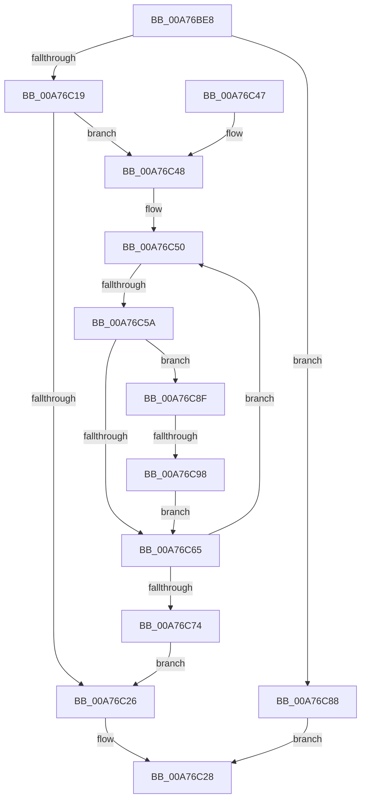

# CmVirtualKCBToRealPath

- RVA: `0x00A76BE8`–`0x00A76C9A` (길이 `178` bytes)
- VA: `0x0000000140A76BE8`
- 실행 섹션: `PAGE`
- PDB 이름 있음: `예`; PDB Function 태그: `예`
- unwind 정보 RVA: `0x000B5D1C`
- 디코드: `53`개 명령, `178/178` bytes 표시
- 미해석 바이트: `0` (있으면 어셈블리에 `.byte`로 보존)

> 이 문서는 커널 이미지의 기계어와 PDB 기호를 분석해 생성했습니다. 4번과 5번은 함수 원형과 자료형을 바이너리 사용 방식에서 추정한 C 해석이며 원본 소스 복구 결과는 아닙니다.

## 1. Dependencies

- 직접 호출 지점: **2**; 고유 호출 대상: **2**
- 직접 호출자로 확인된 함수: **6**
- RIP 상대 이미지 참조: **1**

### Outgoing calls
- `0x00A76C19` → [CmpConstructName](../85/CmpConstructName_function_00856BE0.md) (function, `0x00856BE0`)
- `0x00A76C81` → [CmpFreePoolWithTag](../../text/44/CmpFreePoolWithTag_function_004489E0.md) (function, `0x004489E0`)

### Direct callers
- [CmpDoQueryKeyName](../../text/45/CmpDoQueryKeyName_function_00456664.md) at `0x00456A5F`
- [CmpReportAuditVirtualizationEvent](../7E/CmpReportAuditVirtualizationEvent_function_007ED758.md) at `0x007ED869`
- [CmQueryKey](../85/CmQueryKey_function_00858240.md) at `0x00858B6B`
- [sub_008B4B26](../8B/Unknown_function_008B4B26.md) at `0x008B4B74`
- [CmpVEExecuteVirtualStoreParseLogic](CmpVEExecuteVirtualStoreParseLogic_function_00A76A20.md) at `0x00A76A9F`
- [sub_00B169F2](../B1/Unknown_function_00B169F2.md) at `0x00B16A5D`

### Static image references
- `0x00A76C0B` → RVA `0x00E0ECA0` (`.data`; read)

## 2. Other-region calls and transfers

- 다른 실행 섹션으로 향하는 call: **1**
  - `0x00A76C81` → [CmpFreePoolWithTag](../../text/44/CmpFreePoolWithTag_function_004489E0.md) (`PAGE` → `.text`)
- call이 아닌 외부 분기/꼬리 이동: **2**
  - `0x00A76C54` → [sub_00B4169E](../B4/Unknown_function_00B4169E.md) (`tail-transfer`)
  - `0x00A76C92` → [sub_00B4169E](../B4/Unknown_function_00B4169E.md) (`tail-transfer`)

## 3. Assembly (complete function range)

```asm
00A76BE8  48 8B C4                        mov rax, rsp
00A76BEB  48 89 58 08                     mov qword ptr [rax + 8], rbx
00A76BEF  48 89 68 10                     mov qword ptr [rax + 0x10], rbp
00A76BF3  48 89 70 18                     mov qword ptr [rax + 0x18], rsi
00A76BF7  48 89 78 20                     mov qword ptr [rax + 0x20], rdi
00A76BFB  41 54                           push r12
00A76BFD  41 56                           push r14
00A76BFF  41 57                           push r15
00A76C01  48 83 EC 30                     sub rsp, 0x30
00A76C05  45 33 E4                        xor r12d, r12d
00A76C08  4C 8B F2                        mov r14, rdx
00A76C0B  44 38 25 8E 80 39 00            cmp byte ptr [rip + 0x39808e], r12b
00A76C12  BB 9A 00 00 C0                  mov ebx, 0xc000009a
00A76C17  74 6F                           je 0x140a76c88
00A76C19  E8 C2 FF DD FF                  call 0x140856be0
00A76C1E  48 8B F0                        mov rsi, rax
00A76C21  48 85 C0                        test rax, rax
00A76C24  75 22                           jne 0x140a76c48
00A76C26  8B C3                           mov eax, ebx
00A76C28  48 8B 5C 24 50                  mov rbx, qword ptr [rsp + 0x50]
00A76C2D  48 8B 6C 24 58                  mov rbp, qword ptr [rsp + 0x58]
00A76C32  48 8B 74 24 60                  mov rsi, qword ptr [rsp + 0x60]
00A76C37  48 8B 7C 24 68                  mov rdi, qword ptr [rsp + 0x68]
00A76C3C  48 83 C4 30                     add rsp, 0x30
00A76C40  41 5F                           pop r15
00A76C42  41 5E                           pop r14
00A76C44  41 5C                           pop r12
00A76C46  C3                              ret
00A76C47  CC                              int3
00A76C48  41 8B FC                        mov edi, r12d
00A76C4B  BA 05 00 00 00                  mov edx, 5
00A76C50  8B EF                           mov ebp, edi
00A76C52  85 D2                           test edx, edx
00A76C54  0F 84 44 AA 0C 00               je 0x140b4169e
00A76C5A  48 8B 46 08                     mov rax, qword ptr [rsi + 8]
00A76C5E  66 83 3C 68 5C                  cmp word ptr [rax + rbp*2], 0x5c
00A76C63  74 2A                           je 0x140a76c8f
00A76C65  0F B7 06                        movzx eax, word ptr [rsi]
00A76C68  FF C7                           inc edi
00A76C6A  8B CF                           mov ecx, edi
00A76C6C  48 03 C9                        add rcx, rcx
00A76C6F  48 3B C8                        cmp rcx, rax
00A76C72  72 DC                           jb 0x140a76c50
00A76C74  BB 0D 00 00 C0                  mov ebx, 0xc000000d
00A76C79  BA 43 4D 4E 62                  mov edx, 0x624e4d43
00A76C7E  48 8B CE                        mov rcx, rsi
00A76C81  E8 5A 1D 9D FF                  call 0x1404489e0
00A76C86  EB 9E                           jmp 0x140a76c26
00A76C88  B8 0D 00 00 C0                  mov eax, 0xc000000d
00A76C8D  EB 99                           jmp 0x140a76c28
00A76C8F  83 C2 FF                        add edx, -1
00A76C92  0F 84 06 AA 0C 00               je 0x140b4169e
00A76C98  EB CB                           jmp 0x140a76c65
```

## 4. C-style interpretation (structured pseudocode)

```c
__int64 __fastcall CmVirtualKCBToRealPath(__int64 a1, __int64 a2)
{
    __int64 result;
    __int64 v_r12;
    __int64 v_rdi;
    __int64 v_rsp;
    unsigned __int64 v_stack_p10;
    unsigned __int64 v_stack_p18;
    unsigned __int64 v_stack_p20;
    unsigned __int64 v_stack_p8;

    *(unsigned __int64 *)(v_rsp + 8) = v_rbx;
    *(unsigned __int64 *)(v_rsp + 16) = v_rbp;
    *(unsigned __int64 *)(v_rsp + 24) = v_rsi;
    *(unsigned __int64 *)(v_rsp + 32) = v_rdi;
    v_rsp = (v_rsp) - (48);
    v_r12 = 0;
    if ((*(unsigned __int8 *)(v_rip + 3768462)) == 0) goto loc_00A76C88;
    result = CmpConstructName(a1, a2, a3, a4);
    if (result != 0) goto loc_00A76C48;
loc_00A76C26:
loc_00A76C28:
    v_rsp = (v_rsp) + (48);
    return (unsigned int)((unsigned int)((unsigned int)(0xC000009AULL)));
loc_00A76C48:
loc_00A76C50:
    if ((*(unsigned __int16 *)(*(unsigned __int64 *)(v_stack_p18 + 8) + 0 * 2)) == 92) goto loc_00A76C8F;
loc_00A76C65:
    v_rdi = (unsigned int)((0) + 1);
    a1 = ((unsigned int)((unsigned int)(v_rdi))) + ((unsigned int)((unsigned int)(v_rdi)));
    if (a1 < (*(unsigned __int16 *)(v_stack_p18))) goto loc_00A76C50;
    result = CmpFreePoolWithTag(v_stack_p18, (unsigned int)(0x624E4D43ULL), a3, a4);
    goto loc_00A76C26;
loc_00A76C88:
    goto loc_00A76C28;
loc_00A76C8F:
    a2 = (unsigned int)(((unsigned int)(0x624E4D43ULL)) + (-1));
    goto loc_00A76C65;
}
```

## 5. (Beta) C Style

```c
int64_t CmVirtualKCBToRealPath(int64_t Arg1, int64_t Arg2)
{
    int64_t result;
    int64_t local_r12;
    int64_t local_rdi;
    int64_t local_rsp;
    uint64_t v_stack_p10;
    uint64_t v_stack_p18;
    uint64_t v_stack_p20;
    uint64_t v_stack_p8;

    *(uint64_t *)(local_rsp + 0x8) = local_rbx;
    *(uint64_t *)(local_rsp + 0x10) = local_rbp;
    *(uint64_t *)(local_rsp + 0x18) = local_rsi;
    *(uint64_t *)(local_rsp + 0x20) = local_rdi;
    local_rsp = (local_rsp) - (48);
    local_r12 = 0;
    if ((*(uint8_t *)(v_rip + 0x39808E)) == 0) goto loc_00A76C88;
    result = CmpConstructName(Arg1, Arg2, a3, a4);
    if (result != 0) goto loc_00A76C48;
loc_00A76C26:
loc_00A76C28:
    local_rsp = (local_rsp) + (48);
    return (uint32_t)((uint32_t)((uint32_t)(0xC000009AULL)));
loc_00A76C48:
loc_00A76C50:
    if ((*(uint16_t *)(*(uint64_t *)(v_stack_p18 + 0x8) + 0x0 * 2)) == 92) goto loc_00A76C8F;
loc_00A76C65:
    local_rdi = (uint32_t)((0) + 1);
    Arg1 = ((uint32_t)((uint32_t)(local_rdi))) + ((uint32_t)((uint32_t)(local_rdi)));
    if (Arg1 < (*(uint16_t *)(v_stack_p18))) goto loc_00A76C50;
    result = CmpFreePoolWithTag(v_stack_p18, (uint32_t)(0x624E4D43ULL), a3, a4);
    goto loc_00A76C26;
loc_00A76C88:
    goto loc_00A76C28;
loc_00A76C8F:
    Arg2 = (uint32_t)(((uint32_t)(0x624E4D43ULL)) + (-1));
    goto loc_00A76C65;
}
```

## 6. Execution-region graph

[열기: 2D/3D 그래프와 함수 탐색 컨트롤 패널](../../../control-panel.html?section=page&rva=0x00A76BE8&view=graph)

- 2D 그래프는 위에서 아래로 흐르고, 3D 그래프는 빈 공간을 드래그해 회전합니다. Shift+드래그는 이동, 휠은 확대·축소, 함수 노드 선택은 대상 보고서 이동입니다.

### Static fallback


