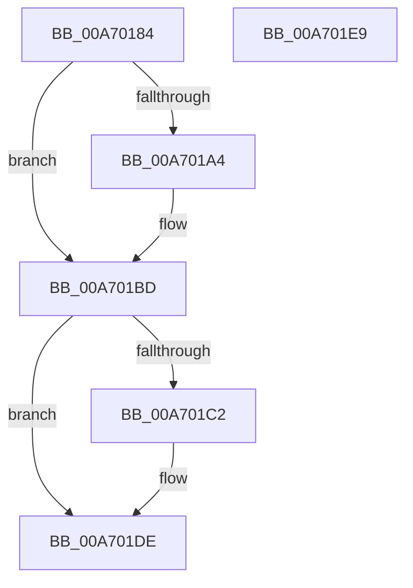

# CmpDeleteKcbCache

- RVA: `0x00A70184`–`0x00A701EA` (길이 `102` bytes)
- VA: `0x0000000140A70184`
- 실행 섹션: `PAGE`
- PDB 이름 있음: `예`; PDB Function 태그: `아니요`
- unwind 정보 RVA: `0x0005CAAC`
- 디코드: `24`개 명령, `102/102` bytes 표시
- 미해석 바이트: `0` (있으면 어셈블리에 `.byte`로 보존)

> 이 문서는 커널 이미지의 기계어와 PDB 기호를 분석해 생성했습니다. 4번과 5번은 함수 원형과 자료형을 바이너리 사용 방식에서 추정한 C 해석이며 원본 소스 복구 결과는 아닙니다.

## 1. Dependencies

- 직접 호출 지점: **2**; 고유 호출 대상: **1**
- 직접 호출자로 확인된 함수: **2**
- RIP 상대 이미지 참조: **0**

### Outgoing calls
- `0x00A701B8` → [ExFreePoolWithTag](../../poolcode/B8/ExFreePoolWithTag_function_00B82870.md) (function, `0x00B82870`)
- `0x00A701D9` → [ExFreePoolWithTag](../../poolcode/B8/ExFreePoolWithTag_function_00B82870.md) (function, `0x00B82870`)

### Direct callers
- [CmpDeleteHive](../86/CmpDeleteHive_function_0086450C.md) at `0x00864560`
- [CmpInitializeKcbCache](../87/CmpInitializeKcbCache_function_00878208.md) at `0x00878307`

### Static image references
- 디코드된 RIP-relative 메모리 참조가 없습니다.

## 2. Other-region calls and transfers

- 다른 실행 섹션으로 향하는 call: **2**
  - `0x00A701B8` → [ExFreePoolWithTag](../../poolcode/B8/ExFreePoolWithTag_function_00B82870.md) (`PAGE` → `POOLCODE`)
  - `0x00A701D9` → [ExFreePoolWithTag](../../poolcode/B8/ExFreePoolWithTag_function_00B82870.md) (`PAGE` → `POOLCODE`)
- 별도 외부 분기/꼬리 이동을 확인하지 못했습니다.

## 3. Assembly (complete function range)

```asm
00A70184  48 89 5C 24 08                  mov qword ptr [rsp + 8], rbx
00A70189  57                              push rdi
00A7018A  48 83 EC 20                     sub rsp, 0x20
00A7018E  48 8B D9                        mov rbx, rcx
00A70191  48 8B 89 70 06 00 00            mov rcx, qword ptr [rcx + 0x670]
00A70198  48 8B BB 80 06 00 00            mov rdi, qword ptr [rbx + 0x680]
00A7019F  48 85 C9                        test rcx, rcx
00A701A2  74 19                           je 0x140a701bd
00A701A4  48 83 A3 70 06 00 00 00         and qword ptr [rbx + 0x670], 0
00A701AC  BA 43 4D 43 61                  mov edx, 0x61434d43
00A701B1  83 A3 78 06 00 00 00            and dword ptr [rbx + 0x678], 0
00A701B8  E8 B3 26 11 00                  call 0x140b82870
00A701BD  48 85 FF                        test rdi, rdi
00A701C0  74 1C                           je 0x140a701de
00A701C2  48 83 A3 80 06 00 00 00         and qword ptr [rbx + 0x680], 0
00A701CA  BA 43 4D 43 61                  mov edx, 0x61434d43
00A701CF  83 A3 88 06 00 00 00            and dword ptr [rbx + 0x688], 0
00A701D6  48 8B CF                        mov rcx, rdi
00A701D9  E8 92 26 11 00                  call 0x140b82870
00A701DE  48 8B 5C 24 30                  mov rbx, qword ptr [rsp + 0x30]
00A701E3  48 83 C4 20                     add rsp, 0x20
00A701E7  5F                              pop rdi
00A701E8  C3                              ret
00A701E9  CC                              int3
```

## 4. C-style interpretation (structured pseudocode)

```c
__int64 __fastcall CmpDeleteKcbCache(__int64 a1)
{
    __int64 result;
    __int64 v_rsp;
    unsigned __int64 v_stack_p8;

    v_stack_p8 = v_rbx;
    v_rsp = (v_rsp) - (32);
    if (*(unsigned __int64 *)(a1 + 1648) != 0) {
        a2 = 0x61434D43ULL;
        result = ExFreePoolWithTag(*(unsigned __int64 *)(a1 + 1648), a2, a3, a4);
    }
    if (*(unsigned __int64 *)(a1 + 1664) != 0) {
        a2 = 0x61434D43ULL;
        a1 = *(unsigned __int64 *)(a1 + 1664);
        result = ExFreePoolWithTag(a1, a2, a3, a4);
    }
    v_rsp = (v_rsp) + (32);
    return result;
}
```

## 5. (Beta) C Style

```c
int64_t CmpDeleteKcbCache(void *Arg1)
{
    uint8_t *arg1 = (uint8_t *)Arg1;

    int64_t result;
    int64_t local_rsp;
    uint64_t v_stack_p8;

    v_stack_p8 = local_rbx;
    local_rsp = (local_rsp) - (32);
    if (*(uint64_t *)(arg1 + 0x670) != 0) {
        a2 = 0x61434D43ULL;
        result = ExFreePoolWithTag(*(uint64_t *)(arg1 + 0x670), a2, a3, a4);
    }
    if (*(uint64_t *)(arg1 + 0x680) != 0) {
        a2 = 0x61434D43ULL;
        Arg1 = *(uint64_t *)(arg1 + 0x680);
        result = ExFreePoolWithTag(Arg1, a2, a3, a4);
    }
    local_rsp = (local_rsp) + (32);
    return result;
}
```

### 관측된 메모리 오프셋

구조체 형식이 확인되지 않은 접근은 인자 기준의 오프셋으로만 기록했습니다.

| 기준 인자 | 오프셋 표현 | 폭 (bit) | 접근 |
|---|---:|---:|---|
| `Arg1` | `+ 0x670` | `64` | `R` |
| `Arg1` | `+ 0x670` | `64` | `R/W` |
| `Arg1` | `+ 0x678` | `32` | `R/W` |
| `Arg1` | `+ 0x680` | `64` | `R` |
| `Arg1` | `+ 0x680` | `64` | `R/W` |
| `Arg1` | `+ 0x688` | `32` | `R/W` |

## 6. Execution-region graph

[열기: 2D/3D 그래프와 함수 탐색 컨트롤 패널](../../../control-panel.html?section=page&rva=0x00A70184&view=graph)

- 2D 그래프는 위에서 아래로 흐르고, 3D 그래프는 빈 공간을 드래그해 회전합니다. Shift+드래그는 이동, 휠은 확대·축소, 함수 노드 선택은 대상 보고서 이동입니다.

### Static fallback


