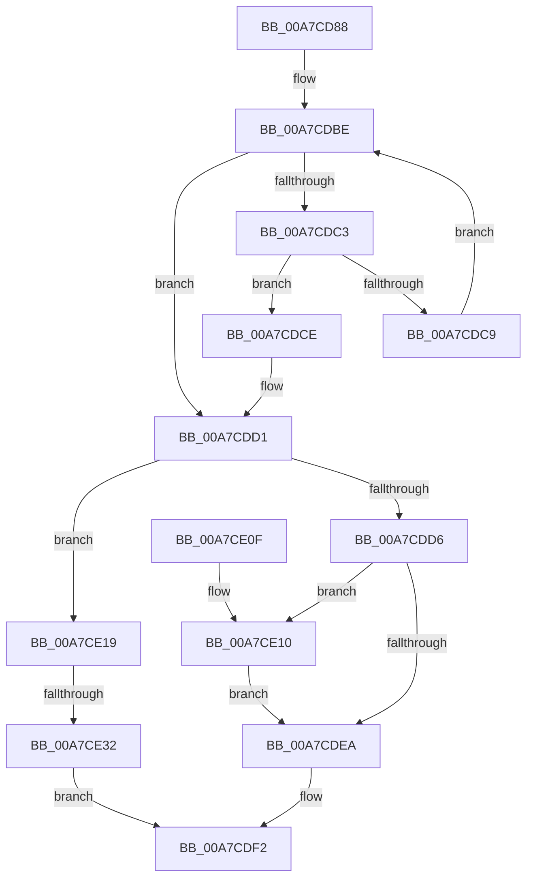

# CmpGlobalLockKeyForWrite

- RVA: `0x00A7CD88`–`0x00A7CE39` (길이 `177` bytes)
- VA: `0x0000000140A7CD88`
- 실행 섹션: `PAGE`
- PDB 이름 있음: `예`; PDB Function 태그: `예`
- unwind 정보 RVA: `0x00089928`
- 디코드: `50`개 명령, `177/177` bytes 표시
- 미해석 바이트: `0` (있으면 어셈블리에 `.byte`로 보존)

> 이 문서는 커널 이미지의 기계어와 PDB 기호를 분석해 생성했습니다. 4번과 5번은 함수 원형과 자료형을 바이너리 사용 방식에서 추정한 C 해석이며 원본 소스 복구 결과는 아닙니다.

## 1. Dependencies

- 직접 호출 지점: **4**; 고유 호출 대상: **3**
- 직접 호출자로 확인된 함수: **1**
- RIP 상대 이미지 참조: **1**

### Outgoing calls
- `0x00A7CDA7` → [CmpLockGlobalKeyLockTrackerShared](../6F/CmpLockGlobalKeyLockTrackerShared_function_006FE23C.md) (function, `0x006FE23C`)
- `0x00A7CDED` → [CmpUnlockGlobalKeyLockTracker](../7E/CmpUnlockGlobalKeyLockTracker_function_007EDEDC.md) (function, `0x007EDEDC`)
- `0x00A7CE19` → [CmpUnlockGlobalKeyLockTracker](../7E/CmpUnlockGlobalKeyLockTracker_function_007EDEDC.md) (function, `0x007EDEDC`)
- `0x00A7CE21` → [CmpCreateGlobalKeyLockEntry](../7E/CmpCreateGlobalKeyLockEntry_function_007EDC88.md) (function, `0x007EDC88`)

### Direct callers
- [sub_00B3073E](../B3/Unknown_function_00B3073E.md) at `0x00B30746`

### Static image references
- `0x00A7CDAC` → RVA `0x00EF5868` (`.data`; read)

## 2. Other-region calls and transfers

- 다른 실행 섹션으로 향하는 call: **0**
- call이 아닌 외부 분기/꼬리 이동: **1**
  - `0x00A7CE2C` → [sub_00B42872](../B4/Unknown_function_00B42872.md) (`tail-transfer`)

## 3. Assembly (complete function range)

```asm
00A7CD88  48 8B C4                        mov rax, rsp
00A7CD8B  48 89 58 08                     mov qword ptr [rax + 8], rbx
00A7CD8F  48 89 68 10                     mov qword ptr [rax + 0x10], rbp
00A7CD93  48 89 70 18                     mov qword ptr [rax + 0x18], rsi
00A7CD97  48 89 78 20                     mov qword ptr [rax + 0x20], rdi
00A7CD9B  41 56                           push r14
00A7CD9D  48 83 EC 20                     sub rsp, 0x20
00A7CDA1  4C 8B F2                        mov r14, rdx
00A7CDA4  48 8B F1                        mov rsi, rcx
00A7CDA7  E8 90 14 C8 FF                  call 0x1406fe23c
00A7CDAC  48 8B 05 B5 8A 47 00            mov rax, qword ptr [rip + 0x478ab5]
00A7CDB3  48 8D 2D AE 8A 47 00            lea rbp, [rip + 0x478aae]
00A7CDBA  33 FF                           xor edi, edi
00A7CDBC  8B DF                           mov ebx, edi
00A7CDBE  48 3B C5                        cmp rax, rbp
00A7CDC1  74 0E                           je 0x140a7cdd1
00A7CDC3  48 39 70 18                     cmp qword ptr [rax + 0x18], rsi
00A7CDC7  74 05                           je 0x140a7cdce
00A7CDC9  48 8B 00                        mov rax, qword ptr [rax]
00A7CDCC  EB F0                           jmp 0x140a7cdbe
00A7CDCE  48 8B D8                        mov rbx, rax
00A7CDD1  48 85 DB                        test rbx, rbx
00A7CDD4  74 43                           je 0x140a7ce19
00A7CDD6  B8 01 00 00 00                  mov eax, 1
00A7CDDB  F0 48 0F C1 43 10               lock xadd qword ptr [rbx + 0x10], rax
00A7CDE1  48 FF C0                        inc rax
00A7CDE4  48 83 F8 01                     cmp rax, 1
00A7CDE8  7E 26                           jle 0x140a7ce10
00A7CDEA  49 89 1E                        mov qword ptr [r14], rbx
00A7CDED  E8 EA 10 D7 FF                  call 0x1407ededc
00A7CDF2  48 8B 5C 24 30                  mov rbx, qword ptr [rsp + 0x30]
00A7CDF7  8B C7                           mov eax, edi
00A7CDF9  48 8B 7C 24 48                  mov rdi, qword ptr [rsp + 0x48]
00A7CDFE  48 8B 6C 24 38                  mov rbp, qword ptr [rsp + 0x38]
00A7CE03  48 8B 74 24 40                  mov rsi, qword ptr [rsp + 0x40]
00A7CE08  48 83 C4 20                     add rsp, 0x20
00A7CE0C  41 5E                           pop r14
00A7CE0E  C3                              ret
00A7CE0F  CC                              int3
00A7CE10  B9 0E 00 00 00                  mov ecx, 0xe
00A7CE15  CD 29                           int 0x29
00A7CE17  EB D1                           jmp 0x140a7cdea
00A7CE19  E8 BE 10 D7 FF                  call 0x1407ededc
00A7CE1E  48 8B CE                        mov rcx, rsi
00A7CE21  E8 62 0E D7 FF                  call 0x1407edc88
00A7CE26  48 8B D8                        mov rbx, rax
00A7CE29  48 85 C0                        test rax, rax
00A7CE2C  0F 85 40 5A 0C 00               jne 0x140b42872
00A7CE32  BF 9A 00 00 C0                  mov edi, 0xc000009a
00A7CE37  EB B9                           jmp 0x140a7cdf2
```

## 4. C-style interpretation (structured pseudocode)

```c
__int64 __fastcall CmpGlobalLockKeyForWrite(__int64 a1, __int64 a2)
{
    __int64 result;
    __int64 v_rdi;
    __int64 v_rsp;
    unsigned __int64 v_stack_p10;
    unsigned __int64 v_stack_p18;
    unsigned __int64 v_stack_p20;
    unsigned __int64 v_stack_p8;

    *(unsigned __int64 *)(v_rsp + 8) = v_rbx;
    *(unsigned __int64 *)(v_rsp + 16) = v_rbp;
    *(unsigned __int64 *)(v_rsp + 24) = v_rsi;
    *(unsigned __int64 *)(v_rsp + 32) = v_rdi;
    v_rsp = (v_rsp) - (32);
    result = CmpLockGlobalKeyLockTrackerShared(a1, a2, a3, a4);
    v_rdi = 0;
loc_00A7CDBE:
    if ((*(unsigned __int64 *)(v_rip + 4688565)) == (v_rip + 4688558)) goto loc_00A7CDD1;
    if ((*(unsigned __int64 *)(*(unsigned __int64 *)(v_rip + 4688565) + 24)) == a1) goto loc_00A7CDCE;
    goto loc_00A7CDBE;
loc_00A7CDCE:
loc_00A7CDD1:
    if (*(unsigned __int64 *)(*(unsigned __int64 *)(v_rip + 4688565)) == 0) goto loc_00A7CE19;
    result = (1) + 1;
    if (result <= 1) goto loc_00A7CE10;
loc_00A7CDEA:
    *(unsigned __int64 *)(a2) = *(unsigned __int64 *)(*(unsigned __int64 *)(v_rip + 4688565));
    result = CmpUnlockGlobalKeyLockTracker(a1, a2, a3, a4);
loc_00A7CDF2:
    v_rsp = (v_rsp) + (32);
    return 0;
loc_00A7CE10:
    goto loc_00A7CDEA;
loc_00A7CE19:
    result = CmpUnlockGlobalKeyLockTracker(14, a2, a3, a4);
    result = CmpCreateGlobalKeyLockEntry(v_stack_p18, a2, a3, a4);
    goto loc_00A7CDF2;
}
```

## 5. (Beta) C Style

```c
int64_t CmpGlobalLockKeyForWrite(int64_t Arg1, void *Arg2)
{
    uint8_t *arg2 = (uint8_t *)Arg2;

    int64_t result;
    int64_t local_rdi;
    int64_t local_rsp;
    uint64_t v_stack_p10;
    uint64_t v_stack_p18;
    uint64_t v_stack_p20;
    uint64_t v_stack_p8;

    *(uint64_t *)(local_rsp + 0x8) = local_rbx;
    *(uint64_t *)(local_rsp + 0x10) = local_rbp;
    *(uint64_t *)(local_rsp + 0x18) = local_rsi;
    *(uint64_t *)(local_rsp + 0x20) = local_rdi;
    local_rsp = (local_rsp) - (32);
    result = CmpLockGlobalKeyLockTrackerShared(Arg1, Arg2, a3, a4);
    local_rdi = 0;
loc_00A7CDBE:
    if ((*(uint64_t *)(v_rip + 0x478AB5)) == (v_rip + 4688558)) goto loc_00A7CDD1;
    if ((*(uint64_t *)(*(uint64_t *)(v_rip + 0x478AB5) + 0x18)) == Arg1) goto loc_00A7CDCE;
    goto loc_00A7CDBE;
loc_00A7CDCE:
loc_00A7CDD1:
    if (*(uint64_t *)(*(uint64_t *)(v_rip + 0x478AB5)) == 0) goto loc_00A7CE19;
    result = (1) + 1;
    if (result <= 1) goto loc_00A7CE10;
loc_00A7CDEA:
    *(uint64_t *)(arg2) = *(uint64_t *)(*(uint64_t *)(v_rip + 0x478AB5));
    result = CmpUnlockGlobalKeyLockTracker(Arg1, Arg2, a3, a4);
loc_00A7CDF2:
    local_rsp = (local_rsp) + (32);
    return 0;
loc_00A7CE10:
    goto loc_00A7CDEA;
loc_00A7CE19:
    result = CmpUnlockGlobalKeyLockTracker(14, Arg2, a3, a4);
    result = CmpCreateGlobalKeyLockEntry(v_stack_p18, Arg2, a3, a4);
    goto loc_00A7CDF2;
}
```

### 관측된 메모리 오프셋

구조체 형식이 확인되지 않은 접근은 인자 기준의 오프셋으로만 기록했습니다.

| 기준 인자 | 오프셋 표현 | 폭 (bit) | 접근 |
|---|---:|---:|---|
| `Arg2` | `+ 0x0` | `64` | `W` |

## 6. Execution-region graph

[열기: 2D/3D 그래프와 함수 탐색 컨트롤 패널](../../../control-panel.html?section=page&rva=0x00A7CD88&view=graph)

- 2D 그래프는 위에서 아래로 흐르고, 3D 그래프는 빈 공간을 드래그해 회전합니다. Shift+드래그는 이동, 휠은 확대·축소, 함수 노드 선택은 대상 보고서 이동입니다.

### Static fallback


