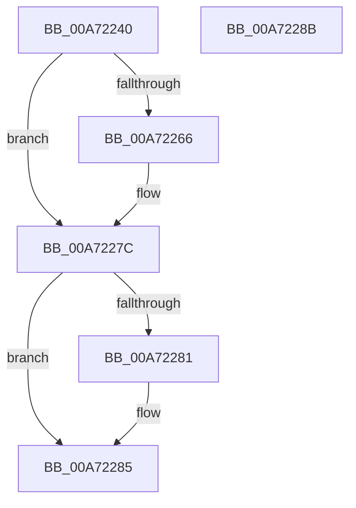

# CmpLockHiveListExclusive

- RVA: `0x00A72240`–`0x00A7228C` (길이 `76` bytes)
- VA: `0x0000000140A72240`
- 실행 섹션: `PAGE`
- PDB 이름 있음: `예`; PDB Function 태그: `아니요`
- unwind 정보 RVA: `0x0005CF00`
- 디코드: `20`개 명령, `76/76` bytes 표시
- 미해석 바이트: `0` (있으면 어셈블리에 `.byte`로 보존)

> 이 문서는 커널 이미지의 기계어와 PDB 기호를 분석해 생성했습니다. 4번과 5번은 함수 원형과 자료형을 바이너리 사용 방식에서 추정한 C 해석이며 원본 소스 복구 결과는 아닙니다.

## 1. Dependencies

- 직접 호출 지점: **2**; 고유 호출 대상: **2**
- 직접 호출자로 확인된 함수: **7**
- RIP 상대 이미지 참조: **2**

### Outgoing calls
- `0x00A72252` → [KeAbPreAcquire](../../text/21/KeAbPreAcquire_function_00210230.md) (function, `0x00210230`)
- `0x00A72277` → [ExfAcquirePushLockExclusiveEx](../../text/20/ExfAcquirePushLockExclusiveEx_function_0020FC90.md) (function, `0x0020FC90`)

### Direct callers
- [CmpLoadKeyCommon](../../text/46/CmpLoadKeyCommon_function_0046E9F8.md) at `0x0046EB4A`
- [CmpJoinClassOfTrust](../../text/46/CmpJoinClassOfTrust_function_0046EEB4.md) at `0x0046EEDD`
- [CmpUnJoinClassOfTrust](../../text/4A/CmpUnJoinClassOfTrust_function_004A27C0.md) at `0x004A27D2`
- [CmpFinishSystemHivesLoad](../7D/CmpFinishSystemHivesLoad_function_007DA210.md) at `0x007DA523`
- [CmpLoadHiveVolatile](../7D/CmpLoadHiveVolatile_function_007DE5F0.md) at `0x007DE9E2`
- [CmpDeleteHive](../86/CmpDeleteHive_function_0086450C.md) at `0x00864525`
- [CmpCreateHive](../87/CmpCreateHive_function_00879DF0.md) at `0x0087A624`

### Static image references
- `0x00A72249` → RVA `0x00EF7C70` (`.data`; read)
- `0x00A72257` → RVA `0x00EF7C70` (`.data`; read/write)

## 2. Other-region calls and transfers

- 다른 실행 섹션으로 향하는 call: **2**
  - `0x00A72252` → [KeAbPreAcquire](../../text/21/KeAbPreAcquire_function_00210230.md) (`PAGE` → `.text`)
  - `0x00A72277` → [ExfAcquirePushLockExclusiveEx](../../text/20/ExfAcquirePushLockExclusiveEx_function_0020FC90.md) (`PAGE` → `.text`)
- 별도 외부 분기/꼬리 이동을 확인하지 못했습니다.

## 3. Assembly (complete function range)

```asm
00A72240  40 53                           push rbx
00A72242  48 83 EC 20                     sub rsp, 0x20
00A72246  45 33 C0                        xor r8d, r8d
00A72249  48 8D 0D 20 5A 48 00            lea rcx, [rip + 0x485a20]
00A72250  33 D2                           xor edx, edx
00A72252  E8 D9 DF 79 FF                  call 0x140210230
00A72257  F0 48 0F BA 2D 0F 5A 48 00 00   lock bts qword ptr [rip + 0x485a0f], 0
00A72261  48 8B D8                        mov rbx, rax
00A72264  73 16                           jae 0x140a7227c
00A72266  4C 8D 05 03 5A 48 00            lea r8, [rip + 0x485a03]
00A7226D  48 8B D0                        mov rdx, rax
00A72270  48 8D 0D F9 59 48 00            lea rcx, [rip + 0x4859f9]
00A72277  E8 14 DA 79 FF                  call 0x14020fc90
00A7227C  48 85 DB                        test rbx, rbx
00A7227F  74 04                           je 0x140a72285
00A72281  C6 43 0A 01                     mov byte ptr [rbx + 0xa], 1
00A72285  48 83 C4 20                     add rsp, 0x20
00A72289  5B                              pop rbx
00A7228A  C3                              ret
00A7228B  CC                              int3
```

## 4. C-style interpretation (structured pseudocode)

```c
__int64 __fastcall CmpLockHiveListExclusive(__int64 a1, int a2, int a3)
{
    __int64 result;
    __int64 v_rsp;

    v_rsp = (v_rsp) - (32);
    a3 = 0;
    a2 = 0;
    result = KeAbPreAcquire(v_rip + 4741664, a2, a3, a4);
    if (!(condition_is_above_or_equal)) {
        a3 = v_rip + 4741635;
        a2 = result;
        a1 = v_rip + 4741625;
        result = ExfAcquirePushLockExclusiveEx(a1, a2, a3, a4);
    }
    if (result != 0) {
        *(unsigned __int8 *)(result + 10) = 1;
    }
    v_rsp = (v_rsp) + (32);
    return result;
}
```

## 5. (Beta) C Style

```c
int64_t CmpLockHiveListExclusive(int64_t Arg1, int32_t Arg2, int32_t Arg3)
{
    int64_t result;
    int64_t local_rsp;

    local_rsp = (local_rsp) - (32);
    Arg3 = 0;
    Arg2 = 0;
    result = KeAbPreAcquire(v_rip + 4741664, Arg2, Arg3, a4);
    if (!(condition_is_above_or_equal)) {
        Arg3 = v_rip + 4741635;
        Arg2 = result;
        Arg1 = v_rip + 4741625;
        result = ExfAcquirePushLockExclusiveEx(Arg1, Arg2, Arg3, a4);
    }
    if (result != 0) {
        *(uint8_t *)(result + 0xA) = 1;
    }
    local_rsp = (local_rsp) + (32);
    return result;
}
```

## 6. Execution-region graph

[열기: 2D/3D 그래프와 함수 탐색 컨트롤 패널](../../../control-panel.html?section=page&rva=0x00A72240&view=graph)

- 2D 그래프는 위에서 아래로 흐르고, 3D 그래프는 빈 공간을 드래그해 회전합니다. Shift+드래그는 이동, 휠은 확대·축소, 함수 노드 선택은 대상 보고서 이동입니다.

### Static fallback


