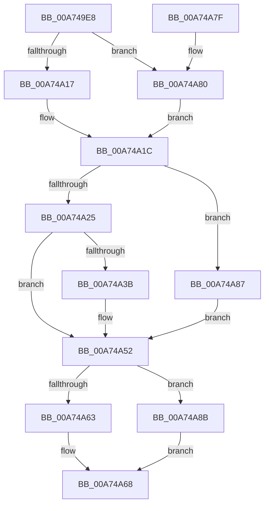

# CmpMarkKeyParentDirty

- RVA: `0x00A749E8`–`0x00A74A92` (길이 `170` bytes)
- VA: `0x0000000140A749E8`
- 실행 섹션: `PAGE`
- PDB 이름 있음: `예`; PDB Function 태그: `아니요`
- unwind 정보 RVA: `0x000B5828`
- 디코드: `53`개 명령, `170/170` bytes 표시
- 미해석 바이트: `0` (있으면 어셈블리에 `.byte`로 보존)

> 이 문서는 커널 이미지의 기계어와 PDB 기호를 분석해 생성했습니다. 4번과 5번은 함수 원형과 자료형을 바이너리 사용 방식에서 추정한 C 해석이며 원본 소스 복구 결과는 아닙니다.

## 1. Dependencies

- 직접 호출 지점: **6**; 고유 호출 대상: **6**
- 직접 호출자로 확인된 함수: **1**
- RIP 상대 이미지 참조: **0**

### Outgoing calls
- `0x00A74A17` → [HvpGetCellFlat](../85/HvpGetCellFlat_function_00854C60.md) (function, `0x00854C60`)
- `0x00A74A30` → [CmpMarkIndexDirty](../84/CmpMarkIndexDirty_function_0084C30C.md) (function, `0x0084C30C`)
- `0x00A74A46` → [HvpMarkCellDirty](../85/HvpMarkCellDirty_function_00858080.md) (function, `0x00858080`)
- `0x00A74A63` → [HvpReleaseCellPaged](../85/HvpReleaseCellPaged_function_00855F40.md) (function, `0x00855F40`)
- `0x00A74A80` → [HvpGetCellPaged](../85/HvpGetCellPaged_function_00854CB0.md) (function, `0x00854CB0`)
- `0x00A74A8B` → [HvpReleaseCellFlat](../85/HvpReleaseCellFlat_function_0085CC20.md) (function, `0x0085CC20`)

### Direct callers
- [CmpCopySyncTree2](../85/CmpCopySyncTree2_function_0085BF78.md) at `0x0085C426`

### Static image references
- 디코드된 RIP-relative 메모리 참조가 없습니다.

## 2. Other-region calls and transfers

- 다른 실행 섹션으로 향하는 call: **0**
- 별도 외부 분기/꼬리 이동을 확인하지 못했습니다.

## 3. Assembly (complete function range)

```asm
00A749E8  48 8B C4                        mov rax, rsp
00A749EB  48 89 58 10                     mov qword ptr [rax + 0x10], rbx
00A749EF  48 89 68 18                     mov qword ptr [rax + 0x18], rbp
00A749F3  48 89 70 20                     mov qword ptr [rax + 0x20], rsi
00A749F7  57                              push rdi
00A749F8  48 83 EC 20                     sub rsp, 0x20
00A749FC  83 48 08 FF                     or dword ptr [rax + 8], 0xffffffff
00A74A00  4C 8D 40 08                     lea r8, [rax + 8]
00A74A04  33 ED                           xor ebp, ebp
00A74A06  8B FA                           mov edi, edx
00A74A08  F6 81 8C 00 00 00 01            test byte ptr [rcx + 0x8c], 1
00A74A0F  48 8B D9                        mov rbx, rcx
00A74A12  89 68 0C                        mov dword ptr [rax + 0xc], ebp
00A74A15  74 69                           je 0x140a74a80
00A74A17  E8 44 02 DE FF                  call 0x140854c60
00A74A1C  F6 40 02 04                     test byte ptr [rax + 2], 4
00A74A20  48 8B C8                        mov rcx, rax
00A74A23  75 62                           jne 0x140a74a87
00A74A25  8B 70 10                        mov esi, dword ptr [rax + 0x10]
00A74A28  44 8B C7                        mov r8d, edi
00A74A2B  8B D6                           mov edx, esi
00A74A2D  48 8B CB                        mov rcx, rbx
00A74A30  E8 D7 78 DD FF                  call 0x14084c30c
00A74A35  8B F8                           mov edi, eax
00A74A37  85 C0                           test eax, eax
00A74A39  78 17                           js 0x140a74a52
00A74A3B  45 33 C9                        xor r9d, r9d
00A74A3E  45 33 C0                        xor r8d, r8d
00A74A41  8B D6                           mov edx, esi
00A74A43  48 8B CB                        mov rcx, rbx
00A74A46  E8 35 36 DE FF                  call 0x140858080
00A74A4B  85 C0                           test eax, eax
00A74A4D  8B F8                           mov edi, eax
00A74A4F  0F 49 FD                        cmovns edi, ebp
00A74A52  F6 83 8C 00 00 00 01            test byte ptr [rbx + 0x8c], 1
00A74A59  48 8D 54 24 30                  lea rdx, [rsp + 0x30]
00A74A5E  48 8B CB                        mov rcx, rbx
00A74A61  75 28                           jne 0x140a74a8b
00A74A63  E8 D8 14 DE FF                  call 0x140855f40
00A74A68  48 8B 5C 24 38                  mov rbx, qword ptr [rsp + 0x38]
00A74A6D  8B C7                           mov eax, edi
00A74A6F  48 8B 6C 24 40                  mov rbp, qword ptr [rsp + 0x40]
00A74A74  48 8B 74 24 48                  mov rsi, qword ptr [rsp + 0x48]
00A74A79  48 83 C4 20                     add rsp, 0x20
00A74A7D  5F                              pop rdi
00A74A7E  C3                              ret
00A74A7F  CC                              int3
00A74A80  E8 2B 02 DE FF                  call 0x140854cb0
00A74A85  EB 95                           jmp 0x140a74a1c
00A74A87  8B FD                           mov edi, ebp
00A74A89  EB C7                           jmp 0x140a74a52
00A74A8B  E8 90 81 DE FF                  call 0x14085cc20
00A74A90  EB D6                           jmp 0x140a74a68
```

## 4. C-style interpretation (structured pseudocode)

```c
__int64 __fastcall CmpMarkKeyParentDirty(__int64 a1, int a2, __int64 a3, int a4)
{
    __int64 result;
    __int64 v_rbp;
    __int64 v_rdi;
    __int64 v_rsp;
    unsigned __int64 v_stack_p10;
    unsigned __int64 v_stack_p18;
    unsigned __int64 v_stack_p20;
    unsigned __int64 v_stack_p8;

    *(unsigned __int64 *)(v_rsp + 16) = v_rbx;
    *(unsigned __int64 *)(v_rsp + 24) = v_rbp;
    *(unsigned __int64 *)(v_rsp + 32) = v_rsi;
    v_rsp = (v_rsp) - (32);
    v_rbp = 0;
    *(unsigned int *)(v_rsp + 12) = 0;
    if (((*(unsigned __int8 *)(a1 + 140)) & (1)) == 0) goto loc_00A74A80;
    result = HvpGetCellFlat(a1, a2, v_rsp + 8, a4);
loc_00A74A1C:
    if (((*(unsigned __int8 *)(result + 2)) & (4)) != 0) goto loc_00A74A87;
    result = CmpMarkIndexDirty(a1, (unsigned int)((unsigned int)((unsigned int)(*(unsigned int *)(result + 16)))), (unsigned int)((unsigned int)((unsigned int)(a2))), a4);
    v_rdi = (unsigned int)((unsigned int)(result));
    if (!(sign_flag)) {
        a4 = 0;
        a3 = 0;
        a2 = (unsigned int)((unsigned int)(*(unsigned int *)(result + 16)));
        a1 = a1;
        result = HvpMarkCellDirty(a1, a2, a3, a4);
        v_rdi = (unsigned int)(result);
        if (!sign_flag) { v_rdi = 0; }
    }
    if (((*(unsigned __int8 *)(a1 + 140)) & (1)) != 0) goto loc_00A74A8B;
    result = HvpReleaseCellPaged(a1, v_stack_p8, a3, a4);
loc_00A74A68:
    v_rsp = (v_rsp) + (32);
    return (unsigned int)((unsigned int)(v_rdi));
loc_00A74A80:
    result = HvpGetCellPaged(a1, v_stack_p8, a3, a4);
    goto loc_00A74A1C;
loc_00A74A87:
    goto loc_00A74A52;
loc_00A74A8B:
    result = HvpReleaseCellFlat(a1, v_stack_p8, a3, a4);
    goto loc_00A74A68;
}
```

## 5. (Beta) C Style

```c
int64_t CmpMarkKeyParentDirty(void *Arg1, int32_t Arg2, int64_t Arg3, int32_t Arg4)
{
    uint8_t *arg1 = (uint8_t *)Arg1;

    int64_t result;
    int64_t local_rbp;
    int64_t local_rdi;
    int64_t local_rsp;
    uint64_t v_stack_p10;
    uint64_t v_stack_p18;
    uint64_t v_stack_p20;
    uint64_t v_stack_p8;

    *(uint64_t *)(local_rsp + 0x10) = local_rbx;
    *(uint64_t *)(local_rsp + 0x18) = local_rbp;
    *(uint64_t *)(local_rsp + 0x20) = local_rsi;
    local_rsp = (local_rsp) - (32);
    local_rbp = 0;
    *(uint32_t *)(local_rsp + 0xC) = 0;
    if (((*(uint8_t *)(arg1 + 0x8C)) & (1)) == 0) goto loc_00A74A80;
    result = HvpGetCellFlat(Arg1, Arg2, local_rsp + 8, Arg4);
loc_00A74A1C:
    if (((*(uint8_t *)(result + 0x2)) & (4)) != 0) goto loc_00A74A87;
    result = CmpMarkIndexDirty(Arg1, (uint32_t)((uint32_t)((uint32_t)(*(uint32_t *)(result + 0x10)))), (uint32_t)((uint32_t)((uint32_t)(Arg2))), Arg4);
    local_rdi = (uint32_t)((uint32_t)(result));
    if (!(sign_flag)) {
        Arg4 = 0;
        Arg3 = 0;
        Arg2 = (uint32_t)((uint32_t)(*(uint32_t *)(result + 0x10)));
        Arg1 = Arg1;
        result = HvpMarkCellDirty(Arg1, Arg2, Arg3, Arg4);
        local_rdi = (uint32_t)(result);
        if (!sign_flag) { local_rdi = 0; }
    }
    if (((*(uint8_t *)(arg1 + 0x8C)) & (1)) != 0) goto loc_00A74A8B;
    result = HvpReleaseCellPaged(Arg1, v_stack_p8, Arg3, Arg4);
loc_00A74A68:
    local_rsp = (local_rsp) + (32);
    return (uint32_t)((uint32_t)(local_rdi));
loc_00A74A80:
    result = HvpGetCellPaged(Arg1, v_stack_p8, Arg3, Arg4);
    goto loc_00A74A1C;
loc_00A74A87:
    goto loc_00A74A52;
loc_00A74A8B:
    result = HvpReleaseCellFlat(Arg1, v_stack_p8, Arg3, Arg4);
    goto loc_00A74A68;
}
```

### 관측된 메모리 오프셋

구조체 형식이 확인되지 않은 접근은 인자 기준의 오프셋으로만 기록했습니다.

| 기준 인자 | 오프셋 표현 | 폭 (bit) | 접근 |
|---|---:|---:|---|
| `Arg1` | `+ 0x8C` | `8` | `R` |

## 6. Execution-region graph

[열기: 2D/3D 그래프와 함수 탐색 컨트롤 패널](../../../control-panel.html?section=page&rva=0x00A749E8&view=graph)

- 2D 그래프는 위에서 아래로 흐르고, 3D 그래프는 빈 공간을 드래그해 회전합니다. Shift+드래그는 이동, 휠은 확대·축소, 함수 노드 선택은 대상 보고서 이동입니다.

### Static fallback


