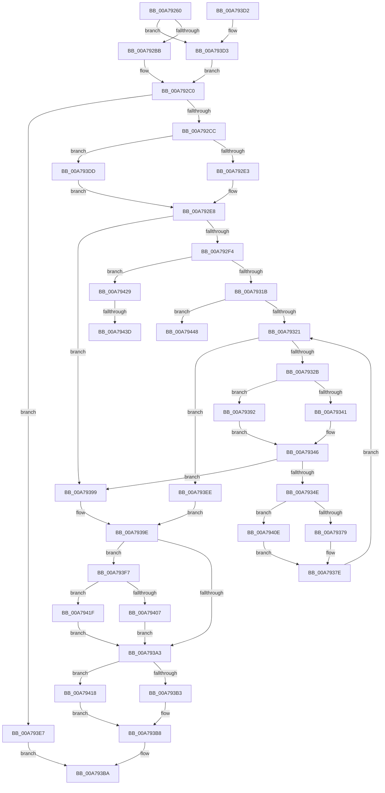

# CmpSetValueDataExisting

- RVA: `0x00A79260`–`0x00A79451` (길이 `497` bytes)
- VA: `0x0000000140A79260`
- 실행 섹션: `PAGE`
- PDB 이름 있음: `예`; PDB Function 태그: `예`
- unwind 정보 RVA: `0x000B61B8`
- 디코드: `132`개 명령, `497/497` bytes 표시
- 미해석 바이트: `0` (있으면 어셈블리에 `.byte`로 보존)

> 이 문서는 커널 이미지의 기계어와 PDB 기호를 분석해 생성했습니다. 4번과 5번은 함수 원형과 자료형을 바이너리 사용 방식에서 추정한 C 해석이며 원본 소스 복구 결과는 아닙니다.

## 1. Dependencies

- 직접 호출 지점: **14**; 고유 호출 대상: **5**
- 직접 호출자로 확인된 함수: **1**
- RIP 상대 이미지 참조: **0**

### Outgoing calls
- `0x00A792BB` → [HvpGetCellFlat](../85/HvpGetCellFlat_function_00854C60.md) (function, `0x00854C60`)
- `0x00A792E3` → [HvpGetCellFlat](../85/HvpGetCellFlat_function_00854C60.md) (function, `0x00854C60`)
- `0x00A79341` → [HvpGetCellFlat](../85/HvpGetCellFlat_function_00854C60.md) (function, `0x00854C60`)
- `0x00A79360` → [memcpy](../../text/6C/memcpy_function_006C6840.md) (function, `0x006C6840`)
- `0x00A79379` → [HvpReleaseCellPaged](../85/HvpReleaseCellPaged_function_00855F40.md) (function, `0x00855F40`)
- `0x00A79392` → [HvpGetCellPaged](../85/HvpGetCellPaged_function_00854CB0.md) (function, `0x00854CB0`)
- `0x00A793B3` → [HvpReleaseCellPaged](../85/HvpReleaseCellPaged_function_00855F40.md) (function, `0x00855F40`)
- `0x00A793D3` → [HvpGetCellPaged](../85/HvpGetCellPaged_function_00854CB0.md) (function, `0x00854CB0`)
- `0x00A793DD` → [HvpGetCellPaged](../85/HvpGetCellPaged_function_00854CB0.md) (function, `0x00854CB0`)
- `0x00A79407` → [HvpReleaseCellPaged](../85/HvpReleaseCellPaged_function_00855F40.md) (function, `0x00855F40`)
- `0x00A7940E` → [HvpReleaseCellFlat](../85/HvpReleaseCellFlat_function_0085CC20.md) (function, `0x0085CC20`)
- `0x00A79418` → [HvpReleaseCellFlat](../85/HvpReleaseCellFlat_function_0085CC20.md) (function, `0x0085CC20`)
- `0x00A7941F` → [HvpReleaseCellFlat](../85/HvpReleaseCellFlat_function_0085CC20.md) (function, `0x0085CC20`)
- `0x00A7943D` → [HvpReleaseCellFlat](../85/HvpReleaseCellFlat_function_0085CC20.md) (function, `0x0085CC20`)

### Direct callers
- [CmpSetValueKeyExisting](../84/CmpSetValueKeyExisting_function_0084B53C.md) at `0x0084B838`

### Static image references
- 디코드된 RIP-relative 메모리 참조가 없습니다.

## 2. Other-region calls and transfers

- 다른 실행 섹션으로 향하는 call: **1**
  - `0x00A79360` → [memcpy](../../text/6C/memcpy_function_006C6840.md) (`PAGE` → `.text`)
- call이 아닌 외부 분기/꼬리 이동: **3**
  - `0x00A79437` → [sub_00B41CEA](../B4/Unknown_function_00B41CEA.md) (`tail-transfer`)
  - `0x00A79443` → [sub_00B41CEA + 0x5](../B4/Unknown_function_00B41CEA.md) (`tail-transfer`)
  - `0x00A7944C` → [sub_00B41CEA + 0x94](../B4/Unknown_function_00B41CEA.md) (`tail-transfer`)

## 3. Assembly (complete function range)

```asm
00A79260  48 89 5C 24 18                  mov qword ptr [rsp + 0x18], rbx
00A79265  44 89 4C 24 20                  mov dword ptr [rsp + 0x20], r9d
00A7926A  48 89 54 24 10                  mov qword ptr [rsp + 0x10], rdx
00A7926F  55                              push rbp
00A79270  56                              push rsi
00A79271  57                              push rdi
00A79272  41 54                           push r12
00A79274  41 55                           push r13
00A79276  41 56                           push r14
00A79278  41 57                           push r15
00A7927A  48 8B EC                        mov rbp, rsp
00A7927D  48 83 EC 60                     sub rsp, 0x60
00A79281  33 FF                           xor edi, edi
00A79283  48 8B D9                        mov rbx, rcx
00A79286  83 C9 FF                        or ecx, 0xffffffff
00A79289  89 7D F4                        mov dword ptr [rbp - 0xc], edi
00A7928C  45 8B E8                        mov r13d, r8d
00A7928F  89 4D F0                        mov dword ptr [rbp - 0x10], ecx
00A79292  4C 8B E2                        mov r12, rdx
00A79295  89 4D F8                        mov dword ptr [rbp - 8], ecx
00A79298  F6 83 8C 00 00 00 01            test byte ptr [rbx + 0x8c], 1
00A7929F  4C 8D 45 F8                     lea r8, [rbp - 8]
00A792A3  8B 55 60                        mov edx, dword ptr [rbp + 0x60]
00A792A6  89 4D E0                        mov dword ptr [rbp - 0x20], ecx
00A792A9  48 8B CB                        mov rcx, rbx
00A792AC  89 7D FC                        mov dword ptr [rbp - 4], edi
00A792AF  89 7D E4                        mov dword ptr [rbp - 0x1c], edi
00A792B2  89 7D 40                        mov dword ptr [rbp + 0x40], edi
00A792B5  0F 84 18 01 00 00               je 0x140a793d3
00A792BB  E8 A0 B9 DD FF                  call 0x140854c60
00A792C0  4C 8B F0                        mov r14, rax
00A792C3  48 85 C0                        test rax, rax
00A792C6  0F 84 1B 01 00 00               je 0x140a793e7
00A792CC  F6 83 8C 00 00 00 01            test byte ptr [rbx + 0x8c], 1
00A792D3  4C 8D 45 E0                     lea r8, [rbp - 0x20]
00A792D7  8B 50 04                        mov edx, dword ptr [rax + 4]
00A792DA  48 8B CB                        mov rcx, rbx
00A792DD  0F 84 FA 00 00 00               je 0x140a793dd
00A792E3  E8 78 B9 DD FF                  call 0x140854c60
00A792E8  48 8B F0                        mov rsi, rax
00A792EB  48 85 C0                        test rax, rax
00A792EE  0F 84 A5 00 00 00               je 0x140a79399
00A792F4  45 8D BD D7 3F 00 00            lea r15d, [r13 + 0x3fd7]
00A792FB  B8 3F 64 A0 00                  mov eax, 0xa0643f
00A79300  41 F7 E7                        mul r15d
00A79303  44 2B FA                        sub r15d, edx
00A79306  41 D1 EF                        shr r15d, 1
00A79309  44 03 FA                        add r15d, edx
00A7930C  41 C1 EF 0D                     shr r15d, 0xd
00A79310  66 45 3B 7E 02                  cmp r15w, word ptr [r14 + 2]
00A79315  0F 87 0E 01 00 00               ja 0x140a79429
00A7931B  0F 82 27 01 00 00               jb 0x140a79448
00A79321  66 41 3B FF                     cmp di, r15w
00A79325  0F 83 C3 00 00 00               jae 0x140a793ee
00A7932B  F6 83 8C 00 00 00 01            test byte ptr [rbx + 0x8c], 1
00A79332  4C 8D 45 F0                     lea r8, [rbp - 0x10]
00A79336  0F B7 C7                        movzx eax, di
00A79339  48 8B CB                        mov rcx, rbx
00A7933C  8B 14 86                        mov edx, dword ptr [rsi + rax*4]
00A7933F  74 51                           je 0x140a79392
00A79341  E8 1A B9 DD FF                  call 0x140854c60
00A79346  48 8B C8                        mov rcx, rax
00A79349  48 85 C0                        test rax, rax
00A7934C  74 4B                           je 0x140a79399
00A7934E  BA D8 3F 00 00                  mov edx, 0x3fd8
00A79353  45 8B C5                        mov r8d, r13d
00A79356  44 3B EA                        cmp r13d, edx
00A79359  44 0F 47 C2                     cmova r8d, edx
00A7935D  49 8B D4                        mov rdx, r12
00A79360  E8 DB D4 C4 FF                  call 0x1406c6840
00A79365  F6 83 8C 00 00 00 01            test byte ptr [rbx + 0x8c], 1
00A7936C  48 8D 55 F0                     lea rdx, [rbp - 0x10]
00A79370  48 8B CB                        mov rcx, rbx
00A79373  0F 85 95 00 00 00               jne 0x140a7940e
00A79379  E8 C2 CB DD FF                  call 0x140855f40
00A7937E  B8 D8 3F 00 00                  mov eax, 0x3fd8
00A79383  41 81 C5 28 C0 FF FF            add r13d, 0xffffc028
00A7938A  4C 03 E0                        add r12, rax
00A7938D  66 FF C7                        inc di
00A79390  EB 8F                           jmp 0x140a79321
00A79392  E8 19 B9 DD FF                  call 0x140854cb0
00A79397  EB AD                           jmp 0x140a79346
00A79399  BF 9A 00 00 C0                  mov edi, 0xc000009a
00A7939E  48 85 F6                        test rsi, rsi
00A793A1  75 54                           jne 0x140a793f7
00A793A3  F6 83 8C 00 00 00 01            test byte ptr [rbx + 0x8c], 1
00A793AA  48 8D 55 F8                     lea rdx, [rbp - 8]
00A793AE  48 8B CB                        mov rcx, rbx
00A793B1  75 65                           jne 0x140a79418
00A793B3  E8 88 CB DD FF                  call 0x140855f40
00A793B8  8B C7                           mov eax, edi
00A793BA  48 8B 9C 24 B0 00 00 00         mov rbx, qword ptr [rsp + 0xb0]
00A793C2  48 83 C4 60                     add rsp, 0x60
00A793C6  41 5F                           pop r15
00A793C8  41 5E                           pop r14
00A793CA  41 5D                           pop r13
00A793CC  41 5C                           pop r12
00A793CE  5F                              pop rdi
00A793CF  5E                              pop rsi
00A793D0  5D                              pop rbp
00A793D1  C3                              ret
00A793D2  CC                              int3
00A793D3  E8 D8 B8 DD FF                  call 0x140854cb0
00A793D8  E9 E3 FE FF FF                  jmp 0x140a792c0
00A793DD  E8 CE B8 DD FF                  call 0x140854cb0
00A793E2  E9 01 FF FF FF                  jmp 0x140a792e8
00A793E7  B8 9A 00 00 C0                  mov eax, 0xc000009a
00A793EC  EB CC                           jmp 0x140a793ba
00A793EE  66 45 89 7E 02                  mov word ptr [r14 + 2], r15w
00A793F3  33 FF                           xor edi, edi
00A793F5  EB A7                           jmp 0x140a7939e
00A793F7  F6 83 8C 00 00 00 01            test byte ptr [rbx + 0x8c], 1
00A793FE  48 8D 55 E0                     lea rdx, [rbp - 0x20]
00A79402  48 8B CB                        mov rcx, rbx
00A79405  75 18                           jne 0x140a7941f
00A79407  E8 34 CB DD FF                  call 0x140855f40
00A7940C  EB 95                           jmp 0x140a793a3
00A7940E  E8 0D 38 DE FF                  call 0x14085cc20
00A79413  E9 66 FF FF FF                  jmp 0x140a7937e
00A79418  E8 03 38 DE FF                  call 0x14085cc20
00A7941D  EB 99                           jmp 0x140a793b8
00A7941F  E8 FC 37 DE FF                  call 0x14085cc20
00A79424  E9 7A FF FF FF                  jmp 0x140a793a3
00A79429  F6 83 8C 00 00 00 01            test byte ptr [rbx + 0x8c], 1
00A79430  48 8D 55 E0                     lea rdx, [rbp - 0x20]
00A79434  48 8B CB                        mov rcx, rbx
00A79437  0F 84 AD 88 0C 00               je 0x140b41cea
00A7943D  E8 DE 37 DE FF                  call 0x14085cc20
00A79442  90                              nop
00A79443  E9 A7 88 0C 00                  jmp 0x140b41cef
00A79448  41 0F B7 FF                     movzx edi, r15w
00A7944C  E9 2D 89 0C 00                  jmp 0x140b41d7e
```

## 4. C-style interpretation (structured pseudocode)

```c
__int64 __fastcall CmpSetValueDataExisting(__int64 a1, __int64 a2, int a3, int a4, unsigned int a5)
{
    __int64 result;
    __int64 v_r12;
    __int64 v_r13;
    __int64 v_r15;
    __int64 v_rdi;
    __int64 v_rsp;
    unsigned int v_stack_m3C;
    unsigned int v_stack_m40;
    unsigned int v_stack_m44;
    unsigned int v_stack_m48;
    unsigned int v_stack_m54;
    unsigned int v_stack_m58;
    unsigned __int64 v_stack_p10;
    unsigned __int64 v_stack_p18;
    unsigned int v_stack_p20;
    unsigned int v_stack_p8;

    v_stack_p18 = v_rbx;
    v_stack_p20 = a4;
    v_stack_p10 = a2;
    v_rsp = (v_rsp) - (96);
    v_rdi = 0;
    a1 = (unsigned int)((a1) | (0xFFFFFFFFULL));
    v_stack_m44 = 0;
    v_stack_m48 = (unsigned int)(a1);
    v_stack_m40 = (unsigned int)(a1);
    v_stack_m58 = (unsigned int)(a1);
    v_stack_m3C = 0;
    v_stack_m54 = 0;
    v_stack_p8 = 0;
    if (((*(unsigned __int8 *)(a1 + 140)) & (1)) == 0) goto loc_00A793D3;
    result = HvpGetCellFlat(a1, (unsigned int)(a5), v_stack_m40, a4);
loc_00A792C0:
    if (result == 0) goto loc_00A793E7;
    if (((*(unsigned __int8 *)(a1 + 140)) & (1)) == 0) goto loc_00A793DD;
    result = HvpGetCellFlat(a1, (unsigned int)(*(unsigned int *)(result + 4)), v_stack_m58, a4);
loc_00A792E8:
    if (result == 0) goto loc_00A79399;
    v_r15 = (unsigned int)(((unsigned int)(a3) + 16343) - ((unsigned int)((unsigned int)(*(unsigned int *)(result + 4)))));
    v_r15 = (unsigned int)((v_r15) >> (1));
    v_r15 = (unsigned int)((v_r15) + ((unsigned int)((unsigned int)(*(unsigned int *)(result + 4)))));
    v_r15 = (unsigned int)((v_r15) >> (13));
    if (((unsigned __int16)(v_r15)) > (*(unsigned __int16 *)(result + 2))) goto loc_00A79429;
    if (((unsigned __int16)(v_r15)) < (*(unsigned __int16 *)(result + 2))) goto loc_00A79448;
loc_00A79321:
    if (0 >= ((unsigned __int16)(v_r15))) goto loc_00A793EE;
    if (((*(unsigned __int8 *)(a1 + 140)) & (1)) == 0) goto loc_00A79392;
    result = HvpGetCellFlat(a1, (unsigned int)(*(unsigned int *)(result + 0 * 4)), v_stack_m48, a4);
loc_00A79346:
    if (result == 0) goto loc_00A79399;
    a3 = (unsigned int)((unsigned int)((unsigned int)(a3)));
    if (((unsigned int)((unsigned int)(a3))) > ((unsigned int)((unsigned int)(0x3FD8ULL)))) { a3 = (unsigned int)((unsigned int)(0x3FD8ULL)); }
    result = memcpy(result, a2, a3, a4);
    if (((*(unsigned __int8 *)(a1 + 140)) & (1)) != 0) goto loc_00A7940E;
    result = HvpReleaseCellPaged(a1, v_stack_m48, a3, a4);
loc_00A7937E:
    v_r13 = (unsigned int)(((unsigned int)(a3)) + (0xFFFFC028ULL));
    v_r12 = (a2) + ((unsigned int)(0x3FD8ULL));
    v_rdi = (unsigned __int16)((v_rdi) + 1);
    goto loc_00A79321;
loc_00A79392:
    result = HvpGetCellPaged(a1, v_stack_m48, a3, a4);
    goto loc_00A79346;
loc_00A79399:
loc_00A7939E:
    if (result != 0) goto loc_00A793F7;
loc_00A793A3:
    if (((*(unsigned __int8 *)(a1 + 140)) & (1)) != 0) goto loc_00A79418;
    result = HvpReleaseCellPaged(a1, v_stack_m40, a3, a4);
loc_00A793B8:
loc_00A793BA:
    v_rsp = (v_rsp) + (96);
    return (unsigned int)((unsigned int)((unsigned int)(0xC000009AULL)));
loc_00A793D3:
    result = HvpGetCellPaged(a1, v_stack_m40, a3, a4);
    goto loc_00A792C0;
loc_00A793DD:
    result = HvpGetCellPaged(a1, v_stack_m40, a3, a4);
    goto loc_00A792E8;
loc_00A793E7:
    goto loc_00A793BA;
loc_00A793EE:
    *(unsigned __int16 *)(result + 2) = (unsigned __int16)(v_r15);
    v_rdi = 0;
    goto loc_00A7939E;
loc_00A793F7:
    if (((*(unsigned __int8 *)(v_stack_p18 + 140)) & (1)) != 0) goto loc_00A7941F;
    result = HvpReleaseCellPaged(v_stack_p18, v_stack_m58, a3, a4);
    goto loc_00A793A3;
loc_00A7940E:
    result = HvpReleaseCellFlat(v_stack_p18, v_stack_m58, a3, a4);
    goto loc_00A7937E;
loc_00A79418:
    result = HvpReleaseCellFlat(v_stack_p18, v_stack_m58, a3, a4);
    goto loc_00A793B8;
loc_00A7941F:
    result = HvpReleaseCellFlat(v_stack_p18, v_stack_m58, a3, a4);
    goto loc_00A793A3;
loc_00A79429:
    result = HvpReleaseCellFlat(v_stack_p18, v_stack_m58, a3, a4);
loc_00A79448:
}
```

## 5. (Beta) C Style

```c
int64_t CmpSetValueDataExisting(void *Arg1, int64_t Arg2, void *Arg3, int32_t Arg4, uint32_t Arg5)
{
    uint8_t *arg1 = (uint8_t *)Arg1;
    uint8_t *arg3 = (uint8_t *)Arg3;

    int64_t result;
    int64_t local_r12;
    int64_t local_r13;
    int64_t local_r15;
    int64_t local_rdi;
    int64_t local_rsp;
    uint32_t v_stack_m3C;
    uint32_t v_stack_m40;
    uint32_t v_stack_m44;
    uint32_t v_stack_m48;
    uint32_t v_stack_m54;
    uint32_t v_stack_m58;
    uint64_t v_stack_p10;
    uint64_t v_stack_p18;
    uint32_t v_stack_p20;
    uint32_t v_stack_p8;

    v_stack_p18 = local_rbx;
    v_stack_p20 = Arg4;
    v_stack_p10 = Arg2;
    local_rsp = (local_rsp) - (96);
    local_rdi = 0;
    Arg1 = (uint32_t)((Arg1) | (0xFFFFFFFFULL));
    v_stack_m44 = 0;
    v_stack_m48 = (uint32_t)(Arg1);
    v_stack_m40 = (uint32_t)(Arg1);
    v_stack_m58 = (uint32_t)(Arg1);
    v_stack_m3C = 0;
    v_stack_m54 = 0;
    v_stack_p8 = 0;
    if (((*(uint8_t *)(arg1 + 0x8C)) & (1)) == 0) goto loc_00A793D3;
    result = HvpGetCellFlat(Arg1, (uint32_t)(Arg5), v_stack_m40, Arg4);
loc_00A792C0:
    if (result == 0) goto loc_00A793E7;
    if (((*(uint8_t *)(arg1 + 0x8C)) & (1)) == 0) goto loc_00A793DD;
    result = HvpGetCellFlat(Arg1, (uint32_t)(*(uint32_t *)(result + 0x4)), v_stack_m58, Arg4);
loc_00A792E8:
    if (result == 0) goto loc_00A79399;
    local_r15 = (uint32_t)(((uint32_t)(Arg3) + 16343) - ((uint32_t)((uint32_t)(*(uint32_t *)(result + 0x4)))));
    local_r15 = (uint32_t)((local_r15) >> (1));
    local_r15 = (uint32_t)((local_r15) + ((uint32_t)((uint32_t)(*(uint32_t *)(result + 0x4)))));
    local_r15 = (uint32_t)((local_r15) >> (13));
    if (((uint16_t)(local_r15)) > (*(uint16_t *)(result + 0x2))) goto loc_00A79429;
    if (((uint16_t)(local_r15)) < (*(uint16_t *)(result + 0x2))) goto loc_00A79448;
loc_00A79321:
    if (0 >= ((uint16_t)(local_r15))) goto loc_00A793EE;
    if (((*(uint8_t *)(arg1 + 0x8C)) & (1)) == 0) goto loc_00A79392;
    result = HvpGetCellFlat(Arg1, (uint32_t)(*(uint32_t *)(result + 0x0 * 4)), v_stack_m48, Arg4);
loc_00A79346:
    if (result == 0) goto loc_00A79399;
    Arg3 = (uint32_t)((uint32_t)((uint32_t)(Arg3)));
    if (((uint32_t)((uint32_t)(Arg3))) > ((uint32_t)((uint32_t)(0x3FD8ULL)))) { Arg3 = (uint32_t)((uint32_t)(0x3FD8ULL)); }
    result = memcpy(result, Arg2, Arg3, Arg4);
    if (((*(uint8_t *)(arg1 + 0x8C)) & (1)) != 0) goto loc_00A7940E;
    result = HvpReleaseCellPaged(Arg1, v_stack_m48, Arg3, Arg4);
loc_00A7937E:
    local_r13 = (uint32_t)(((uint32_t)(Arg3)) + (0xFFFFC028ULL));
    local_r12 = (Arg2) + ((uint32_t)(0x3FD8ULL));
    local_rdi = (uint16_t)((local_rdi) + 1);
    goto loc_00A79321;
loc_00A79392:
    result = HvpGetCellPaged(Arg1, v_stack_m48, Arg3, Arg4);
    goto loc_00A79346;
loc_00A79399:
loc_00A7939E:
    if (result != 0) goto loc_00A793F7;
loc_00A793A3:
    if (((*(uint8_t *)(arg1 + 0x8C)) & (1)) != 0) goto loc_00A79418;
    result = HvpReleaseCellPaged(Arg1, v_stack_m40, Arg3, Arg4);
loc_00A793B8:
loc_00A793BA:
    local_rsp = (local_rsp) + (96);
    return (uint32_t)((uint32_t)((uint32_t)(0xC000009AULL)));
loc_00A793D3:
    result = HvpGetCellPaged(Arg1, v_stack_m40, Arg3, Arg4);
    goto loc_00A792C0;
loc_00A793DD:
    result = HvpGetCellPaged(Arg1, v_stack_m40, Arg3, Arg4);
    goto loc_00A792E8;
loc_00A793E7:
    goto loc_00A793BA;
loc_00A793EE:
    *(uint16_t *)(result + 0x2) = (uint16_t)(local_r15);
    local_rdi = 0;
    goto loc_00A7939E;
loc_00A793F7:
    if (((*(uint8_t *)(v_stack_p18 + 0x8C)) & (1)) != 0) goto loc_00A7941F;
    result = HvpReleaseCellPaged(v_stack_p18, v_stack_m58, Arg3, Arg4);
    goto loc_00A793A3;
loc_00A7940E:
    result = HvpReleaseCellFlat(v_stack_p18, v_stack_m58, Arg3, Arg4);
    goto loc_00A7937E;
loc_00A79418:
    result = HvpReleaseCellFlat(v_stack_p18, v_stack_m58, Arg3, Arg4);
    goto loc_00A793B8;
loc_00A7941F:
    result = HvpReleaseCellFlat(v_stack_p18, v_stack_m58, Arg3, Arg4);
    goto loc_00A793A3;
loc_00A79429:
    result = HvpReleaseCellFlat(v_stack_p18, v_stack_m58, Arg3, Arg4);
loc_00A79448:
}
```

### 관측된 메모리 오프셋

구조체 형식이 확인되지 않은 접근은 인자 기준의 오프셋으로만 기록했습니다.

| 기준 인자 | 오프셋 표현 | 폭 (bit) | 접근 |
|---|---:|---:|---|
| `Arg1` | `+ 0x8C` | `8` | `R` |
| `Arg3` | `+ 0x3FD7` | `32` | `R` |

## 6. Execution-region graph

[열기: 2D/3D 그래프와 함수 탐색 컨트롤 패널](../../../control-panel.html?section=page&rva=0x00A79260&view=graph)

- 2D 그래프는 위에서 아래로 흐르고, 3D 그래프는 빈 공간을 드래그해 회전합니다. Shift+드래그는 이동, 휠은 확대·축소, 함수 노드 선택은 대상 보고서 이동입니다.

### Static fallback


