# CmpSplitLeaf

- RVA: `0x00A7C7E0`–`0x00A7CB33` (길이 `851` bytes)
- VA: `0x0000000140A7C7E0`
- 실행 섹션: `PAGE`
- PDB 이름 있음: `예`; PDB Function 태그: `아니요`
- unwind 정보 RVA: `0x000B68C8`
- 디코드: `218`개 명령, `851/851` bytes 표시
- 미해석 바이트: `0` (있으면 어셈블리에 `.byte`로 보존)

> 이 문서는 커널 이미지의 기계어와 PDB 기호를 분석해 생성했습니다. 4번과 5번은 함수 원형과 자료형을 바이너리 사용 방식에서 추정한 C 해석이며 원본 소스 복구 결과는 아닙니다.

## 1. Dependencies

- 직접 호출 지점: **18**; 고유 호출 대상: **9**
- 직접 호출자로 확인된 함수: **1**
- RIP 상대 이미지 참조: **0**

### Outgoing calls
- `0x00A7C84A` → [HvpGetCellFlat](../85/HvpGetCellFlat_function_00854C60.md) (function, `0x00854C60`)
- `0x00A7C87D` → [HvpGetCellFlat](../85/HvpGetCellFlat_function_00854C60.md) (function, `0x00854C60`)
- `0x00A7C8C9` → [HvpMarkCellDirty](../85/HvpMarkCellDirty_function_00858080.md) (function, `0x00858080`)
- `0x00A7C904` → [HvAllocateCell](../85/HvAllocateCell_function_00859C94.md) (function, `0x00859C94`)
- `0x00A7C976` → [memcpy](../../text/6C/memcpy_function_006C6840.md) (function, `0x006C6840`)
- `0x00A7C9D1` → [HvpReleaseCellPaged](../85/HvpReleaseCellPaged_function_00855F40.md) (function, `0x00855F40`)
- `0x00A7C9EF` → [HvpReleaseCellPaged](../85/HvpReleaseCellPaged_function_00855F40.md) (function, `0x00855F40`)
- `0x00A7CA0D` → [HvpReleaseCellPaged](../85/HvpReleaseCellPaged_function_00855F40.md) (function, `0x00855F40`)
- `0x00A7CA37` → [HvpGetCellPaged](../85/HvpGetCellPaged_function_00854CB0.md) (function, `0x00854CB0`)
- `0x00A7CA41` → [HvpGetCellPaged](../85/HvpGetCellPaged_function_00854CB0.md) (function, `0x00854CB0`)
- `0x00A7CA61` → [HvpReleaseCellPaged](../85/HvpReleaseCellPaged_function_00855F40.md) (function, `0x00855F40`)
- `0x00A7CA92` → [HvReallocateCell](../85/HvReallocateCell_function_0085B5D0.md) (function, `0x0085B5D0`)
- `0x00A7CAC6` → [HvpReleaseCellFlat](../85/HvpReleaseCellFlat_function_0085CC20.md) (function, `0x0085CC20`)
- `0x00A7CAD0` → [HvpReleaseCellFlat](../85/HvpReleaseCellFlat_function_0085CC20.md) (function, `0x0085CC20`)
- `0x00A7CADA` → [HvpReleaseCellFlat](../85/HvpReleaseCellFlat_function_0085CC20.md) (function, `0x0085CC20`)
- `0x00A7CAE4` → [HvpReleaseCellFlat](../85/HvpReleaseCellFlat_function_0085CC20.md) (function, `0x0085CC20`)
- `0x00A7CB1A` → [memcpy](../../text/6C/memcpy_function_006C6840.md) (function, `0x006C6840`)
- `0x00A7CB29` → [HvFreeCell](../85/HvFreeCell_function_0085A72C.md) (function, `0x0085A72C`)

### Direct callers
- [CmpSelectLeaf](../84/CmpSelectLeaf_function_0084BFB4.md) at `0x0084C120`

### Static image references
- 디코드된 RIP-relative 메모리 참조가 없습니다.

## 2. Other-region calls and transfers

- 다른 실행 섹션으로 향하는 call: **2**
  - `0x00A7C976` → [memcpy](../../text/6C/memcpy_function_006C6840.md) (`PAGE` → `.text`)
  - `0x00A7CB1A` → [memcpy](../../text/6C/memcpy_function_006C6840.md) (`PAGE` → `.text`)
- 별도 외부 분기/꼬리 이동을 확인하지 못했습니다.

## 3. Assembly (complete function range)

```asm
00A7C7E0  48 89 5C 24 18                  mov qword ptr [rsp + 0x18], rbx
00A7C7E5  44 89 4C 24 20                  mov dword ptr [rsp + 0x20], r9d
00A7C7EA  89 54 24 10                     mov dword ptr [rsp + 0x10], edx
00A7C7EE  55                              push rbp
00A7C7EF  56                              push rsi
00A7C7F0  57                              push rdi
00A7C7F1  41 54                           push r12
00A7C7F3  41 55                           push r13
00A7C7F5  41 56                           push r14
00A7C7F7  41 57                           push r15
00A7C7F9  48 8B EC                        mov rbp, rsp
00A7C7FC  48 83 EC 70                     sub rsp, 0x70
00A7C800  48 8B D9                        mov rbx, rcx
00A7C803  45 8B E8                        mov r13d, r8d
00A7C806  33 C9                           xor ecx, ecx
00A7C808  41 83 C8 FF                     or r8d, 0xffffffff
00A7C80C  44 89 45 E0                     mov dword ptr [rbp - 0x20], r8d
00A7C810  44 8B F1                        mov r14d, ecx
00A7C813  89 4D E4                        mov dword ptr [rbp - 0x1c], ecx
00A7C816  41 8B F0                        mov esi, r8d
00A7C819  44 89 45 E8                     mov dword ptr [rbp - 0x18], r8d
00A7C81D  44 8D 61 01                     lea r12d, [rcx + 1]
00A7C821  89 4D EC                        mov dword ptr [rbp - 0x14], ecx
00A7C824  44 89 45 F0                     mov dword ptr [rbp - 0x10], r8d
00A7C828  89 4D F4                        mov dword ptr [rbp - 0xc], ecx
00A7C82B  89 4D D8                        mov dword ptr [rbp - 0x28], ecx
00A7C82E  48 89 4D F8                     mov qword ptr [rbp - 8], rcx
00A7C832  48 8B CB                        mov rcx, rbx
00A7C835  44 89 45 D4                     mov dword ptr [rbp - 0x2c], r8d
00A7C839  4C 8D 45 E0                     lea r8, [rbp - 0x20]
00A7C83D  44 84 A3 8C 00 00 00            test byte ptr [rbx + 0x8c], r12b
00A7C844  0F 84 ED 01 00 00               je 0x140a7ca37
00A7C84A  E8 11 84 DD FF                  call 0x140854c60
00A7C84F  48 8B F8                        mov rdi, rax
00A7C852  B8 FF FF 00 00                  mov eax, 0xffff
00A7C857  66 39 47 02                     cmp word ptr [rdi + 2], ax
00A7C85B  0F 84 8D 02 00 00               je 0x140a7caee
00A7C861  4C 8D 45 E8                     lea r8, [rbp - 0x18]
00A7C865  46 8B 7C AF 04                  mov r15d, dword ptr [rdi + r13*4 + 4]
00A7C86A  41 8B D7                        mov edx, r15d
00A7C86D  48 8B CB                        mov rcx, rbx
00A7C870  44 84 A3 8C 00 00 00            test byte ptr [rbx + 0x8c], r12b
00A7C877  0F 84 C4 01 00 00               je 0x140a7ca41
00A7C87D  E8 DE 83 DD FF                  call 0x140854c60
00A7C882  0F B7 48 02                     movzx ecx, word ptr [rax + 2]
00A7C886  4C 8B E0                        mov r12, rax
00A7C889  0F B7 C1                        movzx eax, cx
00A7C88C  41 8B D7                        mov edx, r15d
00A7C88F  66 D1 E8                        shr ax, 1
00A7C892  66 2B C8                        sub cx, ax
00A7C895  66 89 45 40                     mov word ptr [rbp + 0x40], ax
00A7C899  41 0F B7 04 24                  movzx eax, word ptr [r12]
00A7C89E  66 89 4D D0                     mov word ptr [rbp - 0x30], cx
00A7C8A2  B9 6C 66 00 00                  mov ecx, 0x666c
00A7C8A7  66 2B C1                        sub ax, cx
00A7C8AA  B9 FF FD 00 00                  mov ecx, 0xfdff
00A7C8AF  66 23 C1                        and ax, cx
00A7C8B2  48 8B CB                        mov rcx, rbx
00A7C8B5  66 F7 D8                        neg ax
00A7C8B8  1B C0                           sbb eax, eax
00A7C8BA  45 33 C9                        xor r9d, r9d
00A7C8BD  83 E0 FC                        and eax, 0xfffffffc
00A7C8C0  45 33 C0                        xor r8d, r8d
00A7C8C3  83 C0 08                        add eax, 8
00A7C8C6  89 45 DC                        mov dword ptr [rbp - 0x24], eax
00A7C8C9  E8 B2 B7 DD FF                  call 0x140858080
00A7C8CE  44 8B F8                        mov r15d, eax
00A7C8D1  85 C0                           test eax, eax
00A7C8D3  0F 88 E2 01 00 00               js 0x140a7cabb
00A7C8D9  0F B7 45 D0                     movzx eax, word ptr [rbp - 0x30]
00A7C8DD  4C 8D 4D D4                     lea r9, [rbp - 0x2c]
00A7C8E1  0F AF 45 DC                     imul eax, dword ptr [rbp - 0x24]
00A7C8E5  48 8B CB                        mov rcx, rbx
00A7C8E8  44 8B 45 58                     mov r8d, dword ptr [rbp + 0x58]
00A7C8EC  89 45 DC                        mov dword ptr [rbp - 0x24], eax
00A7C8EF  8D 50 05                        lea edx, [rax + 5]
00A7C8F2  48 8D 45 F0                     lea rax, [rbp - 0x10]
00A7C8F6  48 89 44 24 28                  mov qword ptr [rsp + 0x28], rax
00A7C8FB  48 8D 45 F8                     lea rax, [rbp - 8]
00A7C8FF  48 89 44 24 20                  mov qword ptr [rsp + 0x20], rax
00A7C904  E8 8B D3 DD FF                  call 0x140859c94
00A7C909  4C 8B 75 F8                     mov r14, qword ptr [rbp - 8]
00A7C90D  44 8B F8                        mov r15d, eax
00A7C910  85 C0                           test eax, eax
00A7C912  0F 88 A0 01 00 00               js 0x140a7cab8
00A7C918  41 0F B7 04 24                  movzx eax, word ptr [r12]
00A7C91D  B9 F8 FF FF FF                  mov ecx, 0xfffffff8
00A7C922  66 41 89 06                     mov word ptr [r14], ax
00A7C926  0F B7 47 02                     movzx eax, word ptr [rdi + 2]
00A7C92A  8B 77 FC                        mov esi, dword ptr [rdi - 4]
00A7C92D  C1 E0 02                        shl eax, 2
00A7C930  2B C8                           sub ecx, eax
00A7C932  2B CE                           sub ecx, esi
00A7C934  83 E1 FC                        and ecx, 0xfffffffc
00A7C937  83 F9 04                        cmp ecx, 4
00A7C93A  0F 82 0B 01 00 00               jb 0x140a7ca4b
00A7C940  44 8B 7D 48                     mov r15d, dword ptr [rbp + 0x48]
00A7C944  41 0F B7 04 24                  movzx eax, word ptr [r12]
00A7C949  B9 6C 66 00 00                  mov ecx, 0x666c
00A7C94E  44 8B 45 DC                     mov r8d, dword ptr [rbp - 0x24]
00A7C952  66 2B C1                        sub ax, cx
00A7C955  0F B7 75 40                     movzx esi, word ptr [rbp + 0x40]
00A7C959  B9 FF FD 00 00                  mov ecx, 0xfdff
00A7C95E  66 85 C1                        test cx, ax
00A7C961  49 8D 4E 04                     lea rcx, [r14 + 4]
00A7C965  0F 85 40 01 00 00               jne 0x140a7caab
00A7C96B  48 8D 14 F5 04 00 00 00         lea rdx, [rsi*8 + 4]
00A7C973  49 03 D4                        add rdx, r12
00A7C976  E8 C5 9E C4 FF                  call 0x1406c6840
00A7C97B  0F B7 45 D0                     movzx eax, word ptr [rbp - 0x30]
00A7C97F  66 41 89 74 24 02               mov word ptr [r12 + 2], si
00A7C985  41 8D 75 01                     lea esi, [r13 + 1]
00A7C989  66 41 89 46 02                  mov word ptr [r14 + 2], ax
00A7C98E  41 BC 01 00 00 00               mov r12d, 1
00A7C994  0F B7 4F 02                     movzx ecx, word ptr [rdi + 2]
00A7C998  8D 41 FF                        lea eax, [rcx - 1]
00A7C99B  44 3B E8                        cmp r13d, eax
00A7C99E  0F 82 55 01 00 00               jb 0x140a7caf9
00A7C9A4  66 44 01 67 02                  add word ptr [rdi + 2], r12w
00A7C9A9  8B 45 D4                        mov eax, dword ptr [rbp - 0x2c]
00A7C9AC  89 44 B7 04                     mov dword ptr [rdi + rsi*4 + 4], eax
00A7C9B0  83 CE FF                        or esi, 0xffffffff
00A7C9B3  48 8B 45 60                     mov rax, qword ptr [rbp + 0x60]
00A7C9B7  44 89 38                        mov dword ptr [rax], r15d
00A7C9BA  45 33 FF                        xor r15d, r15d
00A7C9BD  48 8D 55 E8                     lea rdx, [rbp - 0x18]
00A7C9C1  48 8B CB                        mov rcx, rbx
00A7C9C4  44 84 A3 8C 00 00 00            test byte ptr [rbx + 0x8c], r12b
00A7C9CB  0F 85 F5 00 00 00               jne 0x140a7cac6
00A7C9D1  E8 6A 95 DD FF                  call 0x140855f40
00A7C9D6  4D 85 F6                        test r14, r14
00A7C9D9  74 19                           je 0x140a7c9f4
00A7C9DB  48 8D 55 F0                     lea rdx, [rbp - 0x10]
00A7C9DF  48 8B CB                        mov rcx, rbx
00A7C9E2  44 84 A3 8C 00 00 00            test byte ptr [rbx + 0x8c], r12b
00A7C9E9  0F 85 E1 00 00 00               jne 0x140a7cad0
00A7C9EF  E8 4C 95 DD FF                  call 0x140855f40
00A7C9F4  48 85 FF                        test rdi, rdi
00A7C9F7  74 19                           je 0x140a7ca12
00A7C9F9  48 8D 55 E0                     lea rdx, [rbp - 0x20]
00A7C9FD  48 8B CB                        mov rcx, rbx
00A7CA00  44 84 A3 8C 00 00 00            test byte ptr [rbx + 0x8c], r12b
00A7CA07  0F 85 CD 00 00 00               jne 0x140a7cada
00A7CA0D  E8 2E 95 DD FF                  call 0x140855f40
00A7CA12  83 FE FF                        cmp esi, -1
00A7CA15  0F 85 09 01 00 00               jne 0x140a7cb24
00A7CA1B  48 8B 9C 24 C0 00 00 00         mov rbx, qword ptr [rsp + 0xc0]
00A7CA23  41 8B C7                        mov eax, r15d
00A7CA26  48 83 C4 70                     add rsp, 0x70
00A7CA2A  41 5F                           pop r15
00A7CA2C  41 5E                           pop r14
00A7CA2E  41 5D                           pop r13
00A7CA30  41 5C                           pop r12
00A7CA32  5F                              pop rdi
00A7CA33  5E                              pop rsi
00A7CA34  5D                              pop rbp
00A7CA35  C3                              ret
00A7CA36  CC                              int3
00A7CA37  E8 74 82 DD FF                  call 0x140854cb0
00A7CA3C  E9 0E FE FF FF                  jmp 0x140a7c84f
00A7CA41  E8 6A 82 DD FF                  call 0x140854cb0
00A7CA46  E9 37 FE FF FF                  jmp 0x140a7c882
00A7CA4B  F7 DE                           neg esi
00A7CA4D  48 8D 55 E0                     lea rdx, [rbp - 0x20]
00A7CA51  F6 83 8C 00 00 00 01            test byte ptr [rbx + 0x8c], 1
00A7CA58  48 8B CB                        mov rcx, rbx
00A7CA5B  0F 85 83 00 00 00               jne 0x140a7cae4
00A7CA61  E8 DA 94 DD FF                  call 0x140855f40
00A7CA66  8B 55 48                        mov edx, dword ptr [rbp + 0x48]
00A7CA69  48 8D 45 E0                     lea rax, [rbp - 0x20]
00A7CA6D  48 83 65 F8 00                  and qword ptr [rbp - 8], 0
00A7CA72  41 B1 01                        mov r9b, 1
00A7CA75  48 89 44 24 30                  mov qword ptr [rsp + 0x30], rax
00A7CA7A  44 8B C6                        mov r8d, esi
00A7CA7D  48 8D 45 F8                     lea rax, [rbp - 8]
00A7CA81  48 8B CB                        mov rcx, rbx
00A7CA84  48 89 44 24 28                  mov qword ptr [rsp + 0x28], rax
00A7CA89  48 8D 45 D8                     lea rax, [rbp - 0x28]
00A7CA8D  48 89 44 24 20                  mov qword ptr [rsp + 0x20], rax
00A7CA92  E8 39 EB DD FF                  call 0x14085b5d0
00A7CA97  48 8B 7D F8                     mov rdi, qword ptr [rbp - 8]
00A7CA9B  44 8B F8                        mov r15d, eax
00A7CA9E  85 C0                           test eax, eax
00A7CAA0  78 16                           js 0x140a7cab8
00A7CAA2  44 8B 7D D8                     mov r15d, dword ptr [rbp - 0x28]
00A7CAA6  E9 99 FE FF FF                  jmp 0x140a7c944
00A7CAAB  48 8D 46 01                     lea rax, [rsi + 1]
00A7CAAF  49 8D 14 84                     lea rdx, [r12 + rax*4]
00A7CAB3  E9 BE FE FF FF                  jmp 0x140a7c976
00A7CAB8  8B 75 D4                        mov esi, dword ptr [rbp - 0x2c]
00A7CABB  41 BC 01 00 00 00               mov r12d, 1
00A7CAC1  E9 F7 FE FF FF                  jmp 0x140a7c9bd
00A7CAC6  E8 55 01 DE FF                  call 0x14085cc20
00A7CACB  E9 06 FF FF FF                  jmp 0x140a7c9d6
00A7CAD0  E8 4B 01 DE FF                  call 0x14085cc20
00A7CAD5  E9 1A FF FF FF                  jmp 0x140a7c9f4
00A7CADA  E8 41 01 DE FF                  call 0x14085cc20
00A7CADF  E9 2E FF FF FF                  jmp 0x140a7ca12
00A7CAE4  E8 37 01 DE FF                  call 0x14085cc20
00A7CAE9  E9 78 FF FF FF                  jmp 0x140a7ca66
00A7CAEE  41 BF 9A 00 00 C0               mov r15d, 0xc000009a
00A7CAF4  E9 FB FE FF FF                  jmp 0x140a7c9f4
00A7CAF9  41 2B CD                        sub ecx, r13d
00A7CAFC  8B C6                           mov eax, esi
00A7CAFE  41 2B CC                        sub ecx, r12d
00A7CB01  48 FF C0                        inc rax
00A7CB04  44 8B C1                        mov r8d, ecx
00A7CB07  41 8D 4D 02                     lea ecx, [r13 + 2]
00A7CB0B  48 FF C1                        inc rcx
00A7CB0E  49 C1 E0 02                     shl r8, 2
00A7CB12  48 8D 14 87                     lea rdx, [rdi + rax*4]
00A7CB16  48 8D 0C 8F                     lea rcx, [rdi + rcx*4]
00A7CB1A  E8 21 9D C4 FF                  call 0x1406c6840
00A7CB1F  E9 80 FE FF FF                  jmp 0x140a7c9a4
00A7CB24  8B D6                           mov edx, esi
00A7CB26  48 8B CB                        mov rcx, rbx
00A7CB29  E8 FE DB DD FF                  call 0x14085a72c
00A7CB2E  E9 E8 FE FF FF                  jmp 0x140a7ca1b
```

## 4. C-style interpretation (structured pseudocode)

```c
__int64 __fastcall CmpSplitLeaf(__int64 a1, int a2, int a3, int a4, __int64 a5)
{
    __int64 result;
    __int64 v_r15;
    __int64 v_rsi;
    __int64 v_rsp;
    unsigned __int64 v_stack_m40;
    unsigned int v_stack_m44;
    unsigned int v_stack_m48;
    unsigned int v_stack_m4C;
    unsigned int v_stack_m50;
    unsigned int v_stack_m54;
    unsigned int v_stack_m58;
    unsigned int v_stack_m5C;
    unsigned int v_stack_m60;
    unsigned int v_stack_m64;
    unsigned __int16 v_stack_m68;
    unsigned __int64 v_stack_m80;
    unsigned __int64 v_stack_m88;
    unsigned int v_stack_p10;
    unsigned __int64 v_stack_p18;
    unsigned int v_stack_p20;
    unsigned __int64 v_stack_p28;
    unsigned __int64 v_stack_p30;
    unsigned __int16 v_stack_p8;

    v_stack_p18 = v_rbx;
    v_stack_p20 = a4;
    v_stack_p10 = a2;
    v_rsp = (v_rsp) - (112);
    a1 = 0;
    a3 = (unsigned int)((a3) | (0xFFFFFFFFULL));
    v_stack_m58 = a3;
    v_stack_m54 = 0;
    v_stack_m50 = a3;
    v_stack_m4C = 0;
    v_stack_m48 = a3;
    v_stack_m44 = 0;
    v_stack_m60 = 0;
    v_stack_m40 = 0;
    v_stack_m64 = a3;
    if (((*(unsigned __int8 *)(a1 + 140)) & ((unsigned __int8)(a1 + 1))) == 0) goto loc_00A7CA37;
    result = HvpGetCellFlat(0, a2, v_stack_m58, a4);
loc_00A7C84F:
    if ((*(unsigned __int16 *)(result + 2)) == ((unsigned __int16)((unsigned int)(0xFFFFULL)))) goto loc_00A7CAEE;
    if (((*(unsigned __int8 *)(a1 + 140)) & ((unsigned __int8)(a1 + 1))) == 0) goto loc_00A7CA41;
    result = HvpGetCellFlat(0, (unsigned int)((unsigned int)((unsigned int)(*(unsigned int *)(result + (unsigned int)(a3) * 4 + 4)))), v_stack_m50, a4);
loc_00A7C882:
    result = (unsigned __int16)(((unsigned __int16)(*(unsigned __int16 *)(result + 2))) >> (1));
    a1 = (unsigned __int16)((*(unsigned __int16 *)(result + 2)) - ((unsigned __int16)(result)));
    v_stack_p8 = (unsigned __int16)(result);
    v_stack_m68 = (unsigned __int16)(a1);
    result = (unsigned __int16)((*(unsigned __int16 *)(result)) - ((unsigned __int16)((unsigned int)(0x666CULL))));
    result = (unsigned __int16)((result) & ((unsigned __int16)((unsigned int)(0xFDFFULL))));
    result = (unsigned __int16)(-(result));
    a4 = 0;
    result = (unsigned int)((result) & (0xFFFFFFFCULL));
    a3 = 0;
    result = (unsigned int)((result) + (8));
    v_stack_m5C = (unsigned int)(result);
    result = HvpMarkCellDirty(a1, (unsigned int)((unsigned int)((unsigned int)(*(unsigned int *)(result + (unsigned int)(a3) * 4 + 4)))), a3, a4);
    if (sign_flag) goto loc_00A7CABB;
    result = (unsigned int)((v_stack_m68) * (v_stack_m5C));
    v_stack_m5C = (unsigned int)(result);
    v_stack_m80 = v_stack_m48;
    v_stack_m88 = v_stack_m40;
    result = HvAllocateCell(a1, result + 5, (unsigned int)(v_stack_p20), v_stack_m64);
    if (sign_flag) goto loc_00A7CAB8;
    *(unsigned __int16 *)(v_stack_m40) = (unsigned __int16)(*(unsigned __int16 *)(result));
    result = (unsigned int)((*(unsigned __int16 *)(result + 2)) << (2));
    a1 = (unsigned int)(((unsigned int)(0xFFFFFFF8ULL)) - ((unsigned int)(result)));
    a1 = (unsigned int)((a1) - ((unsigned int)((unsigned int)(*(unsigned int *)(result - 4)))));
    a1 = (unsigned int)((a1) & (0xFFFFFFFCULL));
    if (((unsigned int)(a1)) < 4) goto loc_00A7CA4B;
loc_00A7C944:
    result = (unsigned __int16)((*(unsigned __int16 *)(result)) - ((unsigned __int16)((unsigned int)(0x666CULL))));
    if ((((unsigned __int16)((unsigned int)(0xFDFFULL))) & ((unsigned __int16)(result))) != 0) goto loc_00A7CAAB;
    a2 = (v_stack_p8 * 8 + 4) + (result);
loc_00A7C976:
    result = memcpy(v_stack_m40 + 4, a2, (unsigned int)(v_stack_m5C), v_stack_m64);
    *(unsigned __int16 *)(result + 2) = (unsigned __int16)(v_stack_p8);
    *(unsigned __int16 *)(v_stack_m40 + 2) = (unsigned __int16)(v_stack_m68);
    if (((unsigned int)((unsigned int)(a3))) < ((unsigned int)(*(unsigned __int16 *)(result + 2) - 1))) goto loc_00A7CAF9;
loc_00A7C9A4:
    *(unsigned int *)(result + (unsigned int)(a3) + 1 * 4 + 4) = (unsigned int)((unsigned int)(v_stack_m64));
    v_rsi = (unsigned int)(((unsigned int)(a3) + 1) | (0xFFFFFFFFULL));
    *(unsigned int *)(a5) = (unsigned int)((unsigned int)(v_stack_p10));
    v_r15 = 0;
loc_00A7C9BD:
    if (((*(unsigned __int8 *)(a1 + 140)) & (1)) != 0) goto loc_00A7CAC6;
    result = HvpReleaseCellPaged(a1, v_stack_m50, (unsigned int)(v_stack_m5C), v_stack_m64);
loc_00A7C9D6:
    if (v_stack_m40 == 0) goto loc_00A7C9F4;
    if (((*(unsigned __int8 *)(a1 + 140)) & (1)) != 0) goto loc_00A7CAD0;
    result = HvpReleaseCellPaged(a1, v_stack_m48, (unsigned int)(v_stack_m5C), v_stack_m64);
loc_00A7C9F4:
    if (result == 0) goto loc_00A7CA12;
    if (((*(unsigned __int8 *)(a1 + 140)) & (1)) != 0) goto loc_00A7CADA;
    result = HvpReleaseCellPaged(a1, v_stack_m58, (unsigned int)(v_stack_m5C), v_stack_m64);
loc_00A7CA12:
    if (((unsigned int)(v_rsi)) != -1) goto loc_00A7CB24;
loc_00A7CA1B:
    v_rsp = (v_rsp) + (112);
    return 0;
loc_00A7CA37:
    result = HvpGetCellPaged(a1, v_stack_m58, (unsigned int)(v_stack_m5C), v_stack_m64);
    goto loc_00A7C84F;
loc_00A7CA41:
    result = HvpGetCellPaged(a1, v_stack_m58, (unsigned int)(v_stack_m5C), v_stack_m64);
    goto loc_00A7C882;
loc_00A7CA4B:
    v_rsi = (unsigned int)(-(v_rsi));
    if (((*(unsigned __int8 *)(v_stack_p18 + 140)) & (1)) != 0) goto loc_00A7CAE4;
    result = HvpReleaseCellPaged(v_stack_p18, v_stack_m58, (unsigned int)(v_stack_m5C), v_stack_m64);
loc_00A7CA66:
    v_stack_p30 = v_stack_m58;
    v_stack_p28 = v_stack_m40;
    v_stack_p20 = v_stack_m60;
    result = HvReallocateCell(v_stack_p18, (unsigned int)(v_stack_p10), (unsigned int)((unsigned int)(v_rsi)), 1);
    if (sign_flag) goto loc_00A7CAB8;
    goto loc_00A7C944;
loc_00A7CAAB:
    goto loc_00A7C976;
loc_00A7CAB8:
loc_00A7CABB:
    goto loc_00A7C9BD;
loc_00A7CAC6:
    result = HvpReleaseCellFlat(v_stack_p18, 1 + v_rsi + 1 * 4, (unsigned int)((unsigned int)(v_rsi)), 1);
    goto loc_00A7C9D6;
loc_00A7CAD0:
    result = HvpReleaseCellFlat(v_stack_p18, 1 + v_rsi + 1 * 4, (unsigned int)((unsigned int)(v_rsi)), 1);
    goto loc_00A7C9F4;
loc_00A7CADA:
    result = HvpReleaseCellFlat(v_stack_p18, 1 + v_rsi + 1 * 4, (unsigned int)((unsigned int)(v_rsi)), 1);
    goto loc_00A7CA12;
loc_00A7CAE4:
    result = HvpReleaseCellFlat(v_stack_p18, 1 + v_rsi + 1 * 4, (unsigned int)((unsigned int)(v_rsi)), 1);
    goto loc_00A7CA66;
loc_00A7CAEE:
    goto loc_00A7C9F4;
loc_00A7CAF9:
    a1 = (unsigned int)((v_stack_p18) - ((unsigned int)((unsigned int)(a3))));
    a1 = (unsigned int)((a1) - (1));
    result = ((unsigned int)((unsigned int)((unsigned int)(v_stack_m64)))) + 1;
    a1 = ((unsigned int)(a3) + 2) + 1;
    a3 = ((unsigned int)((unsigned int)(a1))) << (2);
    result = memcpy(v_stack_m40 + a1 * 4, v_stack_m40 + result * 4, a3, 1);
    goto loc_00A7C9A4;
loc_00A7CB24:
    result = HvFreeCell(v_stack_p18, (unsigned int)((unsigned int)((unsigned int)(v_stack_m64))), a3, 1);
    goto loc_00A7CA1B;
}
```

## 5. (Beta) C Style

```c
int64_t CmpSplitLeaf(void *Arg1, int32_t Arg2, void *Arg3, int32_t Arg4, void *Arg5)
{
    uint8_t *arg1 = (uint8_t *)Arg1;
    uint8_t *arg3 = (uint8_t *)Arg3;
    uint8_t *arg5 = (uint8_t *)Arg5;

    int64_t result;
    int64_t local_r15;
    int64_t local_rsi;
    int64_t local_rsp;
    uint64_t v_stack_m40;
    uint32_t v_stack_m44;
    uint32_t v_stack_m48;
    uint32_t v_stack_m4C;
    uint32_t v_stack_m50;
    uint32_t v_stack_m54;
    uint32_t v_stack_m58;
    uint32_t v_stack_m5C;
    uint32_t v_stack_m60;
    uint32_t v_stack_m64;
    uint16_t v_stack_m68;
    uint64_t v_stack_m80;
    uint64_t v_stack_m88;
    uint32_t v_stack_p10;
    uint64_t v_stack_p18;
    uint32_t v_stack_p20;
    uint64_t v_stack_p28;
    uint64_t v_stack_p30;
    uint16_t v_stack_p8;

    v_stack_p18 = local_rbx;
    v_stack_p20 = Arg4;
    v_stack_p10 = Arg2;
    local_rsp = (local_rsp) - (112);
    Arg1 = 0;
    Arg3 = (uint32_t)((Arg3) | (0xFFFFFFFFULL));
    v_stack_m58 = Arg3;
    v_stack_m54 = 0;
    v_stack_m50 = Arg3;
    v_stack_m4C = 0;
    v_stack_m48 = Arg3;
    v_stack_m44 = 0;
    v_stack_m60 = 0;
    v_stack_m40 = 0;
    v_stack_m64 = Arg3;
    if (((*(uint8_t *)(arg1 + 0x8C)) & ((uint8_t)(Arg1 + 1))) == 0) goto loc_00A7CA37;
    result = HvpGetCellFlat(0, Arg2, v_stack_m58, Arg4);
loc_00A7C84F:
    if ((*(uint16_t *)(result + 0x2)) == ((uint16_t)((uint32_t)(0xFFFFULL)))) goto loc_00A7CAEE;
    if (((*(uint8_t *)(arg1 + 0x8C)) & ((uint8_t)(Arg1 + 1))) == 0) goto loc_00A7CA41;
    result = HvpGetCellFlat(0, (uint32_t)((uint32_t)((uint32_t)(*(uint32_t *)(result + (uint32_t)(arg3) * 4 + 0x4)))), v_stack_m50, Arg4);
loc_00A7C882:
    result = (uint16_t)(((uint16_t)(*(uint16_t *)(result + 0x2))) >> (1));
    Arg1 = (uint16_t)((*(uint16_t *)(result + 0x2)) - ((uint16_t)(result)));
    v_stack_p8 = (uint16_t)(result);
    v_stack_m68 = (uint16_t)(Arg1);
    result = (uint16_t)((*(uint16_t *)(result)) - ((uint16_t)((uint32_t)(0x666CULL))));
    result = (uint16_t)((result) & ((uint16_t)((uint32_t)(0xFDFFULL))));
    result = (uint16_t)(-(result));
    Arg4 = 0;
    result = (uint32_t)((result) & (0xFFFFFFFCULL));
    Arg3 = 0;
    result = (uint32_t)((result) + (8));
    v_stack_m5C = (uint32_t)(result);
    result = HvpMarkCellDirty(Arg1, (uint32_t)((uint32_t)((uint32_t)(*(uint32_t *)(result + (uint32_t)(arg3) * 4 + 0x4)))), Arg3, Arg4);
    if (sign_flag) goto loc_00A7CABB;
    result = (uint32_t)((v_stack_m68) * (v_stack_m5C));
    v_stack_m5C = (uint32_t)(result);
    v_stack_m80 = v_stack_m48;
    v_stack_m88 = v_stack_m40;
    result = HvAllocateCell(Arg1, result + 5, (uint32_t)(v_stack_p20), v_stack_m64);
    if (sign_flag) goto loc_00A7CAB8;
    *(uint16_t *)(v_stack_m40) = (uint16_t)(*(uint16_t *)(result));
    result = (uint32_t)((*(uint16_t *)(result + 0x2)) << (2));
    Arg1 = (uint32_t)(((uint32_t)(0xFFFFFFF8ULL)) - ((uint32_t)(result)));
    Arg1 = (uint32_t)((Arg1) - ((uint32_t)((uint32_t)(*(uint32_t *)(result - 0x4)))));
    Arg1 = (uint32_t)((Arg1) & (0xFFFFFFFCULL));
    if (((uint32_t)(Arg1)) < 4) goto loc_00A7CA4B;
loc_00A7C944:
    result = (uint16_t)((*(uint16_t *)(result)) - ((uint16_t)((uint32_t)(0x666CULL))));
    if ((((uint16_t)((uint32_t)(0xFDFFULL))) & ((uint16_t)(result))) != 0) goto loc_00A7CAAB;
    Arg2 = (v_stack_p8 * 8 + 4) + (result);
loc_00A7C976:
    result = memcpy(v_stack_m40 + 4, Arg2, (uint32_t)(v_stack_m5C), v_stack_m64);
    *(uint16_t *)(result + 0x2) = (uint16_t)(v_stack_p8);
    *(uint16_t *)(v_stack_m40 + 0x2) = (uint16_t)(v_stack_m68);
    if (((uint32_t)((uint32_t)(Arg3))) < ((uint32_t)(*(uint16_t *)(result + 0x2) - 1))) goto loc_00A7CAF9;
loc_00A7C9A4:
    *(uint32_t *)(result + (uint32_t)(arg3) + 0x1 * 4 + 0x4) = (uint32_t)((uint32_t)(v_stack_m64));
    local_rsi = (uint32_t)(((uint32_t)(Arg3) + 1) | (0xFFFFFFFFULL));
    *(uint32_t *)(arg5) = (uint32_t)((uint32_t)(v_stack_p10));
    local_r15 = 0;
loc_00A7C9BD:
    if (((*(uint8_t *)(arg1 + 0x8C)) & (1)) != 0) goto loc_00A7CAC6;
    result = HvpReleaseCellPaged(Arg1, v_stack_m50, (uint32_t)(v_stack_m5C), v_stack_m64);
loc_00A7C9D6:
    if (v_stack_m40 == 0) goto loc_00A7C9F4;
    if (((*(uint8_t *)(arg1 + 0x8C)) & (1)) != 0) goto loc_00A7CAD0;
    result = HvpReleaseCellPaged(Arg1, v_stack_m48, (uint32_t)(v_stack_m5C), v_stack_m64);
loc_00A7C9F4:
    if (result == 0) goto loc_00A7CA12;
    if (((*(uint8_t *)(arg1 + 0x8C)) & (1)) != 0) goto loc_00A7CADA;
    result = HvpReleaseCellPaged(Arg1, v_stack_m58, (uint32_t)(v_stack_m5C), v_stack_m64);
loc_00A7CA12:
    if (((uint32_t)(local_rsi)) != -1) goto loc_00A7CB24;
loc_00A7CA1B:
    local_rsp = (local_rsp) + (112);
    return 0;
loc_00A7CA37:
    result = HvpGetCellPaged(Arg1, v_stack_m58, (uint32_t)(v_stack_m5C), v_stack_m64);
    goto loc_00A7C84F;
loc_00A7CA41:
    result = HvpGetCellPaged(Arg1, v_stack_m58, (uint32_t)(v_stack_m5C), v_stack_m64);
    goto loc_00A7C882;
loc_00A7CA4B:
    local_rsi = (uint32_t)(-(local_rsi));
    if (((*(uint8_t *)(v_stack_p18 + 0x8C)) & (1)) != 0) goto loc_00A7CAE4;
    result = HvpReleaseCellPaged(v_stack_p18, v_stack_m58, (uint32_t)(v_stack_m5C), v_stack_m64);
loc_00A7CA66:
    v_stack_p30 = v_stack_m58;
    v_stack_p28 = v_stack_m40;
    v_stack_p20 = v_stack_m60;
    result = HvReallocateCell(v_stack_p18, (uint32_t)(v_stack_p10), (uint32_t)((uint32_t)(local_rsi)), 1);
    if (sign_flag) goto loc_00A7CAB8;
    goto loc_00A7C944;
loc_00A7CAAB:
    goto loc_00A7C976;
loc_00A7CAB8:
loc_00A7CABB:
    goto loc_00A7C9BD;
loc_00A7CAC6:
    result = HvpReleaseCellFlat(v_stack_p18, 1 + local_rsi + 1 * 4, (uint32_t)((uint32_t)(local_rsi)), 1);
    goto loc_00A7C9D6;
loc_00A7CAD0:
    result = HvpReleaseCellFlat(v_stack_p18, 1 + local_rsi + 1 * 4, (uint32_t)((uint32_t)(local_rsi)), 1);
    goto loc_00A7C9F4;
loc_00A7CADA:
    result = HvpReleaseCellFlat(v_stack_p18, 1 + local_rsi + 1 * 4, (uint32_t)((uint32_t)(local_rsi)), 1);
    goto loc_00A7CA12;
loc_00A7CAE4:
    result = HvpReleaseCellFlat(v_stack_p18, 1 + local_rsi + 1 * 4, (uint32_t)((uint32_t)(local_rsi)), 1);
    goto loc_00A7CA66;
loc_00A7CAEE:
    goto loc_00A7C9F4;
loc_00A7CAF9:
    Arg1 = (uint32_t)((v_stack_p18) - ((uint32_t)((uint32_t)(Arg3))));
    Arg1 = (uint32_t)((Arg1) - (1));
    result = ((uint32_t)((uint32_t)((uint32_t)(v_stack_m64)))) + 1;
    Arg1 = ((uint32_t)(Arg3) + 2) + 1;
    Arg3 = ((uint32_t)((uint32_t)(Arg1))) << (2);
    result = memcpy(v_stack_m40 + Arg1 * 4, v_stack_m40 + result * 4, Arg3, 1);
    goto loc_00A7C9A4;
loc_00A7CB24:
    result = HvFreeCell(v_stack_p18, (uint32_t)((uint32_t)((uint32_t)(v_stack_m64))), Arg3, 1);
    goto loc_00A7CA1B;
}
```

### 관측된 메모리 오프셋

구조체 형식이 확인되지 않은 접근은 인자 기준의 오프셋으로만 기록했습니다.

| 기준 인자 | 오프셋 표현 | 폭 (bit) | 접근 |
|---|---:|---:|---|
| `Arg1` | `+ 0x8C` | `8` | `R` |
| `Arg3` | `+ 0x1` | `32` | `R` |
| `Arg5` | `+ 0x0` | `32` | `W` |

## 6. Execution-region graph

[열기: 2D/3D 그래프와 함수 탐색 컨트롤 패널](../../../control-panel.html?section=page&rva=0x00A7C7E0&view=graph)

- 2D 그래프는 위에서 아래로 흐르고, 3D 그래프는 빈 공간을 드래그해 회전합니다. Shift+드래그는 이동, 휠은 확대·축소, 함수 노드 선택은 대상 보고서 이동입니다.

### Static fallback

```mermaid
flowchart TD
  bb_00A7C7E0[BB_00A7C7E0]
  bb_00A7C84A[BB_00A7C84A]
  bb_00A7C84F[BB_00A7C84F]
  bb_00A7C861[BB_00A7C861]
  bb_00A7C87D[BB_00A7C87D]
  bb_00A7C882[BB_00A7C882]
  bb_00A7C8D9[BB_00A7C8D9]
  bb_00A7C918[BB_00A7C918]
  bb_00A7C940[BB_00A7C940]
  bb_00A7C944[BB_00A7C944]
  bb_00A7C96B[BB_00A7C96B]
  bb_00A7C976[BB_00A7C976]
  bb_00A7C9A4[BB_00A7C9A4]
  bb_00A7C9BD[BB_00A7C9BD]
  bb_00A7C9D1[BB_00A7C9D1]
  bb_00A7C9D6[BB_00A7C9D6]
  bb_00A7C9DB[BB_00A7C9DB]
  bb_00A7C9EF[BB_00A7C9EF]
  bb_00A7C9F4[BB_00A7C9F4]
  bb_00A7C9F9[BB_00A7C9F9]
  bb_00A7CA0D[BB_00A7CA0D]
  bb_00A7CA12[BB_00A7CA12]
  bb_00A7CA1B[BB_00A7CA1B]
  bb_00A7CA36[BB_00A7CA36]
  bb_00A7CA37[BB_00A7CA37]
  bb_00A7CA41[BB_00A7CA41]
  bb_00A7CA4B[BB_00A7CA4B]
  bb_00A7CA61[BB_00A7CA61]
  bb_00A7CA66[BB_00A7CA66]
  bb_00A7CAA2[BB_00A7CAA2]
  bb_00A7CAAB[BB_00A7CAAB]
  bb_00A7CAB8[BB_00A7CAB8]
  bb_00A7CABB[BB_00A7CABB]
  bb_00A7CAC6[BB_00A7CAC6]
  bb_00A7CAD0[BB_00A7CAD0]
  bb_00A7CADA[BB_00A7CADA]
  bb_00A7CAE4[BB_00A7CAE4]
  bb_00A7CAEE[BB_00A7CAEE]
  bb_00A7CAF9[BB_00A7CAF9]
  bb_00A7CB24[BB_00A7CB24]
  bb_00A7C7E0 -->|branch| bb_00A7CA37
  bb_00A7C7E0 -->|fallthrough| bb_00A7C84A
  bb_00A7C84A -->|flow| bb_00A7C84F
  bb_00A7C84F -->|branch| bb_00A7CAEE
  bb_00A7C84F -->|fallthrough| bb_00A7C861
  bb_00A7C861 -->|branch| bb_00A7CA41
  bb_00A7C861 -->|fallthrough| bb_00A7C87D
  bb_00A7C87D -->|flow| bb_00A7C882
  bb_00A7C882 -->|branch| bb_00A7CABB
  bb_00A7C882 -->|fallthrough| bb_00A7C8D9
  bb_00A7C8D9 -->|branch| bb_00A7CAB8
  bb_00A7C8D9 -->|fallthrough| bb_00A7C918
  bb_00A7C918 -->|branch| bb_00A7CA4B
  bb_00A7C918 -->|fallthrough| bb_00A7C940
  bb_00A7C940 -->|flow| bb_00A7C944
  bb_00A7C944 -->|branch| bb_00A7CAAB
  bb_00A7C944 -->|fallthrough| bb_00A7C96B
  bb_00A7C96B -->|flow| bb_00A7C976
  bb_00A7C976 -->|branch| bb_00A7CAF9
  bb_00A7C976 -->|fallthrough| bb_00A7C9A4
  bb_00A7C9A4 -->|flow| bb_00A7C9BD
  bb_00A7C9BD -->|branch| bb_00A7CAC6
  bb_00A7C9BD -->|fallthrough| bb_00A7C9D1
  bb_00A7C9D1 -->|flow| bb_00A7C9D6
  bb_00A7C9D6 -->|branch| bb_00A7C9F4
  bb_00A7C9D6 -->|fallthrough| bb_00A7C9DB
  bb_00A7C9DB -->|branch| bb_00A7CAD0
  bb_00A7C9DB -->|fallthrough| bb_00A7C9EF
  bb_00A7C9EF -->|flow| bb_00A7C9F4
  bb_00A7C9F4 -->|branch| bb_00A7CA12
  bb_00A7C9F4 -->|fallthrough| bb_00A7C9F9
  bb_00A7C9F9 -->|branch| bb_00A7CADA
  bb_00A7C9F9 -->|fallthrough| bb_00A7CA0D
  bb_00A7CA0D -->|flow| bb_00A7CA12
  bb_00A7CA12 -->|branch| bb_00A7CB24
  bb_00A7CA12 -->|fallthrough| bb_00A7CA1B
  bb_00A7CA36 -->|flow| bb_00A7CA37
  bb_00A7CA37 -->|branch| bb_00A7C84F
  bb_00A7CA41 -->|branch| bb_00A7C882
  bb_00A7CA4B -->|branch| bb_00A7CAE4
  bb_00A7CA4B -->|fallthrough| bb_00A7CA61
  bb_00A7CA61 -->|flow| bb_00A7CA66
  bb_00A7CA66 -->|branch| bb_00A7CAB8
  bb_00A7CA66 -->|fallthrough| bb_00A7CAA2
  bb_00A7CAA2 -->|branch| bb_00A7C944
  bb_00A7CAAB -->|branch| bb_00A7C976
  bb_00A7CAB8 -->|flow| bb_00A7CABB
  bb_00A7CABB -->|branch| bb_00A7C9BD
  bb_00A7CAC6 -->|branch| bb_00A7C9D6
  bb_00A7CAD0 -->|branch| bb_00A7C9F4
  bb_00A7CADA -->|branch| bb_00A7CA12
  bb_00A7CAE4 -->|branch| bb_00A7CA66
  bb_00A7CAEE -->|branch| bb_00A7C9F4
  bb_00A7CAF9 -->|branch| bb_00A7C9A4
  bb_00A7CB24 -->|branch| bb_00A7CA1B
```


