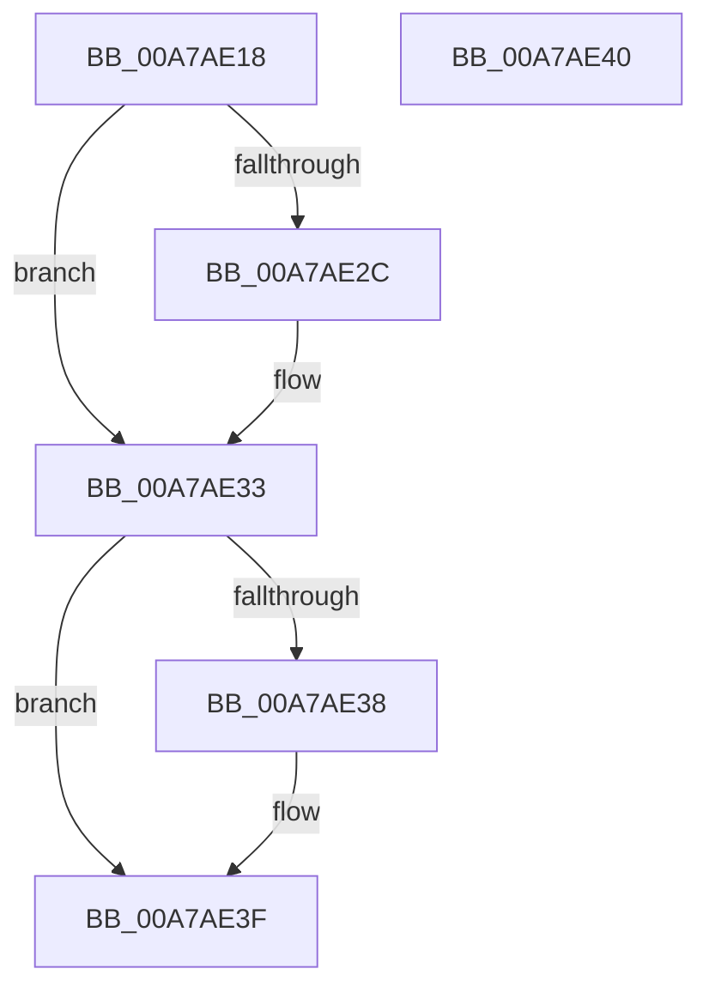

# CmpSubtreeEnumeratorGetCurrentKeyStacks

- RVA: `0x00A7AE18`–`0x00A7AE41` (길이 `41` bytes)
- VA: `0x0000000140A7AE18`
- 실행 섹션: `PAGE`
- PDB 이름 있음: `예`; PDB Function 태그: `아니요`
- unwind 정보 RVA: `0x000DB714`
- 디코드: `13`개 명령, `41/41` bytes 표시
- 미해석 바이트: `0` (있으면 어셈블리에 `.byte`로 보존)

> 이 문서는 커널 이미지의 기계어와 PDB 기호를 분석해 생성했습니다. 4번과 5번은 함수 원형과 자료형을 바이너리 사용 방식에서 추정한 C 해석이며 원본 소스 복구 결과는 아닙니다.

## 1. Dependencies

- 직접 호출 지점: **0**; 고유 호출 대상: **0**
- 직접 호출자로 확인된 함수: **1**
- RIP 상대 이미지 참조: **0**

### Outgoing calls
- 직접 디코드된 call 명령이 없습니다.

### Direct callers
- [CmRenameKey](../7E/CmRenameKey_function_007E8F48.md) at `0x007E9AEC`
- [CmRenameKey](../7E/CmRenameKey_function_007E8F48.md) at `0x007E9F7F`

### Static image references
- 디코드된 RIP-relative 메모리 참조가 없습니다.

## 2. Other-region calls and transfers

- 다른 실행 섹션으로 향하는 call: **0**
- 별도 외부 분기/꼬리 이동을 확인하지 못했습니다.

## 3. Assembly (complete function range)

```asm
00A7AE18  48 0F BF 01                     movsx rax, word ptr [rcx]
00A7AE1C  4C 69 C8 98 01 00 00            imul r9, rax, 0x198
00A7AE23  4C 03 49 60                     add r9, qword ptr [rcx + 0x60]
00A7AE27  48 85 D2                        test rdx, rdx
00A7AE2A  74 07                           je 0x140a7ae33
00A7AE2C  49 8B 41 08                     mov rax, qword ptr [r9 + 8]
00A7AE30  48 89 02                        mov qword ptr [rdx], rax
00A7AE33  4D 85 C0                        test r8, r8
00A7AE36  74 07                           je 0x140a7ae3f
00A7AE38  49 8B 41 10                     mov rax, qword ptr [r9 + 0x10]
00A7AE3C  49 89 00                        mov qword ptr [r8], rax
00A7AE3F  C3                              ret
00A7AE40  CC                              int3
```

## 4. C-style interpretation (structured pseudocode)

```c
__int64 __fastcall CmpSubtreeEnumeratorGetCurrentKeyStacks(__int64 a1, __int64 a2, __int64 a3)
{
    __int64 result;

    a4 = (a4) * ((__int16)(*(unsigned __int16 *)(a1)));
    a4 = (a4) + (*(unsigned __int64 *)(a1 + 96));
    result = (__int16)(*(unsigned __int16 *)(a1));
    if (a2 != 0) {
        result = *(unsigned __int64 *)(a4 + 8);
        *(unsigned __int64 *)(a2) = result;
    }
    if (a3 != 0) {
        result = *(unsigned __int64 *)(a4 + 16);
        *(unsigned __int64 *)(a3) = result;
    }
    return result;
}
```

## 5. (Beta) C Style

```c
int64_t CmpSubtreeEnumeratorGetCurrentKeyStacks(void *Arg1, int64_t Arg2, int64_t Arg3)
{
    uint8_t *arg1 = (uint8_t *)Arg1;

    int64_t result;

    a4 = (a4) * ((int16_t)(*(uint16_t *)(arg1)));
    a4 = (a4) + (*(uint64_t *)(arg1 + 0x60));
    result = (int16_t)(*(uint16_t *)(arg1));
    if (Arg2 != 0) {
        result = *(uint64_t *)(a4 + 0x8);
        *(uint64_t *)(Arg2) = result;
    }
    if (Arg3 != 0) {
        result = *(uint64_t *)(a4 + 0x10);
        *(uint64_t *)(Arg3) = result;
    }
    return result;
}
```

### 관측된 메모리 오프셋

구조체 형식이 확인되지 않은 접근은 인자 기준의 오프셋으로만 기록했습니다.

| 기준 인자 | 오프셋 표현 | 폭 (bit) | 접근 |
|---|---:|---:|---|
| `Arg1` | `+ 0x0` | `16` | `R` |
| `Arg1` | `+ 0x60` | `64` | `R` |

## 6. Execution-region graph

[열기: 2D/3D 그래프와 함수 탐색 컨트롤 패널](../../../control-panel.html?section=page&rva=0x00A7AE18&view=graph)

- 2D 그래프는 위에서 아래로 흐르고, 3D 그래프는 빈 공간을 드래그해 회전합니다. Shift+드래그는 이동, 휠은 확대·축소, 함수 노드 선택은 대상 보고서 이동입니다.

### Static fallback


