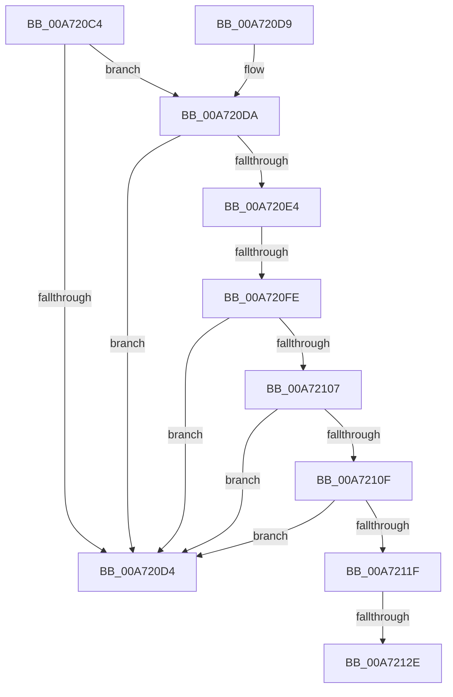

# CmpUpdateSystemHiveHysteresis

- RVA: `0x00A720C4`–`0x00A72133` (길이 `111` bytes)
- VA: `0x0000000140A720C4`
- 실행 섹션: `PAGE`
- PDB 이름 있음: `예`; PDB Function 태그: `예`
- unwind 정보 RVA: `0x000B54C8`
- 디코드: `27`개 명령, `111/111` bytes 표시
- 미해석 바이트: `0` (있으면 어셈블리에 `.byte`로 보존)

> 이 문서는 커널 이미지의 기계어와 PDB 기호를 분석해 생성했습니다. 4번과 5번은 함수 원형과 자료형을 바이너리 사용 방식에서 추정한 C 해석이며 원본 소스 복구 결과는 아닙니다.

## 1. Dependencies

- 직접 호출 지점: **1**; 고유 호출 대상: **1**
- 직접 호출자로 확인된 함수: **2**
- RIP 상대 이미지 참조: **7**

### Outgoing calls
- `0x00A72121` → [CmpDoQueueSystemHiveHysteresis](../7E/CmpDoQueueSystemHiveHysteresis_function_007E224C.md) (function, `0x007E224C`)

### Direct callers
- [HvpAddBin](../AF/HvpAddBin_function_00AF7D48.md) at `0x00AF8472`
- [sub_00B3E78C](../B3/Unknown_function_00B3E78C.md) at `0x00B3E89E`

### Static image references
- `0x00A720C8` → RVA `0x00E09AE0` (`.data`; read)
- `0x00A720DA` → RVA `0x00EEFBB8` (`.data`; read)
- `0x00A720EF` → RVA `0x00EEFBA8` (`.data`; read)
- `0x00A720FE` → RVA `0x00EEFBCC` (`.data`; read)
- `0x00A72107` → RVA `0x00EEFBC8` (`.data`; read)
- `0x00A7210F` → RVA `0x00EEFBCD` (`.data`; read)
- `0x00A72116` → RVA `0x00EEFBCC` (`.data`; write)

## 2. Other-region calls and transfers

- 다른 실행 섹션으로 향하는 call: **0**
- call이 아닌 외부 분기/꼬리 이동: **3**
  - `0x00A720F8` → [sub_00B40366](../B4/Unknown_function_00B40366.md) (`tail-transfer`)
  - `0x00A72128` → [sub_00B40366 + 0x38](../B4/Unknown_function_00B40366.md) (`tail-transfer`)
  - `0x00A7212E` → [sub_00B40366 + 0x44](../B4/Unknown_function_00B40366.md) (`tail-transfer`)

## 3. Assembly (complete function range)

```asm
00A720C4  48 83 EC 28                     sub rsp, 0x28
00A720C8  48 3B 0D 11 7A 39 00            cmp rcx, qword ptr [rip + 0x397a11]
00A720CF  44 8B CA                        mov r9d, edx
00A720D2  74 06                           je 0x140a720da
00A720D4  48 83 C4 28                     add rsp, 0x28
00A720D8  C3                              ret
00A720D9  CC                              int3
00A720DA  48 83 3D D6 DA 47 00 00         cmp qword ptr [rip + 0x47dad6], 0
00A720E2  74 F0                           je 0x140a720d4
00A720E4  8D 82 00 10 00 00               lea eax, [rdx + 0x1000]
00A720EA  33 D2                           xor edx, edx
00A720EC  6B C0 64                        imul eax, eax, 0x64
00A720EF  F7 35 B3 DA 47 00               div dword ptr [rip + 0x47dab3]
00A720F5  45 3B C8                        cmp r9d, r8d
00A720F8  0F 86 68 E2 0C 00               jbe 0x140b40366
00A720FE  80 3D C7 DA 47 00 00            cmp byte ptr [rip + 0x47dac7], 0
00A72105  75 CD                           jne 0x140a720d4
00A72107  3B 05 BB DA 47 00               cmp eax, dword ptr [rip + 0x47dabb]
00A7210D  76 C5                           jbe 0x140a720d4
00A7210F  80 3D B7 DA 47 00 01            cmp byte ptr [rip + 0x47dab7], 1
00A72116  C6 05 AF DA 47 00 01            mov byte ptr [rip + 0x47daaf], 1
00A7211D  75 B5                           jne 0x140a720d4
00A7211F  8B C8                           mov ecx, eax
00A72121  E8 26 01 D7 FF                  call 0x1407e224c
00A72126  3C 01                           cmp al, 1
00A72128  0F 85 70 E2 0C 00               jne 0x140b4039e
00A7212E  E9 77 E2 0C 00                  jmp 0x140b403aa
```

## 4. C-style interpretation (structured pseudocode)

```c
__int64 __fastcall CmpUpdateSystemHiveHysteresis(__int64 a1, __int64 a2, int a3)
{
    __int64 result;
    __int64 v_rsp;

    v_rsp = (v_rsp) - (40);
    if (a1 == (*(unsigned __int64 *)(v_rip + 3766801))) goto loc_00A720DA;
loc_00A720D4:
    v_rsp = (v_rsp) + (40);
    return result;
loc_00A720DA:
    if ((*(unsigned __int64 *)(v_rip + 4709078)) == 0) goto loc_00A720D4;
    a2 = 0;
    result = (unsigned int)((a2 + 4096) * ((unsigned int)(a2 + 4096)));
    if ((*(unsigned __int8 *)(v_rip + 4709063)) != 0) goto loc_00A720D4;
    if (((unsigned int)(result)) <= (*(unsigned int *)(v_rip + 4709051))) goto loc_00A720D4;
    *(unsigned __int8 *)(v_rip + 4709039) = 1;
    if ((*(unsigned __int8 *)(v_rip + 4709047)) != 1) goto loc_00A720D4;
    result = CmpDoQueueSystemHiveHysteresis((unsigned int)((unsigned int)(result)), a2, a3, (unsigned int)((unsigned int)(a2)));
}
```

## 5. (Beta) C Style

```c
int64_t CmpUpdateSystemHiveHysteresis(int64_t Arg1, void *Arg2, int32_t Arg3)
{
    uint8_t *arg2 = (uint8_t *)Arg2;

    int64_t result;
    int64_t local_rsp;

    local_rsp = (local_rsp) - (40);
    if (Arg1 == (*(uint64_t *)(v_rip + 0x397A11))) goto loc_00A720DA;
loc_00A720D4:
    local_rsp = (local_rsp) + (40);
    return result;
loc_00A720DA:
    if ((*(uint64_t *)(v_rip + 0x47DAD6)) == 0) goto loc_00A720D4;
    Arg2 = 0;
    result = (uint32_t)((Arg2 + 4096) * ((uint32_t)(Arg2 + 4096)));
    if ((*(uint8_t *)(v_rip + 0x47DAC7)) != 0) goto loc_00A720D4;
    if (((uint32_t)(result)) <= (*(uint32_t *)(v_rip + 0x47DABB))) goto loc_00A720D4;
    *(uint8_t *)(v_rip + 0x47DAAF) = 1;
    if ((*(uint8_t *)(v_rip + 0x47DAB7)) != 1) goto loc_00A720D4;
    result = CmpDoQueueSystemHiveHysteresis((uint32_t)((uint32_t)(result)), Arg2, Arg3, (uint32_t)((uint32_t)(Arg2)));
}
```

### 관측된 메모리 오프셋

구조체 형식이 확인되지 않은 접근은 인자 기준의 오프셋으로만 기록했습니다.

| 기준 인자 | 오프셋 표현 | 폭 (bit) | 접근 |
|---|---:|---:|---|
| `Arg2` | `+ 0x1000` | `32` | `R` |

## 6. Execution-region graph

[열기: 2D/3D 그래프와 함수 탐색 컨트롤 패널](../../../control-panel.html?section=page&rva=0x00A720C4&view=graph)

- 2D 그래프는 위에서 아래로 흐르고, 3D 그래프는 빈 공간을 드래그해 회전합니다. Shift+드래그는 이동, 휠은 확대·축소, 함수 노드 선택은 대상 보고서 이동입니다.

### Static fallback


