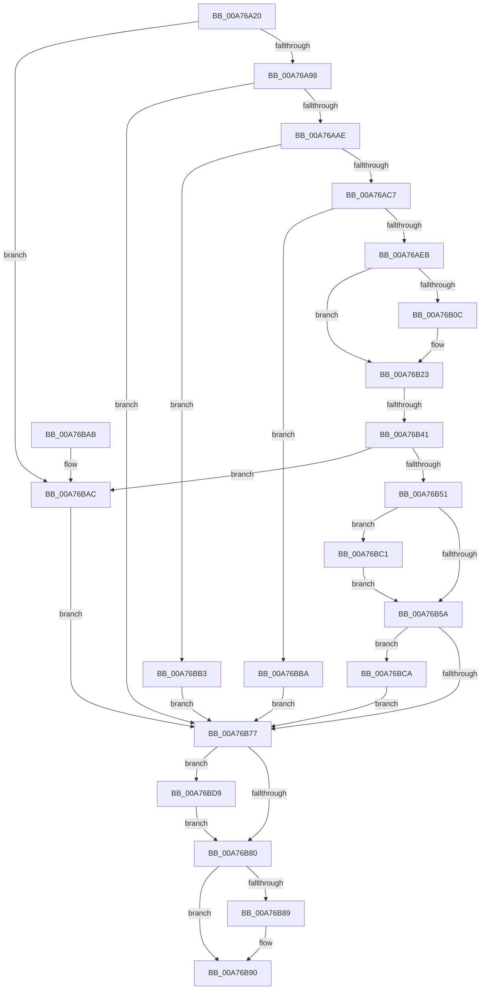

# CmpVEExecuteVirtualStoreParseLogic

- RVA: `0x00A76A20`–`0x00A76BE2` (길이 `450` bytes)
- VA: `0x0000000140A76A20`
- 실행 섹션: `PAGE`
- PDB 이름 있음: `예`; PDB Function 태그: `예`
- unwind 정보 RVA: `0x000B5CF0`
- 디코드: `129`개 명령, `450/450` bytes 표시
- 미해석 바이트: `0` (있으면 어셈블리에 `.byte`로 보존)

> 이 문서는 커널 이미지의 기계어와 PDB 기호를 분석해 생성했습니다. 4번과 5번은 함수 원형과 자료형을 바이너리 사용 방식에서 추정한 C 해석이며 원본 소스 복구 결과는 아닙니다.

## 1. Dependencies

- 직접 호출 지점: **12**; 고유 호출 대상: **8**
- 직접 호출자로 확인된 함수: **1**
- RIP 상대 이미지 참조: **0**

### Outgoing calls
- `0x00A76A6C` → [RtlInitUnicodeString](../../text/42/RtlInitUnicodeString_function_0042A780.md) (function, `0x0042A780`)
- `0x00A76A77` → [RtlInitUnicodeString](../../text/42/RtlInitUnicodeString_function_0042A780.md) (function, `0x0042A780`)
- `0x00A76A8B` → [CmpVirtualBranchIsReplicated](../84/CmpVirtualBranchIsReplicated_function_0084A3E0.md) (function, `0x0084A3E0`)
- `0x00A76A9F` → [CmVirtualKCBToRealPath](CmVirtualKCBToRealPath_function_00A76BE8.md) (function, `0x00A76BE8`)
- `0x00A76AD9` → [ExAllocatePool2](../../poolcode/B8/ExAllocatePool2_function_00B820F0.md) (function, `0x00B820F0`)
- `0x00A76AF3` → [RtlUnicodeStringCopy](../../text/3D/RtlUnicodeStringCopy_function_003D4130.md) (function, `0x003D4130`)
- `0x00A76B2A` → [RtlUnicodeStringCat](../../text/3E/RtlUnicodeStringCat_function_003E6030.md) (function, `0x003E6030`)
- `0x00A76B68` → [RtlInitUnicodeString](../../text/42/RtlInitUnicodeString_function_0042A780.md) (function, `0x0042A780`)
- `0x00A76B8B` → [ExFreePoolWithTag](../../poolcode/B8/ExFreePoolWithTag_function_00B82870.md) (function, `0x00B82870`)
- `0x00A76BC3` → [ExFreePoolWithTag](../../poolcode/B8/ExFreePoolWithTag_function_00B82870.md) (function, `0x00B82870`)
- `0x00A76BD2` → [CmpUnblockHiveWrites](../A5/CmpUnblockHiveWrites_function_00A5E4B0.md) (function, `0x00A5E4B0`)
- `0x00A76BDB` → [ExFreePoolWithTag](../../poolcode/B8/ExFreePoolWithTag_function_00B82870.md) (function, `0x00B82870`)

### Direct callers
- [CmpDoParseKey](../85/CmpDoParseKey_function_0085F750.md) at `0x008610EF`

### Static image references
- 디코드된 RIP-relative 메모리 참조가 없습니다.

## 2. Other-region calls and transfers

- 다른 실행 섹션으로 향하는 call: **9**
  - `0x00A76A6C` → [RtlInitUnicodeString](../../text/42/RtlInitUnicodeString_function_0042A780.md) (`PAGE` → `.text`)
  - `0x00A76A77` → [RtlInitUnicodeString](../../text/42/RtlInitUnicodeString_function_0042A780.md) (`PAGE` → `.text`)
  - `0x00A76AD9` → [ExAllocatePool2](../../poolcode/B8/ExAllocatePool2_function_00B820F0.md) (`PAGE` → `POOLCODE`)
  - `0x00A76AF3` → [RtlUnicodeStringCopy](../../text/3D/RtlUnicodeStringCopy_function_003D4130.md) (`PAGE` → `.text`)
  - `0x00A76B2A` → [RtlUnicodeStringCat](../../text/3E/RtlUnicodeStringCat_function_003E6030.md) (`PAGE` → `.text`)
  - `0x00A76B68` → [RtlInitUnicodeString](../../text/42/RtlInitUnicodeString_function_0042A780.md) (`PAGE` → `.text`)
  - `0x00A76B8B` → [ExFreePoolWithTag](../../poolcode/B8/ExFreePoolWithTag_function_00B82870.md) (`PAGE` → `POOLCODE`)
  - `0x00A76BC3` → [ExFreePoolWithTag](../../poolcode/B8/ExFreePoolWithTag_function_00B82870.md) (`PAGE` → `POOLCODE`)
  - `0x00A76BDB` → [ExFreePoolWithTag](../../poolcode/B8/ExFreePoolWithTag_function_00B82870.md) (`PAGE` → `POOLCODE`)
- call이 아닌 외부 분기/꼬리 이동: **1**
  - `0x00A76B3B` → [sub_00B4160E](../B4/Unknown_function_00B4160E.md) (`tail-transfer`)

## 3. Assembly (complete function range)

```asm
00A76A20  48 89 5C 24 08                  mov qword ptr [rsp + 8], rbx
00A76A25  48 89 74 24 10                  mov qword ptr [rsp + 0x10], rsi
00A76A2A  55                              push rbp
00A76A2B  57                              push rdi
00A76A2C  41 54                           push r12
00A76A2E  41 56                           push r14
00A76A30  41 57                           push r15
00A76A32  48 8B EC                        mov rbp, rsp
00A76A35  48 83 EC 70                     sub rsp, 0x70
00A76A39  48 83 65 D0 00                  and qword ptr [rbp - 0x30], 0
00A76A3E  4C 8B FA                        mov r15, rdx
00A76A41  83 65 C0 00                     and dword ptr [rbp - 0x40], 0
00A76A45  4C 8B F1                        mov r14, rcx
00A76A48  0F 57 C0                        xorps xmm0, xmm0
00A76A4B  C6 45 40 00                     mov byte ptr [rbp + 0x40], 0
00A76A4F  0F 57 C9                        xorps xmm1, xmm1
00A76A52  48 8D 4D E8                     lea rcx, [rbp - 0x18]
00A76A56  33 F6                           xor esi, esi
00A76A58  33 D2                           xor edx, edx
00A76A5A  0F 11 45 E8                     movups xmmword ptr [rbp - 0x18], xmm0
00A76A5E  48 89 75 C8                     mov qword ptr [rbp - 0x38], rsi
00A76A62  49 8B F9                        mov rdi, r9
00A76A65  0F 11 4D D8                     movups xmmword ptr [rbp - 0x28], xmm1
00A76A69  4D 8B E0                        mov r12, r8
00A76A6C  E8 0F 3D 9B FF                  call 0x14042a780
00A76A71  33 D2                           xor edx, edx
00A76A73  48 8D 4D D8                     lea rcx, [rbp - 0x28]
00A76A77  E8 04 3D 9B FF                  call 0x14042a780
00A76A7C  41 83 0C 24 08                  or dword ptr [r12], 8
00A76A81  4C 8D 45 40                     lea r8, [rbp + 0x40]
00A76A85  49 8B D7                        mov rdx, r15
00A76A88  49 8B CE                        mov rcx, r14
00A76A8B  E8 50 39 DD FF                  call 0x14084a3e0
00A76A90  84 C0                           test al, al
00A76A92  0F 85 14 01 00 00               jne 0x140a76bac
00A76A98  48 8D 55 E8                     lea rdx, [rbp - 0x18]
00A76A9C  49 8B CE                        mov rcx, r14
00A76A9F  E8 44 01 00 00                  call 0x140a76be8
00A76AA4  8B D8                           mov ebx, eax
00A76AA6  85 C0                           test eax, eax
00A76AA8  0F 88 C9 00 00 00               js 0x140a76b77
00A76AAE  0F B7 55 E8                     movzx edx, word ptr [rbp - 0x18]
00A76AB2  41 0F B7 0F                     movzx ecx, word ptr [r15]
00A76AB6  83 C2 02                        add edx, 2
00A76AB9  03 D1                           add edx, ecx
00A76ABB  81 FA FF FF 00 00               cmp edx, 0xffff
00A76AC1  0F 87 EC 00 00 00               ja 0x140a76bb3
00A76AC7  0F B7 D2                        movzx edx, dx
00A76ACA  B9 00 01 00 00                  mov ecx, 0x100
00A76ACF  41 B8 43 4D 4E 62               mov r8d, 0x624e4d43
00A76AD5  66 89 55 DA                     mov word ptr [rbp - 0x26], dx
00A76AD9  E8 12 B6 10 00                  call 0x140b820f0
00A76ADE  48 89 45 E0                     mov qword ptr [rbp - 0x20], rax
00A76AE2  48 85 C0                        test rax, rax
00A76AE5  0F 84 CF 00 00 00               je 0x140a76bba
00A76AEB  48 8D 55 E8                     lea rdx, [rbp - 0x18]
00A76AEF  48 8D 4D D8                     lea rcx, [rbp - 0x28]
00A76AF3  E8 38 D6 95 FF                  call 0x1403d4130
00A76AF8  0F B7 55 D8                     movzx edx, word ptr [rbp - 0x28]
00A76AFC  44 8D 4E 02                     lea r9d, [rsi + 2]
00A76B00  0F B7 45 DA                     movzx eax, word ptr [rbp - 0x26]
00A76B04  41 8D 0C 11                     lea ecx, [r9 + rdx]
00A76B08  3B C8                           cmp ecx, eax
00A76B0A  77 17                           ja 0x140a76b23
00A76B0C  48 8B 45 E0                     mov rax, qword ptr [rbp - 0x20]
00A76B10  8B CA                           mov ecx, edx
00A76B12  48 D1 E9                        shr rcx, 1
00A76B15  66 41 03 D1                     add dx, r9w
00A76B19  66 89 55 D8                     mov word ptr [rbp - 0x28], dx
00A76B1D  66 C7 04 48 5C 00               mov word ptr [rax + rcx*2], 0x5c
00A76B23  49 8B D7                        mov rdx, r15
00A76B26  48 8D 4D D8                     lea rcx, [rbp - 0x28]
00A76B2A  E8 01 F5 96 FF                  call 0x1403e6030
00A76B2F  41 8B 04 24                     mov eax, dword ptr [r12]
00A76B33  41 BF 10 00 00 00               mov r15d, 0x10
00A76B39  A8 01                           test al, 1
00A76B3B  0F 85 CD AA 0C 00               jne 0x140b4160e
00A76B41  41 8B 46 08                     mov eax, dword ptr [r14 + 8]
00A76B45  25 00 00 E0 7F                  and eax, 0x7fe00000
00A76B4A  3D 00 00 80 00                  cmp eax, 0x800000
00A76B4F  76 5B                           jbe 0x140a76bac
00A76B51  48 8B 4F 08                     mov rcx, qword ptr [rdi + 8]
00A76B55  48 85 C9                        test rcx, rcx
00A76B58  75 67                           jne 0x140a76bc1
00A76B5A  0F 10 45 D8                     movups xmm0, xmmword ptr [rbp - 0x28]
00A76B5E  33 D2                           xor edx, edx
00A76B60  48 8D 4D D8                     lea rcx, [rbp - 0x28]
00A76B64  F3 0F 7F 07                     movdqu xmmword ptr [rdi], xmm0
00A76B68  E8 13 3C 9B FF                  call 0x14042a780
00A76B6D  BB 04 01 00 00                  mov ebx, 0x104
00A76B72  48 85 F6                        test rsi, rsi
00A76B75  75 53                           jne 0x140a76bca
00A76B77  48 8B 4D E0                     mov rcx, qword ptr [rbp - 0x20]
00A76B7B  48 85 C9                        test rcx, rcx
00A76B7E  75 59                           jne 0x140a76bd9
00A76B80  48 8B 4D F0                     mov rcx, qword ptr [rbp - 0x10]
00A76B84  48 85 C9                        test rcx, rcx
00A76B87  74 07                           je 0x140a76b90
00A76B89  33 D2                           xor edx, edx
00A76B8B  E8 E0 BC 10 00                  call 0x140b82870
00A76B90  4C 8D 5C 24 70                  lea r11, [rsp + 0x70]
00A76B95  8B C3                           mov eax, ebx
00A76B97  49 8B 5B 30                     mov rbx, qword ptr [r11 + 0x30]
00A76B9B  49 8B 73 38                     mov rsi, qword ptr [r11 + 0x38]
00A76B9F  49 8B E3                        mov rsp, r11
00A76BA2  41 5F                           pop r15
00A76BA4  41 5E                           pop r14
00A76BA6  41 5C                           pop r12
00A76BA8  5F                              pop rdi
00A76BA9  5D                              pop rbp
00A76BAA  C3                              ret
00A76BAB  CC                              int3
00A76BAC  BB 71 02 00 C0                  mov ebx, 0xc0000271
00A76BB1  EB C4                           jmp 0x140a76b77
00A76BB3  BB 0D 00 00 C0                  mov ebx, 0xc000000d
00A76BB8  EB BD                           jmp 0x140a76b77
00A76BBA  BB 9A 00 00 C0                  mov ebx, 0xc000009a
00A76BBF  EB B6                           jmp 0x140a76b77
00A76BC1  33 D2                           xor edx, edx
00A76BC3  E8 A8 BC 10 00                  call 0x140b82870
00A76BC8  EB 90                           jmp 0x140a76b5a
00A76BCA  4C 8B C6                        mov r8, rsi
00A76BCD  41 8B D7                        mov edx, r15d
00A76BD0  33 C9                           xor ecx, ecx
00A76BD2  E8 D9 78 FE FF                  call 0x140a5e4b0
00A76BD7  EB 9E                           jmp 0x140a76b77
00A76BD9  33 D2                           xor edx, edx
00A76BDB  E8 90 BC 10 00                  call 0x140b82870
00A76BE0  EB 9E                           jmp 0x140a76b80
```

## 4. C-style interpretation (structured pseudocode)

```c
__int64 __fastcall CmpVEExecuteVirtualStoreParseLogic(__int64 a1, __int64 a2, __int64 a3, __int64 a4)
{
    __int64 result;
    __int64 v_rsi;
    __int64 v_rsp;
    unsigned __int64 v_stack_m28;
    unsigned __int64 v_stack_m38;
    unsigned __int64 v_stack_m40;
    unsigned __int64 v_stack_m48;
    unsigned __int16 v_stack_m4E;
    unsigned __int64 v_stack_m50;
    unsigned __int64 v_stack_m58;
    unsigned __int64 v_stack_m60;
    unsigned int v_stack_m68;
    unsigned __int64 v_stack_p10;
    unsigned __int8 v_stack_p18;
    unsigned __int64 v_stack_p8;

    v_stack_p8 = v_rbx;
    v_stack_p10 = v_rsi;
    v_rsp = (v_rsp) - (112);
    v_stack_p18 = 0;
    v_rsi = 0;
    a2 = 0;
    v_stack_m40 = v_xmm0;
    v_stack_m60 = 0;
    v_stack_m50 = v_xmm1;
    result = RtlInitUnicodeString(v_stack_m40, a2, a3, a4);
    a2 = 0;
    result = RtlInitUnicodeString(v_stack_m50, a2, a3, a4);
    result = CmpVirtualBranchIsReplicated(a1, 0, v_stack_p18, a4);
    if ((unsigned __int8)(result) != 0) goto loc_00A76BAC;
    result = CmVirtualKCBToRealPath(a1, v_stack_m40, v_stack_p18, a4);
    if (sign_flag) goto loc_00A76B77;
    a2 = (unsigned int)((v_stack_m40) + (2));
    a2 = (unsigned int)((a2) + ((unsigned int)(*(unsigned __int16 *)(a2))));
    if (((unsigned int)(a2)) > 0xFFFFULL) goto loc_00A76BB3;
    v_stack_m4E = (unsigned __int16)((unsigned __int16)(a2));
    result = ExAllocatePool2(256, (unsigned __int16)(a2), (unsigned int)(0x624E4D43ULL), a4);
    v_stack_m48 = result;
    if (result == 0) goto loc_00A76BBA;
    result = RtlUnicodeStringCopy(v_stack_m50, v_stack_m40, (unsigned int)(0x624E4D43ULL), a4);
    result = v_stack_m4E;
    if (((unsigned int)(v_rsi + 2 + v_stack_m50 * 1)) <= ((unsigned int)(v_stack_m4E))) {
        result = v_stack_m48;
        a1 = (unsigned int)(v_stack_m50);
        a1 = (a1) >> (1);
        a2 = (unsigned __int16)((v_stack_m50) + ((unsigned __int16)(v_rsi + 2)));
        v_stack_m50 = (unsigned __int16)(a2);
        *(unsigned __int16 *)(result + a1 * 2) = 92;
    }
    result = RtlUnicodeStringCat(v_stack_m50, a2, (unsigned int)(0x624E4D43ULL), v_rsi + 2);
    result = (unsigned int)(((unsigned int)(*(unsigned int *)(a1 + 8))) & (0x7FE00000ULL));
    if (((unsigned int)(result)) <= 0x800000ULL) goto loc_00A76BAC;
    if (*(unsigned __int64 *)(a4 + 8) != 0) goto loc_00A76BC1;
loc_00A76B5A:
    a2 = 0;
    *(unsigned __int64 *)(a4) = v_xmm0;
    result = RtlInitUnicodeString(v_stack_m50, a2, (unsigned int)(0x624E4D43ULL), v_rsi + 2);
    if (0 != 0) goto loc_00A76BCA;
loc_00A76B77:
    if (v_stack_m48 != 0) goto loc_00A76BD9;
loc_00A76B80:
    if (v_stack_m38 != 0) {
        a2 = 0;
        result = ExFreePoolWithTag(v_stack_m38, a2, (unsigned int)(0x624E4D43ULL), v_rsi + 2);
    }
    return 260;
loc_00A76BAC:
    goto loc_00A76B77;
loc_00A76BB3:
    goto loc_00A76B77;
loc_00A76BBA:
    goto loc_00A76B77;
loc_00A76BC1:
    a2 = 0;
    result = ExFreePoolWithTag(v_stack_m38, a2, (unsigned int)(0x624E4D43ULL), v_rsi + 2);
    goto loc_00A76B5A;
loc_00A76BCA:
    a1 = 0;
    result = CmpUnblockHiveWrites(a1, 16, *(unsigned __int64 *)(v_stack_m28 + 56), v_rsi + 2);
    goto loc_00A76B77;
loc_00A76BD9:
    a2 = 0;
    result = ExFreePoolWithTag(a1, a2, *(unsigned __int64 *)(v_stack_m28 + 56), v_rsi + 2);
    goto loc_00A76B80;
}
```

## 5. (Beta) C Style

```c
int64_t CmpVEExecuteVirtualStoreParseLogic(void *Arg1, void *Arg2, void *Arg3, void *Arg4)
{
    uint8_t *arg1 = (uint8_t *)Arg1;
    uint8_t *arg2 = (uint8_t *)Arg2;
    uint8_t *arg3 = (uint8_t *)Arg3;
    uint8_t *arg4 = (uint8_t *)Arg4;

    int64_t result;
    int64_t local_rsi;
    int64_t local_rsp;
    uint64_t v_stack_m28;
    uint64_t v_stack_m38;
    uint64_t v_stack_m40;
    uint64_t v_stack_m48;
    uint16_t v_stack_m4E;
    uint64_t v_stack_m50;
    uint64_t v_stack_m58;
    uint64_t v_stack_m60;
    uint32_t v_stack_m68;
    uint64_t v_stack_p10;
    uint8_t v_stack_p18;
    uint64_t v_stack_p8;

    v_stack_p8 = local_rbx;
    v_stack_p10 = local_rsi;
    local_rsp = (local_rsp) - (112);
    v_stack_p18 = 0;
    local_rsi = 0;
    Arg2 = 0;
    v_stack_m40 = v_xmm0;
    v_stack_m60 = 0;
    v_stack_m50 = v_xmm1;
    result = RtlInitUnicodeString(v_stack_m40, Arg2, Arg3, Arg4);
    Arg2 = 0;
    result = RtlInitUnicodeString(v_stack_m50, Arg2, Arg3, Arg4);
    result = CmpVirtualBranchIsReplicated(Arg1, 0, v_stack_p18, Arg4);
    if ((uint8_t)(result) != 0) goto loc_00A76BAC;
    result = CmVirtualKCBToRealPath(Arg1, v_stack_m40, v_stack_p18, Arg4);
    if (sign_flag) goto loc_00A76B77;
    Arg2 = (uint32_t)((v_stack_m40) + (2));
    Arg2 = (uint32_t)((Arg2) + ((uint32_t)(*(uint16_t *)(arg2))));
    if (((uint32_t)(Arg2)) > 0xFFFFULL) goto loc_00A76BB3;
    v_stack_m4E = (uint16_t)((uint16_t)(Arg2));
    result = ExAllocatePool2(256, (uint16_t)(Arg2), (uint32_t)(0x624E4D43ULL), Arg4);
    v_stack_m48 = result;
    if (result == 0) goto loc_00A76BBA;
    result = RtlUnicodeStringCopy(v_stack_m50, v_stack_m40, (uint32_t)(0x624E4D43ULL), Arg4);
    result = v_stack_m4E;
    if (((uint32_t)(local_rsi + 2 + v_stack_m50 * 1)) <= ((uint32_t)(v_stack_m4E))) {
        result = v_stack_m48;
        Arg1 = (uint32_t)(v_stack_m50);
        Arg1 = (Arg1) >> (1);
        Arg2 = (uint16_t)((v_stack_m50) + ((uint16_t)(local_rsi + 2)));
        v_stack_m50 = (uint16_t)(Arg2);
        *(uint16_t *)(result + arg1 * 2) = 92;
    }
    result = RtlUnicodeStringCat(v_stack_m50, Arg2, (uint32_t)(0x624E4D43ULL), local_rsi + 2);
    result = (uint32_t)(((uint32_t)(*(uint32_t *)(arg1 + 0x8))) & (0x7FE00000ULL));
    if (((uint32_t)(result)) <= 0x800000ULL) goto loc_00A76BAC;
    if (*(uint64_t *)(arg4 + 0x8) != 0) goto loc_00A76BC1;
loc_00A76B5A:
    Arg2 = 0;
    *(uint64_t *)(arg4) = v_xmm0;
    result = RtlInitUnicodeString(v_stack_m50, Arg2, (uint32_t)(0x624E4D43ULL), local_rsi + 2);
    if (0 != 0) goto loc_00A76BCA;
loc_00A76B77:
    if (v_stack_m48 != 0) goto loc_00A76BD9;
loc_00A76B80:
    if (v_stack_m38 != 0) {
        Arg2 = 0;
        result = ExFreePoolWithTag(v_stack_m38, Arg2, (uint32_t)(0x624E4D43ULL), local_rsi + 2);
    }
    return 260;
loc_00A76BAC:
    goto loc_00A76B77;
loc_00A76BB3:
    goto loc_00A76B77;
loc_00A76BBA:
    goto loc_00A76B77;
loc_00A76BC1:
    Arg2 = 0;
    result = ExFreePoolWithTag(v_stack_m38, Arg2, (uint32_t)(0x624E4D43ULL), local_rsi + 2);
    goto loc_00A76B5A;
loc_00A76BCA:
    Arg1 = 0;
    result = CmpUnblockHiveWrites(Arg1, 16, *(uint64_t *)(v_stack_m28 + 0x38), local_rsi + 2);
    goto loc_00A76B77;
loc_00A76BD9:
    Arg2 = 0;
    result = ExFreePoolWithTag(Arg1, Arg2, *(uint64_t *)(v_stack_m28 + 0x38), local_rsi + 2);
    goto loc_00A76B80;
}
```

### 관측된 메모리 오프셋

구조체 형식이 확인되지 않은 접근은 인자 기준의 오프셋으로만 기록했습니다.

| 기준 인자 | 오프셋 표현 | 폭 (bit) | 접근 |
|---|---:|---:|---|
| `Arg1` | `+ 0x8` | `32` | `R` |
| `Arg2` | `+ 0x0` | `16` | `R` |
| `Arg3` | `+ 0x0` | `32` | `R` |
| `Arg3` | `+ 0x0` | `32` | `R/W` |
| `Arg4` | `+ 0x0` | `128` | `W` |
| `Arg4` | `+ 0x8` | `64` | `R` |

## 6. Execution-region graph

[열기: 2D/3D 그래프와 함수 탐색 컨트롤 패널](../../../control-panel.html?section=page&rva=0x00A76A20&view=graph)

- 2D 그래프는 위에서 아래로 흐르고, 3D 그래프는 빈 공간을 드래그해 회전합니다. Shift+드래그는 이동, 휠은 확대·축소, 함수 노드 선택은 대상 보고서 이동입니다.

### Static fallback


