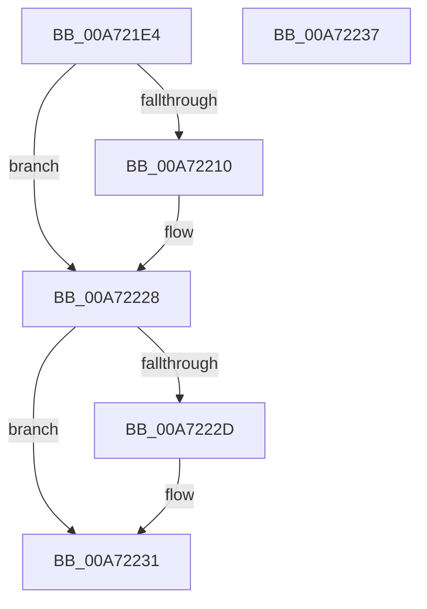

# CmpVolumeManagerLockContextListShared

- RVA: `0x00A721E4`–`0x00A72238` (길이 `84` bytes)
- VA: `0x0000000140A721E4`
- 실행 섹션: `PAGE`
- PDB 이름 있음: `예`; PDB Function 태그: `아니요`
- unwind 정보 RVA: `0x0005CF00`
- 디코드: `23`개 명령, `84/84` bytes 표시
- 미해석 바이트: `0` (있으면 어셈블리에 `.byte`로 보존)

> 이 문서는 커널 이미지의 기계어와 PDB 기호를 분석해 생성했습니다. 4번과 5번은 함수 원형과 자료형을 바이너리 사용 방식에서 추정한 C 해석이며 원본 소스 복구 결과는 아닙니다.

## 1. Dependencies

- 직접 호출 지점: **2**; 고유 호출 대상: **2**
- 직접 호출자로 확인된 함수: **1**
- RIP 상대 이미지 참조: **1**

### Outgoing calls
- `0x00A721F6` → [KeAbPreAcquire](../../text/21/KeAbPreAcquire_function_00210230.md) (function, `0x00210230`)
- `0x00A72223` → [ExfAcquirePushLockSharedEx](../../text/21/ExfAcquirePushLockSharedEx_function_0021044C.md) (function, `0x0021044C`)

### Direct callers
- [CmpVolumeManagerGetContextForFile](../95/CmpVolumeManagerGetContextForFile_function_009525A8.md) at `0x00952654`

### Static image references
- `0x00A721ED` → RVA `0x00FDA418` (`PAGEDATA`; read)

## 2. Other-region calls and transfers

- 다른 실행 섹션으로 향하는 call: **2**
  - `0x00A721F6` → [KeAbPreAcquire](../../text/21/KeAbPreAcquire_function_00210230.md) (`PAGE` → `.text`)
  - `0x00A72223` → [ExfAcquirePushLockSharedEx](../../text/21/ExfAcquirePushLockSharedEx_function_0021044C.md) (`PAGE` → `.text`)
- 별도 외부 분기/꼬리 이동을 확인하지 못했습니다.

## 3. Assembly (complete function range)

```asm
00A721E4  40 53                           push rbx
00A721E6  48 83 EC 20                     sub rsp, 0x20
00A721EA  45 33 C0                        xor r8d, r8d
00A721ED  48 8D 0D 24 82 56 00            lea rcx, [rip + 0x568224]
00A721F4  33 D2                           xor edx, edx
00A721F6  E8 35 E0 79 FF                  call 0x140210230
00A721FB  48 8B D8                        mov rbx, rax
00A721FE  BA 11 00 00 00                  mov edx, 0x11
00A72203  33 C0                           xor eax, eax
00A72205  F0 48 0F B1 15 0A 82 56 00      lock cmpxchg qword ptr [rip + 0x56820a], rdx
00A7220E  74 18                           je 0x140a72228
00A72210  4C 8D 0D 01 82 56 00            lea r9, [rip + 0x568201]
00A72217  4C 8B C3                        mov r8, rbx
00A7221A  33 D2                           xor edx, edx
00A7221C  48 8D 0D F5 81 56 00            lea rcx, [rip + 0x5681f5]
00A72223  E8 24 E2 79 FF                  call 0x14021044c
00A72228  48 85 DB                        test rbx, rbx
00A7222B  74 04                           je 0x140a72231
00A7222D  C6 43 0A 01                     mov byte ptr [rbx + 0xa], 1
00A72231  48 83 C4 20                     add rsp, 0x20
00A72235  5B                              pop rbx
00A72236  C3                              ret
00A72237  CC                              int3
```

## 4. C-style interpretation (structured pseudocode)

```c
__int64 __fastcall CmpVolumeManagerLockContextListShared(__int64 a1, int a2, int a3)
{
    __int64 result;
    __int64 v_rsp;

    v_rsp = (v_rsp) - (32);
    a3 = 0;
    a2 = 0;
    result = KeAbPreAcquire(v_rip + 5669412, a2, a3, a4);
    result = 0;
    if (!(condition_is_equal)) {
        a4 = v_rip + 5669377;
        a3 = 0;
        a2 = 0;
        a1 = v_rip + 5669365;
        result = ExfAcquirePushLockSharedEx(a1, a2, a3, a4);
    }
    if (result != 0) {
        *(unsigned __int8 *)(result + 10) = 1;
    }
    v_rsp = (v_rsp) + (32);
    return result;
}
```

## 5. (Beta) C Style

```c
int64_t CmpVolumeManagerLockContextListShared(int64_t Arg1, int32_t Arg2, int32_t Arg3)
{
    int64_t result;
    int64_t local_rsp;

    local_rsp = (local_rsp) - (32);
    Arg3 = 0;
    Arg2 = 0;
    result = KeAbPreAcquire(v_rip + 5669412, Arg2, Arg3, a4);
    result = 0;
    if (!(condition_is_equal)) {
        a4 = v_rip + 5669377;
        Arg3 = 0;
        Arg2 = 0;
        Arg1 = v_rip + 5669365;
        result = ExfAcquirePushLockSharedEx(Arg1, Arg2, Arg3, a4);
    }
    if (result != 0) {
        *(uint8_t *)(result + 0xA) = 1;
    }
    local_rsp = (local_rsp) + (32);
    return result;
}
```

## 6. Execution-region graph

[열기: 2D/3D 그래프와 함수 탐색 컨트롤 패널](../../../control-panel.html?section=page&rva=0x00A721E4&view=graph)

- 2D 그래프는 위에서 아래로 흐르고, 3D 그래프는 빈 공간을 드래그해 회전합니다. Shift+드래그는 이동, 휠은 확대·축소, 함수 노드 선택은 대상 보고서 이동입니다.

### Static fallback


