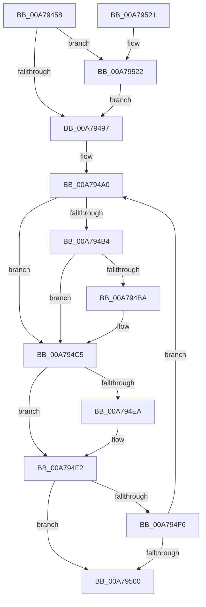

# DbgkpSendApiMessage

- RVA: `0x00A79458`–`0x00A79545` (길이 `237` bytes)
- VA: `0x0000000140A79458`
- 실행 섹션: `PAGE`
- PDB 이름 있음: `예`; PDB Function 태그: `아니요`
- unwind 정보 RVA: `0x000B61E4`
- 디코드: `60`개 명령, `237/237` bytes 표시
- 미해석 바이트: `0` (있으면 어셈블리에 `.byte`로 보존)

> 이 문서는 커널 이미지의 기계어와 PDB 기호를 분석해 생성했습니다. 4번과 5번은 함수 원형과 자료형을 바이너리 사용 방식에서 추정한 C 해석이며 원본 소스 복구 결과는 아닙니다.

## 1. Dependencies

- 직접 호출 지점: **4**; 고유 호출 대상: **4**
- 직접 호출자로 확인된 함수: **10**
- RIP 상대 이미지 참조: **1**

### Outgoing calls
- `0x00A794BD` → [DbgkpSuspendProcess](../8A/DbgkpSuspendProcess_function_008A34D4.md) (function, `0x008A34D4`)
- `0x00A794DF` → [DbgkpQueueMessage](../8A/DbgkpQueueMessage_function_008A31C0.md) (function, `0x008A31C0`)
- `0x00A794ED` → [DbgkpResumeProcess](DbgkpResumeProcess_function_00A7954C.md) (function, `0x00A7954C`)
- `0x00A7953B` → [EtwTraceDebuggerEvent](../../text/4D/EtwTraceDebuggerEvent_function_004D2700.md) (function, `0x004D2700`)

### Direct callers
- [DbgkPostModuleMessage](../../text/49/DbgkPostModuleMessage_function_004913C4.md) at `0x00491512`
- [DbgkCreateMinimalProcess](../71/DbgkCreateMinimalProcess_function_007108F8.md) at `0x00710971`
- [DbgkExitProcess](../71/DbgkExitProcess_function_00710998.md) at `0x00710A2E`
- [DbgkExitThread](../71/DbgkExitThread_function_00710A54.md) at `0x00710ADC`
- [DbgkMapViewOfSection](../89/DbgkMapViewOfSection_function_00897460.md) at `0x008975C4`
- [DbgkCreateThread](../8D/DbgkCreateThread_function_008D5E34.md) at `0x008D614F`
- [DbgkCreateMinimalThread](../8D/DbgkCreateMinimalThread_function_008D6748.md) at `0x008D67CA`
- [DbgkSendSystemDllMessages](../A1/DbgkSendSystemDllMessages_function_00A10C04.md) at `0x00A10EE6`
- [sub_00B1BA80](../B1/Unknown_function_00B1BA80.md) at `0x00B1BB70`
- [sub_00B3A32E](../B3/Unknown_function_00B3A32E.md) at `0x00B3A358`

### Static image references
- `0x00A79481` → RVA `0x00FC6B00` (`ALMOSTRO`; read)

## 2. Other-region calls and transfers

- 다른 실행 섹션으로 향하는 call: **1**
  - `0x00A7953B` → [EtwTraceDebuggerEvent](../../text/4D/EtwTraceDebuggerEvent_function_004D2700.md) (`PAGE` → `.text`)
- 별도 외부 분기/꼬리 이동을 확인하지 못했습니다.

## 3. Assembly (complete function range)

```asm
00A79458  48 8B C4                        mov rax, rsp
00A7945B  48 89 58 08                     mov qword ptr [rax + 8], rbx
00A7945F  48 89 68 10                     mov qword ptr [rax + 0x10], rbp
00A79463  48 89 70 18                     mov qword ptr [rax + 0x18], rsi
00A79467  48 89 78 20                     mov qword ptr [rax + 0x20], rdi
00A7946B  41 54                           push r12
00A7946D  41 56                           push r14
00A7946F  41 57                           push r15
00A79471  48 83 EC 30                     sub rsp, 0x30
00A79475  65 4C 8B 24 25 88 01 00 00      mov r12, qword ptr gs:[0x188]
00A7947E  4D 8B F0                        mov r14, r8
00A79481  F7 05 75 D6 54 00 00 00 40 00   test dword ptr [rip + 0x54d675], 0x400000
00A7948B  44 8B FA                        mov r15d, edx
00A7948E  48 8B F9                        mov rdi, rcx
00A79491  0F 85 8B 00 00 00               jne 0x140a79522
00A79497  41 8B DF                        mov ebx, r15d
00A7949A  83 E3 02                        and ebx, 2
00A7949D  C1 E3 05                        shl ebx, 5
00A794A0  65 48 8B 04 25 88 01 00 00      mov rax, qword ptr gs:[0x188]
00A794A9  33 ED                           xor ebp, ebp
00A794AB  48 3B B8 B8 00 00 00            cmp rdi, qword ptr [rax + 0xb8]
00A794B2  75 11                           jne 0x140a794c5
00A794B4  41 F6 C7 01                     test r15b, 1
00A794B8  74 0B                           je 0x140a794c5
00A794BA  48 8B CF                        mov rcx, rdi
00A794BD  E8 12 A0 E2 FF                  call 0x1408a34d4
00A794C2  0F B6 E8                        movzx ebp, al
00A794C5  48 83 64 24 20 00               and qword ptr [rsp + 0x20], 0
00A794CB  44 8B CB                        mov r9d, ebx
00A794CE  4D 8B C6                        mov r8, r14
00A794D1  41 C7 46 2C 03 01 00 00         mov dword ptr [r14 + 0x2c], 0x103
00A794D9  49 8B D4                        mov rdx, r12
00A794DC  48 8B CF                        mov rcx, rdi
00A794DF  E8 DC 9C E2 FF                  call 0x1408a31c0
00A794E4  8B F0                           mov esi, eax
00A794E6  85 ED                           test ebp, ebp
00A794E8  74 08                           je 0x140a794f2
00A794EA  48 8B CF                        mov rcx, rdi
00A794ED  E8 5A 00 00 00                  call 0x140a7954c
00A794F2  85 F6                           test esi, esi
00A794F4  78 0A                           js 0x140a79500
00A794F6  41 81 7E 2C 01 00 01 40         cmp dword ptr [r14 + 0x2c], 0x40010001
00A794FE  74 A0                           je 0x140a794a0
00A79500  48 8B 5C 24 50                  mov rbx, qword ptr [rsp + 0x50]
00A79505  8B C6                           mov eax, esi
00A79507  48 8B 74 24 60                  mov rsi, qword ptr [rsp + 0x60]
00A7950C  48 8B 6C 24 58                  mov rbp, qword ptr [rsp + 0x58]
00A79511  48 8B 7C 24 68                  mov rdi, qword ptr [rsp + 0x68]
00A79516  48 83 C4 30                     add rsp, 0x30
00A7951A  41 5F                           pop r15
00A7951C  41 5E                           pop r14
00A7951E  41 5C                           pop r12
00A79520  C3                              ret
00A79521  CC                              int3
00A79522  65 48 8B 0C 25 88 01 00 00      mov rcx, qword ptr gs:[0x188]
00A7952B  41 B8 01 00 00 00               mov r8d, 1
00A79531  49 8B D4                        mov rdx, r12
00A79534  48 8B 89 B8 00 00 00            mov rcx, qword ptr [rcx + 0xb8]
00A7953B  E8 C0 91 A5 FF                  call 0x1404d2700
00A79540  E9 52 FF FF FF                  jmp 0x140a79497
```

## 4. C-style interpretation (structured pseudocode)

```c
__int64 __fastcall DbgkpSendApiMessage(__int64 a1, int a2, __int64 a3)
{
    __int64 result;
    __int64 v_rbp;
    __int64 v_rbx;
    __int64 v_rsp;
    unsigned __int64 v_stack_m28;
    unsigned __int64 v_stack_p10;
    unsigned __int64 v_stack_p18;
    unsigned __int64 v_stack_p20;
    unsigned __int64 v_stack_p8;

    *(unsigned __int64 *)(v_rsp + 8) = v_rbx;
    *(unsigned __int64 *)(v_rsp + 16) = v_rbp;
    *(unsigned __int64 *)(v_rsp + 24) = v_rsi;
    *(unsigned __int64 *)(v_rsp + 32) = v_rdi;
    v_rsp = (v_rsp) - (48);
    if (((*(unsigned int *)(v_rip + 5559925)) & (0x400000ULL)) != 0) goto loc_00A79522;
loc_00A79497:
    v_rbx = (unsigned int)(((unsigned int)((unsigned int)((unsigned int)(a2)))) & (2));
    v_rbx = (unsigned int)((v_rbx) << (5));
loc_00A794A0:
    v_rbp = 0;
    if (a1 != (*(unsigned __int64 *)(*(unsigned __int64 *)(gs_base + (0 + 392)) + 184))) goto loc_00A794C5;
    result = *(unsigned __int64 *)(gs_base + (0 + 392));
    if ((((unsigned __int8)((unsigned int)(a2))) & (1)) != 0) {
        a1 = a1;
        result = DbgkpSuspendProcess(a1, a2, a3, a4);
        v_rbp = (unsigned __int8)(result);
    }
    *(unsigned int *)(a3 + 44) = 259;
    result = DbgkpQueueMessage(a1, *(unsigned __int64 *)(gs_base + (0 + 392)), a3, (unsigned int)((unsigned int)(v_rbx)));
    if ((unsigned int)(v_rbp) != 0) {
        a1 = a1;
        result = DbgkpResumeProcess(a1, *(unsigned __int64 *)(gs_base + (0 + 392)), a3, (unsigned int)((unsigned int)(v_rbx)));
    }
    if (sign_flag) goto loc_00A79500;
    if ((*(unsigned int *)(a3 + 44)) == 0x40010001ULL) goto loc_00A794A0;
loc_00A79500:
    v_rsp = (v_rsp) + (48);
    return (unsigned int)((unsigned int)((unsigned int)((unsigned int)(result))));
loc_00A79522:
    result = EtwTraceDebuggerEvent(*(unsigned __int64 *)(*(unsigned __int64 *)(gs_base + (0 + 392)) + 184), *(unsigned __int64 *)(gs_base + (0 + 392)), 1, (unsigned int)((unsigned int)(v_rbx)));
    goto loc_00A79497;
}
```

## 5. (Beta) C Style

```c
int64_t DbgkpSendApiMessage(int64_t Arg1, int32_t Arg2, void *Arg3)
{
    uint8_t *arg3 = (uint8_t *)Arg3;

    int64_t result;
    int64_t local_rbp;
    int64_t local_rbx;
    int64_t local_rsp;
    uint64_t v_stack_m28;
    uint64_t v_stack_p10;
    uint64_t v_stack_p18;
    uint64_t v_stack_p20;
    uint64_t v_stack_p8;

    *(uint64_t *)(local_rsp + 0x8) = local_rbx;
    *(uint64_t *)(local_rsp + 0x10) = local_rbp;
    *(uint64_t *)(local_rsp + 0x18) = local_rsi;
    *(uint64_t *)(local_rsp + 0x20) = local_rdi;
    local_rsp = (local_rsp) - (48);
    if (((*(uint32_t *)(v_rip + 0x54D675)) & (0x400000ULL)) != 0) goto loc_00A79522;
loc_00A79497:
    local_rbx = (uint32_t)(((uint32_t)((uint32_t)((uint32_t)(Arg2)))) & (2));
    local_rbx = (uint32_t)((local_rbx) << (5));
loc_00A794A0:
    local_rbp = 0;
    if (Arg1 != (*(uint64_t *)(*(uint64_t *)(gs_base + (0 + 0x188)) + 0xB8))) goto loc_00A794C5;
    result = *(uint64_t *)(gs_base + (0 + 0x188));
    if ((((uint8_t)((uint32_t)(Arg2))) & (1)) != 0) {
        Arg1 = Arg1;
        result = DbgkpSuspendProcess(Arg1, Arg2, Arg3, a4);
        local_rbp = (uint8_t)(result);
    }
    *(uint32_t *)(arg3 + 0x2C) = 259;
    result = DbgkpQueueMessage(Arg1, *(uint64_t *)(gs_base + (0 + 0x188)), Arg3, (uint32_t)((uint32_t)(local_rbx)));
    if ((uint32_t)(local_rbp) != 0) {
        Arg1 = Arg1;
        result = DbgkpResumeProcess(Arg1, *(uint64_t *)(gs_base + (0 + 0x188)), Arg3, (uint32_t)((uint32_t)(local_rbx)));
    }
    if (sign_flag) goto loc_00A79500;
    if ((*(uint32_t *)(arg3 + 0x2C)) == 0x40010001ULL) goto loc_00A794A0;
loc_00A79500:
    local_rsp = (local_rsp) + (48);
    return (uint32_t)((uint32_t)((uint32_t)((uint32_t)(result))));
loc_00A79522:
    result = EtwTraceDebuggerEvent(*(uint64_t *)(*(uint64_t *)(gs_base + (0 + 0x188)) + 0xB8), *(uint64_t *)(gs_base + (0 + 0x188)), 1, (uint32_t)((uint32_t)(local_rbx)));
    goto loc_00A79497;
}
```

### 관측된 메모리 오프셋

구조체 형식이 확인되지 않은 접근은 인자 기준의 오프셋으로만 기록했습니다.

| 기준 인자 | 오프셋 표현 | 폭 (bit) | 접근 |
|---|---:|---:|---|
| `Arg3` | `+ 0x2C` | `32` | `R` |
| `Arg3` | `+ 0x2C` | `32` | `W` |

## 6. Execution-region graph

[열기: 2D/3D 그래프와 함수 탐색 컨트롤 패널](../../../control-panel.html?section=page&rva=0x00A79458&view=graph)

- 2D 그래프는 위에서 아래로 흐르고, 3D 그래프는 빈 공간을 드래그해 회전합니다. Shift+드래그는 이동, 휠은 확대·축소, 함수 노드 선택은 대상 보고서 이동입니다.

### Static fallback


