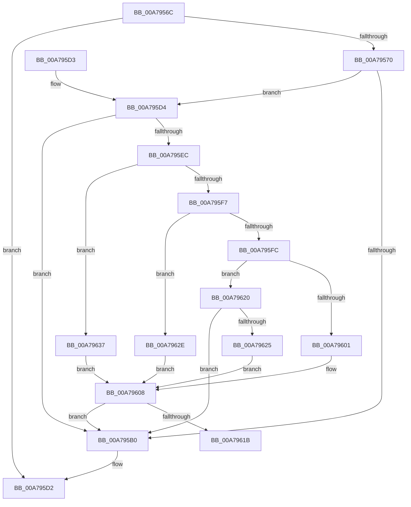

# EtwTiLogSuspendResumeProcess

- RVA: `0x00A7956C`–`0x00A79640` (길이 `212` bytes)
- VA: `0x0000000140A7956C`
- 실행 섹션: `PAGE`
- PDB 이름 있음: `예`; PDB Function 태그: `예`
- unwind 정보 RVA: `0x000B6204`
- 디코드: `55`개 명령, `212/212` bytes 표시
- 미해석 바이트: `0` (있으면 어셈블리에 `.byte`로 보존)

> 이 문서는 커널 이미지의 기계어와 PDB 기호를 분석해 생성했습니다. 4번과 5번은 함수 원형과 자료형을 바이너리 사용 방식에서 추정한 C 해석이며 원본 소스 복구 결과는 아닙니다.

## 1. Dependencies

- 직접 호출 지점: **3**; 고유 호출 대상: **3**
- 직접 호출자로 확인된 함수: **4**
- RIP 상대 이미지 참조: **6**

### Outgoing calls
- `0x00A795BB` → [_security_check_cookie](../../text/6A/_security_check_cookie_function_006AC640.md) (function, `0x006AC640`)
- `0x00A795E3` → [EtwProviderEnabled](../../text/3B/EtwProviderEnabled_function_003BA250.md) (function, `0x003BA250`)
- `0x00A79612` → [EtwEventEnabled](../../text/39/EtwEventEnabled_function_00392450.md) (function, `0x00392450`)

### Direct callers
- [PsThawMultiProcess](../../text/45/PsThawMultiProcess_function_0045FFE0.md) at `0x004600EC`
- [PsMultiResumeProcess](../../text/4A/PsMultiResumeProcess_function_004A2B3C.md) at `0x004A2C02`
- [PsSuspendProcess](../A1/PsSuspendProcess_function_00A10F30.md) at `0x00A10FF0`
- [PsFreezeProcess](../AA/PsFreezeProcess_function_00AA6D04.md) at `0x00AA6D69`

### Static image references
- `0x00A79583` → RVA `0x00E0A740` (`.data`; read)
- `0x00A795D4` → RVA `0x00EFFA30` (`.data`; read)
- `0x00A79601` → RVA `0x0001BAD0` (`.rdata`; read)
- `0x00A79625` → RVA `0x000210C8` (`.rdata`; read)
- `0x00A7962E` → RVA `0x00021340` (`.rdata`; read)
- `0x00A79637` → RVA `0x00020F50` (`.rdata`; read)

## 2. Other-region calls and transfers

- 다른 실행 섹션으로 향하는 call: **3**
  - `0x00A795BB` → [_security_check_cookie](../../text/6A/_security_check_cookie_function_006AC640.md) (`PAGE` → `.text`)
  - `0x00A795E3` → [EtwProviderEnabled](../../text/3B/EtwProviderEnabled_function_003BA250.md) (`PAGE` → `.text`)
  - `0x00A79612` → [EtwEventEnabled](../../text/39/EtwEventEnabled_function_00392450.md) (`PAGE` → `.text`)
- call이 아닌 외부 분기/꼬리 이동: **1**
  - `0x00A7961B` → [sub_00B41E06](../B4/Unknown_function_00B41E06.md) (`tail-transfer`)

## 3. Assembly (complete function range)

```asm
00A7956C  85 C9                           test ecx, ecx
00A7956E  78 62                           js 0x140a795d2
00A79570  48 89 5C 24 20                  mov qword ptr [rsp + 0x20], rbx
00A79575  89 4C 24 08                     mov dword ptr [rsp + 8], ecx
00A79579  55                              push rbp
00A7957A  56                              push rsi
00A7957B  57                              push rdi
00A7957C  48 81 EC 40 01 00 00            sub rsp, 0x140
00A79583  48 8B 05 B6 11 39 00            mov rax, qword ptr [rip + 0x3911b6]
00A7958A  48 33 C4                        xor rax, rsp
00A7958D  48 89 84 24 30 01 00 00         mov qword ptr [rsp + 0x130], rax
00A79595  65 48 8B 04 25 88 01 00 00      mov rax, qword ptr gs:[0x188]
00A7959E  41 8B D9                        mov ebx, r9d
00A795A1  49 8B E8                        mov rbp, r8
00A795A4  48 8B FA                        mov rdi, rdx
00A795A7  80 B8 32 02 00 00 01            cmp byte ptr [rax + 0x232], 1
00A795AE  74 24                           je 0x140a795d4
00A795B0  48 8B 8C 24 30 01 00 00         mov rcx, qword ptr [rsp + 0x130]
00A795B8  48 33 CC                        xor rcx, rsp
00A795BB  E8 80 30 C3 FF                  call 0x1406ac640
00A795C0  48 8B 9C 24 78 01 00 00         mov rbx, qword ptr [rsp + 0x178]
00A795C8  48 81 C4 40 01 00 00            add rsp, 0x140
00A795CF  5F                              pop rdi
00A795D0  5E                              pop rsi
00A795D1  5D                              pop rbp
00A795D2  C3                              ret
00A795D3  CC                              int3
00A795D4  48 8B 0D 55 64 48 00            mov rcx, qword ptr [rip + 0x486455]
00A795DB  33 D2                           xor edx, edx
00A795DD  41 B8 00 00 C0 00               mov r8d, 0xc00000
00A795E3  E8 68 0C 94 FF                  call 0x1403ba250
00A795E8  84 C0                           test al, al
00A795EA  74 C4                           je 0x140a795b0
00A795EC  48 8B B7 20 02 00 00            mov rsi, qword ptr [rdi + 0x220]
00A795F3  85 DB                           test ebx, ebx
00A795F5  74 40                           je 0x140a79637
00A795F7  83 EB 01                        sub ebx, 1
00A795FA  74 32                           je 0x140a7962e
00A795FC  83 EB 01                        sub ebx, 1
00A795FF  75 1F                           jne 0x140a79620
00A79601  48 8D 1D C8 24 5A FF            lea rbx, [rip - 0xa5db38]
00A79608  48 8B 0D 21 64 48 00            mov rcx, qword ptr [rip + 0x486421]
00A7960F  48 8B D3                        mov rdx, rbx
00A79612  E8 39 8E 91 FF                  call 0x140392450
00A79617  84 C0                           test al, al
00A79619  74 95                           je 0x140a795b0
00A7961B  E9 E6 87 0C 00                  jmp 0x140b41e06
00A79620  83 FB 01                        cmp ebx, 1
00A79623  75 8B                           jne 0x140a795b0
00A79625  48 8D 1D 9C 7A 5A FF            lea rbx, [rip - 0xa58564]
00A7962C  EB DA                           jmp 0x140a79608
00A7962E  48 8D 1D 0B 7D 5A FF            lea rbx, [rip - 0xa582f5]
00A79635  EB D1                           jmp 0x140a79608
00A79637  48 8D 1D 12 79 5A FF            lea rbx, [rip - 0xa586ee]
00A7963E  EB C8                           jmp 0x140a79608
```

## 4. C-style interpretation (structured pseudocode)

```c
__int64 __fastcall EtwTiLogSuspendResumeProcess(int a1, __int64 a2, __int64 a3, int a4)
{
    __int64 result;
    __int64 v_rbx;
    __int64 v_rsp;
    unsigned __int64 v_stack_m28;
    unsigned __int64 v_stack_p20;
    unsigned int v_stack_p8;

    if (sign_flag) goto loc_00A795D2;
    v_stack_p20 = v_rbx;
    v_stack_p8 = a1;
    v_rsp = (v_rsp) - (320);
    result = (*(unsigned __int64 *)(v_rip + 3740086)) ^ (v_rsp);
    v_stack_m28 = result;
    if ((*(unsigned __int8 *)(*(unsigned __int64 *)(gs_base + (0 + 392)) + 562)) == 1) goto loc_00A795D4;
loc_00A795B0:
    a1 = (v_stack_m28) ^ (v_rsp);
    result = _security_check_cookie(a1, a2, a3, a4);
    v_rsp = (v_rsp) + (320);
loc_00A795D2:
    return result;
loc_00A795D4:
    a2 = 0;
    result = EtwProviderEnabled(*(unsigned __int64 *)(v_rip + 4744277), a2, (unsigned int)(0xC00000ULL), a4);
    if ((unsigned __int8)(result) == 0) goto loc_00A795B0;
    if ((unsigned int)(v_stack_p20) == 0) goto loc_00A79637;
    v_rbx = (unsigned int)((v_stack_p20) - (1));
    if (condition_is_equal) goto loc_00A7962E;
    v_rbx = (unsigned int)((v_rbx) - (1));
    if (condition_is_not_equal) goto loc_00A79620;
loc_00A79608:
    result = EtwEventEnabled(*(unsigned __int64 *)(v_rip + 4744225), v_rip - 10869560, (unsigned int)(0xC00000ULL), a4);
    if ((unsigned __int8)(result) == 0) goto loc_00A795B0;
loc_00A79620:
    if (((unsigned int)(v_rip - 10869560)) != 1) goto loc_00A795B0;
    goto loc_00A79608;
loc_00A7962E:
    goto loc_00A79608;
loc_00A79637:
    goto loc_00A79608;
}
```

## 5. (Beta) C Style

```c
int64_t EtwTiLogSuspendResumeProcess(int32_t Arg1, void *Arg2, int64_t Arg3, int32_t Arg4)
{
    uint8_t *arg2 = (uint8_t *)Arg2;

    int64_t result;
    int64_t local_rbx;
    int64_t local_rsp;
    uint64_t v_stack_m28;
    uint64_t v_stack_p20;
    uint32_t v_stack_p8;

    if (sign_flag) goto loc_00A795D2;
    v_stack_p20 = local_rbx;
    v_stack_p8 = Arg1;
    local_rsp = (local_rsp) - (320);
    result = (*(uint64_t *)(v_rip + 0x3911B6)) ^ (local_rsp);
    v_stack_m28 = result;
    if ((*(uint8_t *)(*(uint64_t *)(gs_base + (0 + 0x188)) + 0x232)) == 1) goto loc_00A795D4;
loc_00A795B0:
    Arg1 = (v_stack_m28) ^ (local_rsp);
    result = _security_check_cookie(Arg1, Arg2, Arg3, Arg4);
    local_rsp = (local_rsp) + (320);
loc_00A795D2:
    return result;
loc_00A795D4:
    Arg2 = 0;
    result = EtwProviderEnabled(*(uint64_t *)(v_rip + 0x486455), Arg2, (uint32_t)(0xC00000ULL), Arg4);
    if ((uint8_t)(result) == 0) goto loc_00A795B0;
    if ((uint32_t)(v_stack_p20) == 0) goto loc_00A79637;
    local_rbx = (uint32_t)((v_stack_p20) - (1));
    if (condition_is_equal) goto loc_00A7962E;
    local_rbx = (uint32_t)((local_rbx) - (1));
    if (condition_is_not_equal) goto loc_00A79620;
loc_00A79608:
    result = EtwEventEnabled(*(uint64_t *)(v_rip + 0x486421), v_rip - 10869560, (uint32_t)(0xC00000ULL), Arg4);
    if ((uint8_t)(result) == 0) goto loc_00A795B0;
loc_00A79620:
    if (((uint32_t)(v_rip - 10869560)) != 1) goto loc_00A795B0;
    goto loc_00A79608;
loc_00A7962E:
    goto loc_00A79608;
loc_00A79637:
    goto loc_00A79608;
}
```

### 관측된 메모리 오프셋

구조체 형식이 확인되지 않은 접근은 인자 기준의 오프셋으로만 기록했습니다.

| 기준 인자 | 오프셋 표현 | 폭 (bit) | 접근 |
|---|---:|---:|---|
| `Arg2` | `+ 0x220` | `64` | `R` |

## 6. Execution-region graph

[열기: 2D/3D 그래프와 함수 탐색 컨트롤 패널](../../../control-panel.html?section=page&rva=0x00A7956C&view=graph)

- 2D 그래프는 위에서 아래로 흐르고, 3D 그래프는 빈 공간을 드래그해 회전합니다. Shift+드래그는 이동, 휠은 확대·축소, 함수 노드 선택은 대상 보고서 이동입니다.

### Static fallback


