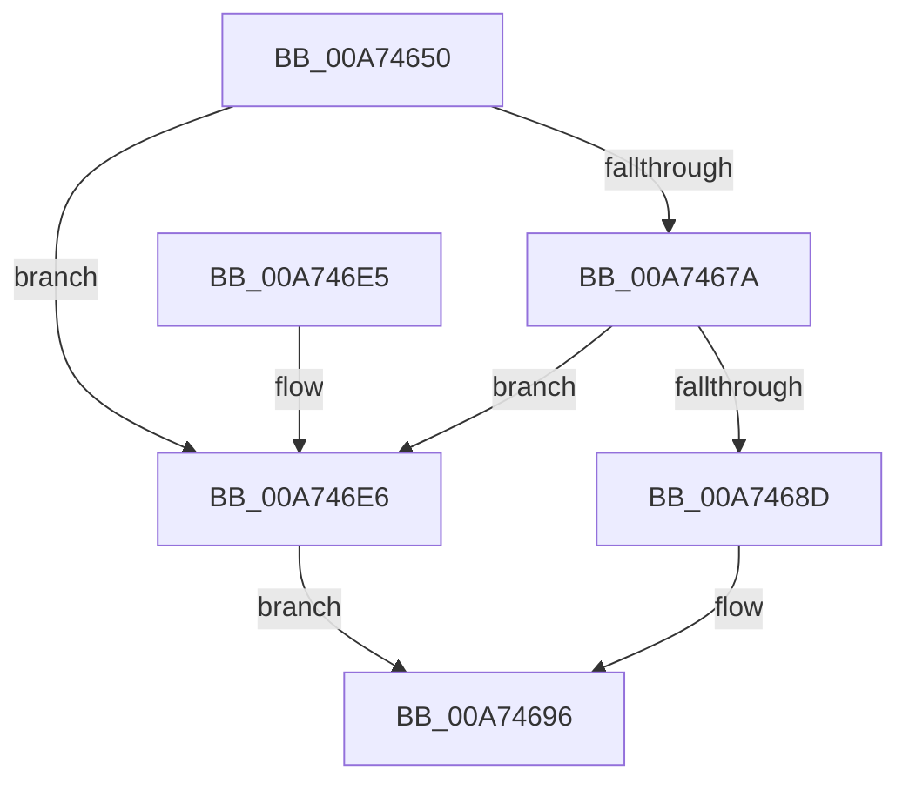

# EtwTraceJobRemoveProcess

- RVA: `0x00A74650`–`0x00A746EC` (길이 `156` bytes)
- VA: `0x0000000140A74650`
- 실행 섹션: `PAGE`
- PDB 이름 있음: `예`; PDB Function 태그: `아니요`
- unwind 정보 RVA: `0x000AB670`
- 디코드: `39`개 명령, `156/156` bytes 표시
- 미해석 바이트: `0` (있으면 어셈블리에 `.byte`로 보존)

> 이 문서는 커널 이미지의 기계어와 PDB 기호를 분석해 생성했습니다. 4번과 5번은 함수 원형과 자료형을 바이너리 사용 방식에서 추정한 C 해석이며 원본 소스 복구 결과는 아닙니다.

## 1. Dependencies

- 직접 호출 지점: **2**; 고유 호출 대상: **2**
- 직접 호출자로 확인된 함수: **1**
- RIP 상대 이미지 참조: **1**

### Outgoing calls
- `0x00A746CE` → [EtwTraceKernelEvent](../../text/23/EtwTraceKernelEvent_function_00235350.md) (function, `0x00235350`)
- `0x00A746DA` → [_security_check_cookie](../../text/6A/_security_check_cookie_function_006AC640.md) (function, `0x006AC640`)

### Direct callers
- [PspRemoveProcessFromJobChain](../90/PspRemoveProcessFromJobChain_function_00907288.md) at `0x00907364`

### Static image references
- `0x00A74659` → RVA `0x00E0A740` (`.data`; read)

## 2. Other-region calls and transfers

- 다른 실행 섹션으로 향하는 call: **2**
  - `0x00A746CE` → [EtwTraceKernelEvent](../../text/23/EtwTraceKernelEvent_function_00235350.md) (`PAGE` → `.text`)
  - `0x00A746DA` → [_security_check_cookie](../../text/6A/_security_check_cookie_function_006AC640.md) (`PAGE` → `.text`)
- 별도 외부 분기/꼬리 이동을 확인하지 못했습니다.

## 3. Assembly (complete function range)

```asm
00A74650  40 55                           push rbp
00A74652  48 8B EC                        mov rbp, rsp
00A74655  48 83 EC 70                     sub rsp, 0x70
00A74659  48 8B 05 E0 60 39 00            mov rax, qword ptr [rip + 0x3960e0]
00A74660  48 33 C4                        xor rax, rsp
00A74663  48 89 45 F0                     mov qword ptr [rbp - 0x10], rax
00A74667  45 33 D2                        xor r10d, r10d
00A7466A  4C 89 55 C0                     mov qword ptr [rbp - 0x40], r10
00A7466E  45 8B CA                        mov r9d, r10d
00A74671  4C 89 55 C8                     mov qword ptr [rbp - 0x38], r10
00A74675  48 85 C9                        test rcx, rcx
00A74678  74 6C                           je 0x140a746e6
00A7467A  48 8B 81 A0 02 00 00            mov rax, qword ptr [rcx + 0x2a0]
00A74681  44 8B 89 D0 01 00 00            mov r9d, dword ptr [rcx + 0x1d0]
00A74688  48 85 C0                        test rax, rax
00A7468B  74 59                           je 0x140a746e6
00A7468D  8B 80 BC 05 00 00               mov eax, dword ptr [rax + 0x5bc]
00A74693  89 45 D0                        mov dword ptr [rbp - 0x30], eax
00A74696  44 89 4D D4                     mov dword ptr [rbp - 0x2c], r9d
00A7469A  48 8D 45 C0                     lea rax, [rbp - 0x40]
00A7469E  89 55 D8                        mov dword ptr [rbp - 0x28], edx
00A746A1  48 8D 4D E0                     lea rcx, [rbp - 0x20]
00A746A5  44 89 45 DC                     mov dword ptr [rbp - 0x24], r8d
00A746A9  41 B9 24 07 00 00               mov r9d, 0x724
00A746AF  BA 01 00 00 00                  mov edx, 1
00A746B4  48 89 45 E0                     mov qword ptr [rbp - 0x20], rax
00A746B8  41 B8 00 00 08 00               mov r8d, 0x80000
00A746BE  48 C7 45 E8 20 00 00 00         mov qword ptr [rbp - 0x18], 0x20
00A746C6  C7 44 24 20 04 19 60 00         mov dword ptr [rsp + 0x20], 0x601904
00A746CE  E8 7D 0C 7C FF                  call 0x140235350
00A746D3  48 8B 4D F0                     mov rcx, qword ptr [rbp - 0x10]
00A746D7  48 33 CC                        xor rcx, rsp
00A746DA  E8 61 7F C3 FF                  call 0x1406ac640
00A746DF  48 83 C4 70                     add rsp, 0x70
00A746E3  5D                              pop rbp
00A746E4  C3                              ret
00A746E5  CC                              int3
00A746E6  44 89 55 D0                     mov dword ptr [rbp - 0x30], r10d
00A746EA  EB AA                           jmp 0x140a74696
```

## 4. C-style interpretation (structured pseudocode)

```c
__int64 __fastcall EtwTraceJobRemoveProcess(__int64 a1, int a2, int a3)
{
    __int64 result;
    __int64 v_r10;
    __int64 v_rsp;
    unsigned __int64 v_stack_m18;
    unsigned __int64 v_stack_m20;
    unsigned __int64 v_stack_m28;
    unsigned int v_stack_m2C;
    unsigned int v_stack_m30;
    unsigned int v_stack_m34;
    unsigned int v_stack_m38;
    unsigned __int64 v_stack_m40;
    unsigned __int64 v_stack_m48;
    unsigned int v_stack_m58;

    v_rsp = (v_rsp) - (112);
    result = (*(unsigned __int64 *)(v_rip + 3760352)) ^ (v_rsp);
    v_stack_m18 = result;
    v_r10 = 0;
    v_stack_m48 = 0;
    v_stack_m40 = 0;
    if (a1 == 0) goto loc_00A746E6;
    if (*(unsigned __int64 *)(a1 + 672) == 0) goto loc_00A746E6;
    v_stack_m38 = (unsigned int)((unsigned int)(*(unsigned int *)(*(unsigned __int64 *)(a1 + 672) + 1468)));
loc_00A74696:
    v_stack_m34 = (unsigned int)((unsigned int)(*(unsigned int *)(a1 + 464)));
    v_stack_m30 = a2;
    v_stack_m2C = a3;
    v_stack_m28 = v_stack_m48;
    v_stack_m20 = 32;
    v_stack_m58 = 0x601904ULL;
    result = EtwTraceKernelEvent(v_stack_m28, 1, (unsigned int)(0x80000ULL), (unsigned int)(0x724ULL));
    a1 = (v_stack_m18) ^ (v_rsp);
    result = _security_check_cookie(a1, 1, (unsigned int)(0x80000ULL), (unsigned int)(0x724ULL));
    v_rsp = (v_rsp) + (112);
    return result;
loc_00A746E6:
    v_stack_m38 = 0;
    goto loc_00A74696;
}
```

## 5. (Beta) C Style

```c
int64_t EtwTraceJobRemoveProcess(int64_t Arg1, int32_t Arg2, int32_t Arg3)
{
    int64_t result;
    int64_t local_r10;
    int64_t local_rsp;
    uint64_t v_stack_m18;
    uint64_t v_stack_m20;
    uint64_t v_stack_m28;
    uint32_t v_stack_m2C;
    uint32_t v_stack_m30;
    uint32_t v_stack_m34;
    uint32_t v_stack_m38;
    uint64_t v_stack_m40;
    uint64_t v_stack_m48;
    uint32_t v_stack_m58;

    local_rsp = (local_rsp) - (112);
    result = (*(uint64_t *)(v_rip + 0x3960E0)) ^ (local_rsp);
    v_stack_m18 = result;
    local_r10 = 0;
    v_stack_m48 = 0;
    v_stack_m40 = 0;
    if (Arg1 == 0) goto loc_00A746E6;
    if (*(uint64_t *)(Arg1 + 0x2A0) == 0) goto loc_00A746E6;
    v_stack_m38 = (uint32_t)((uint32_t)(*(uint32_t *)(*(uint64_t *)(Arg1 + 0x2A0) + 0x5BC)));
loc_00A74696:
    v_stack_m34 = (uint32_t)((uint32_t)(*(uint32_t *)(Arg1 + 0x1D0)));
    v_stack_m30 = Arg2;
    v_stack_m2C = Arg3;
    v_stack_m28 = v_stack_m48;
    v_stack_m20 = 32;
    v_stack_m58 = 0x601904ULL;
    result = EtwTraceKernelEvent(v_stack_m28, 1, (uint32_t)(0x80000ULL), (uint32_t)(0x724ULL));
    Arg1 = (v_stack_m18) ^ (local_rsp);
    result = _security_check_cookie(Arg1, 1, (uint32_t)(0x80000ULL), (uint32_t)(0x724ULL));
    local_rsp = (local_rsp) + (112);
    return result;
loc_00A746E6:
    v_stack_m38 = 0;
    goto loc_00A74696;
}
```

## 6. Execution-region graph

[열기: 2D/3D 그래프와 함수 탐색 컨트롤 패널](../../../control-panel.html?section=page&rva=0x00A74650&view=graph)

- 2D 그래프는 위에서 아래로 흐르고, 3D 그래프는 빈 공간을 드래그해 회전합니다. Shift+드래그는 이동, 휠은 확대·축소, 함수 노드 선택은 대상 보고서 이동입니다.

### Static fallback


