# EtwUnregister

- RVA: `0x00A723D0`–`0x00A7268A` (길이 `698` bytes)
- VA: `0x0000000140A723D0`
- 실행 섹션: `PAGE`
- PDB 이름 있음: `예`; PDB Function 태그: `예`
- unwind 정보 RVA: `0x000B5568`
- 디코드: `175`개 명령, `698/698` bytes 표시
- 미해석 바이트: `0` (있으면 어셈블리에 `.byte`로 보존)

> 이 문서는 커널 이미지의 기계어와 PDB 기호를 분석해 생성했습니다. 4번과 5번은 함수 원형과 자료형을 바이너리 사용 방식에서 추정한 C 해석이며 원본 소스 복구 결과는 아닙니다.

## 1. Dependencies

- 직접 호출 지점: **15**; 고유 호출 대상: **12**
- 직접 호출자로 확인된 함수: **20**
- RIP 상대 이미지 참조: **3**

### Outgoing calls
- `0x00A7243B` → [KeAbPreAcquire](../../text/21/KeAbPreAcquire_function_00210230.md) (function, `0x00210230`)
- `0x00A72454` → [ExfAcquirePushLockExclusiveEx](../../text/20/ExfAcquirePushLockExclusiveEx_function_0020FC90.md) (function, `0x0020FC90`)
- `0x00A72496` → [KeAbPreAcquire](../../text/21/KeAbPreAcquire_function_00210230.md) (function, `0x00210230`)
- `0x00A724AF` → [ExfAcquirePushLockExclusiveEx](../../text/20/ExfAcquirePushLockExclusiveEx_function_0020FC90.md) (function, `0x0020FC90`)
- `0x00A7251E` → [KeBugCheckEx](../../text/4F/KeBugCheckEx_function_004FD660.md) (function, `0x004FD660`)
- `0x00A7256C` → [KeAbPostRelease](../../text/2E/KeAbPostRelease_function_002E1600.md) (function, `0x002E1600`)
- `0x00A72571` → [KeLeaveCriticalRegion](../../text/25/KeLeaveCriticalRegion_function_0025D8B0.md) (function, `0x0025D8B0`)
- `0x00A72591` → [EtwEventEnabled](../../text/39/EtwEventEnabled_function_00392450.md) (function, `0x00392450`)
- `0x00A7259E` → [EtwpUnreferenceGuidEntry](../8C/EtwpUnreferenceGuidEntry_function_008C3320.md) (function, `0x008C3320`)
- `0x00A725B3` → [EtwpReleaseProviderTraitsReference](../8C/EtwpReleaseProviderTraitsReference_function_008C11EC.md) (function, `0x008C11EC`)
- `0x00A725BD` → [ExFreePoolWithTag](../../poolcode/B8/ExFreePoolWithTag_function_00B82870.md) (function, `0x00B82870`)
- `0x00A725CC` → [_security_check_cookie](../../text/6A/_security_check_cookie_function_006AC640.md) (function, `0x006AC640`)
- `0x00A725F1` → [ExfReleasePushLock](../../text/26/ExfReleasePushLock_function_002638D0.md) (function, `0x002638D0`)
- `0x00A72637` → [EtwWrite](../../text/41/EtwWrite_function_0041C720.md) (function, `0x0041C720`)
- `0x00A72680` → [EtwpUnreferenceGuidEntry](../8C/EtwpUnreferenceGuidEntry_function_008C3320.md) (function, `0x008C3320`)

### Direct callers
- [BapdWriteEtwEvents](../../text/4A/BapdWriteEtwEvents_function_004AE884.md) at `0x004AEC36`
- [BapdWriteEtwEvents](../../text/4A/BapdWriteEtwEvents_function_004AE884.md) at `0x004AECCE`
- [BapdWriteEtwEvents](../../text/4A/BapdWriteEtwEvents_function_004AE884.md) at `0x004AECDB`
- [BapdWriteEtwEvents](../../text/4A/BapdWriteEtwEvents_function_004AE884.md) at `0x004AECE8`
- [HvlPhase2Initialize](../../text/58/HvlPhase2Initialize_function_00583EA0.md) at `0x00583F8C`
- [McGenEventUnregister_EtwUnregister](../../text/60/McGenEventUnregister_EtwUnregister_function_006058E4.md) at `0x006058F8`
- [CarCleanup](../../text/61/CarCleanup_function_0061850C.md) at `0x0061853F`
- [DifEtwUnregisterWrapper](../../text/61/DifEtwUnregisterWrapper_function_0061D330.md) at `0x0061D3FD`
- [sub_006F88AE](../../text/6F/Unknown_function_006F88AE.md) at `0x006F8A56`
- [DbgkCaptureLiveDump](../71/DbgkCaptureLiveDump_function_0071113C.md) at `0x0071151B`
- [PsShutdownSystem](../78/PsShutdownSystem_function_00785E94.md) at `0x0078615C`
- [WmipGECleanup](../7B/WmipGECleanup_function_007B3D00.md) at `0x007B3D12`
- [WmipProcessLegacyEtwRegister](../7B/WmipProcessLegacyEtwRegister_function_007B3F64.md) at `0x007B3FC9`
- [WmipProcessLegacyEtwUnregister](../7B/WmipProcessLegacyEtwUnregister_function_007B404C.md) at `0x007B4092`
- [EtwpCoverageSamplerStop](../7C/EtwpCoverageSamplerStop_function_007C2564.md) at `0x007C2862`
- [VrpRegistryUnload](../83/VrpRegistryUnload_function_0083B0E0.md) at `0x0083B15C`
- [DbgkpStartSystemErrorHandler](../92/DbgkpStartSystemErrorHandler_function_00920F78.md) at `0x0092106F`
- [BapdRecordFirmwareBootStats](../../pagelk/B7/BapdRecordFirmwareBootStats_function_00B72474.md) at `0x00B728B3`
- [BapdRecordFirmwareBootStats](../../pagelk/B7/BapdRecordFirmwareBootStats_function_00B72474.md) at `0x00B728CD`
- [VslpIumInitializeTelemetry](../../init/C2/VslpIumInitializeTelemetry_function_00C29EA0.md) at `0x00C2A078`
- [ObpShutdownTraceLoggingProvider](../../init/C3/ObpShutdownTraceLoggingProvider_function_00C3C834.md) at `0x00C3C84E`
- [SshpUninitialize](../../init/C4/SshpUninitialize_function_00C44798.md) at `0x00C447D3`
- [SshpUninitialize](../../init/C4/SshpUninitialize_function_00C44798.md) at `0x00C447EB`
- [PerfDiagInitialize](../../init/C4/PerfDiagInitialize_function_00C4D150.md) at `0x00C4D245`
- [BapdpRecordIumStatus](../../init/C5/BapdpRecordIumStatus_function_00C50424.md) at `0x00C50506`

### Static image references
- `0x00A723E2` → RVA `0x00E0A740` (`.data`; read)
- `0x00A72583` → RVA `0x00EFF840` (`.data`; read)
- `0x00A7258A` → RVA `0x00010888` (`.rdata`; read)

## 2. Other-region calls and transfers

- 다른 실행 섹션으로 향하는 call: **12**
  - `0x00A7243B` → [KeAbPreAcquire](../../text/21/KeAbPreAcquire_function_00210230.md) (`PAGE` → `.text`)
  - `0x00A72454` → [ExfAcquirePushLockExclusiveEx](../../text/20/ExfAcquirePushLockExclusiveEx_function_0020FC90.md) (`PAGE` → `.text`)
  - `0x00A72496` → [KeAbPreAcquire](../../text/21/KeAbPreAcquire_function_00210230.md) (`PAGE` → `.text`)
  - `0x00A724AF` → [ExfAcquirePushLockExclusiveEx](../../text/20/ExfAcquirePushLockExclusiveEx_function_0020FC90.md) (`PAGE` → `.text`)
  - `0x00A7251E` → [KeBugCheckEx](../../text/4F/KeBugCheckEx_function_004FD660.md) (`PAGE` → `.text`)
  - `0x00A7256C` → [KeAbPostRelease](../../text/2E/KeAbPostRelease_function_002E1600.md) (`PAGE` → `.text`)
  - `0x00A72571` → [KeLeaveCriticalRegion](../../text/25/KeLeaveCriticalRegion_function_0025D8B0.md) (`PAGE` → `.text`)
  - `0x00A72591` → [EtwEventEnabled](../../text/39/EtwEventEnabled_function_00392450.md) (`PAGE` → `.text`)
  - `0x00A725BD` → [ExFreePoolWithTag](../../poolcode/B8/ExFreePoolWithTag_function_00B82870.md) (`PAGE` → `POOLCODE`)
  - `0x00A725CC` → [_security_check_cookie](../../text/6A/_security_check_cookie_function_006AC640.md) (`PAGE` → `.text`)
  - `0x00A725F1` → [ExfReleasePushLock](../../text/26/ExfReleasePushLock_function_002638D0.md) (`PAGE` → `.text`)
  - `0x00A72637` → [EtwWrite](../../text/41/EtwWrite_function_0041C720.md) (`PAGE` → `.text`)
- call이 아닌 외부 분기/꼬리 이동: **3**
  - `0x00A7266A` → [sub_00B403C2](../B4/Unknown_function_00B403C2.md) (`tail-transfer`)
  - `0x00A72675` → [sub_00B403C2](../B4/Unknown_function_00B403C2.md) (`tail-transfer`)
  - `0x00A7267B` → [sub_00B403C2 + 0x8](../B4/Unknown_function_00B403C2.md) (`tail-transfer`)

## 3. Assembly (complete function range)

```asm
00A723D0  48 89 5C 24 10                  mov qword ptr [rsp + 0x10], rbx
00A723D5  48 89 6C 24 18                  mov qword ptr [rsp + 0x18], rbp
00A723DA  56                              push rsi
00A723DB  57                              push rdi
00A723DC  41 57                           push r15
00A723DE  48 83 EC 70                     sub rsp, 0x70
00A723E2  48 8B 05 57 83 39 00            mov rax, qword ptr [rip + 0x398357]
00A723E9  48 33 C4                        xor rax, rsp
00A723EC  48 89 44 24 60                  mov qword ptr [rsp + 0x60], rax
00A723F1  48 8B C1                        mov rax, rcx
00A723F4  48 F7 D8                        neg rax
00A723F7  48 1B DB                        sbb rbx, rbx
00A723FA  48 23 D9                        and rbx, rcx
00A723FD  0F 84 E4 01 00 00               je 0x140a725e7
00A72403  33 FF                           xor edi, edi
00A72405  F6 43 62 01                     test byte ptr [rbx + 0x62], 1
00A72409  0F 84 F8 00 00 00               je 0x140a72507
00A7240F  41 BF 98 02 00 00               mov r15d, 0x298
00A72415  48 39 7B 28                     cmp qword ptr [rbx + 0x28], rdi
00A72419  74 5B                           je 0x140a72476
00A7241B  65 48 8B 04 25 88 01 00 00      mov rax, qword ptr gs:[0x188]
00A72424  45 33 C0                        xor r8d, r8d
00A72427  33 D2                           xor edx, edx
00A72429  66 FF 88 E4 01 00 00            dec word ptr [rax + 0x1e4]
00A72430  90                              nop
00A72431  48 8B 73 28                     mov rsi, qword ptr [rbx + 0x28]
00A72435  49 03 F7                        add rsi, r15
00A72438  48 8B CE                        mov rcx, rsi
00A7243B  E8 F0 DD 79 FF                  call 0x140210230
00A72440  F0 48 0F BA 2E 00               lock bts qword ptr [rsi], 0
00A72446  48 8B E8                        mov rbp, rax
00A72449  73 0E                           jae 0x140a72459
00A7244B  4C 8B C6                        mov r8, rsi
00A7244E  48 8B D0                        mov rdx, rax
00A72451  48 8B CE                        mov rcx, rsi
00A72454  E8 37 D8 79 FF                  call 0x14020fc90
00A72459  48 85 ED                        test rbp, rbp
00A7245C  74 04                           je 0x140a72462
00A7245E  C6 45 0A 01                     mov byte ptr [rbp + 0xa], 1
00A72462  65 48 8B 0C 25 88 01 00 00      mov rcx, qword ptr gs:[0x188]
00A7246B  48 8B 43 28                     mov rax, qword ptr [rbx + 0x28]
00A7246F  48 89 88 A0 02 00 00            mov qword ptr [rax + 0x2a0], rcx
00A72476  65 48 8B 04 25 88 01 00 00      mov rax, qword ptr gs:[0x188]
00A7247F  45 33 C0                        xor r8d, r8d
00A72482  33 D2                           xor edx, edx
00A72484  66 FF 88 E4 01 00 00            dec word ptr [rax + 0x1e4]
00A7248B  90                              nop
00A7248C  48 8B 73 20                     mov rsi, qword ptr [rbx + 0x20]
00A72490  49 03 F7                        add rsi, r15
00A72493  48 8B CE                        mov rcx, rsi
00A72496  E8 95 DD 79 FF                  call 0x140210230
00A7249B  F0 48 0F BA 2E 00               lock bts qword ptr [rsi], 0
00A724A1  48 8B E8                        mov rbp, rax
00A724A4  73 0E                           jae 0x140a724b4
00A724A6  4C 8B C6                        mov r8, rsi
00A724A9  48 8B D0                        mov rdx, rax
00A724AC  48 8B CE                        mov rcx, rsi
00A724AF  E8 DC D7 79 FF                  call 0x14020fc90
00A724B4  48 85 ED                        test rbp, rbp
00A724B7  74 04                           je 0x140a724bd
00A724B9  C6 45 0A 01                     mov byte ptr [rbp + 0xa], 1
00A724BD  65 48 8B 0C 25 88 01 00 00      mov rcx, qword ptr gs:[0x188]
00A724C6  48 8B 43 20                     mov rax, qword ptr [rbx + 0x20]
00A724CA  48 89 88 A0 02 00 00            mov qword ptr [rax + 0x2a0], rcx
00A724D1  48 8B 0B                        mov rcx, qword ptr [rbx]
00A724D4  48 39 59 08                     cmp qword ptr [rcx + 8], rbx
00A724D8  75 26                           jne 0x140a72500
00A724DA  48 8B 43 08                     mov rax, qword ptr [rbx + 8]
00A724DE  48 39 18                        cmp qword ptr [rax], rbx
00A724E1  75 1D                           jne 0x140a72500
00A724E3  48 89 08                        mov qword ptr [rax], rcx
00A724E6  48 89 41 08                     mov qword ptr [rcx + 8], rax
00A724EA  48 8D 43 10                     lea rax, [rbx + 0x10]
00A724EE  48 8B 10                        mov rdx, qword ptr [rax]
00A724F1  48 39 42 08                     cmp qword ptr [rdx + 8], rax
00A724F5  75 09                           jne 0x140a72500
00A724F7  48 8B 48 08                     mov rcx, qword ptr [rax + 8]
00A724FB  48 39 01                        cmp qword ptr [rcx], rax
00A724FE  74 24                           je 0x140a72524
00A72500  B9 03 00 00 00                  mov ecx, 3
00A72505  CD 29                           int 0x29
00A72507  41 B9 01 00 00 00               mov r9d, 1
00A7250D  48 89 7C 24 20                  mov qword ptr [rsp + 0x20], rdi
00A72512  4C 8B C3                        mov r8, rbx
00A72515  B9 1D 01 00 00                  mov ecx, 0x11d
00A7251A  41 8D 51 03                     lea edx, [r9 + 3]
00A7251E  E8 3D B1 A8 FF                  call 0x1404fd660
00A72523  CC                              int3
00A72524  48 89 11                        mov qword ptr [rcx], rdx
00A72527  48 89 4A 08                     mov qword ptr [rdx + 8], rcx
00A7252B  48 8B 43 20                     mov rax, qword ptr [rbx + 0x20]
00A7252F  48 89 B8 A0 02 00 00            mov qword ptr [rax + 0x2a0], rdi
00A72536  48 8B 73 20                     mov rsi, qword ptr [rbx + 0x20]
00A7253A  49 03 F7                        add rsi, r15
00A7253D  0F 0D 0E                        prefetchw byte ptr [rsi]
00A72540  48 8B 06                        mov rax, qword ptr [rsi]
00A72543  48 8B C8                        mov rcx, rax
00A72546  48 83 E1 F0                     and rcx, 0xfffffffffffffff0
00A7254A  48 83 F9 10                     cmp rcx, 0x10
00A7254E  48 8D 50 F0                     lea rdx, [rax - 0x10]
00A72552  48 0F 46 D7                     cmovbe rdx, rdi
00A72556  A8 02                           test al, 2
00A72558  0F 85 90 00 00 00               jne 0x140a725ee
00A7255E  F0 48 0F B1 16                  lock cmpxchg qword ptr [rsi], rdx
00A72563  0F 85 85 00 00 00               jne 0x140a725ee
00A72569  48 8B CE                        mov rcx, rsi
00A7256C  E8 8F F0 86 FF                  call 0x1402e1600
00A72571  E8 3A B3 7E FF                  call 0x14025d8b0
00A72576  48 8B 43 28                     mov rax, qword ptr [rbx + 0x28]
00A7257A  48 85 C0                        test rax, rax
00A7257D  0F 85 BE 00 00 00               jne 0x140a72641
00A72583  48 8B 0D B6 D2 48 00            mov rcx, qword ptr [rip + 0x48d2b6]
00A7258A  48 8D 15 F7 E2 59 FF            lea rdx, [rip - 0xa61d09]
00A72591  E8 BA FE 91 FF                  call 0x140392450
00A72596  84 C0                           test al, al
00A72598  75 61                           jne 0x140a725fb
00A7259A  48 8B 4B 20                     mov rcx, qword ptr [rbx + 0x20]
00A7259E  E8 7D 0D E5 FF                  call 0x1408c3320
00A725A3  48 8B 4B 28                     mov rcx, qword ptr [rbx + 0x28]
00A725A7  48 85 C9                        test rcx, rcx
00A725AA  0F 85 D0 00 00 00               jne 0x140a72680
00A725B0  48 8B CB                        mov rcx, rbx
00A725B3  E8 34 EC E4 FF                  call 0x1408c11ec
00A725B8  33 D2                           xor edx, edx
00A725BA  48 8B CB                        mov rcx, rbx
00A725BD  E8 AE 02 11 00                  call 0x140b82870
00A725C2  33 C0                           xor eax, eax
00A725C4  48 8B 4C 24 60                  mov rcx, qword ptr [rsp + 0x60]
00A725C9  48 33 CC                        xor rcx, rsp
00A725CC  E8 6F A0 C3 FF                  call 0x1406ac640
00A725D1  4C 8D 5C 24 70                  lea r11, [rsp + 0x70]
00A725D6  49 8B 5B 28                     mov rbx, qword ptr [r11 + 0x28]
00A725DA  49 8B 6B 30                     mov rbp, qword ptr [r11 + 0x30]
00A725DE  49 8B E3                        mov rsp, r11
00A725E1  41 5F                           pop r15
00A725E3  5F                              pop rdi
00A725E4  5E                              pop rsi
00A725E5  C3                              ret
00A725E6  CC                              int3
00A725E7  B8 08 00 00 C0                  mov eax, 0xc0000008
00A725EC  EB D6                           jmp 0x140a725c4
00A725EE  48 8B CE                        mov rcx, rsi
00A725F1  E8 DA 12 7F FF                  call 0x1402638d0
00A725F6  E9 6E FF FF FF                  jmp 0x140a72569
00A725FB  48 8B 43 20                     mov rax, qword ptr [rbx + 0x20]
00A725FF  44 8B CF                        mov r9d, edi
00A72602  48 8B 0D 37 D2 48 00            mov rcx, qword ptr [rip + 0x48d237]
00A72609  48 83 C0 28                     add rax, 0x28
00A7260D  74 14                           je 0x140a72623
00A7260F  48 89 44 24 30                  mov qword ptr [rsp + 0x30], rax
00A72614  41 B9 01 00 00 00               mov r9d, 1
00A7261A  48 C7 44 24 38 10 00 00 00      mov qword ptr [rsp + 0x38], 0x10
00A72623  48 8D 44 24 30                  lea rax, [rsp + 0x30]
00A72628  45 33 C0                        xor r8d, r8d
00A7262B  48 8D 15 56 E2 59 FF            lea rdx, [rip - 0xa61daa]
00A72632  48 89 44 24 20                  mov qword ptr [rsp + 0x20], rax
00A72637  E8 E4 A0 9A FF                  call 0x14041c720
00A7263C  E9 59 FF FF FF                  jmp 0x140a7259a
00A72641  48 89 B8 A0 02 00 00            mov qword ptr [rax + 0x2a0], rdi
00A72648  48 8B 73 28                     mov rsi, qword ptr [rbx + 0x28]
00A7264C  49 03 F7                        add rsi, r15
00A7264F  0F 0D 0E                        prefetchw byte ptr [rsi]
00A72652  48 8B 06                        mov rax, qword ptr [rsi]
00A72655  48 8B C8                        mov rcx, rax
00A72658  48 83 E1 F0                     and rcx, 0xfffffffffffffff0
00A7265C  48 83 F9 10                     cmp rcx, 0x10
00A72660  48 8D 50 F0                     lea rdx, [rax - 0x10]
00A72664  48 0F 46 D7                     cmovbe rdx, rdi
00A72668  A8 02                           test al, 2
00A7266A  0F 85 52 DD 0C 00               jne 0x140b403c2
00A72670  F0 48 0F B1 16                  lock cmpxchg qword ptr [rsi], rdx
00A72675  0F 85 47 DD 0C 00               jne 0x140b403c2
00A7267B  E9 4A DD 0C 00                  jmp 0x140b403ca
00A72680  E8 9B 0C E5 FF                  call 0x1408c3320
00A72685  E9 26 FF FF FF                  jmp 0x140a725b0
```

## 4. C-style interpretation (structured pseudocode)

```c
__int64 __fastcall EtwUnregister(__int64 a1, int a2, int a3)
{
    __int64 result;
    __int64 v_rbx;
    __int64 v_rdi;
    __int64 v_rsi;
    __int64 v_rsp;
    unsigned __int64 v_stack_m18;
    unsigned __int64 v_stack_m28;
    unsigned __int64 v_stack_m38;
    unsigned __int64 v_stack_m40;
    unsigned __int64 v_stack_m50;
    unsigned __int64 v_stack_m68;
    unsigned __int64 v_stack_p10;
    unsigned __int64 v_stack_p18;

    v_stack_p10 = v_rbx;
    v_stack_p18 = v_rbp;
    v_rsp = (v_rsp) - (112);
    result = (*(unsigned __int64 *)(v_rip + 3769175)) ^ (v_rsp);
    v_stack_m28 = result;
    result = -(a1);
    v_rbx = (v_rbx) & (a1);
    if (condition_is_equal) goto loc_00A725E7;
    v_rdi = 0;
    if (((*(unsigned __int8 *)(v_rbx + 98)) & (1)) == 0) goto loc_00A72507;
    if ((*(unsigned __int64 *)(v_rbx + 40)) == 0) goto loc_00A72476;
    a3 = 0;
    a2 = 0;
    v_rsi = (*(unsigned __int64 *)(v_rbx + 40)) + (664);
    result = KeAbPreAcquire(v_rsi, a2, a3, a4);
    if (!(condition_is_above_or_equal)) {
        a3 = v_rsi;
        a2 = result;
        a1 = v_rsi;
        result = ExfAcquirePushLockExclusiveEx(a1, a2, a3, a4);
    }
    if (result != 0) {
        *(unsigned __int8 *)(result + 10) = 1;
    }
    *(unsigned __int64 *)(*(unsigned __int64 *)(v_rbx + 40) + 672) = *(unsigned __int64 *)(gs_base + (0 + 392));
loc_00A72476:
    a3 = 0;
    a2 = 0;
    v_rsi = (*(unsigned __int64 *)(v_rbx + 32)) + (664);
    result = KeAbPreAcquire(v_rsi, a2, a3, a4);
    if (!(condition_is_above_or_equal)) {
        a3 = v_rsi;
        a2 = result;
        a1 = v_rsi;
        result = ExfAcquirePushLockExclusiveEx(a1, a2, a3, a4);
    }
    if (result != 0) {
        *(unsigned __int8 *)(result + 10) = 1;
    }
    *(unsigned __int64 *)(*(unsigned __int64 *)(v_rbx + 32) + 672) = *(unsigned __int64 *)(gs_base + (0 + 392));
    if ((*(unsigned __int64 *)(*(unsigned __int64 *)(v_rbx) + 8)) != v_rbx) goto loc_00A72500;
    if ((*(unsigned __int64 *)(*(unsigned __int64 *)(v_rbx + 8))) != v_rbx) goto loc_00A72500;
    *(unsigned __int64 *)(*(unsigned __int64 *)(v_rbx + 8)) = *(unsigned __int64 *)(v_rbx);
    *(unsigned __int64 *)(*(unsigned __int64 *)(v_rbx) + 8) = *(unsigned __int64 *)(v_rbx + 8);
    if ((*(unsigned __int64 *)(*(unsigned __int64 *)(v_rbx + 16) + 8)) != (v_rbx + 16)) goto loc_00A72500;
    if ((*(unsigned __int64 *)(*(unsigned __int64 *)(v_rbx + 16 + 8))) == (v_rbx + 16)) goto loc_00A72524;
loc_00A72500:
loc_00A72507:
    v_stack_m68 = 0;
    result = KeBugCheckEx(285, 1 + 3, v_rbx, 1);
loc_00A72524:
    *(unsigned __int64 *)(285) = 1 + 3;
    *(unsigned __int64 *)(1 + 3 + 8) = 285;
    *(unsigned __int64 *)(*(unsigned __int64 *)(v_rbx + 32) + 672) = 0;
    v_rsi = (*(unsigned __int64 *)(v_rbx + 32)) + (664);
    a1 = (*(unsigned __int64 *)(v_rsi)) & (-16);
    a2 = *(unsigned __int64 *)(v_rsi) - 16;
    if (a1 <= 16) { a2 = 0; }
    if ((((unsigned __int8)(*(unsigned __int64 *)(v_rsi))) & (2)) != 0) goto loc_00A725EE;
    if ((((unsigned __int8)(*(unsigned __int64 *)(v_rsi))) & (2)) != 0) goto loc_00A725EE;
loc_00A72569:
    result = KeAbPostRelease(v_rsi, a2, v_rbx, 1);
    result = KeLeaveCriticalRegion(v_rsi, a2, v_rbx, 1);
    if (*(unsigned __int64 *)(v_rbx + 40) != 0) goto loc_00A72641;
    result = EtwEventEnabled(*(unsigned __int64 *)(v_rip + 4772534), v_rip - 10886409, v_rbx, 1);
    if ((unsigned __int8)(result) != 0) goto loc_00A725FB;
loc_00A7259A:
    result = EtwpUnreferenceGuidEntry(*(unsigned __int64 *)(v_rbx + 32), v_rip - 10886409, v_rbx, 1);
    if (*(unsigned __int64 *)(v_rbx + 40) != 0) goto loc_00A72680;
loc_00A725B0:
    result = EtwpReleaseProviderTraitsReference(v_rbx, v_rip - 10886409, v_rbx, 1);
    a2 = 0;
    result = ExFreePoolWithTag(v_rbx, a2, v_rbx, 1);
    result = 0;
loc_00A725C4:
    a1 = (v_stack_m28) ^ (v_rsp);
    result = _security_check_cookie(a1, a2, v_rbx, 1);
    return result;
loc_00A725E7:
    goto loc_00A725C4;
loc_00A725EE:
    result = ExfReleasePushLock(v_rsi, a2, v_rbx, 1);
    goto loc_00A72569;
loc_00A725FB:
    result = (*(unsigned __int64 *)(*(unsigned __int64 *)(v_stack_m18 + 40) + 32)) + (40);
    if (!(condition_is_equal)) {
        v_stack_m40 = result;
        a4 = 1;
        v_stack_m38 = 16;
    }
    a3 = 0;
    v_stack_m50 = v_stack_m40;
    result = EtwWrite(*(unsigned __int64 *)(v_rip + 4772407), v_rip - 10886570, a3, a4);
    goto loc_00A7259A;
loc_00A72641:
    *(unsigned __int64 *)(result + 672) = 0;
    v_rsi = (*(unsigned __int64 *)(*(unsigned __int64 *)(v_stack_m18 + 40) + 40)) + (664);
    a1 = (*(unsigned __int64 *)(v_rsi)) & (-16);
    a2 = *(unsigned __int64 *)(v_rsi) - 16;
    if (a1 <= 16) { a2 = 0; }
loc_00A72680:
    result = EtwpUnreferenceGuidEntry(a1, a2, a3, a4);
    goto loc_00A725B0;
}
```

## 5. (Beta) C Style

```c
int64_t EtwUnregister(int64_t Arg1, int32_t Arg2, int32_t Arg3)
{
    int64_t result;
    int64_t local_rbx;
    int64_t local_rdi;
    int64_t local_rsi;
    int64_t local_rsp;
    uint64_t v_stack_m18;
    uint64_t v_stack_m28;
    uint64_t v_stack_m38;
    uint64_t v_stack_m40;
    uint64_t v_stack_m50;
    uint64_t v_stack_m68;
    uint64_t v_stack_p10;
    uint64_t v_stack_p18;

    v_stack_p10 = local_rbx;
    v_stack_p18 = local_rbp;
    local_rsp = (local_rsp) - (112);
    result = (*(uint64_t *)(v_rip + 0x398357)) ^ (local_rsp);
    v_stack_m28 = result;
    result = -(Arg1);
    local_rbx = (local_rbx) & (Arg1);
    if (condition_is_equal) goto loc_00A725E7;
    local_rdi = 0;
    if (((*(uint8_t *)(local_rbx + 0x62)) & (1)) == 0) goto loc_00A72507;
    if ((*(uint64_t *)(local_rbx + 0x28)) == 0) goto loc_00A72476;
    Arg3 = 0;
    Arg2 = 0;
    local_rsi = (*(uint64_t *)(local_rbx + 0x28)) + (664);
    result = KeAbPreAcquire(local_rsi, Arg2, Arg3, a4);
    if (!(condition_is_above_or_equal)) {
        Arg3 = local_rsi;
        Arg2 = result;
        Arg1 = local_rsi;
        result = ExfAcquirePushLockExclusiveEx(Arg1, Arg2, Arg3, a4);
    }
    if (result != 0) {
        *(uint8_t *)(result + 0xA) = 1;
    }
    *(uint64_t *)(*(uint64_t *)(local_rbx + 0x28) + 0x2A0) = *(uint64_t *)(gs_base + (0 + 0x188));
loc_00A72476:
    Arg3 = 0;
    Arg2 = 0;
    local_rsi = (*(uint64_t *)(local_rbx + 0x20)) + (664);
    result = KeAbPreAcquire(local_rsi, Arg2, Arg3, a4);
    if (!(condition_is_above_or_equal)) {
        Arg3 = local_rsi;
        Arg2 = result;
        Arg1 = local_rsi;
        result = ExfAcquirePushLockExclusiveEx(Arg1, Arg2, Arg3, a4);
    }
    if (result != 0) {
        *(uint8_t *)(result + 0xA) = 1;
    }
    *(uint64_t *)(*(uint64_t *)(local_rbx + 0x20) + 0x2A0) = *(uint64_t *)(gs_base + (0 + 0x188));
    if ((*(uint64_t *)(*(uint64_t *)(local_rbx) + 0x8)) != local_rbx) goto loc_00A72500;
    if ((*(uint64_t *)(*(uint64_t *)(local_rbx + 0x8))) != local_rbx) goto loc_00A72500;
    *(uint64_t *)(*(uint64_t *)(local_rbx + 0x8)) = *(uint64_t *)(local_rbx);
    *(uint64_t *)(*(uint64_t *)(local_rbx) + 0x8) = *(uint64_t *)(local_rbx + 0x8);
    if ((*(uint64_t *)(*(uint64_t *)(local_rbx + 0x10) + 0x8)) != (local_rbx + 16)) goto loc_00A72500;
    if ((*(uint64_t *)(*(uint64_t *)(local_rbx + 0x10 + 0x8))) == (local_rbx + 16)) goto loc_00A72524;
loc_00A72500:
loc_00A72507:
    v_stack_m68 = 0;
    result = KeBugCheckEx(285, 1 + 3, local_rbx, 1);
loc_00A72524:
    *(uint64_t *)(285) = 1 + 3;
    *(uint64_t *)(1 + 0x3 + 0x8) = 285;
    *(uint64_t *)(*(uint64_t *)(local_rbx + 0x20) + 0x2A0) = 0;
    local_rsi = (*(uint64_t *)(local_rbx + 0x20)) + (664);
    Arg1 = (*(uint64_t *)(local_rsi)) & (-16);
    Arg2 = *(uint64_t *)(local_rsi) - 16;
    if (Arg1 <= 16) { Arg2 = 0; }
    if ((((uint8_t)(*(uint64_t *)(local_rsi))) & (2)) != 0) goto loc_00A725EE;
    if ((((uint8_t)(*(uint64_t *)(local_rsi))) & (2)) != 0) goto loc_00A725EE;
loc_00A72569:
    result = KeAbPostRelease(local_rsi, Arg2, local_rbx, 1);
    result = KeLeaveCriticalRegion(local_rsi, Arg2, local_rbx, 1);
    if (*(uint64_t *)(local_rbx + 0x28) != 0) goto loc_00A72641;
    result = EtwEventEnabled(*(uint64_t *)(v_rip + 0x48D2B6), v_rip - 10886409, local_rbx, 1);
    if ((uint8_t)(result) != 0) goto loc_00A725FB;
loc_00A7259A:
    result = EtwpUnreferenceGuidEntry(*(uint64_t *)(local_rbx + 0x20), v_rip - 10886409, local_rbx, 1);
    if (*(uint64_t *)(local_rbx + 0x28) != 0) goto loc_00A72680;
loc_00A725B0:
    result = EtwpReleaseProviderTraitsReference(local_rbx, v_rip - 10886409, local_rbx, 1);
    Arg2 = 0;
    result = ExFreePoolWithTag(local_rbx, Arg2, local_rbx, 1);
    result = 0;
loc_00A725C4:
    Arg1 = (v_stack_m28) ^ (local_rsp);
    result = _security_check_cookie(Arg1, Arg2, local_rbx, 1);
    return result;
loc_00A725E7:
    goto loc_00A725C4;
loc_00A725EE:
    result = ExfReleasePushLock(local_rsi, Arg2, local_rbx, 1);
    goto loc_00A72569;
loc_00A725FB:
    result = (*(uint64_t *)(*(uint64_t *)(v_stack_m18 + 0x28) + 0x20)) + (40);
    if (!(condition_is_equal)) {
        v_stack_m40 = result;
        a4 = 1;
        v_stack_m38 = 16;
    }
    Arg3 = 0;
    v_stack_m50 = v_stack_m40;
    result = EtwWrite(*(uint64_t *)(v_rip + 0x48D237), v_rip - 10886570, Arg3, a4);
    goto loc_00A7259A;
loc_00A72641:
    *(uint64_t *)(result + 0x2A0) = 0;
    local_rsi = (*(uint64_t *)(*(uint64_t *)(v_stack_m18 + 0x28) + 0x28)) + (664);
    Arg1 = (*(uint64_t *)(local_rsi)) & (-16);
    Arg2 = *(uint64_t *)(local_rsi) - 16;
    if (Arg1 <= 16) { Arg2 = 0; }
loc_00A72680:
    result = EtwpUnreferenceGuidEntry(Arg1, Arg2, Arg3, a4);
    goto loc_00A725B0;
}
```

## 6. Execution-region graph

[열기: 2D/3D 그래프와 함수 탐색 컨트롤 패널](../../../control-panel.html?section=page&rva=0x00A723D0&view=graph)

- 2D 그래프는 위에서 아래로 흐르고, 3D 그래프는 빈 공간을 드래그해 회전합니다. Shift+드래그는 이동, 휠은 확대·축소, 함수 노드 선택은 대상 보고서 이동입니다.

### Static fallback

```mermaid
flowchart TD
  bb_00A723D0[BB_00A723D0]
  bb_00A72403[BB_00A72403]
  bb_00A7240F[BB_00A7240F]
  bb_00A7241B[BB_00A7241B]
  bb_00A7244B[BB_00A7244B]
  bb_00A72459[BB_00A72459]
  bb_00A7245E[BB_00A7245E]
  bb_00A72462[BB_00A72462]
  bb_00A72476[BB_00A72476]
  bb_00A724A6[BB_00A724A6]
  bb_00A724B4[BB_00A724B4]
  bb_00A724B9[BB_00A724B9]
  bb_00A724BD[BB_00A724BD]
  bb_00A724DA[BB_00A724DA]
  bb_00A724E3[BB_00A724E3]
  bb_00A724F7[BB_00A724F7]
  bb_00A72500[BB_00A72500]
  bb_00A72507[BB_00A72507]
  bb_00A72524[BB_00A72524]
  bb_00A7255E[BB_00A7255E]
  bb_00A72569[BB_00A72569]
  bb_00A72583[BB_00A72583]
  bb_00A7259A[BB_00A7259A]
  bb_00A725B0[BB_00A725B0]
  bb_00A725C4[BB_00A725C4]
  bb_00A725E6[BB_00A725E6]
  bb_00A725E7[BB_00A725E7]
  bb_00A725EE[BB_00A725EE]
  bb_00A725FB[BB_00A725FB]
  bb_00A7260F[BB_00A7260F]
  bb_00A72623[BB_00A72623]
  bb_00A72641[BB_00A72641]
  bb_00A72670[BB_00A72670]
  bb_00A7267B[BB_00A7267B]
  bb_00A72680[BB_00A72680]
  bb_00A723D0 -->|branch| bb_00A725E7
  bb_00A723D0 -->|fallthrough| bb_00A72403
  bb_00A72403 -->|branch| bb_00A72507
  bb_00A72403 -->|fallthrough| bb_00A7240F
  bb_00A7240F -->|branch| bb_00A72476
  bb_00A7240F -->|fallthrough| bb_00A7241B
  bb_00A7241B -->|branch| bb_00A72459
  bb_00A7241B -->|fallthrough| bb_00A7244B
  bb_00A7244B -->|flow| bb_00A72459
  bb_00A72459 -->|branch| bb_00A72462
  bb_00A72459 -->|fallthrough| bb_00A7245E
  bb_00A7245E -->|flow| bb_00A72462
  bb_00A72462 -->|flow| bb_00A72476
  bb_00A72476 -->|branch| bb_00A724B4
  bb_00A72476 -->|fallthrough| bb_00A724A6
  bb_00A724A6 -->|flow| bb_00A724B4
  bb_00A724B4 -->|branch| bb_00A724BD
  bb_00A724B4 -->|fallthrough| bb_00A724B9
  bb_00A724B9 -->|flow| bb_00A724BD
  bb_00A724BD -->|branch| bb_00A72500
  bb_00A724BD -->|fallthrough| bb_00A724DA
  bb_00A724DA -->|branch| bb_00A72500
  bb_00A724DA -->|fallthrough| bb_00A724E3
  bb_00A724E3 -->|branch| bb_00A72500
  bb_00A724E3 -->|fallthrough| bb_00A724F7
  bb_00A724F7 -->|branch| bb_00A72524
  bb_00A724F7 -->|fallthrough| bb_00A72500
  bb_00A72500 -->|flow| bb_00A72507
  bb_00A72507 -->|flow| bb_00A72524
  bb_00A72524 -->|branch| bb_00A725EE
  bb_00A72524 -->|fallthrough| bb_00A7255E
  bb_00A7255E -->|branch| bb_00A725EE
  bb_00A7255E -->|fallthrough| bb_00A72569
  bb_00A72569 -->|branch| bb_00A72641
  bb_00A72569 -->|fallthrough| bb_00A72583
  bb_00A72583 -->|branch| bb_00A725FB
  bb_00A72583 -->|fallthrough| bb_00A7259A
  bb_00A7259A -->|branch| bb_00A72680
  bb_00A7259A -->|fallthrough| bb_00A725B0
  bb_00A725B0 -->|flow| bb_00A725C4
  bb_00A725E6 -->|flow| bb_00A725E7
  bb_00A725E7 -->|branch| bb_00A725C4
  bb_00A725EE -->|branch| bb_00A72569
  bb_00A725FB -->|branch| bb_00A72623
  bb_00A725FB -->|fallthrough| bb_00A7260F
  bb_00A7260F -->|flow| bb_00A72623
  bb_00A72623 -->|branch| bb_00A7259A
  bb_00A72641 -->|fallthrough| bb_00A72670
  bb_00A72670 -->|fallthrough| bb_00A7267B
  bb_00A72680 -->|branch| bb_00A725B0
```


