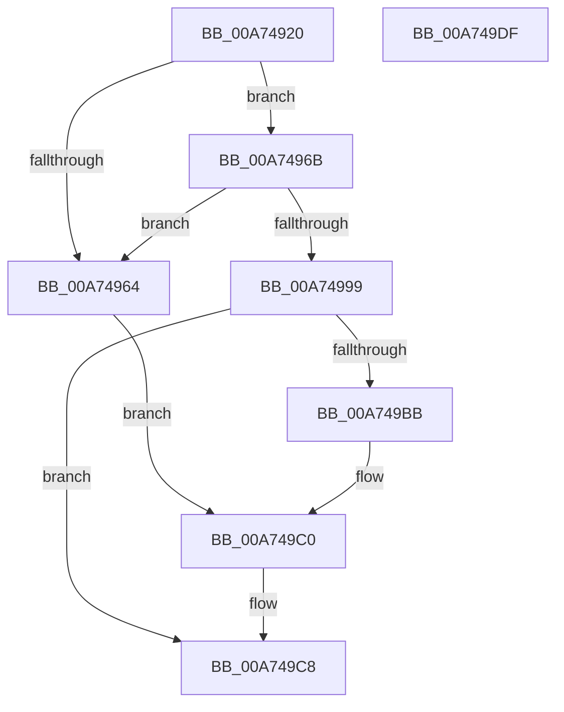

# EtwpAllocatePhysicalMemoryForTraceBuffers

- RVA: `0x00A74920`–`0x00A749E0` (길이 `192` bytes)
- VA: `0x0000000140A74920`
- 실행 섹션: `PAGE`
- PDB 이름 있음: `예`; PDB Function 태그: `아니요`
- unwind 정보 RVA: `0x0005C954`
- 디코드: `46`개 명령, `192/192` bytes 표시
- 미해석 바이트: `0` (있으면 어셈블리에 `.byte`로 보존)

> 이 문서는 커널 이미지의 기계어와 PDB 기호를 분석해 생성했습니다. 4번과 5번은 함수 원형과 자료형을 바이너리 사용 방식에서 추정한 C 해석이며 원본 소스 복구 결과는 아닙니다.

## 1. Dependencies

- 직접 호출 지점: **4**; 고유 호출 대상: **3**
- 직접 호출자로 확인된 함수: **1**
- RIP 상대 이미지 참조: **0**

### Outgoing calls
- `0x00A74951` → [ExAllocatePool2](../../poolcode/B8/ExAllocatePool2_function_00B820F0.md) (function, `0x00B820F0`)
- `0x00A74988` → [ExAllocatePool2](../../poolcode/B8/ExAllocatePool2_function_00B820F0.md) (function, `0x00B820F0`)
- `0x00A749A0` → [EtwpAllocatePhysicalPages](../7B/EtwpAllocatePhysicalPages_function_007B57DC.md) (function, `0x007B57DC`)
- `0x00A749C3` → [EtwpFreePfnArray](../7B/EtwpFreePfnArray_function_007B66A8.md) (function, `0x007B66A8`)

### Direct callers
- [EtwpAllocateTraceBufferPool](EtwpAllocateTraceBufferPool_function_00A74750.md) at `0x00A7483A`

### Static image references
- 디코드된 RIP-relative 메모리 참조가 없습니다.

## 2. Other-region calls and transfers

- 다른 실행 섹션으로 향하는 call: **2**
  - `0x00A74951` → [ExAllocatePool2](../../poolcode/B8/ExAllocatePool2_function_00B820F0.md) (`PAGE` → `POOLCODE`)
  - `0x00A74988` → [ExAllocatePool2](../../poolcode/B8/ExAllocatePool2_function_00B820F0.md) (`PAGE` → `POOLCODE`)
- 별도 외부 분기/꼬리 이동을 확인하지 못했습니다.

## 3. Assembly (complete function range)

```asm
00A74920  48 89 5C 24 08                  mov qword ptr [rsp + 8], rbx
00A74925  48 89 6C 24 10                  mov qword ptr [rsp + 0x10], rbp
00A7492A  48 89 74 24 18                  mov qword ptr [rsp + 0x18], rsi
00A7492F  57                              push rdi
00A74930  48 83 EC 20                     sub rsp, 0x20
00A74934  8B 69 04                        mov ebp, dword ptr [rcx + 4]
00A74937  48 8B F9                        mov rdi, rcx
00A7493A  48 C1 ED 0C                     shr rbp, 0xc
00A7493E  B9 40 00 00 00                  mov ecx, 0x40
00A74943  41 B8 45 74 77 74               mov r8d, 0x74777445
00A74949  48 8D 14 ED 30 00 00 00         lea rdx, [rbp*8 + 0x30]
00A74951  E8 9A D7 10 00                  call 0x140b820f0
00A74956  33 DB                           xor ebx, ebx
00A74958  48 89 87 48 06 00 00            mov qword ptr [rdi + 0x648], rax
00A7495F  48 85 C0                        test rax, rax
00A74962  75 07                           jne 0x140a7496b
00A74964  BB 17 00 00 C0                  mov ebx, 0xc0000017
00A74969  EB 55                           jmp 0x140a749c0
00A7496B  8B B7 E0 00 00 00               mov esi, dword ptr [rdi + 0xe0]
00A74971  B9 00 01 00 00                  mov ecx, 0x100
00A74976  48 0F AF F5                     imul rsi, rbp
00A7497A  41 B8 45 74 77 74               mov r8d, 0x74777445
00A74980  48 8D 14 F5 08 00 00 00         lea rdx, [rsi*8 + 8]
00A74988  E8 63 D7 10 00                  call 0x140b820f0
00A7498D  48 89 87 50 06 00 00            mov qword ptr [rdi + 0x650], rax
00A74994  48 85 C0                        test rax, rax
00A74997  74 CB                           je 0x140a74964
00A74999  48 8D 48 08                     lea rcx, [rax + 8]
00A7499D  48 8B D6                        mov rdx, rsi
00A749A0  E8 37 0E D4 FF                  call 0x1407b57dc
00A749A5  48 8B 8F 50 06 00 00            mov rcx, qword ptr [rdi + 0x650]
00A749AC  48 89 01                        mov qword ptr [rcx], rax
00A749AF  48 8B 87 50 06 00 00            mov rax, qword ptr [rdi + 0x650]
00A749B6  48 39 30                        cmp qword ptr [rax], rsi
00A749B9  74 0D                           je 0x140a749c8
00A749BB  BB 9A 00 00 C0                  mov ebx, 0xc000009a
00A749C0  48 8B CF                        mov rcx, rdi
00A749C3  E8 E0 1C D4 FF                  call 0x1407b66a8
00A749C8  48 8B 6C 24 38                  mov rbp, qword ptr [rsp + 0x38]
00A749CD  8B C3                           mov eax, ebx
00A749CF  48 8B 5C 24 30                  mov rbx, qword ptr [rsp + 0x30]
00A749D4  48 8B 74 24 40                  mov rsi, qword ptr [rsp + 0x40]
00A749D9  48 83 C4 20                     add rsp, 0x20
00A749DD  5F                              pop rdi
00A749DE  C3                              ret
00A749DF  CC                              int3
```

## 4. C-style interpretation (structured pseudocode)

```c
__int64 __fastcall EtwpAllocatePhysicalMemoryForTraceBuffers(__int64 a1)
{
    __int64 result;
    __int64 v_rbp;
    __int64 v_rbx;
    __int64 v_rsi;
    __int64 v_rsp;
    unsigned __int64 v_stack_p10;
    unsigned __int64 v_stack_p18;
    unsigned __int64 v_stack_p8;

    v_stack_p8 = v_rbx;
    v_stack_p10 = v_rbp;
    v_stack_p18 = v_rsi;
    v_rsp = (v_rsp) - (32);
    v_rbp = ((unsigned int)(*(unsigned int *)(a1 + 4))) >> (12);
    result = ExAllocatePool2(64, v_rbp * 8 + 48, (unsigned int)(0x74777445ULL), a4);
    v_rbx = 0;
    *(unsigned __int64 *)(a1 + 1608) = result;
    if (result != 0) goto loc_00A7496B;
loc_00A74964:
    goto loc_00A749C0;
loc_00A7496B:
    v_rsi = ((unsigned int)(*(unsigned int *)(a1 + 224))) * (v_rbp);
    result = ExAllocatePool2(256, v_rsi * 8 + 8, (unsigned int)(0x74777445ULL), a4);
    *(unsigned __int64 *)(a1 + 1616) = result;
    if (result == 0) goto loc_00A74964;
    result = EtwpAllocatePhysicalPages(result + 8, v_rsi, (unsigned int)(0x74777445ULL), a4);
    *(unsigned __int64 *)(*(unsigned __int64 *)(a1 + 1616)) = result;
    if ((*(unsigned __int64 *)(*(unsigned __int64 *)(a1 + 1616))) == v_rsi) goto loc_00A749C8;
loc_00A749C0:
    result = EtwpFreePfnArray(a1, v_rsi, (unsigned int)(0x74777445ULL), a4);
loc_00A749C8:
    v_rsp = (v_rsp) + (32);
    return (unsigned int)((unsigned int)((unsigned int)(0xC000009AULL)));
}
```

## 5. (Beta) C Style

```c
int64_t EtwpAllocatePhysicalMemoryForTraceBuffers(void *Arg1)
{
    uint8_t *arg1 = (uint8_t *)Arg1;

    int64_t result;
    int64_t local_rbp;
    int64_t local_rbx;
    int64_t local_rsi;
    int64_t local_rsp;
    uint64_t v_stack_p10;
    uint64_t v_stack_p18;
    uint64_t v_stack_p8;

    v_stack_p8 = local_rbx;
    v_stack_p10 = local_rbp;
    v_stack_p18 = local_rsi;
    local_rsp = (local_rsp) - (32);
    local_rbp = ((uint32_t)(*(uint32_t *)(arg1 + 0x4))) >> (12);
    result = ExAllocatePool2(64, local_rbp * 8 + 48, (uint32_t)(0x74777445ULL), a4);
    local_rbx = 0;
    *(uint64_t *)(arg1 + 0x648) = result;
    if (result != 0) goto loc_00A7496B;
loc_00A74964:
    goto loc_00A749C0;
loc_00A7496B:
    local_rsi = ((uint32_t)(*(uint32_t *)(arg1 + 0xE0))) * (local_rbp);
    result = ExAllocatePool2(256, local_rsi * 8 + 8, (uint32_t)(0x74777445ULL), a4);
    *(uint64_t *)(arg1 + 0x650) = result;
    if (result == 0) goto loc_00A74964;
    result = EtwpAllocatePhysicalPages(result + 8, local_rsi, (uint32_t)(0x74777445ULL), a4);
    *(uint64_t *)(*(uint64_t *)(arg1 + 0x650)) = result;
    if ((*(uint64_t *)(*(uint64_t *)(arg1 + 0x650))) == local_rsi) goto loc_00A749C8;
loc_00A749C0:
    result = EtwpFreePfnArray(Arg1, local_rsi, (uint32_t)(0x74777445ULL), a4);
loc_00A749C8:
    local_rsp = (local_rsp) + (32);
    return (uint32_t)((uint32_t)((uint32_t)(0xC000009AULL)));
}
```

### 관측된 메모리 오프셋

구조체 형식이 확인되지 않은 접근은 인자 기준의 오프셋으로만 기록했습니다.

| 기준 인자 | 오프셋 표현 | 폭 (bit) | 접근 |
|---|---:|---:|---|
| `Arg1` | `+ 0x4` | `32` | `R` |
| `Arg1` | `+ 0xE0` | `32` | `R` |
| `Arg1` | `+ 0x648` | `64` | `W` |
| `Arg1` | `+ 0x650` | `64` | `R` |
| `Arg1` | `+ 0x650` | `64` | `W` |

## 6. Execution-region graph

[열기: 2D/3D 그래프와 함수 탐색 컨트롤 패널](../../../control-panel.html?section=page&rva=0x00A74920&view=graph)

- 2D 그래프는 위에서 아래로 흐르고, 3D 그래프는 빈 공간을 드래그해 회전합니다. Shift+드래그는 이동, 휠은 확대·축소, 함수 노드 선택은 대상 보고서 이동입니다.

### Static fallback


