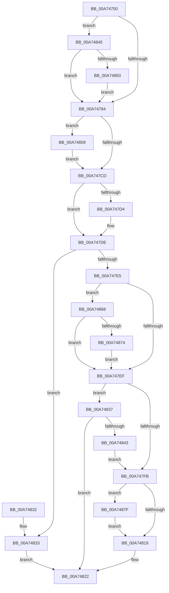

# EtwpAllocateTraceBufferPool

- RVA: `0x00A74750`–`0x00A74889` (길이 `313` bytes)
- VA: `0x0000000140A74750`
- 실행 섹션: `PAGE`
- PDB 이름 있음: `예`; PDB Function 태그: `아니요`
- unwind 정보 RVA: `0x0006797C`
- 디코드: `81`개 명령, `313/313` bytes 표시
- 미해석 바이트: `0` (있으면 어셈블리에 `.byte`로 보존)

> 이 문서는 커널 이미지의 기계어와 PDB 기호를 분석해 생성했습니다. 4번과 5번은 함수 원형과 자료형을 바이너리 사용 방식에서 추정한 C 해석이며 원본 소스 복구 결과는 아닙니다.

## 1. Dependencies

- 직접 호출 지점: **5**; 고유 호출 대상: **5**
- 직접 호출자로 확인된 함수: **1**
- RIP 상대 이미지 참조: **0**

### Outgoing calls
- `0x00A74762` → [EtwpQueryUsedProcessorCount](../../text/3E/EtwpQueryUsedProcessorCount_function_003EB940.md) (function, `0x003EB940`)
- `0x00A74769` → [EtwpGetSystemMaximumBufferCount](EtwpGetSystemMaximumBufferCount_function_00A74890.md) (function, `0x00A74890`)
- `0x00A74806` → [EtwpAllocateFreeBuffers](../../text/3E/EtwpAllocateFreeBuffers_function_003EAEA4.md) (function, `0x003EAEA4`)
- `0x00A7483A` → [EtwpAllocatePhysicalMemoryForTraceBuffers](EtwpAllocatePhysicalMemoryForTraceBuffers_function_00A74920.md) (function, `0x00A74920`)
- `0x00A74882` → [EtwpFreePfnArray](../7B/EtwpFreePfnArray_function_007B66A8.md) (function, `0x007B66A8`)

### Direct callers
- [EtwpStartLogger](../A9/EtwpStartLogger_function_00A99D80.md) at `0x00A9ABD1`

### Static image references
- 디코드된 RIP-relative 메모리 참조가 없습니다.

## 2. Other-region calls and transfers

- 다른 실행 섹션으로 향하는 call: **2**
  - `0x00A74762` → [EtwpQueryUsedProcessorCount](../../text/3E/EtwpQueryUsedProcessorCount_function_003EB940.md) (`PAGE` → `.text`)
  - `0x00A74806` → [EtwpAllocateFreeBuffers](../../text/3E/EtwpAllocateFreeBuffers_function_003EAEA4.md) (`PAGE` → `.text`)
- 별도 외부 분기/꼬리 이동을 확인하지 못했습니다.

## 3. Assembly (complete function range)

```asm
00A74750  48 89 5C 24 08                  mov qword ptr [rsp + 8], rbx
00A74755  48 89 74 24 10                  mov qword ptr [rsp + 0x10], rsi
00A7475A  57                              push rdi
00A7475B  48 83 EC 20                     sub rsp, 0x20
00A7475F  48 8B D9                        mov rbx, rcx
00A74762  E8 D9 71 97 FF                  call 0x1403eb940
00A74767  8B F8                           mov edi, eax
00A74769  E8 22 01 00 00                  call 0x140a74890
00A7476E  44 8B 4B 0C                     mov r9d, dword ptr [rbx + 0xc]
00A74772  44 8D 14 3F                     lea r10d, [rdi + rdi]
00A74776  44 8B C0                        mov r8d, eax
00A74779  41 0F BA E1 1A                  bt r9d, 0x1a
00A7477E  0F 82 C1 00 00 00               jb 0x140a74845
00A74784  8B 83 EC 00 00 00               mov eax, dword ptr [rbx + 0xec]
00A7478A  45 3B C2                        cmp r8d, r10d
00A7478D  41 8B CA                        mov ecx, r10d
00A74790  45 0F 42 C2                     cmovb r8d, r10d
00A74794  41 3B C2                        cmp eax, r10d
00A74797  41 8B D0                        mov edx, r8d
00A7479A  0F 47 C8                        cmova ecx, eax
00A7479D  8B 83 E0 00 00 00               mov eax, dword ptr [rbx + 0xe0]
00A747A3  41 3B C8                        cmp ecx, r8d
00A747A6  0F 42 D1                        cmovb edx, ecx
00A747A9  41 3B C2                        cmp eax, r10d
00A747AC  89 93 EC 00 00 00               mov dword ptr [rbx + 0xec], edx
00A747B2  44 0F 47 D0                     cmova r10d, eax
00A747B6  45 3B D0                        cmp r10d, r8d
00A747B9  45 0F 42 C2                     cmovb r8d, r10d
00A747BD  44 89 83 E0 00 00 00            mov dword ptr [rbx + 0xe0], r8d
00A747C4  44 3B C2                        cmp r8d, edx
00A747C7  0F 87 8C 00 00 00               ja 0x140a74859
00A747CD  41 0F BA E1 0A                  bt r9d, 0xa
00A747D2  73 0A                           jae 0x140a747de
00A747D4  44 89 83 EC 00 00 00            mov dword ptr [rbx + 0xec], r8d
00A747DB  41 8B D0                        mov edx, r8d
00A747DE  41 0F BA E1 12                  bt r9d, 0x12
00A747E3  72 4E                           jb 0x140a74833
00A747E5  8B 83 D4 00 00 00               mov eax, dword ptr [rbx + 0xd4]
00A747EB  85 C0                           test eax, eax
00A747ED  75 79                           jne 0x140a74868
00A747EF  F7 83 30 03 00 00 00 00 00 20   test dword ptr [rbx + 0x330], 0x20000000
00A747F9  75 3C                           jne 0x140a74837
00A747FB  8B BB E0 00 00 00               mov edi, dword ptr [rbx + 0xe0]
00A74801  48 8B CB                        mov rcx, rbx
00A74804  8B D7                           mov edx, edi
00A74806  E8 99 66 97 FF                  call 0x1403eaea4
00A7480B  F7 83 30 03 00 00 00 00 00 20   test dword ptr [rbx + 0x330], 0x20000000
00A74815  8B F0                           mov esi, eax
00A74817  75 66                           jne 0x140a7487f
00A74819  3B F7                           cmp esi, edi
00A7481B  1B C0                           sbb eax, eax
00A7481D  25 17 00 00 C0                  and eax, 0xc0000017
00A74822  48 8B 5C 24 30                  mov rbx, qword ptr [rsp + 0x30]
00A74827  48 8B 74 24 38                  mov rsi, qword ptr [rsp + 0x38]
00A7482C  48 83 C4 20                     add rsp, 0x20
00A74830  5F                              pop rdi
00A74831  C3                              ret
00A74832  CC                              int3
00A74833  33 C0                           xor eax, eax
00A74835  EB EB                           jmp 0x140a74822
00A74837  48 8B CB                        mov rcx, rbx
00A7483A  E8 E1 00 00 00                  call 0x140a74920
00A7483F  85 C0                           test eax, eax
00A74841  78 DF                           js 0x140a74822
00A74843  EB B6                           jmp 0x140a747fb
00A74845  41 0F BA E1 0A                  bt r9d, 0xa
00A7484A  0F 83 34 FF FF FF               jae 0x140a74784
00A74850  41 83 C2 04                     add r10d, 4
00A74854  E9 2B FF FF FF                  jmp 0x140a74784
00A74859  44 89 83 EC 00 00 00            mov dword ptr [rbx + 0xec], r8d
00A74860  41 8B D0                        mov edx, r8d
00A74863  E9 65 FF FF FF                  jmp 0x140a747cd
00A74868  2B D7                           sub edx, edi
00A7486A  FF CA                           dec edx
00A7486C  3B C2                           cmp eax, edx
00A7486E  0F 86 7B FF FF FF               jbe 0x140a747ef
00A74874  89 93 D4 00 00 00               mov dword ptr [rbx + 0xd4], edx
00A7487A  E9 70 FF FF FF                  jmp 0x140a747ef
00A7487F  48 8B CB                        mov rcx, rbx
00A74882  E8 21 1E D4 FF                  call 0x1407b66a8
00A74887  EB 90                           jmp 0x140a74819
```

## 4. C-style interpretation (structured pseudocode)

```c
__int64 __fastcall EtwpAllocateTraceBufferPool(__int64 a1)
{
    __int64 result;
    __int64 v_r10;
    __int64 v_rsp;
    unsigned __int64 v_stack_p10;
    unsigned __int64 v_stack_p8;

    v_stack_p8 = v_rbx;
    v_stack_p10 = v_rsi;
    v_rsp = (v_rsp) - (32);
    result = EtwpQueryUsedProcessorCount(a1, a2, a3, a4);
    result = EtwpGetSystemMaximumBufferCount(a1, a2, a3, a4);
    if (condition_is_below) goto loc_00A74845;
loc_00A74784:
    a3 = (unsigned int)((unsigned int)(result));
    if (((unsigned int)((unsigned int)((unsigned int)(result)))) < ((unsigned int)((unsigned int)((unsigned int)(result)) + (unsigned int)((unsigned int)(result)) * 1))) { a3 = (unsigned int)((unsigned int)((unsigned int)(result)) + (unsigned int)((unsigned int)(result)) * 1); }
    a1 = (unsigned int)((unsigned int)((unsigned int)((unsigned int)(result)) + (unsigned int)((unsigned int)(result)) * 1));
    if (((unsigned int)((unsigned int)(*(unsigned int *)(a1 + 236)))) > ((unsigned int)((unsigned int)((unsigned int)(result)) + (unsigned int)((unsigned int)(result)) * 1))) { a1 = (unsigned int)((unsigned int)(*(unsigned int *)(a1 + 236))); }
    a2 = (unsigned int)((unsigned int)(a3));
    if (((unsigned int)(a1)) < ((unsigned int)(a3))) { a2 = (unsigned int)(a1); }
    *(unsigned int *)(a1 + 236) = (unsigned int)(a2);
    v_r10 = (unsigned int)((unsigned int)(result)) + (unsigned int)((unsigned int)(result)) * 1;
    if (((unsigned int)((unsigned int)(*(unsigned int *)(a1 + 224)))) > ((unsigned int)((unsigned int)((unsigned int)(result)) + (unsigned int)((unsigned int)(result)) * 1))) { v_r10 = (unsigned int)((unsigned int)(*(unsigned int *)(a1 + 224))); }
    if (((unsigned int)(v_r10)) < ((unsigned int)(a3))) { a3 = (unsigned int)(v_r10); }
    *(unsigned int *)(a1 + 224) = (unsigned int)(a3);
    if (((unsigned int)(a3)) > ((unsigned int)(a2))) goto loc_00A74859;
loc_00A747CD:
    if (((unsigned int)(a3)) < ((unsigned int)(a2))) {
        *(unsigned int *)(a1 + 236) = (unsigned int)(a3);
        a2 = (unsigned int)(a3);
    }
    if (((unsigned int)(a3)) < ((unsigned int)(a2))) goto loc_00A74833;
    if ((unsigned int)((unsigned int)(*(unsigned int *)(a1 + 212))) != 0) goto loc_00A74868;
loc_00A747EF:
    if (((*(unsigned int *)(a1 + 816)) & (0x20000000ULL)) != 0) goto loc_00A74837;
loc_00A747FB:
    result = EtwpAllocateFreeBuffers(a1, (unsigned int)((unsigned int)((unsigned int)(*(unsigned int *)(a1 + 224)))), a3, (unsigned int)(*(unsigned int *)(a1 + 12)));
    if (((*(unsigned int *)(a1 + 816)) & (0x20000000ULL)) != 0) goto loc_00A7487F;
loc_00A74819:
    result = (unsigned int)((result) & (0xC0000017ULL));
loc_00A74822:
    v_rsp = (v_rsp) + (32);
    return result;
loc_00A74833:
    result = 0;
    goto loc_00A74822;
loc_00A74837:
    result = EtwpAllocatePhysicalMemoryForTraceBuffers(v_stack_p8, (unsigned int)((unsigned int)((unsigned int)(*(unsigned int *)(a1 + 224)))), a3, (unsigned int)(*(unsigned int *)(a1 + 12)));
    if (sign_flag) goto loc_00A74822;
    goto loc_00A747FB;
loc_00A74845:
    if (condition_is_above_or_equal) goto loc_00A74784;
    v_r10 = (unsigned int)((v_r10) + (4));
    goto loc_00A74784;
loc_00A74859:
    *(unsigned int *)(v_stack_p8 + 236) = (unsigned int)(a3);
    goto loc_00A747CD;
loc_00A74868:
    a2 = (unsigned int)(((unsigned int)((unsigned int)(a3))) - ((unsigned int)((unsigned int)(*(unsigned int *)(a1 + 224)))));
    a2 = (unsigned int)((a2) - 1);
    if (((unsigned int)(result)) <= ((unsigned int)(a2))) goto loc_00A747EF;
    *(unsigned int *)(v_stack_p8 + 212) = (unsigned int)(a2);
    goto loc_00A747EF;
loc_00A7487F:
    result = EtwpFreePfnArray(v_stack_p8, a2, a3, (unsigned int)(*(unsigned int *)(a1 + 12)));
    goto loc_00A74819;
}
```

## 5. (Beta) C Style

```c
int64_t EtwpAllocateTraceBufferPool(void *Arg1)
{
    uint8_t *arg1 = (uint8_t *)Arg1;

    int64_t result;
    int64_t local_r10;
    int64_t local_rsp;
    uint64_t v_stack_p10;
    uint64_t v_stack_p8;

    v_stack_p8 = local_rbx;
    v_stack_p10 = local_rsi;
    local_rsp = (local_rsp) - (32);
    result = EtwpQueryUsedProcessorCount(Arg1, a2, a3, a4);
    result = EtwpGetSystemMaximumBufferCount(Arg1, a2, a3, a4);
    if (condition_is_below) goto loc_00A74845;
loc_00A74784:
    a3 = (uint32_t)((uint32_t)(result));
    if (((uint32_t)((uint32_t)((uint32_t)(result)))) < ((uint32_t)((uint32_t)((uint32_t)(result)) + (uint32_t)((uint32_t)(result)) * 1))) { a3 = (uint32_t)((uint32_t)((uint32_t)(result)) + (uint32_t)((uint32_t)(result)) * 1); }
    Arg1 = (uint32_t)((uint32_t)((uint32_t)((uint32_t)(result)) + (uint32_t)((uint32_t)(result)) * 1));
    if (((uint32_t)((uint32_t)(*(uint32_t *)(arg1 + 0xEC)))) > ((uint32_t)((uint32_t)((uint32_t)(result)) + (uint32_t)((uint32_t)(result)) * 1))) { Arg1 = (uint32_t)((uint32_t)(*(uint32_t *)(arg1 + 0xEC))); }
    a2 = (uint32_t)((uint32_t)(a3));
    if (((uint32_t)(Arg1)) < ((uint32_t)(a3))) { a2 = (uint32_t)(Arg1); }
    *(uint32_t *)(arg1 + 0xEC) = (uint32_t)(a2);
    local_r10 = (uint32_t)((uint32_t)(result)) + (uint32_t)((uint32_t)(result)) * 1;
    if (((uint32_t)((uint32_t)(*(uint32_t *)(arg1 + 0xE0)))) > ((uint32_t)((uint32_t)((uint32_t)(result)) + (uint32_t)((uint32_t)(result)) * 1))) { local_r10 = (uint32_t)((uint32_t)(*(uint32_t *)(arg1 + 0xE0))); }
    if (((uint32_t)(local_r10)) < ((uint32_t)(a3))) { a3 = (uint32_t)(local_r10); }
    *(uint32_t *)(arg1 + 0xE0) = (uint32_t)(a3);
    if (((uint32_t)(a3)) > ((uint32_t)(a2))) goto loc_00A74859;
loc_00A747CD:
    if (((uint32_t)(a3)) < ((uint32_t)(a2))) {
        *(uint32_t *)(arg1 + 0xEC) = (uint32_t)(a3);
        a2 = (uint32_t)(a3);
    }
    if (((uint32_t)(a3)) < ((uint32_t)(a2))) goto loc_00A74833;
    if ((uint32_t)((uint32_t)(*(uint32_t *)(arg1 + 0xD4))) != 0) goto loc_00A74868;
loc_00A747EF:
    if (((*(uint32_t *)(arg1 + 0x330)) & (0x20000000ULL)) != 0) goto loc_00A74837;
loc_00A747FB:
    result = EtwpAllocateFreeBuffers(Arg1, (uint32_t)((uint32_t)((uint32_t)(*(uint32_t *)(arg1 + 0xE0)))), a3, (uint32_t)(*(uint32_t *)(arg1 + 0xC)));
    if (((*(uint32_t *)(arg1 + 0x330)) & (0x20000000ULL)) != 0) goto loc_00A7487F;
loc_00A74819:
    result = (uint32_t)((result) & (0xC0000017ULL));
loc_00A74822:
    local_rsp = (local_rsp) + (32);
    return result;
loc_00A74833:
    result = 0;
    goto loc_00A74822;
loc_00A74837:
    result = EtwpAllocatePhysicalMemoryForTraceBuffers(v_stack_p8, (uint32_t)((uint32_t)((uint32_t)(*(uint32_t *)(arg1 + 0xE0)))), a3, (uint32_t)(*(uint32_t *)(arg1 + 0xC)));
    if (sign_flag) goto loc_00A74822;
    goto loc_00A747FB;
loc_00A74845:
    if (condition_is_above_or_equal) goto loc_00A74784;
    local_r10 = (uint32_t)((local_r10) + (4));
    goto loc_00A74784;
loc_00A74859:
    *(uint32_t *)(v_stack_p8 + 0xEC) = (uint32_t)(a3);
    goto loc_00A747CD;
loc_00A74868:
    a2 = (uint32_t)(((uint32_t)((uint32_t)(a3))) - ((uint32_t)((uint32_t)(*(uint32_t *)(arg1 + 0xE0)))));
    a2 = (uint32_t)((a2) - 1);
    if (((uint32_t)(result)) <= ((uint32_t)(a2))) goto loc_00A747EF;
    *(uint32_t *)(v_stack_p8 + 0xD4) = (uint32_t)(a2);
    goto loc_00A747EF;
loc_00A7487F:
    result = EtwpFreePfnArray(v_stack_p8, a2, a3, (uint32_t)(*(uint32_t *)(arg1 + 0xC)));
    goto loc_00A74819;
}
```

### 관측된 메모리 오프셋

구조체 형식이 확인되지 않은 접근은 인자 기준의 오프셋으로만 기록했습니다.

| 기준 인자 | 오프셋 표현 | 폭 (bit) | 접근 |
|---|---:|---:|---|
| `Arg1` | `+ 0xC` | `32` | `R` |
| `Arg1` | `+ 0xD4` | `32` | `R` |
| `Arg1` | `+ 0xD4` | `32` | `W` |
| `Arg1` | `+ 0xE0` | `32` | `R` |
| `Arg1` | `+ 0xE0` | `32` | `W` |
| `Arg1` | `+ 0xEC` | `32` | `R` |
| `Arg1` | `+ 0xEC` | `32` | `W` |
| `Arg1` | `+ 0x330` | `32` | `R` |

## 6. Execution-region graph

[열기: 2D/3D 그래프와 함수 탐색 컨트롤 패널](../../../control-panel.html?section=page&rva=0x00A74750&view=graph)

- 2D 그래프는 위에서 아래로 흐르고, 3D 그래프는 빈 공간을 드래그해 회전합니다. Shift+드래그는 이동, 휠은 확대·축소, 함수 노드 선택은 대상 보고서 이동입니다.

### Static fallback


