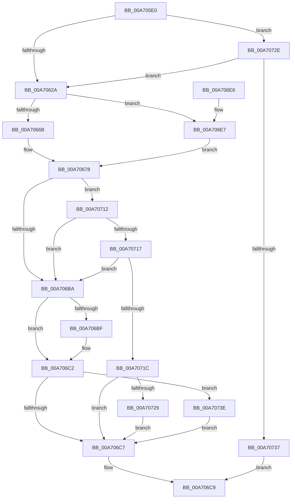

# EtwpCreateDirectoryFile

- RVA: `0x00A705E0`–`0x00A7074D` (길이 `365` bytes)
- VA: `0x0000000140A705E0`
- 실행 섹션: `PAGE`
- PDB 이름 있음: `예`; PDB Function 태그: `아니요`
- unwind 정보 RVA: `0x000B508C`
- 디코드: `102`개 명령, `365/365` bytes 표시
- 미해석 바이트: `0` (있으면 어셈블리에 `.byte`로 보존)

> 이 문서는 커널 이미지의 기계어와 PDB 기호를 분석해 생성했습니다. 4번과 5번은 함수 원형과 자료형을 바이너리 사용 방식에서 추정한 C 해석이며 원본 소스 복구 결과는 아닙니다.

## 1. Dependencies

- 직접 호출 지점: **3**; 고유 호출 대상: **3**
- 직접 호출자로 확인된 함수: **1**
- RIP 상대 이미지 참조: **0**

### Outgoing calls
- `0x00A70631` → [RtlInitUnicodeString](../../text/42/RtlInitUnicodeString_function_0042A780.md) (function, `0x0042A780`)
- `0x00A706AB` → [ZwCreateFile](../../text/6A/ZwCreateFile_function_006ADB70.md) (function, `0x006ADB70`)
- `0x00A7071F` → [ZwClose](../../text/6A/ZwClose_function_006AD2B0.md) (function, `0x006AD2B0`)

### Direct callers
- [sub_00B2EC62](../B2/Unknown_function_00B2EC62.md) at `0x00B2ECAC`
- [sub_00B2EC62](../B2/Unknown_function_00B2EC62.md) at `0x00B2ECE9`

### Static image references
- 디코드된 RIP-relative 메모리 참조가 없습니다.

## 2. Other-region calls and transfers

- 다른 실행 섹션으로 향하는 call: **3**
  - `0x00A70631` → [RtlInitUnicodeString](../../text/42/RtlInitUnicodeString_function_0042A780.md) (`PAGE` → `.text`)
  - `0x00A706AB` → [ZwCreateFile](../../text/6A/ZwCreateFile_function_006ADB70.md) (`PAGE` → `.text`)
  - `0x00A7071F` → [ZwClose](../../text/6A/ZwClose_function_006AD2B0.md) (`PAGE` → `.text`)
- 별도 외부 분기/꼬리 이동을 확인하지 못했습니다.

## 3. Assembly (complete function range)

```asm
00A705E0  48 8B C4                        mov rax, rsp
00A705E3  48 89 58 08                     mov qword ptr [rax + 8], rbx
00A705E7  48 89 70 10                     mov qword ptr [rax + 0x10], rsi
00A705EB  48 89 78 18                     mov qword ptr [rax + 0x18], rdi
00A705EF  55                              push rbp
00A705F0  41 56                           push r14
00A705F2  41 57                           push r15
00A705F4  48 8D 68 B9                     lea rbp, [rax - 0x47]
00A705F8  48 81 EC B0 00 00 00            sub rsp, 0xb0
00A705FF  48 8B 7D 6F                     mov rdi, qword ptr [rbp + 0x6f]
00A70603  45 33 FF                        xor r15d, r15d
00A70606  44 89 7D FB                     mov dword ptr [rbp - 5], r15d
00A7060A  0F 57 C0                        xorps xmm0, xmm0
00A7060D  44 89 7D 13                     mov dword ptr [rbp + 0x13], r15d
00A70611  41 8A D9                        mov bl, r9b
00A70614  4C 89 7D DF                     mov qword ptr [rbp - 0x21], r15
00A70618  45 8A F0                        mov r14b, r8b
00A7061B  40 8A F2                        mov sil, dl
00A7061E  0F 11 45 E7                     movups xmmword ptr [rbp - 0x19], xmm0
00A70622  84 D2                           test dl, dl
00A70624  0F 84 04 01 00 00               je 0x140a7072e
00A7062A  48 8B D1                        mov rdx, rcx
00A7062D  48 8D 4D E7                     lea rcx, [rbp - 0x19]
00A70631  E8 4A A1 9B FF                  call 0x14042a780
00A70636  8A C3                           mov al, bl
00A70638  C7 45 F7 30 00 00 00            mov dword ptr [rbp - 9], 0x30
00A7063F  F6 D8                           neg al
00A70641  4C 89 7D FF                     mov qword ptr [rbp - 1], r15
00A70645  48 8D 45 E7                     lea rax, [rbp - 0x19]
00A70649  0F 57 C0                        xorps xmm0, xmm0
00A7064C  1B C9                           sbb ecx, ecx
00A7064E  48 89 45 07                     mov qword ptr [rbp + 7], rax
00A70652  81 E1 00 FC FF FF               and ecx, 0xfffffc00
00A70658  81 C1 40 06 00 00               add ecx, 0x640
00A7065E  89 4D 0F                        mov dword ptr [rbp + 0xf], ecx
00A70661  F3 0F 7F 45 17                  movdqu xmmword ptr [rbp + 0x17], xmm0
00A70666  40 84 F6                        test sil, sil
00A70669  74 7C                           je 0x140a706e7
00A7066B  B8 03 00 00 00                  mov eax, 3
00A70670  BA 9F 01 12 00                  mov edx, 0x12019f
00A70675  8D 48 1E                        lea ecx, [rax + 0x1e]
00A70678  4C 8B 4D 77                     mov r9, qword ptr [rbp + 0x77]
00A7067C  4C 8D 45 F7                     lea r8, [rbp - 9]
00A70680  44 89 7C 24 50                  mov dword ptr [rsp + 0x50], r15d
00A70685  4C 89 7C 24 48                  mov qword ptr [rsp + 0x48], r15
00A7068A  89 4C 24 40                     mov dword ptr [rsp + 0x40], ecx
00A7068E  48 8D 4D DF                     lea rcx, [rbp - 0x21]
00A70692  89 44 24 38                     mov dword ptr [rsp + 0x38], eax
00A70696  C7 44 24 30 05 00 00 00         mov dword ptr [rsp + 0x30], 5
00A7069E  C7 44 24 28 80 00 00 00         mov dword ptr [rsp + 0x28], 0x80
00A706A6  4C 89 7C 24 20                  mov qword ptr [rsp + 0x20], r15
00A706AB  E8 C0 D4 C3 FF                  call 0x1406adb70
00A706B0  8B D8                           mov ebx, eax
00A706B2  48 8B 45 DF                     mov rax, qword ptr [rbp - 0x21]
00A706B6  85 DB                           test ebx, ebx
00A706B8  79 58                           jns 0x140a70712
00A706BA  48 85 FF                        test rdi, rdi
00A706BD  74 03                           je 0x140a706c2
00A706BF  48 89 07                        mov qword ptr [rdi], rax
00A706C2  40 84 F6                        test sil, sil
00A706C5  75 77                           jne 0x140a7073e
00A706C7  8B C3                           mov eax, ebx
00A706C9  4C 8D 9C 24 B0 00 00 00         lea r11, [rsp + 0xb0]
00A706D1  49 8B 5B 20                     mov rbx, qword ptr [r11 + 0x20]
00A706D5  49 8B 73 28                     mov rsi, qword ptr [r11 + 0x28]
00A706D9  49 8B 7B 30                     mov rdi, qword ptr [r11 + 0x30]
00A706DD  49 8B E3                        mov rsp, r11
00A706E0  41 5F                           pop r15
00A706E2  41 5E                           pop r14
00A706E4  5D                              pop rbp
00A706E5  C3                              ret
00A706E6  CC                              int3
00A706E7  F6 DB                           neg bl
00A706E9  1B D2                           sbb edx, edx
00A706EB  81 E2 00 00 01 00               and edx, 0x10000
00A706F1  81 C2 8B 00 12 00               add edx, 0x12008b
00A706F7  41 F6 DE                        neg r14b
00A706FA  1B C9                           sbb ecx, ecx
00A706FC  83 E1 08                        and ecx, 8
00A706FF  83 C1 20                        add ecx, 0x20
00A70702  F7 5D 7F                        neg dword ptr [rbp + 0x7f]
00A70705  1B C0                           sbb eax, eax
00A70707  83 E0 FE                        and eax, 0xfffffffe
00A7070A  83 C0 05                        add eax, 5
00A7070D  E9 66 FF FF FF                  jmp 0x140a70678
00A70712  40 84 F6                        test sil, sil
00A70715  74 A3                           je 0x140a706ba
00A70717  48 85 C0                        test rax, rax
00A7071A  74 9E                           je 0x140a706ba
00A7071C  48 8B C8                        mov rcx, rax
00A7071F  E8 8C CB C3 FF                  call 0x1406ad2b0
00A70724  48 85 FF                        test rdi, rdi
00A70727  74 9E                           je 0x140a706c7
00A70729  4C 89 3F                        mov qword ptr [rdi], r15
00A7072C  EB 99                           jmp 0x140a706c7
00A7072E  48 85 FF                        test rdi, rdi
00A70731  0F 85 F3 FE FF FF               jne 0x140a7062a
00A70737  B8 0D 00 00 C0                  mov eax, 0xc000000d
00A7073C  EB 8B                           jmp 0x140a706c9
00A7073E  81 FB 43 00 00 C0               cmp ebx, 0xc0000043
00A70744  41 0F 44 DF                     cmove ebx, r15d
00A70748  E9 7A FF FF FF                  jmp 0x140a706c7
```

## 4. C-style interpretation (structured pseudocode)

```c
__int64 __fastcall EtwpCreateDirectoryFile(__int64 a1, unsigned __int8 a2, unsigned __int8 a3, unsigned __int8 a4)
{
    __int64 result;
    __int64 v_r14;
    __int64 v_r15;
    __int64 v_rbx;
    __int64 v_rsp;
    unsigned __int64 v_stack_m18;
    unsigned int v_stack_m78;
    unsigned __int64 v_stack_m80;
    unsigned int v_stack_m88;
    unsigned int v_stack_m90;
    unsigned int v_stack_m98;
    unsigned int v_stack_mA0;
    unsigned __int64 v_stack_mA8;

    *(unsigned __int64 *)(v_rsp + 8) = v_rbx;
    *(unsigned __int64 *)(v_rsp + 16) = v_rsi;
    *(unsigned __int64 *)(v_rsp + 24) = v_rdi;
    v_rsp = (v_rsp) - (176);
    v_r15 = 0;
    *(unsigned int *)(v_rsp - 71 - 5) = 0;
    *(unsigned int *)(v_rsp - 71 + 19) = 0;
    *(unsigned __int64 *)(v_rsp - 71 - 33) = 0;
    *(unsigned __int64 *)(v_rsp - 71 - 25) = v_xmm0;
    if (a2 == 0) goto loc_00A7072E;
loc_00A7062A:
    result = RtlInitUnicodeString(v_rsp - 71 - 25, a1, a3, a4);
    *(unsigned int *)(v_rsp - 71 - 9) = 48;
    result = (unsigned __int8)(-(a4));
    *(unsigned __int64 *)(v_rsp - 71 - 1) = 0;
    *(unsigned __int64 *)(v_rsp - 71 + 7) = v_rsp - 71 - 25;
    a1 = (unsigned int)((v_rsp - 71 - 25) & (0xFFFFFC00ULL));
    a1 = (unsigned int)((a1) + (0x640ULL));
    *(unsigned int *)(v_rsp - 71 + 15) = (unsigned int)(a1);
    *(unsigned __int64 *)(v_rsp - 71 + 23) = v_xmm0;
    if (a2 == 0) goto loc_00A706E7;
loc_00A70678:
    v_stack_m78 = 0;
    v_stack_m80 = 0;
    v_stack_m88 = (unsigned int)(3 + 30);
    v_stack_m90 = 3;
    v_stack_m98 = 5;
    v_stack_mA0 = 128;
    v_stack_mA8 = 0;
    result = ZwCreateFile(v_rsp - 71 - 33, (unsigned int)(0x12019FULL), v_rsp - 71 - 9, *(unsigned __int64 *)(v_rsp - 71 + 119));
    if (!sign_flag) goto loc_00A70712;
loc_00A706BA:
    if (*(unsigned __int64 *)(v_rsp - 71 + 111) != 0) {
        *(unsigned __int64 *)(*(unsigned __int64 *)(v_rsp - 71 + 111)) = *(unsigned __int64 *)(v_rsp - 71 - 33);
    }
    if (a2 != 0) goto loc_00A7073E;
loc_00A706C7:
loc_00A706C9:
    return (unsigned int)((unsigned int)((unsigned int)((unsigned int)(result))));
loc_00A706E7:
    v_rbx = (unsigned __int8)(-(*(unsigned __int64 *)(v_stack_m18 + 32)));
    a2 = (unsigned int)(((unsigned int)(0x12019FULL)) & (0x10000ULL));
    a2 = (unsigned int)((a2) + (0x12008BULL));
    v_r14 = (unsigned __int8)(-(a3));
    a1 = (unsigned int)((v_rsp - 71 - 33) & (8));
    a1 = (unsigned int)((a1) + (32));
    result = (unsigned int)(((unsigned int)((unsigned int)((unsigned int)((unsigned int)(result))))) & (0xFFFFFFFEULL));
    result = (unsigned int)((result) + (5));
    goto loc_00A70678;
loc_00A70712:
    if ((unsigned __int8)(*(unsigned __int64 *)(v_stack_m18 + 40)) == 0) goto loc_00A706BA;
    if (result == 0) goto loc_00A706BA;
    result = ZwClose(result, a2, v_rsp - 71 - 9, *(unsigned __int64 *)(v_rsp - 71 + 119));
    if (*(unsigned __int64 *)(v_stack_m18 + 48) == 0) goto loc_00A706C7;
    *(unsigned __int64 *)(*(unsigned __int64 *)(v_stack_m18 + 48)) = 0;
    goto loc_00A706C7;
loc_00A7072E:
    if (*(unsigned __int64 *)(v_stack_m18 + 48) != 0) goto loc_00A7062A;
    goto loc_00A706C9;
loc_00A7073E:
    if (((unsigned int)(v_rbx)) == 0xC0000043ULL) { v_rbx = 0; }
    goto loc_00A706C7;
}
```

## 5. (Beta) C Style

```c
int64_t EtwpCreateDirectoryFile(int64_t Arg1, uint8_t Arg2, uint8_t Arg3, uint8_t Arg4)
{
    int64_t result;
    int64_t local_r14;
    int64_t local_r15;
    int64_t local_rbx;
    int64_t local_rsp;
    uint64_t v_stack_m18;
    uint32_t v_stack_m78;
    uint64_t v_stack_m80;
    uint32_t v_stack_m88;
    uint32_t v_stack_m90;
    uint32_t v_stack_m98;
    uint32_t v_stack_mA0;
    uint64_t v_stack_mA8;

    *(uint64_t *)(local_rsp + 0x8) = local_rbx;
    *(uint64_t *)(local_rsp + 0x10) = local_rsi;
    *(uint64_t *)(local_rsp + 0x18) = local_rdi;
    local_rsp = (local_rsp) - (176);
    local_r15 = 0;
    *(uint32_t *)(local_rsp - 0x47 - 0x5) = 0;
    *(uint32_t *)(local_rsp - 0x47 + 0x13) = 0;
    *(uint64_t *)(local_rsp - 0x47 - 0x21) = 0;
    *(uint64_t *)(local_rsp - 0x47 - 0x19) = v_xmm0;
    if (Arg2 == 0) goto loc_00A7072E;
loc_00A7062A:
    result = RtlInitUnicodeString(local_rsp - 71 - 25, Arg1, Arg3, Arg4);
    *(uint32_t *)(local_rsp - 0x47 - 0x9) = 48;
    result = (uint8_t)(-(Arg4));
    *(uint64_t *)(local_rsp - 0x47 - 0x1) = 0;
    *(uint64_t *)(local_rsp - 0x47 + 0x7) = local_rsp - 71 - 25;
    Arg1 = (uint32_t)((local_rsp - 71 - 25) & (0xFFFFFC00ULL));
    Arg1 = (uint32_t)((Arg1) + (0x640ULL));
    *(uint32_t *)(local_rsp - 0x47 + 0xF) = (uint32_t)(Arg1);
    *(uint64_t *)(local_rsp - 0x47 + 0x17) = v_xmm0;
    if (Arg2 == 0) goto loc_00A706E7;
loc_00A70678:
    v_stack_m78 = 0;
    v_stack_m80 = 0;
    v_stack_m88 = (uint32_t)(3 + 30);
    v_stack_m90 = 3;
    v_stack_m98 = 5;
    v_stack_mA0 = 128;
    v_stack_mA8 = 0;
    result = ZwCreateFile(local_rsp - 71 - 33, (uint32_t)(0x12019FULL), local_rsp - 71 - 9, *(uint64_t *)(local_rsp - 0x47 + 0x77));
    if (!sign_flag) goto loc_00A70712;
loc_00A706BA:
    if (*(uint64_t *)(local_rsp - 0x47 + 0x6F) != 0) {
        *(uint64_t *)(*(uint64_t *)(local_rsp - 0x47 + 0x6F)) = *(uint64_t *)(local_rsp - 0x47 - 0x21);
    }
    if (Arg2 != 0) goto loc_00A7073E;
loc_00A706C7:
loc_00A706C9:
    return (uint32_t)((uint32_t)((uint32_t)((uint32_t)(result))));
loc_00A706E7:
    local_rbx = (uint8_t)(-(*(uint64_t *)(v_stack_m18 + 0x20)));
    Arg2 = (uint32_t)(((uint32_t)(0x12019FULL)) & (0x10000ULL));
    Arg2 = (uint32_t)((Arg2) + (0x12008BULL));
    local_r14 = (uint8_t)(-(Arg3));
    Arg1 = (uint32_t)((local_rsp - 71 - 33) & (8));
    Arg1 = (uint32_t)((Arg1) + (32));
    result = (uint32_t)(((uint32_t)((uint32_t)((uint32_t)((uint32_t)(result))))) & (0xFFFFFFFEULL));
    result = (uint32_t)((result) + (5));
    goto loc_00A70678;
loc_00A70712:
    if ((uint8_t)(*(uint64_t *)(v_stack_m18 + 0x28)) == 0) goto loc_00A706BA;
    if (result == 0) goto loc_00A706BA;
    result = ZwClose(result, Arg2, local_rsp - 71 - 9, *(uint64_t *)(local_rsp - 0x47 + 0x77));
    if (*(uint64_t *)(v_stack_m18 + 0x30) == 0) goto loc_00A706C7;
    *(uint64_t *)(*(uint64_t *)(v_stack_m18 + 0x30)) = 0;
    goto loc_00A706C7;
loc_00A7072E:
    if (*(uint64_t *)(v_stack_m18 + 0x30) != 0) goto loc_00A7062A;
    goto loc_00A706C9;
loc_00A7073E:
    if (((uint32_t)(local_rbx)) == 0xC0000043ULL) { local_rbx = 0; }
    goto loc_00A706C7;
}
```

## 6. Execution-region graph

[열기: 2D/3D 그래프와 함수 탐색 컨트롤 패널](../../../control-panel.html?section=page&rva=0x00A705E0&view=graph)

- 2D 그래프는 위에서 아래로 흐르고, 3D 그래프는 빈 공간을 드래그해 회전합니다. Shift+드래그는 이동, 휠은 확대·축소, 함수 노드 선택은 대상 보고서 이동입니다.

### Static fallback


