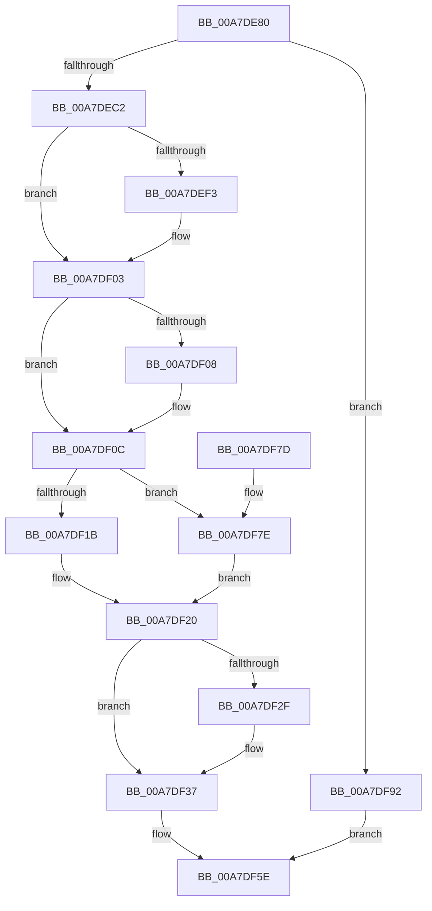

# EtwpGetDisallowList

- RVA: `0x00A7DE80`–`0x00A7DF99` (길이 `281` bytes)
- VA: `0x0000000140A7DE80`
- 실행 섹션: `PAGE`
- PDB 이름 있음: `예`; PDB Function 태그: `아니요`
- unwind 정보 RVA: `0x000B6B68`
- 디코드: `80`개 명령, `281/281` bytes 표시
- 미해석 바이트: `0` (있으면 어셈블리에 `.byte`로 보존)

> 이 문서는 커널 이미지의 기계어와 PDB 기호를 분석해 생성했습니다. 4번과 5번은 함수 원형과 자료형을 바이너리 사용 방식에서 추정한 C 해석이며 원본 소스 복구 결과는 아닙니다.

## 1. Dependencies

- 직접 호출 지점: **8**; 고유 호출 대상: **8**
- 직접 호출자로 확인된 함수: **1**
- RIP 상대 이미지 참조: **0**

### Outgoing calls
- `0x00A7DEB1` → [EtwpAcquireLoggerContextByLoggerId](../93/EtwpAcquireLoggerContextByLoggerId_function_00932920.md) (function, `0x00932920`)
- `0x00A7DECA` → [memset](../../text/6C/memset_function_006C6C40.md) (function, `0x006C6C40`)
- `0x00A7DEDE` → [KeAbPreAcquire](../../text/21/KeAbPreAcquire_function_00210230.md) (function, `0x00210230`)
- `0x00A7DEFE` → [ExfAcquirePushLockSharedEx](../../text/21/ExfAcquirePushLockSharedEx_function_0021044C.md) (function, `0x0021044C`)
- `0x00A7DF32` → [ExfReleasePushLockShared](../../text/26/ExfReleasePushLockShared_function_00263440.md) (function, `0x00263440`)
- `0x00A7DF3A` → [KeAbPostRelease](../../text/2E/KeAbPostRelease_function_002E1600.md) (function, `0x002E1600`)
- `0x00A7DF59` → [ExReleaseRundownProtectionCacheAwareEx](../../text/25/ExReleaseRundownProtectionCacheAwareEx_function_0025F050.md) (function, `0x0025F050`)
- `0x00A7DF8B` → [memcpy](../../text/6C/memcpy_function_006C6840.md) (function, `0x006C6840`)

### Direct callers
- [NtTraceControl](../A9/NtTraceControl_function_00A9ED40.md) at `0x00A9F594`

### Static image references
- 디코드된 RIP-relative 메모리 참조가 없습니다.

## 2. Other-region calls and transfers

- 다른 실행 섹션으로 향하는 call: **7**
  - `0x00A7DECA` → [memset](../../text/6C/memset_function_006C6C40.md) (`PAGE` → `.text`)
  - `0x00A7DEDE` → [KeAbPreAcquire](../../text/21/KeAbPreAcquire_function_00210230.md) (`PAGE` → `.text`)
  - `0x00A7DEFE` → [ExfAcquirePushLockSharedEx](../../text/21/ExfAcquirePushLockSharedEx_function_0021044C.md) (`PAGE` → `.text`)
  - `0x00A7DF32` → [ExfReleasePushLockShared](../../text/26/ExfReleasePushLockShared_function_00263440.md) (`PAGE` → `.text`)
  - `0x00A7DF3A` → [KeAbPostRelease](../../text/2E/KeAbPostRelease_function_002E1600.md) (`PAGE` → `.text`)
  - `0x00A7DF59` → [ExReleaseRundownProtectionCacheAwareEx](../../text/25/ExReleaseRundownProtectionCacheAwareEx_function_0025F050.md) (`PAGE` → `.text`)
  - `0x00A7DF8B` → [memcpy](../../text/6C/memcpy_function_006C6840.md) (`PAGE` → `.text`)
- 별도 외부 분기/꼬리 이동을 확인하지 못했습니다.

## 3. Assembly (complete function range)

```asm
00A7DE80  48 89 5C 24 08                  mov qword ptr [rsp + 8], rbx
00A7DE85  48 89 6C 24 18                  mov qword ptr [rsp + 0x18], rbp
00A7DE8A  48 89 74 24 20                  mov qword ptr [rsp + 0x20], rsi
00A7DE8F  57                              push rdi
00A7DE90  41 54                           push r12
00A7DE92  41 55                           push r13
00A7DE94  41 56                           push r14
00A7DE96  41 57                           push r15
00A7DE98  48 83 EC 20                     sub rsp, 0x20
00A7DE9C  0F B7 12                        movzx edx, word ptr [rdx]
00A7DE9F  4D 8B F8                        mov r15, r8
00A7DEA2  45 8B 21                        mov r12d, dword ptr [r9]
00A7DEA5  45 33 ED                        xor r13d, r13d
00A7DEA8  45 33 C0                        xor r8d, r8d
00A7DEAB  41 8B ED                        mov ebp, r13d
00A7DEAE  4D 8B F1                        mov r14, r9
00A7DEB1  E8 6A 4A EB FF                  call 0x140932920
00A7DEB6  48 8B F0                        mov rsi, rax
00A7DEB9  48 85 C0                        test rax, rax
00A7DEBC  0F 84 D0 00 00 00               je 0x140a7df92
00A7DEC2  45 8B 06                        mov r8d, dword ptr [r14]
00A7DEC5  33 D2                           xor edx, edx
00A7DEC7  49 8B CF                        mov rcx, r15
00A7DECA  E8 71 8D C4 FF                  call 0x1406c6c40
00A7DECF  48 8D 9E B0 02 00 00            lea rbx, [rsi + 0x2b0]
00A7DED6  45 33 C0                        xor r8d, r8d
00A7DED9  48 8B CB                        mov rcx, rbx
00A7DEDC  33 D2                           xor edx, edx
00A7DEDE  E8 4D 23 79 FF                  call 0x140210230
00A7DEE3  48 8B F8                        mov rdi, rax
00A7DEE6  41 8D 4D 11                     lea ecx, [r13 + 0x11]
00A7DEEA  33 C0                           xor eax, eax
00A7DEEC  F0 48 0F B1 0B                  lock cmpxchg qword ptr [rbx], rcx
00A7DEF1  74 10                           je 0x140a7df03
00A7DEF3  4C 8B CB                        mov r9, rbx
00A7DEF6  4C 8B C7                        mov r8, rdi
00A7DEF9  33 D2                           xor edx, edx
00A7DEFB  48 8B CB                        mov rcx, rbx
00A7DEFE  E8 49 25 79 FF                  call 0x14021044c
00A7DF03  48 85 FF                        test rdi, rdi
00A7DF06  74 04                           je 0x140a7df0c
00A7DF08  C6 47 0A 01                     mov byte ptr [rdi + 0xa], 1
00A7DF0C  0F B7 BE 30 05 00 00            movzx edi, word ptr [rsi + 0x530]
00A7DF13  C1 E7 04                        shl edi, 4
00A7DF16  41 3B FC                        cmp edi, r12d
00A7DF19  76 63                           jbe 0x140a7df7e
00A7DF1B  BD 23 00 00 C0                  mov ebp, 0xc0000023
00A7DF20  41 89 3E                        mov dword ptr [r14], edi
00A7DF23  B8 11 00 00 00                  mov eax, 0x11
00A7DF28  F0 4C 0F B1 2B                  lock cmpxchg qword ptr [rbx], r13
00A7DF2D  74 08                           je 0x140a7df37
00A7DF2F  48 8B CB                        mov rcx, rbx
00A7DF32  E8 09 55 7E FF                  call 0x140263440
00A7DF37  48 8B CB                        mov rcx, rbx
00A7DF3A  E8 C1 36 86 FF                  call 0x1402e1600
00A7DF3F  4C 8B 86 50 05 00 00            mov r8, qword ptr [rsi + 0x550]
00A7DF46  BA 01 00 00 00                  mov edx, 1
00A7DF4B  44 8B 0E                        mov r9d, dword ptr [rsi]
00A7DF4E  49 8B 88 C0 02 00 00            mov rcx, qword ptr [r8 + 0x2c0]
00A7DF55  4A 8B 0C C9                     mov rcx, qword ptr [rcx + r9*8]
00A7DF59  E8 F2 10 7E FF                  call 0x14025f050
00A7DF5E  48 8B 5C 24 50                  mov rbx, qword ptr [rsp + 0x50]
00A7DF63  8B C5                           mov eax, ebp
00A7DF65  48 8B 6C 24 60                  mov rbp, qword ptr [rsp + 0x60]
00A7DF6A  48 8B 74 24 68                  mov rsi, qword ptr [rsp + 0x68]
00A7DF6F  48 83 C4 20                     add rsp, 0x20
00A7DF73  41 5F                           pop r15
00A7DF75  41 5E                           pop r14
00A7DF77  41 5D                           pop r13
00A7DF79  41 5C                           pop r12
00A7DF7B  5F                              pop rdi
00A7DF7C  C3                              ret
00A7DF7D  CC                              int3
00A7DF7E  48 8B 96 38 05 00 00            mov rdx, qword ptr [rsi + 0x538]
00A7DF85  49 8B CF                        mov rcx, r15
00A7DF88  44 8B C7                        mov r8d, edi
00A7DF8B  E8 B0 88 C4 FF                  call 0x1406c6840
00A7DF90  EB 8E                           jmp 0x140a7df20
00A7DF92  BD 0D 00 00 C0                  mov ebp, 0xc000000d
00A7DF97  EB C5                           jmp 0x140a7df5e
```

## 4. C-style interpretation (structured pseudocode)

```c
__int64 __fastcall EtwpGetDisallowList(__int64 a1, __int64 a2, __int64 a3, __int64 a4)
{
    __int64 result;
    __int64 v_r13;
    __int64 v_rdi;
    __int64 v_rsp;
    unsigned __int64 v_stack_p18;
    unsigned __int64 v_stack_p20;
    unsigned __int64 v_stack_p8;

    v_stack_p8 = v_rbx;
    v_stack_p18 = v_rbp;
    v_stack_p20 = v_rsi;
    v_rsp = (v_rsp) - (32);
    v_r13 = 0;
    a3 = 0;
    result = EtwpAcquireLoggerContextByLoggerId(a1, *(unsigned __int16 *)(a2), a3, a4);
    if (result == 0) goto loc_00A7DF92;
    a2 = 0;
    result = memset(0, a2, (unsigned int)(*(unsigned int *)(a4)), a4);
    a3 = 0;
    a2 = 0;
    result = KeAbPreAcquire(result + 688, a2, a3, a4);
    result = 0;
    if (!(condition_is_equal)) {
        a4 = result + 688;
        a3 = 0;
        a2 = 0;
        a1 = result + 688;
        result = ExfAcquirePushLockSharedEx(a1, a2, a3, a4);
    }
    if (result != 0) {
        *(unsigned __int8 *)(result + 10) = 1;
    }
    v_rdi = (unsigned int)((*(unsigned __int16 *)(result + 1328)) << (4));
    if (((unsigned int)(v_rdi)) <= ((unsigned int)((unsigned int)(*(unsigned int *)(a4))))) goto loc_00A7DF7E;
loc_00A7DF20:
    *(unsigned int *)(a4) = (unsigned int)(v_rdi);
    result = 17;
    if (((unsigned int)(v_rdi)) != ((unsigned int)((unsigned int)(*(unsigned int *)(a4))))) {
        a1 = result + 688;
        result = ExfReleasePushLockShared(a1, a2, a3, a4);
    }
    result = KeAbPostRelease(result + 688, a2, a3, a4);
    result = ExReleaseRundownProtectionCacheAwareEx(*(unsigned __int64 *)(*(unsigned __int64 *)(*(unsigned __int64 *)(result + 1360) + 704) + (unsigned int)(*(unsigned int *)(result)) * 8), 1, *(unsigned __int64 *)(result + 1360), (unsigned int)(*(unsigned int *)(result)));
loc_00A7DF5E:
    v_rsp = (v_rsp) + (32);
    return (unsigned int)((unsigned int)((unsigned int)(0xC0000023ULL)));
loc_00A7DF7E:
    result = memcpy(a3, *(unsigned __int64 *)(v_stack_p20 + 1336), (unsigned int)((unsigned int)(v_rdi)), (unsigned int)(*(unsigned int *)(result)));
    goto loc_00A7DF20;
loc_00A7DF92:
    goto loc_00A7DF5E;
}
```

## 5. (Beta) C Style

```c
int64_t EtwpGetDisallowList(int64_t Arg1, void *Arg2, int64_t Arg3, void *Arg4)
{
    uint8_t *arg2 = (uint8_t *)Arg2;
    uint8_t *arg4 = (uint8_t *)Arg4;

    int64_t result;
    int64_t local_r13;
    int64_t local_rdi;
    int64_t local_rsp;
    uint64_t v_stack_p18;
    uint64_t v_stack_p20;
    uint64_t v_stack_p8;

    v_stack_p8 = local_rbx;
    v_stack_p18 = local_rbp;
    v_stack_p20 = local_rsi;
    local_rsp = (local_rsp) - (32);
    local_r13 = 0;
    Arg3 = 0;
    result = EtwpAcquireLoggerContextByLoggerId(Arg1, *(uint16_t *)(arg2), Arg3, Arg4);
    if (result == 0) goto loc_00A7DF92;
    Arg2 = 0;
    result = memset(0, Arg2, (uint32_t)(*(uint32_t *)(arg4)), Arg4);
    Arg3 = 0;
    Arg2 = 0;
    result = KeAbPreAcquire(result + 688, Arg2, Arg3, Arg4);
    result = 0;
    if (!(condition_is_equal)) {
        Arg4 = result + 688;
        Arg3 = 0;
        Arg2 = 0;
        Arg1 = result + 688;
        result = ExfAcquirePushLockSharedEx(Arg1, Arg2, Arg3, Arg4);
    }
    if (result != 0) {
        *(uint8_t *)(result + 0xA) = 1;
    }
    local_rdi = (uint32_t)((*(uint16_t *)(result + 0x530)) << (4));
    if (((uint32_t)(local_rdi)) <= ((uint32_t)((uint32_t)(*(uint32_t *)(arg4))))) goto loc_00A7DF7E;
loc_00A7DF20:
    *(uint32_t *)(arg4) = (uint32_t)(local_rdi);
    result = 17;
    if (((uint32_t)(local_rdi)) != ((uint32_t)((uint32_t)(*(uint32_t *)(arg4))))) {
        Arg1 = result + 688;
        result = ExfReleasePushLockShared(Arg1, Arg2, Arg3, Arg4);
    }
    result = KeAbPostRelease(result + 688, Arg2, Arg3, Arg4);
    result = ExReleaseRundownProtectionCacheAwareEx(*(uint64_t *)(*(uint64_t *)(*(uint64_t *)(result + 0x550) + 0x2C0) + (uint32_t)(*(uint32_t *)(result)) * 8), 1, *(uint64_t *)(result + 0x550), (uint32_t)(*(uint32_t *)(result)));
loc_00A7DF5E:
    local_rsp = (local_rsp) + (32);
    return (uint32_t)((uint32_t)((uint32_t)(0xC0000023ULL)));
loc_00A7DF7E:
    result = memcpy(Arg3, *(uint64_t *)(v_stack_p20 + 0x538), (uint32_t)((uint32_t)(local_rdi)), (uint32_t)(*(uint32_t *)(result)));
    goto loc_00A7DF20;
loc_00A7DF92:
    goto loc_00A7DF5E;
}
```

### 관측된 메모리 오프셋

구조체 형식이 확인되지 않은 접근은 인자 기준의 오프셋으로만 기록했습니다.

| 기준 인자 | 오프셋 표현 | 폭 (bit) | 접근 |
|---|---:|---:|---|
| `Arg2` | `+ 0x0` | `16` | `R` |
| `Arg4` | `+ 0x0` | `32` | `R` |
| `Arg4` | `+ 0x0` | `32` | `W` |

## 6. Execution-region graph

[열기: 2D/3D 그래프와 함수 탐색 컨트롤 패널](../../../control-panel.html?section=page&rva=0x00A7DE80&view=graph)

- 2D 그래프는 위에서 아래로 흐르고, 3D 그래프는 빈 공간을 드래그해 회전합니다. Shift+드래그는 이동, 휠은 확대·축소, 함수 노드 선택은 대상 보고서 이동입니다.

### Static fallback


