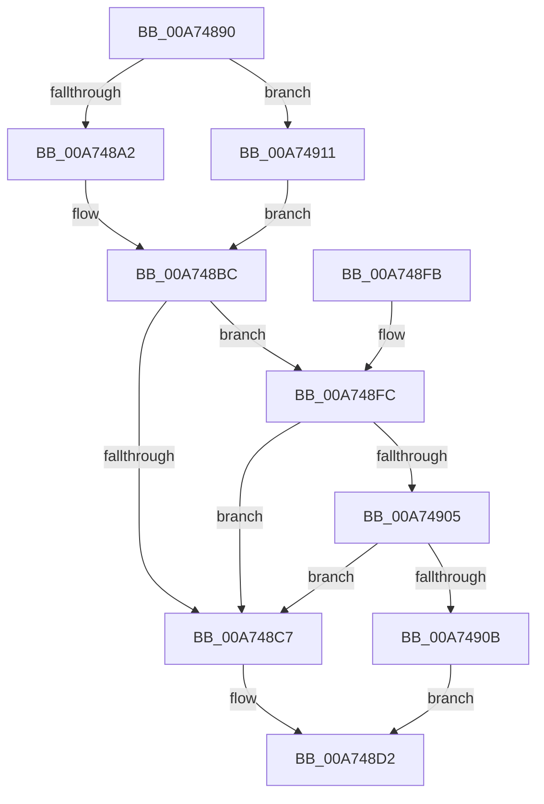

# EtwpGetSystemMaximumBufferCount

- RVA: `0x00A74890`–`0x00A7491A` (길이 `138` bytes)
- VA: `0x0000000140A74890`
- 실행 섹션: `PAGE`
- PDB 이름 있음: `예`; PDB Function 태그: `아니요`
- unwind 정보 RVA: `0x000783D8`
- 디코드: `39`개 명령, `138/138` bytes 표시
- 미해석 바이트: `0` (있으면 어셈블리에 `.byte`로 보존)

> 이 문서는 커널 이미지의 기계어와 PDB 기호를 분석해 생성했습니다. 4번과 5번은 함수 원형과 자료형을 바이너리 사용 방식에서 추정한 C 해석이며 원본 소스 복구 결과는 아닙니다.

## 1. Dependencies

- 직접 호출 지점: **2**; 고유 호출 대상: **2**
- 직접 호출자로 확인된 함수: **2**
- RIP 상대 이미지 참조: **2**

### Outgoing calls
- `0x00A748A4` → [MmGetNumberOfPhysicalPages](../../text/46/MmGetNumberOfPhysicalPages_function_00467F80.md) (function, `0x00467F80`)
- `0x00A748B0` → [MmGetMaximumNonPagedPoolInBytes](../../text/4B/MmGetMaximumNonPagedPoolInBytes_function_004BA168.md) (function, `0x004BA168`)

### Direct callers
- [EtwpAllocateTraceBufferPool](EtwpAllocateTraceBufferPool_function_00A74750.md) at `0x00A74769`
- [EtwpUpdateTrace](../AB/EtwpUpdateTrace_function_00ABCC7C.md) at `0x00ABCFBB`

### Static image references
- `0x00A748C7` → RVA `0x00FD8190` (`PAGEDATA`; read)
- `0x00A74911` → RVA `0x00FC6F18` (`ALMOSTRO`; read)

## 2. Other-region calls and transfers

- 다른 실행 섹션으로 향하는 call: **2**
  - `0x00A748A4` → [MmGetNumberOfPhysicalPages](../../text/46/MmGetNumberOfPhysicalPages_function_00467F80.md) (`PAGE` → `.text`)
  - `0x00A748B0` → [MmGetMaximumNonPagedPoolInBytes](../../text/4B/MmGetMaximumNonPagedPoolInBytes_function_004BA168.md) (`PAGE` → `.text`)
- 별도 외부 분기/꼬리 이동을 확인하지 못했습니다.

## 3. Assembly (complete function range)

```asm
00A74890  40 53                           push rbx
00A74892  48 83 EC 20                     sub rsp, 0x20
00A74896  83 B9 2C 01 00 00 01            cmp dword ptr [rcx + 0x12c], 1
00A7489D  48 8B D9                        mov rbx, rcx
00A748A0  74 6F                           je 0x140a74911
00A748A2  33 C9                           xor ecx, ecx
00A748A4  E8 D7 36 9F FF                  call 0x140467f80
00A748A9  48 8B D0                        mov rdx, rax
00A748AC  48 C1 E2 0C                     shl rdx, 0xc
00A748B0  E8 B3 58 A4 FF                  call 0x1404ba168
00A748B5  48 3B D0                        cmp rdx, rax
00A748B8  48 0F 43 D0                     cmovae rdx, rax
00A748BC  8B 8B 30 03 00 00               mov ecx, dword ptr [rbx + 0x330]
00A748C2  F6 C1 02                        test cl, 2
00A748C5  75 35                           jne 0x140a748fc
00A748C7  44 8B 05 C2 38 56 00            mov r8d, dword ptr [rip + 0x5638c2]
00A748CE  4C 0F AF C2                     imul r8, rdx
00A748D2  8B 4B 04                        mov ecx, dword ptr [rbx + 4]
00A748D5  48 B8 15 AE 47 E1 7A 14 AE 47   movabs rax, 0x47ae147ae147ae15
00A748DF  49 F7 E0                        mul r8
00A748E2  4C 2B C2                        sub r8, rdx
00A748E5  49 D1 E8                        shr r8, 1
00A748E8  4A 8D 04 02                     lea rax, [rdx + r8]
00A748EC  33 D2                           xor edx, edx
00A748EE  48 C1 E8 06                     shr rax, 6
00A748F2  48 F7 F1                        div rcx
00A748F5  48 83 C4 20                     add rsp, 0x20
00A748F9  5B                              pop rbx
00A748FA  C3                              ret
00A748FB  CC                              int3
00A748FC  8B 43 0C                        mov eax, dword ptr [rbx + 0xc]
00A748FF  0F BA E0 19                     bt eax, 0x19
00A74903  73 C2                           jae 0x140a748c7
00A74905  0F BA E0 0A                     bt eax, 0xa
00A74909  73 BC                           jae 0x140a748c7
00A7490B  4C 6B C2 32                     imul r8, rdx, 0x32
00A7490F  EB C1                           jmp 0x140a748d2
00A74911  48 8B 15 00 26 55 00            mov rdx, qword ptr [rip + 0x552600]
00A74918  EB A2                           jmp 0x140a748bc
```

## 4. C-style interpretation (structured pseudocode)

```c
__int64 __fastcall EtwpGetSystemMaximumBufferCount(__int64 a1)
{
    __int64 result;
    __int64 v_rsp;

    v_rsp = (v_rsp) - (32);
    if ((*(unsigned int *)(a1 + 300)) == 1) goto loc_00A74911;
    a1 = 0;
    result = MmGetNumberOfPhysicalPages(a1, a2, a3, a4);
    a2 = (result) << (12);
    result = MmGetMaximumNonPagedPoolInBytes(a1, a2, a3, a4);
    if (a2 >= result) { a2 = result; }
loc_00A748BC:
    if ((((unsigned __int8)((unsigned int)(*(unsigned int *)(a1 + 816)))) & (2)) != 0) goto loc_00A748FC;
loc_00A748C7:
    a3 = ((unsigned int)(*(unsigned int *)(v_rip + 5650626))) * (a2);
loc_00A748D2:
    a3 = (a3) - (a2);
    a3 = (a3) >> (1);
    a2 = 0;
    result = (a2 + a3 * 1) >> (6);
    v_rsp = (v_rsp) + (32);
    return result;
loc_00A748FC:
    if (condition_is_above_or_equal) goto loc_00A748C7;
    if (condition_is_above_or_equal) goto loc_00A748C7;
    a3 = (a3) * (0);
    goto loc_00A748D2;
loc_00A74911:
    goto loc_00A748BC;
}
```

## 5. (Beta) C Style

```c
int64_t EtwpGetSystemMaximumBufferCount(void *Arg1)
{
    uint8_t *arg1 = (uint8_t *)Arg1;

    int64_t result;
    int64_t local_rsp;

    local_rsp = (local_rsp) - (32);
    if ((*(uint32_t *)(arg1 + 0x12C)) == 1) goto loc_00A74911;
    Arg1 = 0;
    result = MmGetNumberOfPhysicalPages(Arg1, a2, a3, a4);
    a2 = (result) << (12);
    result = MmGetMaximumNonPagedPoolInBytes(Arg1, a2, a3, a4);
    if (a2 >= result) { a2 = result; }
loc_00A748BC:
    if ((((uint8_t)((uint32_t)(*(uint32_t *)(arg1 + 0x330)))) & (2)) != 0) goto loc_00A748FC;
loc_00A748C7:
    a3 = ((uint32_t)(*(uint32_t *)(v_rip + 0x5638C2))) * (a2);
loc_00A748D2:
    a3 = (a3) - (a2);
    a3 = (a3) >> (1);
    a2 = 0;
    result = (a2 + a3 * 1) >> (6);
    local_rsp = (local_rsp) + (32);
    return result;
loc_00A748FC:
    if (condition_is_above_or_equal) goto loc_00A748C7;
    if (condition_is_above_or_equal) goto loc_00A748C7;
    a3 = (a3) * (0);
    goto loc_00A748D2;
loc_00A74911:
    goto loc_00A748BC;
}
```

### 관측된 메모리 오프셋

구조체 형식이 확인되지 않은 접근은 인자 기준의 오프셋으로만 기록했습니다.

| 기준 인자 | 오프셋 표현 | 폭 (bit) | 접근 |
|---|---:|---:|---|
| `Arg1` | `+ 0x4` | `32` | `R` |
| `Arg1` | `+ 0xC` | `32` | `R` |
| `Arg1` | `+ 0x12C` | `32` | `R` |
| `Arg1` | `+ 0x330` | `32` | `R` |

## 6. Execution-region graph

[열기: 2D/3D 그래프와 함수 탐색 컨트롤 패널](../../../control-panel.html?section=page&rva=0x00A74890&view=graph)

- 2D 그래프는 위에서 아래로 흐르고, 3D 그래프는 빈 공간을 드래그해 회전합니다. Shift+드래그는 이동, 휠은 확대·축소, 함수 노드 선택은 대상 보고서 이동입니다.

### Static fallback


