# EtwpInitLoggerContext

- RVA: `0x00A7154C`–`0x00A71891` (길이 `837` bytes)
- VA: `0x0000000140A7154C`
- 실행 섹션: `PAGE`
- PDB 이름 있음: `예`; PDB Function 태그: `아니요`
- unwind 정보 RVA: `0x000AC484`
- 디코드: `194`개 명령, `837/837` bytes 표시
- 미해석 바이트: `0` (있으면 어셈블리에 `.byte`로 보존)

> 이 문서는 커널 이미지의 기계어와 PDB 기호를 분석해 생성했습니다. 4번과 5번은 함수 원형과 자료형을 바이너리 사용 방식에서 추정한 C 해석이며 원본 소스 복구 결과는 아닙니다.

## 1. Dependencies

- 직접 호출 지점: **16**; 고유 호출 대상: **15**
- 직접 호출자로 확인된 함수: **1**
- RIP 상대 이미지 참조: **3**

### Outgoing calls
- `0x00A7158E` → [KeQueryMaximumProcessorCountEx](../../text/26/KeQueryMaximumProcessorCountEx_function_00264D60.md) (function, `0x00264D60`)
- `0x00A715C4` → [ExAllocatePool2](../../poolcode/B8/ExAllocatePool2_function_00B820F0.md) (function, `0x00B820F0`)
- `0x00A715F8` → [memcpy](../../text/6C/memcpy_function_006C6840.md) (function, `0x006C6840`)
- `0x00A71607` → [RtlInitUnicodeString](../../text/42/RtlInitUnicodeString_function_0042A780.md) (function, `0x0042A780`)
- `0x00A7167A` → [MmGetNumberOfPhysicalPages](../../text/46/MmGetNumberOfPhysicalPages_function_00467F80.md) (function, `0x00467F80`)
- `0x00A7169D` → [EtwpQueryUsedProcessorCount](../../text/3E/EtwpQueryUsedProcessorCount_function_003EB940.md) (function, `0x003EB940`)
- `0x00A716CD` → [KeQuerySystemTimePrecise](../../text/37/KeQuerySystemTimePrecise_function_0037DA40.md) (function, `0x0037DA40`)
- `0x00A716DB` → [KeInitializeMutex](../../text/48/KeInitializeMutex_function_004830E0.md) (function, `0x004830E0`)
- `0x00A7176E` → [EtwpInitializeApcPool](../../text/46/EtwpInitializeApcPool_function_00467FA0.md) (function, `0x00467FA0`)
- `0x00A7177F` → [KeInitializeEvent](../../text/40/KeInitializeEvent_function_0040DD10.md) (function, `0x0040DD10`)
- `0x00A71790` → [KeInitializeEvent](../../text/40/KeInitializeEvent_function_0040DD10.md) (function, `0x0040DD10`)
- `0x00A7179E` → [KeInitializeTimerEx](../../text/45/KeInitializeTimerEx_function_004563F0.md) (function, `0x004563F0`)
- `0x00A717B4` → [KeInitializeDpc](../../text/45/KeInitializeDpc_function_0045BBD0.md) (function, `0x0045BBD0`)
- `0x00A717C1` → [EtwpInitializeCompression](../../text/4E/EtwpInitializeCompression_function_004EC774.md) (function, `0x004EC774`)
- `0x00A717D3` → [ExFreePoolWithTag](../../poolcode/B8/ExFreePoolWithTag_function_00B82870.md) (function, `0x00B82870`)
- `0x00A71824` → [HalQueryMaximumProcessorCount](../../text/4A/HalQueryMaximumProcessorCount_function_004AC9A0.md) (function, `0x004AC9A0`)

### Direct callers
- [EtwpStartLogger](../A9/EtwpStartLogger_function_00A99D80.md) at `0x00A9A704`

### Static image references
- `0x00A7163C` → RVA `0x00EFF284` (`.data`; read)
- `0x00A717AD` → RVA `0x004A5AF0` (`EtwpLoggerDpc`; read)
- `0x00A71818` → RVA `0x00EFF924` (`.data`; read)

## 2. Other-region calls and transfers

- 다른 실행 섹션으로 향하는 call: **16**
  - `0x00A7158E` → [KeQueryMaximumProcessorCountEx](../../text/26/KeQueryMaximumProcessorCountEx_function_00264D60.md) (`PAGE` → `.text`)
  - `0x00A715C4` → [ExAllocatePool2](../../poolcode/B8/ExAllocatePool2_function_00B820F0.md) (`PAGE` → `POOLCODE`)
  - `0x00A715F8` → [memcpy](../../text/6C/memcpy_function_006C6840.md) (`PAGE` → `.text`)
  - `0x00A71607` → [RtlInitUnicodeString](../../text/42/RtlInitUnicodeString_function_0042A780.md) (`PAGE` → `.text`)
  - `0x00A7167A` → [MmGetNumberOfPhysicalPages](../../text/46/MmGetNumberOfPhysicalPages_function_00467F80.md) (`PAGE` → `.text`)
  - `0x00A7169D` → [EtwpQueryUsedProcessorCount](../../text/3E/EtwpQueryUsedProcessorCount_function_003EB940.md) (`PAGE` → `.text`)
  - `0x00A716CD` → [KeQuerySystemTimePrecise](../../text/37/KeQuerySystemTimePrecise_function_0037DA40.md) (`PAGE` → `.text`)
  - `0x00A716DB` → [KeInitializeMutex](../../text/48/KeInitializeMutex_function_004830E0.md) (`PAGE` → `.text`)
  - `0x00A7176E` → [EtwpInitializeApcPool](../../text/46/EtwpInitializeApcPool_function_00467FA0.md) (`PAGE` → `.text`)
  - `0x00A7177F` → [KeInitializeEvent](../../text/40/KeInitializeEvent_function_0040DD10.md) (`PAGE` → `.text`)
  - `0x00A71790` → [KeInitializeEvent](../../text/40/KeInitializeEvent_function_0040DD10.md) (`PAGE` → `.text`)
  - `0x00A7179E` → [KeInitializeTimerEx](../../text/45/KeInitializeTimerEx_function_004563F0.md) (`PAGE` → `.text`)
  - `0x00A717B4` → [KeInitializeDpc](../../text/45/KeInitializeDpc_function_0045BBD0.md) (`PAGE` → `.text`)
  - `0x00A717C1` → [EtwpInitializeCompression](../../text/4E/EtwpInitializeCompression_function_004EC774.md) (`PAGE` → `.text`)
  - `0x00A717D3` → [ExFreePoolWithTag](../../poolcode/B8/ExFreePoolWithTag_function_00B82870.md) (`PAGE` → `POOLCODE`)
  - `0x00A71824` → [HalQueryMaximumProcessorCount](../../text/4A/HalQueryMaximumProcessorCount_function_004AC9A0.md) (`PAGE` → `.text`)
- 별도 외부 분기/꼬리 이동을 확인하지 못했습니다.

## 3. Assembly (complete function range)

```asm
00A7154C  48 8B C4                        mov rax, rsp
00A7154F  48 89 58 08                     mov qword ptr [rax + 8], rbx
00A71553  48 89 68 10                     mov qword ptr [rax + 0x10], rbp
00A71557  48 89 70 18                     mov qword ptr [rax + 0x18], rsi
00A7155B  48 89 78 20                     mov qword ptr [rax + 0x20], rdi
00A7155F  41 54                           push r12
00A71561  41 56                           push r14
00A71563  41 57                           push r15
00A71565  48 83 EC 20                     sub rsp, 0x20
00A71569  0F B7 19                        movzx ebx, word ptr [rcx]
00A7156C  45 33 E4                        xor r12d, r12d
00A7156F  8B F2                           mov esi, edx
00A71571  4C 8B F9                        mov r15, rcx
00A71574  41 8B EC                        mov ebp, r12d
00A71577  45 8B F4                        mov r14d, r12d
00A7157A  0F BA E2 1C                     bt edx, 0x1c
00A7157E  72 2D                           jb 0x140a715ad
00A71580  45 85 C0                        test r8d, r8d
00A71583  0F 88 9B 02 00 00               js 0x140a71824
00A71589  B9 FF FF 00 00                  mov ecx, 0xffff
00A7158E  E8 CD 37 7F FF                  call 0x140264d60
00A71593  83 F8 20                        cmp eax, 0x20
00A71596  8D 0C C5 00 00 00 00            lea ecx, [rax*8]
00A7159D  8B E9                           mov ebp, ecx
00A7159F  41 0F 46 EC                     cmovbe ebp, r12d
00A715A3  0F BA E6 0A                     bt esi, 0xa
00A715A7  0F 82 81 02 00 00               jb 0x140a7182e
00A715AD  8D 93 62 06 00 00               lea edx, [rbx + 0x662]
00A715B3  B9 48 00 00 00                  mov ecx, 0x48
00A715B8  42 8D 14 72                     lea edx, [rdx + r14*2]
00A715BC  41 B8 45 74 77 4C               mov r8d, 0x4c777445
00A715C2  03 D5                           add edx, ebp
00A715C4  E8 27 0B 11 00                  call 0x140b820f0
00A715C9  48 8B D8                        mov rbx, rax
00A715CC  48 85 C0                        test rax, rax
00A715CF  0F 84 03 02 00 00               je 0x140a717d8
00A715D5  48 8D B8 60 06 00 00            lea rdi, [rax + 0x660]
00A715DC  85 ED                           test ebp, ebp
00A715DE  0F 85 52 02 00 00               jne 0x140a71836
00A715E4  45 85 F6                        test r14d, r14d
00A715E7  0F 85 5A 02 00 00               jne 0x140a71847
00A715ED  45 0F B7 07                     movzx r8d, word ptr [r15]
00A715F1  48 8B CF                        mov rcx, rdi
00A715F4  49 8B 57 08                     mov rdx, qword ptr [r15 + 8]
00A715F8  E8 43 52 C5 FF                  call 0x1406c6840
00A715FD  48 8D 8B 88 00 00 00            lea rcx, [rbx + 0x88]
00A71604  48 8B D7                        mov rdx, rdi
00A71607  E8 74 91 9B FF                  call 0x14042a780
00A7160C  8B C6                           mov eax, esi
00A7160E  89 73 0C                        mov dword ptr [rbx + 0xc], esi
00A71611  C1 E8 18                        shr eax, 0x18
00A71614  BD 01 00 00 00                  mov ebp, 1
00A71619  40 22 C5                        and al, bpl
00A7161C  41 BE 00 02 00 00               mov r14d, 0x200
00A71622  F6 D8                           neg al
00A71624  1B C0                           sbb eax, eax
00A71626  25 01 FE FF FF                  and eax, 0xfffffe01
00A7162B  41 03 C6                        add eax, r14d
00A7162E  89 83 2C 01 00 00               mov dword ptr [rbx + 0x12c], eax
00A71634  85 F6                           test esi, esi
00A71636  0F 88 27 02 00 00               js 0x140a71863
00A7163C  80 3D 41 DC 48 00 03            cmp byte ptr [rip + 0x48dc41], 3
00A71643  76 08                           jbe 0x140a7164d
00A71645  F0 83 8B 30 03 00 00 04         lock or dword ptr [rbx + 0x330], 4
00A7164D  BF 00 40 00 00                  mov edi, 0x4000
00A71652  0F BA E6 0F                     bt esi, 0xf
00A71656  0F 83 B4 01 00 00               jae 0x140a71810
00A7165C  48 8D 83 10 01 00 00            lea rax, [rbx + 0x110]
00A71663  48 89 83 08 01 00 00            mov qword ptr [rbx + 0x108], rax
00A7166A  48 83 8B 38 06 00 00 FF         or qword ptr [rbx + 0x638], 0xffffffffffffffff
00A71672  33 C9                           xor ecx, ecx
00A71674  89 AB 40 01 00 00               mov dword ptr [rbx + 0x140], ebp
00A7167A  E8 01 69 9F FF                  call 0x140467f80
00A7167F  48 8B C8                        mov rcx, rax
00A71682  48 C1 E1 0C                     shl rcx, 0xc
00A71686  48 C1 E9 14                     shr rcx, 0x14
00A7168A  41 3B CE                        cmp ecx, r14d
00A7168D  0F 87 67 01 00 00               ja 0x140a717fa
00A71693  C7 43 04 00 20 00 00            mov dword ptr [rbx + 4], 0x2000
00A7169A  48 8B CB                        mov rcx, rbx
00A7169D  E8 9E A2 97 FF                  call 0x1403eb940
00A716A2  8B F8                           mov edi, eax
00A716A4  8D 0C 00                        lea ecx, [rax + rax]
00A716A7  89 8B E0 00 00 00               mov dword ptr [rbx + 0xe0], ecx
00A716AD  0F BA E6 1A                     bt esi, 0x1a
00A716B1  0F 82 07 01 00 00               jb 0x140a717be
00A716B7  8B 83 E0 00 00 00               mov eax, dword ptr [rbx + 0xe0]
00A716BD  48 8D 8B 18 03 00 00            lea rcx, [rbx + 0x318]
00A716C4  83 C0 16                        add eax, 0x16
00A716C7  89 83 EC 00 00 00               mov dword ptr [rbx + 0xec], eax
00A716CD  E8 6E C3 90 FF                  call 0x14037da40
00A716D2  48 8D 8B 78 02 00 00            lea rcx, [rbx + 0x278]
00A716D9  33 D2                           xor edx, edx
00A716DB  E8 00 1A A1 FF                  call 0x1404830e0
00A716E0  4C 89 A3 B0 02 00 00            mov qword ptr [rbx + 0x2b0], r12
00A716E7  44 8D 04 BD 00 00 00 00         lea r8d, [rdi*4]
00A716EF  41 B9 10 00 00 00               mov r9d, 0x10
00A716F5  C1 E7 04                        shl edi, 4
00A716F8  45 3B C1                        cmp r8d, r9d
00A716FB  48 8D 83 48 01 00 00            lea rax, [rbx + 0x148]
00A71702  48 89 40 08                     mov qword ptr [rax + 8], rax
00A71706  48 8D 8B 40 03 00 00            lea rcx, [rbx + 0x340]
00A7170D  48 89 00                        mov qword ptr [rax], rax
00A71710  45 0F 42 C1                     cmovb r8d, r9d
00A71714  48 8D 43 38                     lea rax, [rbx + 0x38]
00A71718  41 3B F9                        cmp edi, r9d
00A7171B  48 89 43 30                     mov qword ptr [rbx + 0x30], rax
00A7171F  48 8B D3                        mov rdx, rbx
00A71722  4C 89 20                        mov qword ptr [rax], r12
00A71725  44 0F 43 CF                     cmovae r9d, edi
00A71729  48 8D 43 48                     lea rax, [rbx + 0x48]
00A7172D  48 89 43 40                     mov qword ptr [rbx + 0x40], rax
00A71731  4C 89 20                        mov qword ptr [rax], r12
00A71734  48 8D 43 50                     lea rax, [rbx + 0x50]
00A71738  48 89 40 08                     mov qword ptr [rax + 8], rax
00A7173C  48 89 00                        mov qword ptr [rax], rax
00A7173F  48 8D 43 60                     lea rax, [rbx + 0x60]
00A71743  48 89 40 08                     mov qword ptr [rax + 8], rax
00A71747  48 89 00                        mov qword ptr [rax], rax
00A7174A  48 8D 83 18 05 00 00            lea rax, [rbx + 0x518]
00A71751  48 89 40 08                     mov qword ptr [rax + 8], rax
00A71755  48 89 00                        mov qword ptr [rax], rax
00A71758  66 44 89 A3 30 05 00 00         mov word ptr [rbx + 0x530], r12w
00A71760  4C 89 A3 38 05 00 00            mov qword ptr [rbx + 0x538], r12
00A71767  4C 89 A3 B8 02 00 00            mov qword ptr [rbx + 0x2b8], r12
00A7176E  E8 2D 68 9F FF                  call 0x140467fa0
00A71773  48 8D 8B C8 01 00 00            lea rcx, [rbx + 0x1c8]
00A7177A  45 33 C0                        xor r8d, r8d
00A7177D  33 D2                           xor edx, edx
00A7177F  E8 8C C5 99 FF                  call 0x14040dd10
00A71784  48 8D 8B E0 01 00 00            lea rcx, [rbx + 0x1e0]
00A7178B  45 33 C0                        xor r8d, r8d
00A7178E  8B D5                           mov edx, ebp
00A71790  E8 7B C5 99 FF                  call 0x14040dd10
00A71795  48 8D 8B F8 01 00 00            lea rcx, [rbx + 0x1f8]
00A7179C  8B D5                           mov edx, ebp
00A7179E  E8 4D 4C 9E FF                  call 0x1404563f0
00A717A3  48 8D 8B 38 02 00 00            lea rcx, [rbx + 0x238]
00A717AA  4C 8B C3                        mov r8, rbx
00A717AD  48 8D 15 3C 43 A3 FF            lea rdx, [rip - 0x5cbcc4]
00A717B4  E8 17 A4 9E FF                  call 0x14045bbd0
00A717B9  48 8B C3                        mov rax, rbx
00A717BC  EB 1C                           jmp 0x140a717da
00A717BE  48 8B CB                        mov rcx, rbx
00A717C1  E8 AE AF A7 FF                  call 0x1404ec774
00A717C6  85 C0                           test eax, eax
00A717C8  0F 89 AD 00 00 00               jns 0x140a7187b
00A717CE  33 D2                           xor edx, edx
00A717D0  48 8B CB                        mov rcx, rbx
00A717D3  E8 98 10 11 00                  call 0x140b82870
00A717D8  33 C0                           xor eax, eax
00A717DA  48 8B 5C 24 40                  mov rbx, qword ptr [rsp + 0x40]
00A717DF  48 8B 6C 24 48                  mov rbp, qword ptr [rsp + 0x48]
00A717E4  48 8B 74 24 50                  mov rsi, qword ptr [rsp + 0x50]
00A717E9  48 8B 7C 24 58                  mov rdi, qword ptr [rsp + 0x58]
00A717EE  48 83 C4 20                     add rsp, 0x20
00A717F2  41 5F                           pop r15
00A717F4  41 5E                           pop r14
00A717F6  41 5C                           pop r12
00A717F8  C3                              ret
00A717F9  CC                              int3
00A717FA  81 F9 00 04 00 00               cmp ecx, 0x400
00A71800  B8 00 00 01 00                  mov eax, 0x10000
00A71805  0F 46 C7                        cmovbe eax, edi
00A71808  89 43 04                        mov dword ptr [rbx + 4], eax
00A7180B  E9 8A FE FF FF                  jmp 0x140a7169a
00A71810  85 F7                           test edi, esi
00A71812  0F 84 52 FE FF FF               je 0x140a7166a
00A71818  48 8D 05 05 E1 48 00            lea rax, [rip + 0x48e105]
00A7181F  E9 3F FE FF FF                  jmp 0x140a71663
00A71824  E8 77 B1 A3 FF                  call 0x1404ac9a0
00A71829  E9 65 FD FF FF                  jmp 0x140a71593
00A7182E  44 8B F1                        mov r14d, ecx
00A71831  E9 77 FD FF FF                  jmp 0x140a715ad
00A71836  48 89 B8 28 05 00 00            mov qword ptr [rax + 0x528], rdi
00A7183D  8B C5                           mov eax, ebp
00A7183F  48 03 F8                        add rdi, rax
00A71842  E9 9D FD FF FF                  jmp 0x140a715e4
00A71847  41 8B C6                        mov eax, r14d
00A7184A  48 89 BB 28 06 00 00            mov qword ptr [rbx + 0x628], rdi
00A71851  48 03 F8                        add rdi, rax
00A71854  48 89 BB 30 06 00 00            mov qword ptr [rbx + 0x630], rdi
00A7185B  48 03 F8                        add rdi, rax
00A7185E  E9 8A FD FF FF                  jmp 0x140a715ed
00A71863  0F BA E6 18                     bt esi, 0x18
00A71867  0F 83 CF FD FF FF               jae 0x140a7163c
00A7186D  8B C6                           mov eax, esi
00A7186F  0F BA F0 1F                     btr eax, 0x1f
00A71873  89 43 0C                        mov dword ptr [rbx + 0xc], eax
00A71876  E9 C1 FD FF FF                  jmp 0x140a7163c
00A7187B  0F BA E6 0A                     bt esi, 0xa
00A7187F  0F 83 32 FE FF FF               jae 0x140a716b7
00A71885  83 83 E0 00 00 00 04            add dword ptr [rbx + 0xe0], 4
00A7188C  E9 26 FE FF FF                  jmp 0x140a716b7
```

## 4. C-style interpretation (structured pseudocode)

```c
__int64 __fastcall EtwpInitLoggerContext(__int64 a1, int a2, int a3)
{
    __int64 result;
    __int64 v_r12;
    __int64 v_rbp;
    __int64 v_rdi;
    __int64 v_rsp;
    unsigned __int64 v_stack_p10;
    unsigned __int64 v_stack_p18;
    unsigned __int64 v_stack_p20;
    unsigned __int64 v_stack_p8;

    *(unsigned __int64 *)(v_rsp + 8) = v_rbx;
    *(unsigned __int64 *)(v_rsp + 16) = v_rbp;
    *(unsigned __int64 *)(v_rsp + 24) = v_rsi;
    *(unsigned __int64 *)(v_rsp + 32) = v_rdi;
    v_rsp = (v_rsp) - (32);
    v_r12 = 0;
    if (condition_is_below) goto loc_00A715AD;
    if (sign_flag) goto loc_00A71824;
    result = KeQueryMaximumProcessorCountEx((unsigned int)(0xFFFFULL), a2, a3, a4);
loc_00A71593:
    v_rbp = (unsigned int)((unsigned int)(result * 8));
    if (((unsigned int)(result)) <= 32) { v_rbp = 0; }
    if (((unsigned int)(result)) < 32) goto loc_00A7182E;
loc_00A715AD:
    a2 = (unsigned int)((*(unsigned __int16 *)(a1) + 1634 + 0 * 2) + ((unsigned int)(v_rbp)));
    result = ExAllocatePool2(72, a2, (unsigned int)(0x4C777445ULL), a4);
    if (result == 0) goto loc_00A717D8;
    if ((unsigned int)(v_rbp) != 0) goto loc_00A71836;
loc_00A715E4:
    if (0 != 0) goto loc_00A71847;
loc_00A715ED:
    result = memcpy(result + 1632, *(unsigned __int64 *)(a1 + 8), *(unsigned __int16 *)(a1), a4);
    result = RtlInitUnicodeString(result + 136, result + 1632, *(unsigned __int16 *)(a1), a4);
    *(unsigned int *)(result + 12) = (unsigned int)((unsigned int)(a2));
    result = (unsigned int)(((unsigned int)((unsigned int)((unsigned int)(a2)))) >> (24));
    result = (unsigned __int8)((result) & (1));
    result = (unsigned __int8)(-(result));
    result = (unsigned int)((result) & (0xFFFFFE01ULL));
    result = (unsigned int)((result) + (512));
    *(unsigned int *)(result + 300) = (unsigned int)(result);
    if (sign_flag) goto loc_00A71863;
loc_00A7163C:
    if ((*(unsigned __int8 *)(v_rip + 4774977)) >= = 3) {
    }
    if ((*(unsigned __int8 *)(v_rip + 4774977)) >= 3) goto loc_00A71810;
loc_00A71663:
    *(unsigned __int64 *)(result + 264) = result + 272;
loc_00A7166A:
    a1 = 0;
    *(unsigned int *)(result + 320) = 1;
    result = MmGetNumberOfPhysicalPages(a1, result + 1632, *(unsigned __int16 *)(a1), a4);
    a1 = (result) << (12);
    a1 = (a1) >> (20);
    if (((unsigned int)(a1)) > 512) goto loc_00A717FA;
    *(unsigned int *)(result + 4) = 0x2000ULL;
loc_00A7169A:
    result = EtwpQueryUsedProcessorCount(result, result + 1632, *(unsigned __int16 *)(a1), a4);
    *(unsigned int *)(result + 224) = (unsigned int)(result + result * 1);
    if (((unsigned int)(a1)) < 512) goto loc_00A717BE;
loc_00A716B7:
    result = (unsigned int)(((unsigned int)(*(unsigned int *)(result + 224))) + (22));
    *(unsigned int *)(result + 236) = (unsigned int)(result);
    result = KeQuerySystemTimePrecise(result + 792, result + 1632, *(unsigned __int16 *)(a1), a4);
    a2 = 0;
    result = KeInitializeMutex(result + 632, a2, *(unsigned __int16 *)(a1), a4);
    *(unsigned __int64 *)(result + 688) = 0;
    v_rdi = (unsigned int)(((unsigned int)((unsigned int)(result))) << (4));
    *(unsigned __int64 *)(result + 328 + 8) = result + 328;
    *(unsigned __int64 *)(result + 328) = result + 328;
    a3 = (unsigned int)((unsigned int)(result)) * 4;
    if (((unsigned int)((unsigned int)((unsigned int)(result)) * 4)) < 16) { a3 = 16; }
    *(unsigned __int64 *)(result + 48) = result + 56;
    *(unsigned __int64 *)(result + 56) = 0;
    a4 = 16;
    if (((unsigned int)(v_rdi)) >= 16) { a4 = (unsigned int)(v_rdi); }
    *(unsigned __int64 *)(result + 64) = result + 72;
    *(unsigned __int64 *)(result + 72) = 0;
    *(unsigned __int64 *)(result + 80 + 8) = result + 80;
    *(unsigned __int64 *)(result + 80) = result + 80;
    *(unsigned __int64 *)(result + 96 + 8) = result + 96;
    *(unsigned __int64 *)(result + 96) = result + 96;
    *(unsigned __int64 *)(result + 1304 + 8) = result + 1304;
    *(unsigned __int64 *)(result + 1304) = result + 1304;
    *(unsigned __int16 *)(result + 1328) = 0;
    *(unsigned __int64 *)(result + 1336) = 0;
    *(unsigned __int64 *)(result + 696) = 0;
    result = EtwpInitializeApcPool(result + 832, result, a3, a4);
    a3 = 0;
    a2 = 0;
    result = KeInitializeEvent(result + 456, a2, a3, a4);
    a3 = 0;
    result = KeInitializeEvent(result + 480, 1, a3, a4);
    result = KeInitializeTimerEx(result + 504, 1, a3, a4);
    result = KeInitializeDpc(result + 568, v_rip - 6077636, result, a4);
    goto loc_00A717DA;
loc_00A717BE:
    result = EtwpInitializeCompression(result, v_rip - 6077636, result, a4);
    if (!sign_flag) goto loc_00A7187B;
    a2 = 0;
    result = ExFreePoolWithTag(result, a2, result, a4);
loc_00A717D8:
    result = 0;
loc_00A717DA:
    v_rsp = (v_rsp) + (32);
    return result;
loc_00A717FA:
    result = (unsigned int)(0x10000ULL);
    if (0 <= 0x400ULL) { result = (unsigned int)(v_stack_p20); }
    *(unsigned int *)(v_stack_p8 + 4) = (unsigned int)(result);
    goto loc_00A7169A;
loc_00A71810:
    if ((((unsigned int)(v_stack_p20)) & ((unsigned int)(v_stack_p18))) == 0) goto loc_00A7166A;
    goto loc_00A71663;
loc_00A71824:
    result = HalQueryMaximumProcessorCount(result, a2, result, a4);
    goto loc_00A71593;
loc_00A7182E:
    goto loc_00A715AD;
loc_00A71836:
    *(unsigned __int64 *)(result + 1320) = v_stack_p20;
    v_rdi = (v_stack_p20) + ((unsigned int)((unsigned int)(v_stack_p10)));
    goto loc_00A715E4;
loc_00A71847:
    *(unsigned __int64 *)(v_stack_p8 + 1576) = v_rdi;
    v_rdi = (v_rdi) + ((unsigned int)((unsigned int)((unsigned int)((unsigned int)(result)))));
    *(unsigned __int64 *)(v_stack_p8 + 1584) = v_rdi;
    v_rdi = (v_rdi) + ((unsigned int)((unsigned int)((unsigned int)((unsigned int)(result)))));
    goto loc_00A715ED;
loc_00A71863:
    if (condition_is_above_or_equal) goto loc_00A7163C;
    *(unsigned int *)(v_stack_p8 + 12) = (unsigned int)((unsigned int)((unsigned int)(v_stack_p18)));
    goto loc_00A7163C;
loc_00A7187B:
    if (condition_is_above_or_equal) goto loc_00A716B7;
    goto loc_00A716B7;
}
```

## 5. (Beta) C Style

```c
int64_t EtwpInitLoggerContext(void *Arg1, int32_t Arg2, int32_t Arg3)
{
    uint8_t *arg1 = (uint8_t *)Arg1;

    int64_t result;
    int64_t local_r12;
    int64_t local_rbp;
    int64_t local_rdi;
    int64_t local_rsp;
    uint64_t v_stack_p10;
    uint64_t v_stack_p18;
    uint64_t v_stack_p20;
    uint64_t v_stack_p8;

    *(uint64_t *)(local_rsp + 0x8) = local_rbx;
    *(uint64_t *)(local_rsp + 0x10) = local_rbp;
    *(uint64_t *)(local_rsp + 0x18) = local_rsi;
    *(uint64_t *)(local_rsp + 0x20) = local_rdi;
    local_rsp = (local_rsp) - (32);
    local_r12 = 0;
    if (condition_is_below) goto loc_00A715AD;
    if (sign_flag) goto loc_00A71824;
    result = KeQueryMaximumProcessorCountEx((uint32_t)(0xFFFFULL), Arg2, Arg3, a4);
loc_00A71593:
    local_rbp = (uint32_t)((uint32_t)(result * 8));
    if (((uint32_t)(result)) <= 32) { local_rbp = 0; }
    if (((uint32_t)(result)) < 32) goto loc_00A7182E;
loc_00A715AD:
    Arg2 = (uint32_t)((*(uint16_t *)(arg1) + 1634 + 0 * 2) + ((uint32_t)(local_rbp)));
    result = ExAllocatePool2(72, Arg2, (uint32_t)(0x4C777445ULL), a4);
    if (result == 0) goto loc_00A717D8;
    if ((uint32_t)(local_rbp) != 0) goto loc_00A71836;
loc_00A715E4:
    if (0 != 0) goto loc_00A71847;
loc_00A715ED:
    result = memcpy(result + 1632, *(uint64_t *)(arg1 + 0x8), *(uint16_t *)(arg1), a4);
    result = RtlInitUnicodeString(result + 136, result + 1632, *(uint16_t *)(arg1), a4);
    *(uint32_t *)(result + 0xC) = (uint32_t)((uint32_t)(Arg2));
    result = (uint32_t)(((uint32_t)((uint32_t)((uint32_t)(Arg2)))) >> (24));
    result = (uint8_t)((result) & (1));
    result = (uint8_t)(-(result));
    result = (uint32_t)((result) & (0xFFFFFE01ULL));
    result = (uint32_t)((result) + (512));
    *(uint32_t *)(result + 0x12C) = (uint32_t)(result);
    if (sign_flag) goto loc_00A71863;
loc_00A7163C:
    if ((*(uint8_t *)(v_rip + 0x48DC41)) >= = 3) {
    }
    if ((*(uint8_t *)(v_rip + 0x48DC41)) >= 3) goto loc_00A71810;
loc_00A71663:
    *(uint64_t *)(result + 0x108) = result + 272;
loc_00A7166A:
    Arg1 = 0;
    *(uint32_t *)(result + 0x140) = 1;
    result = MmGetNumberOfPhysicalPages(Arg1, result + 1632, *(uint16_t *)(arg1), a4);
    Arg1 = (result) << (12);
    Arg1 = (Arg1) >> (20);
    if (((uint32_t)(Arg1)) > 512) goto loc_00A717FA;
    *(uint32_t *)(result + 0x4) = 0x2000ULL;
loc_00A7169A:
    result = EtwpQueryUsedProcessorCount(result, result + 1632, *(uint16_t *)(arg1), a4);
    *(uint32_t *)(result + 0xE0) = (uint32_t)(result + result * 1);
    if (((uint32_t)(Arg1)) < 512) goto loc_00A717BE;
loc_00A716B7:
    result = (uint32_t)(((uint32_t)(*(uint32_t *)(result + 0xE0))) + (22));
    *(uint32_t *)(result + 0xEC) = (uint32_t)(result);
    result = KeQuerySystemTimePrecise(result + 792, result + 1632, *(uint16_t *)(arg1), a4);
    Arg2 = 0;
    result = KeInitializeMutex(result + 632, Arg2, *(uint16_t *)(arg1), a4);
    *(uint64_t *)(result + 0x2B0) = 0;
    local_rdi = (uint32_t)(((uint32_t)((uint32_t)(result))) << (4));
    *(uint64_t *)(result + 0x148 + 0x8) = result + 328;
    *(uint64_t *)(result + 0x148) = result + 328;
    Arg3 = (uint32_t)((uint32_t)(result)) * 4;
    if (((uint32_t)((uint32_t)((uint32_t)(result)) * 4)) < 16) { Arg3 = 16; }
    *(uint64_t *)(result + 0x30) = result + 56;
    *(uint64_t *)(result + 0x38) = 0;
    a4 = 16;
    if (((uint32_t)(local_rdi)) >= 16) { a4 = (uint32_t)(local_rdi); }
    *(uint64_t *)(result + 0x40) = result + 72;
    *(uint64_t *)(result + 0x48) = 0;
    *(uint64_t *)(result + 0x50 + 0x8) = result + 80;
    *(uint64_t *)(result + 0x50) = result + 80;
    *(uint64_t *)(result + 0x60 + 0x8) = result + 96;
    *(uint64_t *)(result + 0x60) = result + 96;
    *(uint64_t *)(result + 0x518 + 0x8) = result + 1304;
    *(uint64_t *)(result + 0x518) = result + 1304;
    *(uint16_t *)(result + 0x530) = 0;
    *(uint64_t *)(result + 0x538) = 0;
    *(uint64_t *)(result + 0x2B8) = 0;
    result = EtwpInitializeApcPool(result + 832, result, Arg3, a4);
    Arg3 = 0;
    Arg2 = 0;
    result = KeInitializeEvent(result + 456, Arg2, Arg3, a4);
    Arg3 = 0;
    result = KeInitializeEvent(result + 480, 1, Arg3, a4);
    result = KeInitializeTimerEx(result + 504, 1, Arg3, a4);
    result = KeInitializeDpc(result + 568, v_rip - 6077636, result, a4);
    goto loc_00A717DA;
loc_00A717BE:
    result = EtwpInitializeCompression(result, v_rip - 6077636, result, a4);
    if (!sign_flag) goto loc_00A7187B;
    Arg2 = 0;
    result = ExFreePoolWithTag(result, Arg2, result, a4);
loc_00A717D8:
    result = 0;
loc_00A717DA:
    local_rsp = (local_rsp) + (32);
    return result;
loc_00A717FA:
    result = (uint32_t)(0x10000ULL);
    if (0 <= 0x400ULL) { result = (uint32_t)(v_stack_p20); }
    *(uint32_t *)(v_stack_p8 + 0x4) = (uint32_t)(result);
    goto loc_00A7169A;
loc_00A71810:
    if ((((uint32_t)(v_stack_p20)) & ((uint32_t)(v_stack_p18))) == 0) goto loc_00A7166A;
    goto loc_00A71663;
loc_00A71824:
    result = HalQueryMaximumProcessorCount(result, Arg2, result, a4);
    goto loc_00A71593;
loc_00A7182E:
    goto loc_00A715AD;
loc_00A71836:
    *(uint64_t *)(result + 0x528) = v_stack_p20;
    local_rdi = (v_stack_p20) + ((uint32_t)((uint32_t)(v_stack_p10)));
    goto loc_00A715E4;
loc_00A71847:
    *(uint64_t *)(v_stack_p8 + 0x628) = local_rdi;
    local_rdi = (local_rdi) + ((uint32_t)((uint32_t)((uint32_t)((uint32_t)(result)))));
    *(uint64_t *)(v_stack_p8 + 0x630) = local_rdi;
    local_rdi = (local_rdi) + ((uint32_t)((uint32_t)((uint32_t)((uint32_t)(result)))));
    goto loc_00A715ED;
loc_00A71863:
    if (condition_is_above_or_equal) goto loc_00A7163C;
    *(uint32_t *)(v_stack_p8 + 0xC) = (uint32_t)((uint32_t)((uint32_t)(v_stack_p18)));
    goto loc_00A7163C;
loc_00A7187B:
    if (condition_is_above_or_equal) goto loc_00A716B7;
    goto loc_00A716B7;
}
```

### 관측된 메모리 오프셋

구조체 형식이 확인되지 않은 접근은 인자 기준의 오프셋으로만 기록했습니다.

| 기준 인자 | 오프셋 표현 | 폭 (bit) | 접근 |
|---|---:|---:|---|
| `Arg1` | `+ 0x0` | `16` | `R` |
| `Arg1` | `+ 0x8` | `64` | `R` |

## 6. Execution-region graph

[열기: 2D/3D 그래프와 함수 탐색 컨트롤 패널](../../../control-panel.html?section=page&rva=0x00A7154C&view=graph)

- 2D 그래프는 위에서 아래로 흐르고, 3D 그래프는 빈 공간을 드래그해 회전합니다. Shift+드래그는 이동, 휠은 확대·축소, 함수 노드 선택은 대상 보고서 이동입니다.

### Static fallback

```mermaid
flowchart TD
  bb_00A7154C[BB_00A7154C]
  bb_00A71580[BB_00A71580]
  bb_00A71589[BB_00A71589]
  bb_00A71593[BB_00A71593]
  bb_00A715AD[BB_00A715AD]
  bb_00A715D5[BB_00A715D5]
  bb_00A715E4[BB_00A715E4]
  bb_00A715ED[BB_00A715ED]
  bb_00A7163C[BB_00A7163C]
  bb_00A71645[BB_00A71645]
  bb_00A7164D[BB_00A7164D]
  bb_00A7165C[BB_00A7165C]
  bb_00A71663[BB_00A71663]
  bb_00A7166A[BB_00A7166A]
  bb_00A71693[BB_00A71693]
  bb_00A7169A[BB_00A7169A]
  bb_00A716B7[BB_00A716B7]
  bb_00A717BE[BB_00A717BE]
  bb_00A717CE[BB_00A717CE]
  bb_00A717D8[BB_00A717D8]
  bb_00A717DA[BB_00A717DA]
  bb_00A717F9[BB_00A717F9]
  bb_00A717FA[BB_00A717FA]
  bb_00A71810[BB_00A71810]
  bb_00A71818[BB_00A71818]
  bb_00A71824[BB_00A71824]
  bb_00A7182E[BB_00A7182E]
  bb_00A71836[BB_00A71836]
  bb_00A71847[BB_00A71847]
  bb_00A71863[BB_00A71863]
  bb_00A7186D[BB_00A7186D]
  bb_00A7187B[BB_00A7187B]
  bb_00A71885[BB_00A71885]
  bb_00A7154C -->|branch| bb_00A715AD
  bb_00A7154C -->|fallthrough| bb_00A71580
  bb_00A71580 -->|branch| bb_00A71824
  bb_00A71580 -->|fallthrough| bb_00A71589
  bb_00A71589 -->|flow| bb_00A71593
  bb_00A71593 -->|branch| bb_00A7182E
  bb_00A71593 -->|fallthrough| bb_00A715AD
  bb_00A715AD -->|branch| bb_00A717D8
  bb_00A715AD -->|fallthrough| bb_00A715D5
  bb_00A715D5 -->|branch| bb_00A71836
  bb_00A715D5 -->|fallthrough| bb_00A715E4
  bb_00A715E4 -->|branch| bb_00A71847
  bb_00A715E4 -->|fallthrough| bb_00A715ED
  bb_00A715ED -->|branch| bb_00A71863
  bb_00A715ED -->|fallthrough| bb_00A7163C
  bb_00A7163C -->|branch| bb_00A7164D
  bb_00A7163C -->|fallthrough| bb_00A71645
  bb_00A71645 -->|flow| bb_00A7164D
  bb_00A7164D -->|branch| bb_00A71810
  bb_00A7164D -->|fallthrough| bb_00A7165C
  bb_00A7165C -->|flow| bb_00A71663
  bb_00A71663 -->|flow| bb_00A7166A
  bb_00A7166A -->|branch| bb_00A717FA
  bb_00A7166A -->|fallthrough| bb_00A71693
  bb_00A71693 -->|flow| bb_00A7169A
  bb_00A7169A -->|branch| bb_00A717BE
  bb_00A7169A -->|fallthrough| bb_00A716B7
  bb_00A716B7 -->|branch| bb_00A717DA
  bb_00A717BE -->|branch| bb_00A7187B
  bb_00A717BE -->|fallthrough| bb_00A717CE
  bb_00A717CE -->|flow| bb_00A717D8
  bb_00A717D8 -->|flow| bb_00A717DA
  bb_00A717F9 -->|flow| bb_00A717FA
  bb_00A717FA -->|branch| bb_00A7169A
  bb_00A71810 -->|branch| bb_00A7166A
  bb_00A71810 -->|fallthrough| bb_00A71818
  bb_00A71818 -->|branch| bb_00A71663
  bb_00A71824 -->|branch| bb_00A71593
  bb_00A7182E -->|branch| bb_00A715AD
  bb_00A71836 -->|branch| bb_00A715E4
  bb_00A71847 -->|branch| bb_00A715ED
  bb_00A71863 -->|branch| bb_00A7163C
  bb_00A71863 -->|fallthrough| bb_00A7186D
  bb_00A7186D -->|branch| bb_00A7163C
  bb_00A7187B -->|branch| bb_00A716B7
  bb_00A7187B -->|fallthrough| bb_00A71885
  bb_00A71885 -->|branch| bb_00A716B7
```


