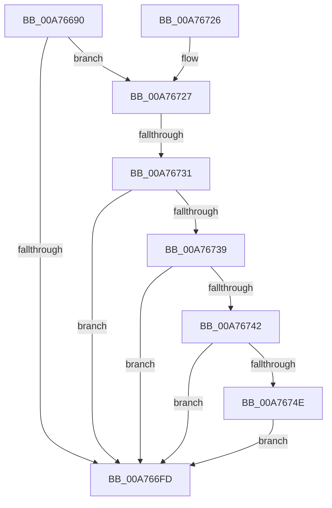

# EtwpPsProvProcessEnumCallback

- RVA: `0x00A76690`–`0x00A7675A` (길이 `202` bytes)
- VA: `0x0000000140A76690`
- 실행 섹션: `PAGE`
- PDB 이름 있음: `예`; PDB Function 태그: `예`
- unwind 정보 RVA: `0x000B5AEC`
- 디코드: `51`개 명령, `202/202` bytes 표시
- 미해석 바이트: `0` (있으면 어셈블리에 `.byte`로 보존)

> 이 문서는 커널 이미지의 기계어와 PDB 기호를 분석해 생성했습니다. 4번과 5번은 함수 원형과 자료형을 바이너리 사용 방식에서 추정한 C 해석이며 원본 소스 복구 결과는 아닙니다.

## 1. Dependencies

- 직접 호출 지점: **4**; 고유 호출 대상: **4**
- 직접 호출자로 확인된 함수: **1**
- RIP 상대 이미지 참조: **2**

### Outgoing calls
- `0x00A766EC` → [memset](../../text/6C/memset_function_006C6C40.md) (function, `0x006C6C40`)
- `0x00A766F4` → [EtwpIsProcessZombie](../8A/EtwpIsProcessZombie_function_008A6304.md) (function, `0x008A6304`)
- `0x00A76709` → [_security_check_cookie](../../text/6A/_security_check_cookie_function_006AC640.md) (function, `0x006AC640`)
- `0x00A76753` → [PsSetProcessTelemetryAppState](../8A/PsSetProcessTelemetryAppState_function_008A35F0.md) (function, `0x008A35F0`)

### Direct callers
- [EtwpPsProvCaptureState](../7C/EtwpPsProvCaptureState_function_007C0AD4.md) at `0x007C0B1A`

### Static image references
- `0x00A766AD` → RVA `0x00E0A740` (`.data`; read)
- `0x00A76739` → RVA `0x00FC6B70` (`ALMOSTRO`; read)

## 2. Other-region calls and transfers

- 다른 실행 섹션으로 향하는 call: **2**
  - `0x00A766EC` → [memset](../../text/6C/memset_function_006C6C40.md) (`PAGE` → `.text`)
  - `0x00A76709` → [_security_check_cookie](../../text/6A/_security_check_cookie_function_006AC640.md) (`PAGE` → `.text`)
- call이 아닌 외부 분기/꼬리 이동: **1**
  - `0x00A7672B` → [sub_00B413EC](../B4/Unknown_function_00B413EC.md) (`tail-transfer`)

## 3. Assembly (complete function range)

```asm
00A76690  48 89 5C 24 18                  mov qword ptr [rsp + 0x18], rbx
00A76695  48 89 74 24 20                  mov qword ptr [rsp + 0x20], rsi
00A7669A  55                              push rbp
00A7669B  57                              push rdi
00A7669C  41 56                           push r14
00A7669E  48 8D AC 24 E0 FD FF FF         lea rbp, [rsp - 0x220]
00A766A6  48 81 EC 20 03 00 00            sub rsp, 0x320
00A766AD  48 8B 05 8C 40 39 00            mov rax, qword ptr [rip + 0x39408c]
00A766B4  48 33 C4                        xor rax, rsp
00A766B7  48 89 85 10 02 00 00            mov qword ptr [rbp + 0x210], rax
00A766BE  48 83 64 24 38 00               and qword ptr [rsp + 0x38], 0
00A766C4  0F 57 C0                        xorps xmm0, xmm0
00A766C7  48 8B FA                        mov rdi, rdx
00A766CA  48 8B D9                        mov rbx, rcx
00A766CD  33 D2                           xor edx, edx
00A766CF  48 8D 4C 24 70                  lea rcx, [rsp + 0x70]
00A766D4  41 B8 A0 02 00 00               mov r8d, 0x2a0
00A766DA  40 32 F6                        xor sil, sil
00A766DD  0F 11 44 24 40                  movups xmmword ptr [rsp + 0x40], xmm0
00A766E2  0F 11 44 24 50                  movups xmmword ptr [rsp + 0x50], xmm0
00A766E7  0F 11 44 24 60                  movups xmmword ptr [rsp + 0x60], xmm0
00A766EC  E8 4F 05 C5 FF                  call 0x1406c6c40
00A766F1  48 8B CB                        mov rcx, rbx
00A766F4  E8 0B FC E2 FF                  call 0x1408a6304
00A766F9  85 C0                           test eax, eax
00A766FB  74 2A                           je 0x140a76727
00A766FD  33 C0                           xor eax, eax
00A766FF  48 8B 8D 10 02 00 00            mov rcx, qword ptr [rbp + 0x210]
00A76706  48 33 CC                        xor rcx, rsp
00A76709  E8 32 5F C3 FF                  call 0x1406ac640
00A7670E  4C 8D 9C 24 20 03 00 00         lea r11, [rsp + 0x320]
00A76716  49 8B 5B 30                     mov rbx, qword ptr [r11 + 0x30]
00A7671A  49 8B 73 38                     mov rsi, qword ptr [r11 + 0x38]
00A7671E  49 8B E3                        mov rsp, r11
00A76721  41 5E                           pop r14
00A76723  5F                              pop rdi
00A76724  5D                              pop rbp
00A76725  C3                              ret
00A76726  CC                              int3
00A76727  40 38 77 09                     cmp byte ptr [rdi + 9], sil
00A7672B  0F 84 BB AC 0C 00               je 0x140b413ec
00A76731  40 B6 01                        mov sil, 1
00A76734  40 84 37                        test byte ptr [rdi], sil
00A76737  74 C4                           je 0x140a766fd
00A76739  48 3B 1D 30 04 55 00            cmp rbx, qword ptr [rip + 0x550430]
00A76740  74 BB                           je 0x140a766fd
00A76742  F7 83 FC 05 00 00 00 10 00 00   test dword ptr [rbx + 0x5fc], 0x1000
00A7674C  75 AF                           jne 0x140a766fd
00A7674E  BA 05 00 00 00                  mov edx, 5
00A76753  E8 98 CE E2 FF                  call 0x1408a35f0
00A76758  EB A3                           jmp 0x140a766fd
```

## 4. C-style interpretation (structured pseudocode)

```c
__int64 __fastcall EtwpPsProvProcessEnumCallback(__int64 a1, __int64 a2)
{
    __int64 result;
    __int64 v_rsi;
    __int64 v_rsp;
    unsigned __int64 v_stack_m18;
    unsigned __int64 v_stack_m238;
    unsigned __int64 v_stack_m28;
    unsigned __int64 v_stack_m2C8;
    unsigned __int64 v_stack_m2D8;
    unsigned __int64 v_stack_m2E8;
    unsigned __int64 v_stack_m2F8;
    unsigned __int64 v_stack_m300;
    unsigned __int64 v_stack_p18;
    unsigned __int64 v_stack_p20;

    v_stack_p18 = v_rbx;
    v_stack_p20 = v_rsi;
    v_rsp = (v_rsp) - (800);
    result = (*(unsigned __int64 *)(v_rip + 3752076)) ^ (v_rsp);
    v_stack_m28 = result;
    a2 = 0;
    v_rsi = 0;
    v_stack_m2F8 = v_xmm0;
    v_stack_m2E8 = v_xmm0;
    v_stack_m2D8 = v_xmm0;
    result = memset(v_stack_m2C8, a2, 672, a4);
    result = EtwpIsProcessZombie(a1, a2, 672, a4);
    if ((unsigned int)(result) == 0) goto loc_00A76727;
loc_00A766FD:
    result = 0;
    a1 = (v_stack_m28) ^ (v_rsp);
    result = _security_check_cookie(a1, a2, 672, a4);
    return result;
loc_00A76727:
    if (((*(unsigned __int8 *)(a2)) & (1)) == 0) goto loc_00A766FD;
    if ((*(unsigned __int64 *)(v_stack_m18 + 48)) == (*(unsigned __int64 *)(v_rip + 5571632))) goto loc_00A766FD;
    if (((*(unsigned int *)(*(unsigned __int64 *)(v_stack_m18 + 48) + 1532)) & (0x1000ULL)) != 0) goto loc_00A766FD;
    result = PsSetProcessTelemetryAppState(a1, 5, 672, a4);
    goto loc_00A766FD;
}
```

## 5. (Beta) C Style

```c
int64_t EtwpPsProvProcessEnumCallback(int64_t Arg1, void *Arg2)
{
    uint8_t *arg2 = (uint8_t *)Arg2;

    int64_t result;
    int64_t local_rsi;
    int64_t local_rsp;
    uint64_t v_stack_m18;
    uint64_t v_stack_m238;
    uint64_t v_stack_m28;
    uint64_t v_stack_m2C8;
    uint64_t v_stack_m2D8;
    uint64_t v_stack_m2E8;
    uint64_t v_stack_m2F8;
    uint64_t v_stack_m300;
    uint64_t v_stack_p18;
    uint64_t v_stack_p20;

    v_stack_p18 = local_rbx;
    v_stack_p20 = local_rsi;
    local_rsp = (local_rsp) - (800);
    result = (*(uint64_t *)(v_rip + 0x39408C)) ^ (local_rsp);
    v_stack_m28 = result;
    Arg2 = 0;
    local_rsi = 0;
    v_stack_m2F8 = v_xmm0;
    v_stack_m2E8 = v_xmm0;
    v_stack_m2D8 = v_xmm0;
    result = memset(v_stack_m2C8, Arg2, 672, a4);
    result = EtwpIsProcessZombie(Arg1, Arg2, 672, a4);
    if ((uint32_t)(result) == 0) goto loc_00A76727;
loc_00A766FD:
    result = 0;
    Arg1 = (v_stack_m28) ^ (local_rsp);
    result = _security_check_cookie(Arg1, Arg2, 672, a4);
    return result;
loc_00A76727:
    if (((*(uint8_t *)(arg2)) & (1)) == 0) goto loc_00A766FD;
    if ((*(uint64_t *)(v_stack_m18 + 0x30)) == (*(uint64_t *)(v_rip + 0x550430))) goto loc_00A766FD;
    if (((*(uint32_t *)(*(uint64_t *)(v_stack_m18 + 0x30) + 0x5FC)) & (0x1000ULL)) != 0) goto loc_00A766FD;
    result = PsSetProcessTelemetryAppState(Arg1, 5, 672, a4);
    goto loc_00A766FD;
}
```

### 관측된 메모리 오프셋

구조체 형식이 확인되지 않은 접근은 인자 기준의 오프셋으로만 기록했습니다.

| 기준 인자 | 오프셋 표현 | 폭 (bit) | 접근 |
|---|---:|---:|---|
| `Arg2` | `+ 0x0` | `8` | `R` |
| `Arg2` | `+ 0x9` | `8` | `R` |

## 6. Execution-region graph

[열기: 2D/3D 그래프와 함수 탐색 컨트롤 패널](../../../control-panel.html?section=page&rva=0x00A76690&view=graph)

- 2D 그래프는 위에서 아래로 흐르고, 3D 그래프는 빈 공간을 드래그해 회전합니다. Shift+드래그는 이동, 휠은 확대·축소, 함수 노드 선택은 대상 보고서 이동입니다.

### Static fallback


