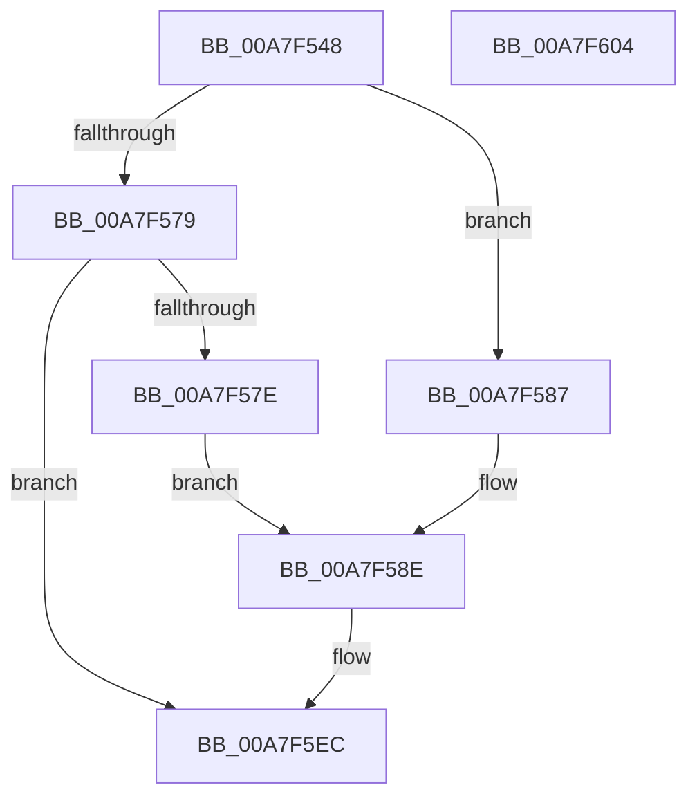

# EtwpPsProvTraceJob

- RVA: `0x00A7F548`–`0x00A7F605` (길이 `189` bytes)
- VA: `0x0000000140A7F548`
- 실행 섹션: `PAGE`
- PDB 이름 있음: `예`; PDB Function 태그: `아니요`
- unwind 정보 RVA: `0x000B6DF8`
- 디코드: `37`개 명령, `189/189` bytes 표시
- 미해석 바이트: `0` (있으면 어셈블리에 `.byte`로 보존)

> 이 문서는 커널 이미지의 기계어와 PDB 기호를 분석해 생성했습니다. 4번과 5번은 함수 원형과 자료형을 바이너리 사용 방식에서 추정한 C 해석이며 원본 소스 복구 결과는 아닙니다.

## 1. Dependencies

- 직접 호출 지점: **2**; 고유 호출 대상: **2**
- 직접 호출자로 확인된 함수: **1**
- RIP 상대 이미지 참조: **4**

### Outgoing calls
- `0x00A7F5E7` → [EtwWrite](../../text/41/EtwWrite_function_0041C720.md) (function, `0x0041C720`)
- `0x00A7F5F6` → [_security_check_cookie](../../text/6A/_security_check_cookie_function_006AC640.md) (function, `0x006AC640`)

### Direct callers
- [EtwTraceJob](../91/EtwTraceJob_function_00917C38.md) at `0x00917CBD`

### Static image references
- `0x00A7F55C` → RVA `0x00E0A740` (`.data`; read)
- `0x00A7F57E` → RVA `0x0001BC48` (`.rdata`; read)
- `0x00A7F587` → RVA `0x0001BC38` (`.rdata`; read)
- `0x00A7F5B9` → RVA `0x00EFF9E8` (`.data`; read)

## 2. Other-region calls and transfers

- 다른 실행 섹션으로 향하는 call: **2**
  - `0x00A7F5E7` → [EtwWrite](../../text/41/EtwWrite_function_0041C720.md) (`PAGE` → `.text`)
  - `0x00A7F5F6` → [_security_check_cookie](../../text/6A/_security_check_cookie_function_006AC640.md) (`PAGE` → `.text`)
- 별도 외부 분기/꼬리 이동을 확인하지 못했습니다.

## 3. Assembly (complete function range)

```asm
00A7F548  89 54 24 10                     mov dword ptr [rsp + 0x10], edx
00A7F54C  55                              push rbp
00A7F54D  48 8D AC 24 60 FD FF FF         lea rbp, [rsp - 0x2a0]
00A7F555  48 81 EC A0 03 00 00            sub rsp, 0x3a0
00A7F55C  48 8B 05 DD B1 38 00            mov rax, qword ptr [rip + 0x38b1dd]
00A7F563  48 33 C4                        xor rax, rsp
00A7F566  48 89 85 90 02 00 00            mov qword ptr [rbp + 0x290], rax
00A7F56D  41 0F B7 D0                     movzx edx, r8w
00A7F571  81 EA 20 07 00 00               sub edx, 0x720
00A7F577  74 0E                           je 0x140a7f587
00A7F579  83 FA 01                        cmp edx, 1
00A7F57C  75 6E                           jne 0x140a7f5ec
00A7F57E  48 8D 15 C3 C6 59 FF            lea rdx, [rip - 0xa6393d]
00A7F585  EB 07                           jmp 0x140a7f58e
00A7F587  48 8D 15 AA C6 59 FF            lea rdx, [rip - 0xa63956]
00A7F58E  48 8D 81 C0 05 00 00            lea rax, [rcx + 0x5c0]
00A7F595  48 C7 44 24 38 10 00 00 00      mov qword ptr [rsp + 0x38], 0x10
00A7F59E  48 89 44 24 30                  mov qword ptr [rsp + 0x30], rax
00A7F5A3  41 B9 03 00 00 00               mov r9d, 3
00A7F5A9  48 8D 81 BC 05 00 00            lea rax, [rcx + 0x5bc]
00A7F5B0  48 C7 44 24 48 04 00 00 00      mov qword ptr [rsp + 0x48], 4
00A7F5B9  48 8B 0D 28 04 48 00            mov rcx, qword ptr [rip + 0x480428]
00A7F5C0  45 33 C0                        xor r8d, r8d
00A7F5C3  48 89 44 24 40                  mov qword ptr [rsp + 0x40], rax
00A7F5C8  48 8D 85 B8 02 00 00            lea rax, [rbp + 0x2b8]
00A7F5CF  48 89 44 24 50                  mov qword ptr [rsp + 0x50], rax
00A7F5D4  48 8D 44 24 30                  lea rax, [rsp + 0x30]
00A7F5D9  48 89 44 24 20                  mov qword ptr [rsp + 0x20], rax
00A7F5DE  48 C7 44 24 58 04 00 00 00      mov qword ptr [rsp + 0x58], 4
00A7F5E7  E8 34 D1 99 FF                  call 0x14041c720
00A7F5EC  48 8B 8D 90 02 00 00            mov rcx, qword ptr [rbp + 0x290]
00A7F5F3  48 33 CC                        xor rcx, rsp
00A7F5F6  E8 45 D0 C2 FF                  call 0x1406ac640
00A7F5FB  48 81 C4 A0 03 00 00            add rsp, 0x3a0
00A7F602  5D                              pop rbp
00A7F603  C3                              ret
00A7F604  CC                              int3
```

## 4. C-style interpretation (structured pseudocode)

```c
__int64 __fastcall EtwpPsProvTraceJob(__int64 a1, int a2, int a3)
{
    __int64 result;
    __int64 v_rsp;
    unsigned __int64 v_stack_m18;
    unsigned __int64 v_stack_m2A8;
    unsigned __int64 v_stack_m350;
    unsigned __int64 v_stack_m358;
    unsigned __int64 v_stack_m360;
    unsigned __int64 v_stack_m368;
    unsigned __int64 v_stack_m370;
    unsigned __int64 v_stack_m378;
    unsigned __int64 v_stack_m388;
    unsigned int v_stack_p10;

    v_stack_p10 = a2;
    v_rsp = (v_rsp) - (928);
    result = (*(unsigned __int64 *)(v_rip + 3715549)) ^ (v_rsp);
    v_stack_m18 = result;
    a2 = (unsigned int)(((unsigned __int16)(a3)) - (0x720ULL));
    if (condition_is_equal) goto loc_00A7F587;
    if (a2 != 1) goto loc_00A7F5EC;
    goto loc_00A7F58E;
loc_00A7F587:
loc_00A7F58E:
    v_stack_m370 = 16;
    v_stack_m378 = a1 + 1472;
    v_stack_m360 = 4;
    a3 = 0;
    v_stack_m368 = a1 + 1468;
    v_stack_m358 = v_stack_p10;
    v_stack_m388 = v_stack_m378;
    v_stack_m350 = 4;
    result = EtwWrite(*(unsigned __int64 *)(v_rip + 4719656), v_rip - 10893654, a3, 3);
loc_00A7F5EC:
    a1 = (v_stack_m18) ^ (v_rsp);
    result = _security_check_cookie(a1, v_rip - 10893654, a3, 3);
    v_rsp = (v_rsp) + (928);
    return result;
}
```

## 5. (Beta) C Style

```c
int64_t EtwpPsProvTraceJob(void *Arg1, int32_t Arg2, int32_t Arg3)
{
    uint8_t *arg1 = (uint8_t *)Arg1;

    int64_t result;
    int64_t local_rsp;
    uint64_t v_stack_m18;
    uint64_t v_stack_m2A8;
    uint64_t v_stack_m350;
    uint64_t v_stack_m358;
    uint64_t v_stack_m360;
    uint64_t v_stack_m368;
    uint64_t v_stack_m370;
    uint64_t v_stack_m378;
    uint64_t v_stack_m388;
    uint32_t v_stack_p10;

    v_stack_p10 = Arg2;
    local_rsp = (local_rsp) - (928);
    result = (*(uint64_t *)(v_rip + 0x38B1DD)) ^ (local_rsp);
    v_stack_m18 = result;
    Arg2 = (uint32_t)(((uint16_t)(Arg3)) - (0x720ULL));
    if (condition_is_equal) goto loc_00A7F587;
    if (Arg2 != 1) goto loc_00A7F5EC;
    goto loc_00A7F58E;
loc_00A7F587:
loc_00A7F58E:
    v_stack_m370 = 16;
    v_stack_m378 = Arg1 + 1472;
    v_stack_m360 = 4;
    Arg3 = 0;
    v_stack_m368 = Arg1 + 1468;
    v_stack_m358 = v_stack_p10;
    v_stack_m388 = v_stack_m378;
    v_stack_m350 = 4;
    result = EtwWrite(*(uint64_t *)(v_rip + 0x480428), v_rip - 10893654, Arg3, 3);
loc_00A7F5EC:
    Arg1 = (v_stack_m18) ^ (local_rsp);
    result = _security_check_cookie(Arg1, v_rip - 10893654, Arg3, 3);
    local_rsp = (local_rsp) + (928);
    return result;
}
```

### 관측된 메모리 오프셋

구조체 형식이 확인되지 않은 접근은 인자 기준의 오프셋으로만 기록했습니다.

| 기준 인자 | 오프셋 표현 | 폭 (bit) | 접근 |
|---|---:|---:|---|
| `Arg1` | `+ 0x5BC` | `64` | `R` |
| `Arg1` | `+ 0x5C0` | `64` | `R` |

## 6. Execution-region graph

[열기: 2D/3D 그래프와 함수 탐색 컨트롤 패널](../../../control-panel.html?section=page&rva=0x00A7F548&view=graph)

- 2D 그래프는 위에서 아래로 흐르고, 3D 그래프는 빈 공간을 드래그해 회전합니다. Shift+드래그는 이동, 휠은 확대·축소, 함수 노드 선택은 대상 보고서 이동입니다.

### Static fallback


