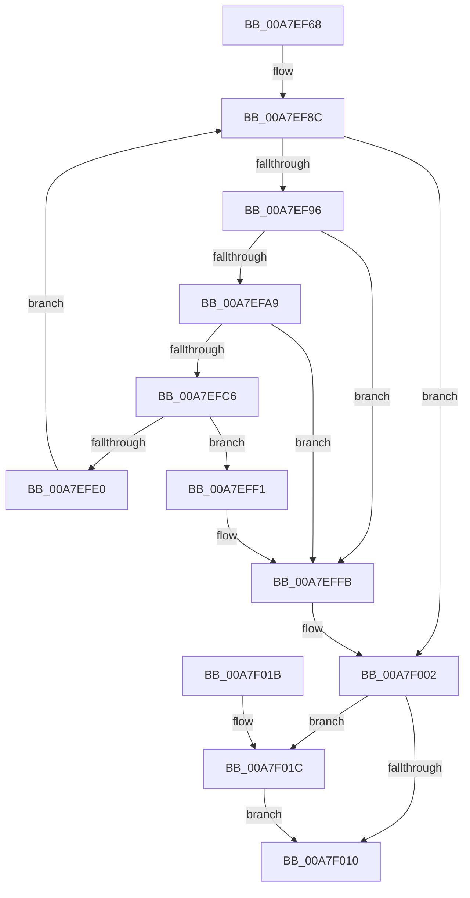

# EtwpReferenceStackLookasideList

- RVA: `0x00A7EF68`–`0x00A7F024` (길이 `188` bytes)
- VA: `0x0000000140A7EF68`
- 실행 섹션: `PAGE`
- PDB 이름 있음: `예`; PDB Function 태그: `아니요`
- unwind 정보 RVA: `0x0007B104`
- 디코드: `50`개 명령, `188/188` bytes 표시
- 미해석 바이트: `0` (있으면 어셈블리에 `.byte`로 보존)

> 이 문서는 커널 이미지의 기계어와 PDB 기호를 분석해 생성했습니다. 4번과 5번은 함수 원형과 자료형을 바이너리 사용 방식에서 추정한 C 해석이며 원본 소스 복구 결과는 아닙니다.

## 1. Dependencies

- 직접 호출 지점: **4**; 고유 호출 대상: **4**
- 직접 호출자로 확인된 함수: **2**
- RIP 상대 이미지 참조: **7**

### Outgoing calls
- `0x00A7EFB9` → [ExAllocatePool2](../../poolcode/B8/ExAllocatePool2_function_00B820F0.md) (function, `0x00B820F0`)
- `0x00A7EFD7` → [KeAllocateCalloutStackEx](KeAllocateCalloutStackEx_function_00A7F030.md) (function, `0x00A7F030`)
- `0x00A7EFEA` → [ExpInterlockedPushEntrySList](../../text/6B/ExpInterlockedPushEntrySList_function_006BA5B0.md) (function, `0x006BA5B0`)
- `0x00A7EFF6` → [ExFreePoolWithTag](../../poolcode/B8/ExFreePoolWithTag_function_00B82870.md) (function, `0x00B82870`)

### Direct callers
- [EtwpEnableGuid](../A5/EtwpEnableGuid_function_00A5CD28.md) at `0x00A5D24D`
- [EtwpInitializeClassicStackTracing](../A6/EtwpInitializeClassicStackTracing_function_00A67874.md) at `0x00A678F8`

### Static image references
- `0x00A7EF72` → RVA `0x00FC6A80` (`ALMOSTRO`; read)
- `0x00A7EF7D` → RVA `0x00E28F90` (`.data`; read/write)
- `0x00A7EF8C` → RVA `0x00E28F94` (`.data`; read)
- `0x00A7EF9B` → RVA `0x00E28F94` (`.data`; read/write)
- `0x00A7EFE3` → RVA `0x00E28F80` (`.data`; read)
- `0x00A7F008` → RVA `0x00E28F98` (`.data`; read)
- `0x00A7F01C` → RVA `0x00E28F98` (`.data`; read/write)

## 2. Other-region calls and transfers

- 다른 실행 섹션으로 향하는 call: **3**
  - `0x00A7EFB9` → [ExAllocatePool2](../../poolcode/B8/ExAllocatePool2_function_00B820F0.md) (`PAGE` → `POOLCODE`)
  - `0x00A7EFEA` → [ExpInterlockedPushEntrySList](../../text/6B/ExpInterlockedPushEntrySList_function_006BA5B0.md) (`PAGE` → `.text`)
  - `0x00A7EFF6` → [ExFreePoolWithTag](../../poolcode/B8/ExFreePoolWithTag_function_00B82870.md) (`PAGE` → `POOLCODE`)
- 별도 외부 분기/꼬리 이동을 확인하지 못했습니다.

## 3. Assembly (complete function range)

```asm
00A7EF68  48 89 5C 24 08                  mov qword ptr [rsp + 8], rbx
00A7EF6D  57                              push rdi
00A7EF6E  48 83 EC 20                     sub rsp, 0x20
00A7EF72  8B 05 08 7B 54 00               mov eax, dword ptr [rip + 0x547b08]
00A7EF78  BB 01 00 00 00                  mov ebx, 1
00A7EF7D  F0 0F C1 1D 0B A0 3A 00         lock xadd dword ptr [rip + 0x3aa00b], ebx
00A7EF85  FF C3                           inc ebx
00A7EF87  0F AF D8                        imul ebx, eax
00A7EF8A  03 DB                           add ebx, ebx
00A7EF8C  8B 05 02 A0 3A 00               mov eax, dword ptr [rip + 0x3aa002]
00A7EF92  3B C3                           cmp eax, ebx
00A7EF94  7D 6C                           jge 0x140a7f002
00A7EF96  B8 01 00 00 00                  mov eax, 1
00A7EF9B  F0 0F C1 05 F1 9F 3A 00         lock xadd dword ptr [rip + 0x3a9ff1], eax
00A7EFA3  FF C0                           inc eax
00A7EFA5  3B C3                           cmp eax, ebx
00A7EFA7  7F 52                           jg 0x140a7effb
00A7EFA9  BA 30 08 00 00                  mov edx, 0x830
00A7EFAE  B9 40 00 00 00                  mov ecx, 0x40
00A7EFB3  41 B8 45 74 77 6C               mov r8d, 0x6c777445
00A7EFB9  E8 32 31 10 00                  call 0x140b820f0
00A7EFBE  48 8B F8                        mov rdi, rax
00A7EFC1  48 85 C0                        test rax, rax
00A7EFC4  74 35                           je 0x140a7effb
00A7EFC6  83 48 10 FF                     or dword ptr [rax + 0x10], 0xffffffff
00A7EFCA  4C 8D 48 18                     lea r9, [rax + 0x18]
00A7EFCE  45 33 C0                        xor r8d, r8d
00A7EFD1  B2 01                           mov dl, 1
00A7EFD3  41 8D 48 02                     lea ecx, [r8 + 2]
00A7EFD7  E8 54 00 00 00                  call 0x140a7f030
00A7EFDC  85 C0                           test eax, eax
00A7EFDE  78 11                           js 0x140a7eff1
00A7EFE0  48 8B D7                        mov rdx, rdi
00A7EFE3  48 8D 0D 96 9F 3A 00            lea rcx, [rip + 0x3a9f96]
00A7EFEA  E8 C1 B5 C3 FF                  call 0x1406ba5b0
00A7EFEF  EB 9B                           jmp 0x140a7ef8c
00A7EFF1  33 D2                           xor edx, edx
00A7EFF3  48 8B CF                        mov rcx, rdi
00A7EFF6  E8 75 38 10 00                  call 0x140b82870
00A7EFFB  F0 FF 0D 92 9F 3A 00            lock dec dword ptr [rip + 0x3a9f92]
00A7F002  8B 05 8C 9F 3A 00               mov eax, dword ptr [rip + 0x3a9f8c]
00A7F008  3B 05 8A 9F 3A 00               cmp eax, dword ptr [rip + 0x3a9f8a]
00A7F00E  7F 0C                           jg 0x140a7f01c
00A7F010  48 8B 5C 24 30                  mov rbx, qword ptr [rsp + 0x30]
00A7F015  48 83 C4 20                     add rsp, 0x20
00A7F019  5F                              pop rdi
00A7F01A  C3                              ret
00A7F01B  CC                              int3
00A7F01C  87 05 76 9F 3A 00               xchg dword ptr [rip + 0x3a9f76], eax
00A7F022  EB EC                           jmp 0x140a7f010
```

## 4. C-style interpretation (structured pseudocode)

```c
__int64 __fastcall EtwpReferenceStackLookasideList(void)
{
    __int64 result;
    __int64 v_rbx;
    __int64 v_rsp;
    unsigned __int64 v_stack_p8;

    v_stack_p8 = v_rbx;
    v_rsp = (v_rsp) - (32);
    v_rbx = (unsigned int)((1) + 1);
    v_rbx = (unsigned int)((v_rbx) * ((unsigned int)((unsigned int)(*(unsigned int *)(v_rip + 5536520)))));
    v_rbx = (unsigned int)((v_rbx) + ((unsigned int)(v_rbx)));
loc_00A7EF8C:
    if (((unsigned int)((unsigned int)(*(unsigned int *)(v_rip + 3842050)))) >= ((unsigned int)(v_rbx))) goto loc_00A7F002;
    result = (unsigned int)((1) + 1);
    if (((unsigned int)(result)) > ((unsigned int)(v_rbx))) goto loc_00A7EFFB;
    result = ExAllocatePool2(64, (unsigned int)(0x830ULL), (unsigned int)(0x6C777445ULL), a4);
    if (result == 0) goto loc_00A7EFFB;
    a3 = 0;
    result = KeAllocateCalloutStackEx(a3 + 2, 1, a3, result + 24);
    if (sign_flag) goto loc_00A7EFF1;
    result = ExpInterlockedPushEntrySList(v_rip + 3841942, result, a3, result + 24);
    goto loc_00A7EF8C;
loc_00A7EFF1:
    a2 = 0;
    result = ExFreePoolWithTag(result, a2, a3, result + 24);
loc_00A7EFFB:
loc_00A7F002:
    if (((unsigned int)((unsigned int)(*(unsigned int *)(v_rip + 3841932)))) > (*(unsigned int *)(v_rip + 3841930))) goto loc_00A7F01C;
loc_00A7F010:
    v_rsp = (v_rsp) + (32);
    return (unsigned int)(*(unsigned int *)(v_rip + 3841932));
loc_00A7F01C:
    goto loc_00A7F010;
}
```

## 5. (Beta) C Style

```c
void EtwpReferenceStackLookasideList(void)
{
    int64_t result;
    int64_t local_rbx;
    int64_t local_rsp;
    uint64_t v_stack_p8;

    v_stack_p8 = local_rbx;
    local_rsp = (local_rsp) - (32);
    local_rbx = (uint32_t)((1) + 1);
    local_rbx = (uint32_t)((local_rbx) * ((uint32_t)((uint32_t)(*(uint32_t *)(v_rip + 0x547B08)))));
    local_rbx = (uint32_t)((local_rbx) + ((uint32_t)(local_rbx)));
loc_00A7EF8C:
    if (((uint32_t)((uint32_t)(*(uint32_t *)(v_rip + 0x3AA002)))) >= ((uint32_t)(local_rbx))) goto loc_00A7F002;
    result = (uint32_t)((1) + 1);
    if (((uint32_t)(result)) > ((uint32_t)(local_rbx))) goto loc_00A7EFFB;
    result = ExAllocatePool2(64, (uint32_t)(0x830ULL), (uint32_t)(0x6C777445ULL), a4);
    if (result == 0) goto loc_00A7EFFB;
    a3 = 0;
    result = KeAllocateCalloutStackEx(a3 + 2, 1, a3, result + 24);
    if (sign_flag) goto loc_00A7EFF1;
    result = ExpInterlockedPushEntrySList(v_rip + 3841942, result, a3, result + 24);
    goto loc_00A7EF8C;
loc_00A7EFF1:
    a2 = 0;
    result = ExFreePoolWithTag(result, a2, a3, result + 24);
loc_00A7EFFB:
loc_00A7F002:
    if (((uint32_t)((uint32_t)(*(uint32_t *)(v_rip + 0x3A9F8C)))) > (*(uint32_t *)(v_rip + 0x3A9F8A))) goto loc_00A7F01C;
loc_00A7F010:
    local_rsp = (local_rsp) + (32);
    return (uint32_t)(*(uint32_t *)(v_rip + 0x3A9F8C));
loc_00A7F01C:
    goto loc_00A7F010;
}
```

## 6. Execution-region graph

[열기: 2D/3D 그래프와 함수 탐색 컨트롤 패널](../../../control-panel.html?section=page&rva=0x00A7EF68&view=graph)

- 2D 그래프는 위에서 아래로 흐르고, 3D 그래프는 빈 공간을 드래그해 회전합니다. Shift+드래그는 이동, 휠은 확대·축소, 함수 노드 선택은 대상 보고서 이동입니다.

### Static fallback


