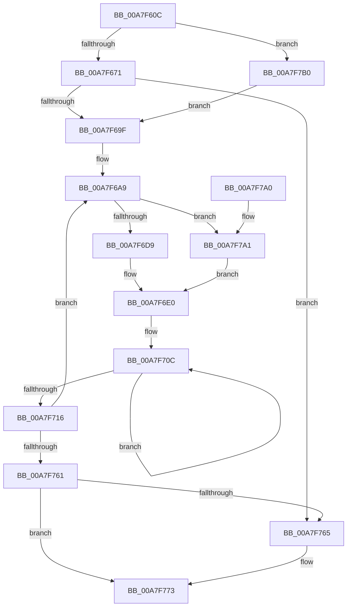

# EtwpSampledProfileRunDown

- RVA: `0x00A7F60C`–`0x00A7F7C1` (길이 `437` bytes)
- VA: `0x0000000140A7F60C`
- 실행 섹션: `PAGE`
- PDB 이름 있음: `예`; PDB Function 태그: `아니요`
- unwind 정보 RVA: `0x000B6E34`
- 디코드: `107`개 명령, `437/437` bytes 표시
- 미해석 바이트: `0` (있으면 어셈블리에 `.byte`로 보존)

> 이 문서는 커널 이미지의 기계어와 PDB 기호를 분석해 생성했습니다. 4번과 5번은 함수 원형과 자료형을 바이너리 사용 방식에서 추정한 C 해석이며 원본 소스 복구 결과는 아닙니다.

## 1. Dependencies

- 직접 호출 지점: **5**; 고유 호출 대상: **5**
- 직접 호출자로 확인된 함수: **1**
- RIP 상대 이미지 참조: **7**

### Outgoing calls
- `0x00A7F685` → [KeWaitForSingleObject](../../text/20/KeWaitForSingleObject_function_0020E6B0.md) (function, `0x0020E6B0`)
- `0x00A7F6CC` → [guard_dispatch_icall](../../text/6B/guard_dispatch_icall_function_006BAAD0.md) (function, `0x006BAAD0`)
- `0x00A7F74B` → [EtwpLogKernelEvent](../../text/25/EtwpLogKernelEvent_function_0025CC00.md) (function, `0x0025CC00`)
- `0x00A7F76E` → [KeReleaseMutex](../../text/39/KeReleaseMutex_function_00396810.md) (function, `0x00396810`)
- `0x00A7F77A` → [_security_check_cookie](../../text/6A/_security_check_cookie_function_006AC640.md) (function, `0x006AC640`)

### Direct callers
- [EtwpKernelTraceRundown](../9E/EtwpKernelTraceRundown_function_009E4080.md) at `0x009E4192`
- [EtwpKernelTraceRundown](../9E/EtwpKernelTraceRundown_function_009E4080.md) at `0x009E41B3`

### Static image references
- `0x00A7F62F` → RVA `0x00E0A740` (`.data`; read)
- `0x00A7F67C` → RVA `0x00EFF7A0` (`.data`; read)
- `0x00A7F68A` → RVA `0x00EFF290` (`.data`; read)
- `0x00A7F690` → RVA `0x00EFF298` (`.data`; read)
- `0x00A7F6B1` → RVA `0x00E00638` (`.data`; read)
- `0x00A7F6E3` → RVA `0x00AFE5E0` (` ?? ::NNGAKEGL::`string'`; read)
- `0x00A7F7B0` → RVA `0x00EFF520` (`.data`; read)

## 2. Other-region calls and transfers

- 다른 실행 섹션으로 향하는 call: **5**
  - `0x00A7F685` → [KeWaitForSingleObject](../../text/20/KeWaitForSingleObject_function_0020E6B0.md) (`PAGE` → `.text`)
  - `0x00A7F6CC` → [guard_dispatch_icall](../../text/6B/guard_dispatch_icall_function_006BAAD0.md) (`PAGE` → `.text`)
  - `0x00A7F74B` → [EtwpLogKernelEvent](../../text/25/EtwpLogKernelEvent_function_0025CC00.md) (`PAGE` → `.text`)
  - `0x00A7F76E` → [KeReleaseMutex](../../text/39/KeReleaseMutex_function_00396810.md) (`PAGE` → `.text`)
  - `0x00A7F77A` → [_security_check_cookie](../../text/6A/_security_check_cookie_function_006AC640.md) (`PAGE` → `.text`)
- 별도 외부 분기/꼬리 이동을 확인하지 못했습니다.

## 3. Assembly (complete function range)

```asm
00A7F60C  48 8B C4                        mov rax, rsp
00A7F60F  48 89 58 10                     mov qword ptr [rax + 0x10], rbx
00A7F613  48 89 70 18                     mov qword ptr [rax + 0x18], rsi
00A7F617  48 89 78 20                     mov qword ptr [rax + 0x20], rdi
00A7F61B  55                              push rbp
00A7F61C  41 54                           push r12
00A7F61E  41 55                           push r13
00A7F620  41 56                           push r14
00A7F622  41 57                           push r15
00A7F624  48 8D 68 A1                     lea rbp, [rax - 0x5f]
00A7F628  48 81 EC 90 00 00 00            sub rsp, 0x90
00A7F62F  48 8B 05 0A B1 38 00            mov rax, qword ptr [rip + 0x38b10a]
00A7F636  48 33 C4                        xor rax, rsp
00A7F639  48 89 45 27                     mov qword ptr [rbp + 0x27], rax
00A7F63D  33 C0                           xor eax, eax
00A7F63F  45 33 ED                        xor r13d, r13d
00A7F642  F6 DA                           neg dl
00A7F644  48 89 45 F7                     mov qword ptr [rbp - 9], rax
00A7F648  0F 57 C0                        xorps xmm0, xmm0
00A7F64B  89 45 FF                        mov dword ptr [rbp - 1], eax
00A7F64E  66 1B F6                        sbb si, si
00A7F651  48 89 45 EF                     mov qword ptr [rbp - 0x11], rax
00A7F655  66 81 C6 4A 0F                  add si, 0xf4a
00A7F65A  44 89 6D D7                     mov dword ptr [rbp - 0x29], r13d
00A7F65E  41 8A D8                        mov bl, r8b
00A7F661  4C 8B E1                        mov r12, rcx
00A7F664  0F 11 45 DF                     movups xmmword ptr [rbp - 0x21], xmm0
00A7F668  45 84 C0                        test r8b, r8b
00A7F66B  0F 85 3F 01 00 00               jne 0x140a7f7b0
00A7F671  45 33 C9                        xor r9d, r9d
00A7F674  4C 89 6C 24 20                  mov qword ptr [rsp + 0x20], r13
00A7F679  45 33 C0                        xor r8d, r8d
00A7F67C  48 8D 0D 1D 01 48 00            lea rcx, [rip + 0x48011d]
00A7F683  33 D2                           xor edx, edx
00A7F685  E8 26 F0 78 FF                  call 0x14020e6b0
00A7F68A  8B 05 00 FC 47 00               mov eax, dword ptr [rip + 0x47fc00]
00A7F690  48 8B 0D 01 FC 47 00            mov rcx, qword ptr [rip + 0x47fc01]
00A7F697  85 C0                           test eax, eax
00A7F699  0F 84 C6 00 00 00               je 0x140a7f765
00A7F69F  48 8D B9 60 02 00 00            lea rdi, [rcx + 0x260]
00A7F6A6  44 8B F8                        mov r15d, eax
00A7F6A9  44 0F BF 37                     movsx r14d, word ptr [rdi]
00A7F6AD  4C 8D 4D D7                     lea r9, [rbp - 0x29]
00A7F6B1  48 8B 05 80 0F 38 00            mov rax, qword ptr [rip + 0x380f80]
00A7F6B8  4C 8D 45 DF                     lea r8, [rbp - 0x21]
00A7F6BC  BA 18 00 00 00                  mov edx, 0x18
00A7F6C1  44 89 6D D7                     mov dword ptr [rbp - 0x29], r13d
00A7F6C5  44 89 75 DF                     mov dword ptr [rbp - 0x21], r14d
00A7F6C9  8D 4A E9                        lea ecx, [rdx - 0x17]
00A7F6CC  E8 FF B3 C3 FF                  call 0x1406baad0
00A7F6D1  85 C0                           test eax, eax
00A7F6D3  0F 88 C8 00 00 00               js 0x140a7f7a1
00A7F6D9  8B 45 E7                        mov eax, dword ptr [rbp - 0x19]
00A7F6DC  48 8B 4D EF                     mov rcx, qword ptr [rbp - 0x11]
00A7F6E0  89 45 FB                        mov dword ptr [rbp - 5], eax
00A7F6E3  48 8D 15 F6 EE 07 00            lea rdx, [rip + 0x7eef6]
00A7F6EA  89 45 FF                        mov dword ptr [rbp - 1], eax
00A7F6ED  48 85 C9                        test rcx, rcx
00A7F6F0  48 8D 45 F7                     lea rax, [rbp - 9]
00A7F6F4  44 89 75 F7                     mov dword ptr [rbp - 9], r14d
00A7F6F8  48 0F 45 D1                     cmovne rdx, rcx
00A7F6FC  48 89 45 07                     mov qword ptr [rbp + 7], rax
00A7F700  48 83 C8 FF                     or rax, 0xffffffffffffffff
00A7F704  48 C7 45 0F 0C 00 00 00         mov qword ptr [rbp + 0xf], 0xc
00A7F70C  48 FF C0                        inc rax
00A7F70F  66 44 39 2C 42                  cmp word ptr [rdx + rax*2], r13w
00A7F714  75 F6                           jne 0x140a7f70c
00A7F716  45 8B 04 24                     mov r8d, dword ptr [r12]
00A7F71A  8D 04 45 02 00 00 00            lea eax, [rax*2 + 2]
00A7F721  48 89 55 17                     mov qword ptr [rbp + 0x17], rdx
00A7F725  48 8D 4D 07                     lea rcx, [rbp + 7]
00A7F729  49 8B 94 24 50 05 00 00         mov rdx, qword ptr [r12 + 0x550]
00A7F731  41 B9 02 00 00 00               mov r9d, 2
00A7F737  C7 44 24 28 03 19 50 00         mov dword ptr [rsp + 0x28], 0x501903
00A7F73F  89 45 1F                        mov dword ptr [rbp + 0x1f], eax
00A7F742  44 89 6D 23                     mov dword ptr [rbp + 0x23], r13d
00A7F746  66 89 74 24 20                  mov word ptr [rsp + 0x20], si
00A7F74B  E8 B0 D4 7D FF                  call 0x14025cc00
00A7F750  48 81 C7 68 02 00 00            add rdi, 0x268
00A7F757  49 83 EF 01                     sub r15, 1
00A7F75B  0F 85 48 FF FF FF               jne 0x140a7f6a9
00A7F761  84 DB                           test bl, bl
00A7F763  75 0E                           jne 0x140a7f773
00A7F765  33 D2                           xor edx, edx
00A7F767  48 8D 0D 32 00 48 00            lea rcx, [rip + 0x480032]
00A7F76E  E8 9D 70 91 FF                  call 0x140396810
00A7F773  48 8B 4D 27                     mov rcx, qword ptr [rbp + 0x27]
00A7F777  48 33 CC                        xor rcx, rsp
00A7F77A  E8 C1 CE C2 FF                  call 0x1406ac640
00A7F77F  4C 8D 9C 24 90 00 00 00         lea r11, [rsp + 0x90]
00A7F787  49 8B 5B 38                     mov rbx, qword ptr [r11 + 0x38]
00A7F78B  49 8B 73 40                     mov rsi, qword ptr [r11 + 0x40]
00A7F78F  49 8B 7B 48                     mov rdi, qword ptr [r11 + 0x48]
00A7F793  49 8B E3                        mov rsp, r11
00A7F796  41 5F                           pop r15
00A7F798  41 5E                           pop r14
00A7F79A  41 5D                           pop r13
00A7F79C  41 5C                           pop r12
00A7F79E  5D                              pop rbp
00A7F79F  C3                              ret
00A7F7A0  CC                              int3
00A7F7A1  41 8B C5                        mov eax, r13d
00A7F7A4  48 8D 0D 35 EE 07 00            lea rcx, [rip + 0x7ee35]
00A7F7AB  E9 30 FF FF FF                  jmp 0x140a7f6e0
00A7F7B0  48 8D 0D 69 FD 47 00            lea rcx, [rip + 0x47fd69]
00A7F7B7  B8 01 00 00 00                  mov eax, 1
00A7F7BC  E9 DE FE FF FF                  jmp 0x140a7f69f
```

## 4. C-style interpretation (structured pseudocode)

```c
__int64 __fastcall EtwpSampledProfileRunDown(__int64 a1, unsigned __int8 a2, int a3, int a4)
{
    __int64 result;
    __int64 v_r13;
    __int64 v_r15;
    __int64 v_rdi;
    __int64 v_rsi;
    __int64 v_rsp;
    unsigned __int64 v_stack_m28;
    unsigned int v_stack_m90;
    unsigned __int64 v_stack_m98;

    *(unsigned __int64 *)(v_rsp + 16) = v_rbx;
    *(unsigned __int64 *)(v_rsp + 24) = v_rsi;
    *(unsigned __int64 *)(v_rsp + 32) = v_rdi;
    v_rsp = (v_rsp) - (144);
    result = (*(unsigned __int64 *)(v_rip + 3715338)) ^ (v_rsp);
    *(unsigned __int64 *)(v_rsp - 95 + 39) = result;
    result = 0;
    v_r13 = 0;
    a2 = (unsigned __int8)(-(a2));
    *(unsigned __int64 *)(v_rsp - 95 - 9) = 0;
    *(unsigned int *)(v_rsp - 95 - 1) = 0;
    *(unsigned __int64 *)(v_rsp - 95 - 17) = 0;
    v_rsi = (unsigned __int16)((v_rsi) + (0xF4AULL));
    *(unsigned int *)(v_rsp - 95 - 41) = 0;
    *(unsigned __int64 *)(v_rsp - 95 - 33) = v_xmm0;
    if ((unsigned __int8)(a3) != 0) goto loc_00A7F7B0;
    a4 = 0;
    v_stack_m98 = 0;
    a3 = 0;
    a2 = 0;
    result = KeWaitForSingleObject(v_rip + 4718877, a2, a3, a4);
    if ((unsigned int)((unsigned int)(*(unsigned int *)(v_rip + 4717568))) == 0) goto loc_00A7F765;
loc_00A7F69F:
loc_00A7F6A9:
    *(unsigned int *)(v_rsp - 95 - 41) = 0;
    *(unsigned int *)(v_rsp - 95 - 33) = (unsigned int)((__int16)(*(unsigned __int16 *)(*(unsigned __int64 *)(v_rip + 4717569) + 608)));
    result = guard_dispatch_icall(24 - 23, 24, v_rsp - 95 - 33, v_rsp - 95 - 41);
    if (sign_flag) goto loc_00A7F7A1;
loc_00A7F6E0:
    *(unsigned int *)(v_rsp - 95 - 5) = (unsigned int)((unsigned int)(*(unsigned int *)(v_rsp - 95 - 25)));
    *(unsigned int *)(v_rsp - 95 - 1) = (unsigned int)((unsigned int)(*(unsigned int *)(v_rsp - 95 - 25)));
    *(unsigned int *)(v_rsp - 95 - 9) = (unsigned int)((__int16)(*(unsigned __int16 *)(*(unsigned __int64 *)(v_rip + 4717569) + 608)));
    a2 = v_rip + 519926;
    if (*(unsigned __int64 *)(v_rsp - 95 - 17) != 0) { a2 = *(unsigned __int64 *)(v_rsp - 95 - 17); }
    *(unsigned __int64 *)(v_rsp - 95 + 7) = v_rsp - 95 - 9;
    result = (v_rsp - 95 - 9) | (-1);
    *(unsigned __int64 *)(v_rsp - 95 + 15) = 12;
loc_00A7F70C:
    result = (result) + 1;
    if ((*(unsigned __int16 *)(a2 + result * 2)) != 0) goto loc_00A7F70C;
    *(unsigned __int64 *)(v_rsp - 95 + 23) = a2;
    v_stack_m90 = 0x501903ULL;
    *(unsigned int *)(v_rsp - 95 + 31) = (unsigned int)(result * 2 + 2);
    *(unsigned int *)(v_rsp - 95 + 35) = 0;
    v_stack_m98 = (unsigned __int16)(v_rsi);
    result = EtwpLogKernelEvent(v_rsp - 95 + 7, *(unsigned __int64 *)(a1 + 1360), (unsigned int)(*(unsigned int *)(a1)), 2);
    v_rdi = (*(unsigned __int64 *)(v_rip + 4717569) + 608) + (616);
    v_r15 = ((unsigned int)((unsigned int)((unsigned int)(*(unsigned int *)(v_rip + 4717568))))) - (1);
    if (condition_is_not_equal) goto loc_00A7F6A9;
    if ((unsigned __int8)((unsigned __int8)(a3)) == 0) {
        a2 = 0;
        a1 = v_rip + 4718642;
        result = KeReleaseMutex(a1, a2, (unsigned int)(*(unsigned int *)(a1)), 2);
    }
    a1 = (*(unsigned __int64 *)(v_rsp - 95 + 39)) ^ (v_rsp);
    result = _security_check_cookie(a1, a2, (unsigned int)(*(unsigned int *)(a1)), 2);
    return result;
loc_00A7F7A1:
    goto loc_00A7F6E0;
loc_00A7F7B0:
    goto loc_00A7F69F;
}
```

## 5. (Beta) C Style

```c
int64_t EtwpSampledProfileRunDown(void *Arg1, uint8_t Arg2, int32_t Arg3, int32_t Arg4)
{
    uint8_t *arg1 = (uint8_t *)Arg1;

    int64_t result;
    int64_t local_r13;
    int64_t local_r15;
    int64_t local_rdi;
    int64_t local_rsi;
    int64_t local_rsp;
    uint64_t v_stack_m28;
    uint32_t v_stack_m90;
    uint64_t v_stack_m98;

    *(uint64_t *)(local_rsp + 0x10) = local_rbx;
    *(uint64_t *)(local_rsp + 0x18) = local_rsi;
    *(uint64_t *)(local_rsp + 0x20) = local_rdi;
    local_rsp = (local_rsp) - (144);
    result = (*(uint64_t *)(v_rip + 0x38B10A)) ^ (local_rsp);
    *(uint64_t *)(local_rsp - 0x5F + 0x27) = result;
    result = 0;
    local_r13 = 0;
    Arg2 = (uint8_t)(-(Arg2));
    *(uint64_t *)(local_rsp - 0x5F - 0x9) = 0;
    *(uint32_t *)(local_rsp - 0x5F - 0x1) = 0;
    *(uint64_t *)(local_rsp - 0x5F - 0x11) = 0;
    local_rsi = (uint16_t)((local_rsi) + (0xF4AULL));
    *(uint32_t *)(local_rsp - 0x5F - 0x29) = 0;
    *(uint64_t *)(local_rsp - 0x5F - 0x21) = v_xmm0;
    if ((uint8_t)(Arg3) != 0) goto loc_00A7F7B0;
    Arg4 = 0;
    v_stack_m98 = 0;
    Arg3 = 0;
    Arg2 = 0;
    result = KeWaitForSingleObject(v_rip + 4718877, Arg2, Arg3, Arg4);
    if ((uint32_t)((uint32_t)(*(uint32_t *)(v_rip + 0x47FC00))) == 0) goto loc_00A7F765;
loc_00A7F69F:
loc_00A7F6A9:
    *(uint32_t *)(local_rsp - 0x5F - 0x29) = 0;
    *(uint32_t *)(local_rsp - 0x5F - 0x21) = (uint32_t)((int16_t)(*(uint16_t *)(*(uint64_t *)(v_rip + 0x47FC01) + 0x260)));
    result = guard_dispatch_icall(24 - 23, 24, local_rsp - 95 - 33, local_rsp - 95 - 41);
    if (sign_flag) goto loc_00A7F7A1;
loc_00A7F6E0:
    *(uint32_t *)(local_rsp - 0x5F - 0x5) = (uint32_t)((uint32_t)(*(uint32_t *)(local_rsp - 0x5F - 0x19)));
    *(uint32_t *)(local_rsp - 0x5F - 0x1) = (uint32_t)((uint32_t)(*(uint32_t *)(local_rsp - 0x5F - 0x19)));
    *(uint32_t *)(local_rsp - 0x5F - 0x9) = (uint32_t)((int16_t)(*(uint16_t *)(*(uint64_t *)(v_rip + 0x47FC01) + 0x260)));
    Arg2 = v_rip + 519926;
    if (*(uint64_t *)(local_rsp - 0x5F - 0x11) != 0) { Arg2 = *(uint64_t *)(local_rsp - 0x5F - 0x11); }
    *(uint64_t *)(local_rsp - 0x5F + 0x7) = local_rsp - 95 - 9;
    result = (local_rsp - 95 - 9) | (-1);
    *(uint64_t *)(local_rsp - 0x5F + 0xF) = 12;
loc_00A7F70C:
    result = (result) + 1;
    if ((*(uint16_t *)(Arg2 + result * 2)) != 0) goto loc_00A7F70C;
    *(uint64_t *)(local_rsp - 0x5F + 0x17) = Arg2;
    v_stack_m90 = 0x501903ULL;
    *(uint32_t *)(local_rsp - 0x5F + 0x1F) = (uint32_t)(result * 2 + 2);
    *(uint32_t *)(local_rsp - 0x5F + 0x23) = 0;
    v_stack_m98 = (uint16_t)(local_rsi);
    result = EtwpLogKernelEvent(local_rsp - 95 + 7, *(uint64_t *)(arg1 + 0x550), (uint32_t)(*(uint32_t *)(arg1)), 2);
    local_rdi = (*(uint64_t *)(v_rip + 0x47FC01) + 608) + (616);
    local_r15 = ((uint32_t)((uint32_t)((uint32_t)(*(uint32_t *)(v_rip + 0x47FC00))))) - (1);
    if (condition_is_not_equal) goto loc_00A7F6A9;
    if ((uint8_t)((uint8_t)(Arg3)) == 0) {
        Arg2 = 0;
        Arg1 = v_rip + 4718642;
        result = KeReleaseMutex(Arg1, Arg2, (uint32_t)(*(uint32_t *)(arg1)), 2);
    }
    Arg1 = (*(uint64_t *)(local_rsp - 0x5F + 0x27)) ^ (local_rsp);
    result = _security_check_cookie(Arg1, Arg2, (uint32_t)(*(uint32_t *)(arg1)), 2);
    return result;
loc_00A7F7A1:
    goto loc_00A7F6E0;
loc_00A7F7B0:
    goto loc_00A7F69F;
}
```

### 관측된 메모리 오프셋

구조체 형식이 확인되지 않은 접근은 인자 기준의 오프셋으로만 기록했습니다.

| 기준 인자 | 오프셋 표현 | 폭 (bit) | 접근 |
|---|---:|---:|---|
| `Arg1` | `+ 0x0` | `32` | `R` |
| `Arg1` | `+ 0x550` | `64` | `R` |

## 6. Execution-region graph

[열기: 2D/3D 그래프와 함수 탐색 컨트롤 패널](../../../control-panel.html?section=page&rva=0x00A7F60C&view=graph)

- 2D 그래프는 위에서 아래로 흐르고, 3D 그래프는 빈 공간을 드래그해 회전합니다. Shift+드래그는 이동, 휠은 확대·축소, 함수 노드 선택은 대상 보고서 이동입니다.

### Static fallback


