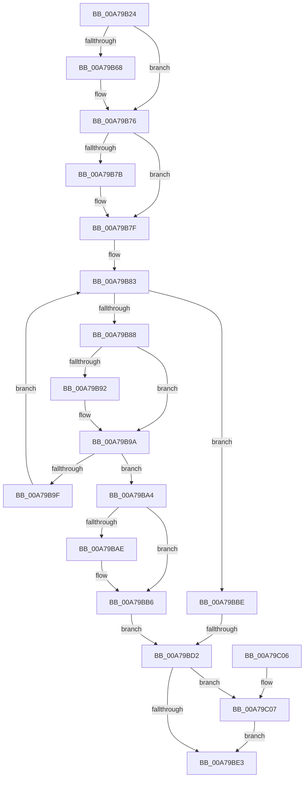

# EtwpTrackDecodeGuidForSession

- RVA: `0x00A79B24`–`0x00A79C11` (길이 `237` bytes)
- VA: `0x0000000140A79B24`
- 실행 섹션: `PAGE`
- PDB 이름 있음: `예`; PDB Function 태그: `예`
- unwind 정보 RVA: `0x0007AC84`
- 디코드: `70`개 명령, `237/237` bytes 표시
- 미해석 바이트: `0` (있으면 어셈블리에 `.byte`로 보존)

> 이 문서는 커널 이미지의 기계어와 PDB 기호를 분석해 생성했습니다. 4번과 5번은 함수 원형과 자료형을 바이너리 사용 방식에서 추정한 C 해석이며 원본 소스 복구 결과는 아닙니다.

## 1. Dependencies

- 직접 호출 지점: **4**; 고유 호출 대상: **4**
- 직접 호출자로 확인된 함수: **2**
- RIP 상대 이미지 참조: **0**

### Outgoing calls
- `0x00A79B58` → [KeAbPreAcquire](../../text/21/KeAbPreAcquire_function_00210230.md) (function, `0x00210230`)
- `0x00A79B71` → [ExfAcquirePushLockExclusiveEx](../../text/20/ExfAcquirePushLockExclusiveEx_function_0020FC90.md) (function, `0x0020FC90`)
- `0x00A79BE6` → [KeAbPostRelease](../../text/2E/KeAbPostRelease_function_002E1600.md) (function, `0x002E1600`)
- `0x00A79C0A` → [ExfTryToWakePushLock](../../text/26/ExfTryToWakePushLock_function_00265DD0.md) (function, `0x00265DD0`)

### Direct callers
- [EtwpUpdateRegEntryEnableMask](../8C/EtwpUpdateRegEntryEnableMask_function_008C1990.md) at `0x008C1A5A`
- [AddDecodeGuidToSessions](AddDecodeGuidToSessions_function_00A79A7C.md) at `0x00A79AF1`

### Static image references
- 디코드된 RIP-relative 메모리 참조가 없습니다.

## 2. Other-region calls and transfers

- 다른 실행 섹션으로 향하는 call: **4**
  - `0x00A79B58` → [KeAbPreAcquire](../../text/21/KeAbPreAcquire_function_00210230.md) (`PAGE` → `.text`)
  - `0x00A79B71` → [ExfAcquirePushLockExclusiveEx](../../text/20/ExfAcquirePushLockExclusiveEx_function_0020FC90.md) (`PAGE` → `.text`)
  - `0x00A79BE6` → [KeAbPostRelease](../../text/2E/KeAbPostRelease_function_002E1600.md) (`PAGE` → `.text`)
  - `0x00A79C0A` → [ExfTryToWakePushLock](../../text/26/ExfTryToWakePushLock_function_00265DD0.md) (`PAGE` → `.text`)
- call이 아닌 외부 분기/꼬리 이동: **1**
  - `0x00A79BCC` → [sub_00B41F78](../B4/Unknown_function_00B41F78.md) (`tail-transfer`)

## 3. Assembly (complete function range)

```asm
00A79B24  48 89 5C 24 08                  mov qword ptr [rsp + 8], rbx
00A79B29  48 89 6C 24 10                  mov qword ptr [rsp + 0x10], rbp
00A79B2E  48 89 74 24 18                  mov qword ptr [rsp + 0x18], rsi
00A79B33  57                              push rdi
00A79B34  41 56                           push r14
00A79B36  41 57                           push r15
00A79B38  48 83 EC 20                     sub rsp, 0x20
00A79B3C  4C 8B 7A 70                     mov r15, qword ptr [rdx + 0x70]
00A79B40  48 8D B1 B0 02 00 00            lea rsi, [rcx + 0x2b0]
00A79B47  4C 8B 72 20                     mov r14, qword ptr [rdx + 0x20]
00A79B4B  48 8B F9                        mov rdi, rcx
00A79B4E  48 8B CE                        mov rcx, rsi
00A79B51  45 33 C0                        xor r8d, r8d
00A79B54  33 D2                           xor edx, edx
00A79B56  33 DB                           xor ebx, ebx
00A79B58  E8 D3 66 79 FF                  call 0x140210230
00A79B5D  F0 48 0F BA 2E 00               lock bts qword ptr [rsi], 0
00A79B63  48 8B E8                        mov rbp, rax
00A79B66  73 0E                           jae 0x140a79b76
00A79B68  4C 8B C6                        mov r8, rsi
00A79B6B  48 8B D0                        mov rdx, rax
00A79B6E  48 8B CE                        mov rcx, rsi
00A79B71  E8 1A 61 79 FF                  call 0x14020fc90
00A79B76  48 85 ED                        test rbp, rbp
00A79B79  74 04                           je 0x140a79b7f
00A79B7B  C6 45 0A 01                     mov byte ptr [rbp + 0xa], 1
00A79B7F  48 8B 57 70                     mov rdx, qword ptr [rdi + 0x70]
00A79B83  48 85 D2                        test rdx, rdx
00A79B86  74 36                           je 0x140a79bbe
00A79B88  49 8B 4F 22                     mov rcx, qword ptr [r15 + 0x22]
00A79B8C  48 2B 4A 08                     sub rcx, qword ptr [rdx + 8]
00A79B90  75 08                           jne 0x140a79b9a
00A79B92  49 8B 4F 2A                     mov rcx, qword ptr [r15 + 0x2a]
00A79B96  48 2B 4A 10                     sub rcx, qword ptr [rdx + 0x10]
00A79B9A  48 85 C9                        test rcx, rcx
00A79B9D  74 05                           je 0x140a79ba4
00A79B9F  48 8B 12                        mov rdx, qword ptr [rdx]
00A79BA2  EB DF                           jmp 0x140a79b83
00A79BA4  49 8B 4E 28                     mov rcx, qword ptr [r14 + 0x28]
00A79BA8  48 2B 4A 18                     sub rcx, qword ptr [rdx + 0x18]
00A79BAC  75 08                           jne 0x140a79bb6
00A79BAE  49 8B 4E 30                     mov rcx, qword ptr [r14 + 0x30]
00A79BB2  48 2B 4A 20                     sub rcx, qword ptr [rdx + 0x20]
00A79BB6  48 85 C9                        test rcx, rcx
00A79BB9  0F 94 C3                        sete bl
00A79BBC  EB 14                           jmp 0x140a79bd2
00A79BBE  8B 87 44 01 00 00               mov eax, dword ptr [rdi + 0x144]
00A79BC4  05 00 08 00 00                  add eax, 0x800
00A79BC9  3B 47 04                        cmp eax, dword ptr [rdi + 4]
00A79BCC  0F 86 A6 83 0C 00               jbe 0x140b41f78
00A79BD2  48 83 CA FF                     or rdx, 0xffffffffffffffff
00A79BD6  F0 48 0F C1 16                  lock xadd qword ptr [rsi], rdx
00A79BDB  80 E2 06                        and dl, 6
00A79BDE  80 FA 02                        cmp dl, 2
00A79BE1  74 24                           je 0x140a79c07
00A79BE3  48 8B CE                        mov rcx, rsi
00A79BE6  E8 15 7A 86 FF                  call 0x1402e1600
00A79BEB  48 8B 6C 24 48                  mov rbp, qword ptr [rsp + 0x48]
00A79BF0  8A C3                           mov al, bl
00A79BF2  48 8B 5C 24 40                  mov rbx, qword ptr [rsp + 0x40]
00A79BF7  48 8B 74 24 50                  mov rsi, qword ptr [rsp + 0x50]
00A79BFC  48 83 C4 20                     add rsp, 0x20
00A79C00  41 5F                           pop r15
00A79C02  41 5E                           pop r14
00A79C04  5F                              pop rdi
00A79C05  C3                              ret
00A79C06  CC                              int3
00A79C07  48 8B CE                        mov rcx, rsi
00A79C0A  E8 C1 C1 7E FF                  call 0x140265dd0
00A79C0F  EB D2                           jmp 0x140a79be3
```

## 4. C-style interpretation (structured pseudocode)

```c
__int64 __fastcall EtwpTrackDecodeGuidForSession(__int64 a1, __int64 a2, int a3)
{
    __int64 result;
    __int64 v_rbx;
    __int64 v_rsp;
    unsigned __int64 v_stack_p10;
    unsigned __int64 v_stack_p18;
    unsigned __int64 v_stack_p8;

    v_stack_p8 = v_rbx;
    v_stack_p10 = v_rbp;
    v_stack_p18 = v_rsi;
    v_rsp = (v_rsp) - (32);
    a3 = 0;
    a2 = 0;
    v_rbx = 0;
    result = KeAbPreAcquire(a1 + 688, a2, a3, a4);
    if (!(condition_is_above_or_equal)) {
        a3 = a1 + 688;
        a2 = result;
        a1 = a1 + 688;
        result = ExfAcquirePushLockExclusiveEx(a1, a2, a3, a4);
    }
    if (result != 0) {
        *(unsigned __int8 *)(result + 10) = 1;
    }
loc_00A79B83:
    if (*(unsigned __int64 *)(a1 + 112) == 0) goto loc_00A79BBE;
    a1 = (*(unsigned __int64 *)(*(unsigned __int64 *)(a2 + 112) + 34)) - (*(unsigned __int64 *)(*(unsigned __int64 *)(a1 + 112) + 8));
    if (!(condition_is_not_equal)) {
        a1 = *(unsigned __int64 *)(*(unsigned __int64 *)(a2 + 112) + 42);
        a1 = (a1) - (*(unsigned __int64 *)(*(unsigned __int64 *)(a1 + 112) + 16));
    }
    if (a1 == 0) goto loc_00A79BA4;
    goto loc_00A79B83;
loc_00A79BA4:
    a1 = (*(unsigned __int64 *)(*(unsigned __int64 *)(a2 + 32) + 40)) - (*(unsigned __int64 *)(*(unsigned __int64 *)(*(unsigned __int64 *)(a1 + 112)) + 24));
    if (!(condition_is_not_equal)) {
        a1 = *(unsigned __int64 *)(*(unsigned __int64 *)(a2 + 32) + 48);
        a1 = (a1) - (*(unsigned __int64 *)(*(unsigned __int64 *)(*(unsigned __int64 *)(a1 + 112)) + 32));
    }
    v_rbx = (a1 == 0) ? 1 : 0;
    goto loc_00A79BD2;
loc_00A79BBE:
    result = (unsigned int)(((unsigned int)(*(unsigned int *)(a1 + 324))) + (0x800ULL));
loc_00A79BD2:
    a2 = (*(unsigned __int64 *)(*(unsigned __int64 *)(a1 + 112))) | (-1);
    a2 = (unsigned __int8)((a2) & (6));
    if (((unsigned __int8)(a2)) == 2) goto loc_00A79C07;
loc_00A79BE3:
    result = KeAbPostRelease(a1 + 688, a2, a3, a4);
    v_rsp = (v_rsp) + (32);
    return (unsigned __int8)(v_rbx);
loc_00A79C07:
    result = ExfTryToWakePushLock(v_stack_p18, a2, a3, a4);
    goto loc_00A79BE3;
}
```

## 5. (Beta) C Style

```c
int64_t EtwpTrackDecodeGuidForSession(void *Arg1, void *Arg2, int32_t Arg3)
{
    uint8_t *arg1 = (uint8_t *)Arg1;
    uint8_t *arg2 = (uint8_t *)Arg2;

    int64_t result;
    int64_t local_rbx;
    int64_t local_rsp;
    uint64_t v_stack_p10;
    uint64_t v_stack_p18;
    uint64_t v_stack_p8;

    v_stack_p8 = local_rbx;
    v_stack_p10 = local_rbp;
    v_stack_p18 = local_rsi;
    local_rsp = (local_rsp) - (32);
    Arg3 = 0;
    Arg2 = 0;
    local_rbx = 0;
    result = KeAbPreAcquire(Arg1 + 688, Arg2, Arg3, a4);
    if (!(condition_is_above_or_equal)) {
        Arg3 = Arg1 + 688;
        Arg2 = result;
        Arg1 = Arg1 + 688;
        result = ExfAcquirePushLockExclusiveEx(Arg1, Arg2, Arg3, a4);
    }
    if (result != 0) {
        *(uint8_t *)(result + 0xA) = 1;
    }
loc_00A79B83:
    if (*(uint64_t *)(arg1 + 0x70) == 0) goto loc_00A79BBE;
    Arg1 = (*(uint64_t *)(*(uint64_t *)(arg2 + 0x70) + 0x22)) - (*(uint64_t *)(*(uint64_t *)(arg1 + 0x70) + 0x8));
    if (!(condition_is_not_equal)) {
        Arg1 = *(uint64_t *)(*(uint64_t *)(arg2 + 0x70) + 0x2A);
        Arg1 = (Arg1) - (*(uint64_t *)(*(uint64_t *)(arg1 + 0x70) + 0x10));
    }
    if (Arg1 == NULL) goto loc_00A79BA4;
    goto loc_00A79B83;
loc_00A79BA4:
    Arg1 = (*(uint64_t *)(*(uint64_t *)(arg2 + 0x20) + 0x28)) - (*(uint64_t *)(*(uint64_t *)(*(uint64_t *)(arg1 + 0x70)) + 0x18));
    if (!(condition_is_not_equal)) {
        Arg1 = *(uint64_t *)(*(uint64_t *)(arg2 + 0x20) + 0x30);
        Arg1 = (Arg1) - (*(uint64_t *)(*(uint64_t *)(*(uint64_t *)(arg1 + 0x70)) + 0x20));
    }
    local_rbx = (Arg1 == NULL) ? 1 : 0;
    goto loc_00A79BD2;
loc_00A79BBE:
    result = (uint32_t)(((uint32_t)(*(uint32_t *)(arg1 + 0x144))) + (0x800ULL));
loc_00A79BD2:
    Arg2 = (*(uint64_t *)(*(uint64_t *)(arg1 + 0x70))) | (-1);
    Arg2 = (uint8_t)((Arg2) & (6));
    if (((uint8_t)(Arg2)) == 2) goto loc_00A79C07;
loc_00A79BE3:
    result = KeAbPostRelease(Arg1 + 688, Arg2, Arg3, a4);
    local_rsp = (local_rsp) + (32);
    return (uint8_t)(local_rbx);
loc_00A79C07:
    result = ExfTryToWakePushLock(v_stack_p18, Arg2, Arg3, a4);
    goto loc_00A79BE3;
}
```

### 관측된 메모리 오프셋

구조체 형식이 확인되지 않은 접근은 인자 기준의 오프셋으로만 기록했습니다.

| 기준 인자 | 오프셋 표현 | 폭 (bit) | 접근 |
|---|---:|---:|---|
| `Arg1` | `+ 0x0` | `64` | `R/W` |
| `Arg1` | `+ 0x4` | `32` | `R` |
| `Arg1` | `+ 0x70` | `64` | `R` |
| `Arg1` | `+ 0x144` | `32` | `R` |
| `Arg1` | `+ 0x2B0` | `64` | `R` |
| `Arg2` | `+ 0x20` | `64` | `R` |
| `Arg2` | `+ 0x70` | `64` | `R` |

## 6. Execution-region graph

[열기: 2D/3D 그래프와 함수 탐색 컨트롤 패널](../../../control-panel.html?section=page&rva=0x00A79B24&view=graph)

- 2D 그래프는 위에서 아래로 흐르고, 3D 그래프는 빈 공간을 드래그해 회전합니다. Shift+드래그는 이동, 휠은 확대·축소, 함수 노드 선택은 대상 보고서 이동입니다.

### Static fallback


