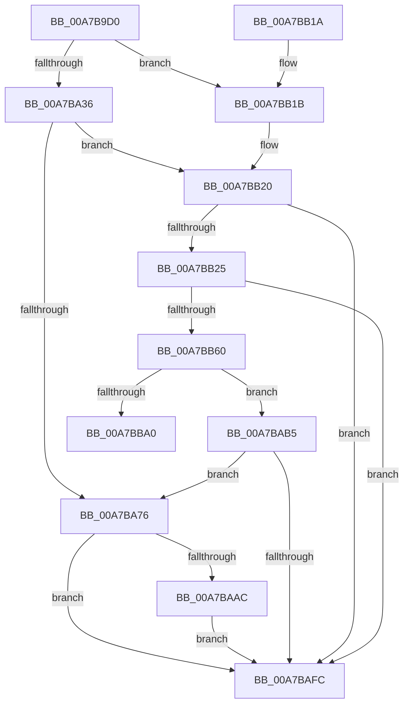

# ExCreateCallback

- RVA: `0x00A7B9D0`–`0x00A7BBA7` (길이 `471` bytes)
- VA: `0x0000000140A7B9D0`
- 실행 섹션: `PAGE`
- PDB 이름 있음: `예`; PDB Function 태그: `아니요`
- unwind 정보 RVA: `0x000B6718`
- 디코드: `122`개 명령, `471/471` bytes 표시
- 미해석 바이트: `0` (있으면 어셈블리에 `.byte`로 보존)

> 이 문서는 커널 이미지의 기계어와 PDB 기호를 분석해 생성했습니다. 4번과 5번은 함수 원형과 자료형을 바이너리 사용 방식에서 추정한 C 해석이며 원본 소스 복구 결과는 아닙니다.

## 1. Dependencies

- 직접 호출 지점: **8**; 고유 호출 대상: **8**
- 직접 호출자로 확인된 함수: **17**
- RIP 상대 이미지 참조: **4**

### Outgoing calls
- `0x00A7BA3D` → [PsGetCurrentSilo](../../text/40/PsGetCurrentSilo_function_004094A0.md) (function, `0x004094A0`)
- `0x00A7BA67` → [ObOpenObjectByNameEx](../89/ObOpenObjectByNameEx_function_0089A8A0.md) (function, `0x0089A8A0`)
- `0x00A7BA98` → [ObReferenceObjectByHandle](../86/ObReferenceObjectByHandle_function_00868DB0.md) (function, `0x00868DB0`)
- `0x00A7BAA3` → [ZwClose](../../text/6A/ZwClose_function_006AD2B0.md) (function, `0x006AD2B0`)
- `0x00A7BAC9` → [ExpUnlockCallbackListExclusive](../../text/4D/ExpUnlockCallbackListExclusive_function_004D643C.md) (function, `0x004D643C`)
- `0x00A7BAED` → [ObInsertObjectEx](../8B/ObInsertObjectEx_function_008B97A0.md) (function, `0x008B97A0`)
- `0x00A7BB55` → [ObCreateObjectEx](../89/ObCreateObjectEx_function_0089B1E0.md) (function, `0x0089B1E0`)
- `0x00A7BB80` → [ExpLockCallbackListExclusive](../../text/4D/ExpLockCallbackListExclusive_function_004D7060.md) (function, `0x004D7060`)

### Direct callers
- [HvlPhase2Initialize](../../text/58/HvlPhase2Initialize_function_00583EA0.md) at `0x005840EB`
- [DifExCreateCallbackWrapper](../../text/61/DifExCreateCallbackWrapper_function_0061F290.md) at `0x0061F387`
- [HaliInitPowerManagement](../70/HaliInitPowerManagement_function_0070BAE0.md) at `0x0070BB95`
- [HalpMiscInitializeKsr](../70/HalpMiscInitializeKsr_function_0070C618.md) at `0x0070C692`
- [IoRegisterBootDriverCallback](../72/IoRegisterBootDriverCallback_function_00729980.md) at `0x007299FF`
- [KeRegisterProcessorChangeCallback](../74/KeRegisterProcessorChangeCallback_function_00746520.md) at `0x007465B2`
- [ExInitLicenseCallback](../7C/ExInitLicenseCallback_function_007C7B14.md) at `0x007C7B3A`
- [KiFilterFiberContext](../../init/BE/KiFilterFiberContext_function_00BEFB50.md) at `0x00BEFC4B`
- [IopInitializeSessionNotifications](../../init/C2/IopInitializeSessionNotifications_function_00C2E248.md) at `0x00C2E2C2`
- [PiCslInitialize](../../init/C3/PiCslInitialize_function_00C362B8.md) at `0x00C36323`
- [PiKsrNotifyInitialize](../../init/C3/PiKsrNotifyInitialize_function_00C36540.md) at `0x00C365F7`
- [PopSetupKsrCallbacks](../../init/C3/PopSetupKsrCallbacks_function_00C3F21C.md) at `0x00C3F296`
- [PopUmpoInitializeChannel](../../init/C4/PopUmpoInitializeChannel_function_00C428F0.md) at `0x00C42AC3`
- [PopUmpoInitializeMonitorChannel](../../init/C4/PopUmpoInitializeMonitorChannel_function_00C42B6C.md) at `0x00C42C5B`
- [SshpAlpcInitialize](../../init/C4/SshpAlpcInitialize_function_00C448B4.md) at `0x00C44AF2`
- [EtwpInitializeKsrSupport](../../init/C4/EtwpInitializeKsrSupport_function_00C4F458.md) at `0x00C4F4D0`
- [ExpInitializeCallbacks](../../init/C5/ExpInitializeCallbacks_function_00C532CC.md) at `0x00C53481`

### Static image references
- `0x00A7BA36` → RVA `0x00FC7008` (`ALMOSTRO`; read)
- `0x00A7BABF` → RVA `0x00EFACB8` (`.data`; write)
- `0x00A7BB85` → RVA `0x00EFACB8` (`.data`; read)
- `0x00A7BB8C` → RVA `0x00EFACB0` (`.data`; read)

## 2. Other-region calls and transfers

- 다른 실행 섹션으로 향하는 call: **4**
  - `0x00A7BA3D` → [PsGetCurrentSilo](../../text/40/PsGetCurrentSilo_function_004094A0.md) (`PAGE` → `.text`)
  - `0x00A7BAA3` → [ZwClose](../../text/6A/ZwClose_function_006AD2B0.md) (`PAGE` → `.text`)
  - `0x00A7BAC9` → [ExpUnlockCallbackListExclusive](../../text/4D/ExpUnlockCallbackListExclusive_function_004D643C.md) (`PAGE` → `.text`)
  - `0x00A7BB80` → [ExpLockCallbackListExclusive](../../text/4D/ExpLockCallbackListExclusive_function_004D7060.md) (`PAGE` → `.text`)
- 별도 외부 분기/꼬리 이동을 확인하지 못했습니다.

## 3. Assembly (complete function range)

```asm
00A7B9D0  48 89 5C 24 08                  mov qword ptr [rsp + 8], rbx
00A7B9D5  48 89 74 24 18                  mov qword ptr [rsp + 0x18], rsi
00A7B9DA  55                              push rbp
00A7B9DB  57                              push rdi
00A7B9DC  41 54                           push r12
00A7B9DE  41 56                           push r14
00A7B9E0  41 57                           push r15
00A7B9E2  48 8D 6C 24 C9                  lea rbp, [rsp - 0x37]
00A7B9E7  48 81 EC 90 00 00 00            sub rsp, 0x90
00A7B9EE  65 48 8B 34 25 88 01 00 00      mov rsi, qword ptr gs:[0x188]
00A7B9F7  45 33 E4                        xor r12d, r12d
00A7B9FA  0F 10 02                        movups xmm0, xmmword ptr [rdx]
00A7B9FD  8B 42 18                        mov eax, dword ptr [rdx + 0x18]
00A7BA00  45 8A F9                        mov r15b, r9b
00A7BA03  0F 10 4A 10                     movups xmm1, xmmword ptr [rdx + 0x10]
00A7BA07  0F BA E8 09                     bts eax, 9
00A7BA0B  4C 89 65 6F                     mov qword ptr [rbp + 0x6f], r12
00A7BA0F  0F 11 45 FF                     movups xmmword ptr [rbp - 1], xmm0
00A7BA13  41 8A F8                        mov dil, r8b
00A7BA16  4C 8B F1                        mov r14, rcx
00A7BA19  0F 10 42 20                     movups xmm0, xmmword ptr [rdx + 0x20]
00A7BA1D  4C 89 65 F7                     mov qword ptr [rbp - 9], r12
00A7BA21  0F 11 4D 0F                     movups xmmword ptr [rbp + 0xf], xmm1
00A7BA25  89 45 17                        mov dword ptr [rbp + 0x17], eax
00A7BA28  0F 11 45 1F                     movups xmmword ptr [rbp + 0x1f], xmm0
00A7BA2C  4C 39 65 0F                     cmp qword ptr [rbp + 0xf], r12
00A7BA30  0F 84 E5 00 00 00               je 0x140a7bb1b
00A7BA36  48 8B 1D CB B5 54 00            mov rbx, qword ptr [rip + 0x54b5cb]
00A7BA3D  E8 5E DA 98 FF                  call 0x1404094a0
00A7BA42  48 8D 4D 6F                     lea rcx, [rbp + 0x6f]
00A7BA46  45 33 C9                        xor r9d, r9d
00A7BA49  48 89 4C 24 38                  mov qword ptr [rsp + 0x38], rcx
00A7BA4E  45 33 C0                        xor r8d, r8d
00A7BA51  48 89 44 24 30                  mov qword ptr [rsp + 0x30], rax
00A7BA56  48 8D 4D FF                     lea rcx, [rbp - 1]
00A7BA5A  4C 89 64 24 28                  mov qword ptr [rsp + 0x28], r12
00A7BA5F  48 8B D3                        mov rdx, rbx
00A7BA62  44 89 64 24 20                  mov dword ptr [rsp + 0x20], r12d
00A7BA67  E8 34 EE E1 FF                  call 0x14089a8a0
00A7BA6C  8B D8                           mov ebx, eax
00A7BA6E  85 C0                           test eax, eax
00A7BA70  0F 88 AA 00 00 00               js 0x140a7bb20
00A7BA76  4C 8B 05 8B B5 54 00            mov r8, qword ptr [rip + 0x54b58b]
00A7BA7D  48 8D 45 F7                     lea rax, [rbp - 9]
00A7BA81  48 8B 4D 6F                     mov rcx, qword ptr [rbp + 0x6f]
00A7BA85  45 33 C9                        xor r9d, r9d
00A7BA88  4C 89 64 24 28                  mov qword ptr [rsp + 0x28], r12
00A7BA8D  33 D2                           xor edx, edx
00A7BA8F  48 89 44 24 20                  mov qword ptr [rsp + 0x20], rax
00A7BA94  4C 89 65 F7                     mov qword ptr [rbp - 9], r12
00A7BA98  E8 13 D3 DE FF                  call 0x140868db0
00A7BA9D  48 8B 4D 6F                     mov rcx, qword ptr [rbp + 0x6f]
00A7BAA1  8B D8                           mov ebx, eax
00A7BAA3  E8 08 18 C3 FF                  call 0x1406ad2b0
00A7BAA8  85 DB                           test ebx, ebx
00A7BAAA  78 50                           js 0x140a7bafc
00A7BAAC  48 8B 45 F7                     mov rax, qword ptr [rbp - 9]
00A7BAB0  49 89 06                        mov qword ptr [r14], rax
00A7BAB3  EB 47                           jmp 0x140a7bafc
00A7BAB5  48 89 11                        mov qword ptr [rcx], rdx
00A7BAB8  48 89 41 08                     mov qword ptr [rcx + 8], rax
00A7BABC  48 89 08                        mov qword ptr [rax], rcx
00A7BABF  48 89 0D F2 F1 47 00            mov qword ptr [rip + 0x47f1f2], rcx
00A7BAC6  48 8B CE                        mov rcx, rsi
00A7BAC9  E8 6E A9 A5 FF                  call 0x1404d643c
00A7BACE  45 33 C9                        xor r9d, r9d
00A7BAD1  48 8D 45 6F                     lea rax, [rbp + 0x6f]
00A7BAD5  48 89 44 24 30                  mov qword ptr [rsp + 0x30], rax
00A7BADA  33 D2                           xor edx, edx
00A7BADC  4C 89 64 24 28                  mov qword ptr [rsp + 0x28], r12
00A7BAE1  48 8B CB                        mov rcx, rbx
00A7BAE4  44 89 64 24 20                  mov dword ptr [rsp + 0x20], r12d
00A7BAE9  45 8D 41 01                     lea r8d, [r9 + 1]
00A7BAED  E8 AE DC E3 FF                  call 0x1408b97a0
00A7BAF2  8B D8                           mov ebx, eax
00A7BAF4  85 C0                           test eax, eax
00A7BAF6  0F 89 7A FF FF FF               jns 0x140a7ba76
00A7BAFC  4C 8D 9C 24 90 00 00 00         lea r11, [rsp + 0x90]
00A7BB04  8B C3                           mov eax, ebx
00A7BB06  49 8B 5B 30                     mov rbx, qword ptr [r11 + 0x30]
00A7BB0A  49 8B 73 40                     mov rsi, qword ptr [r11 + 0x40]
00A7BB0E  49 8B E3                        mov rsp, r11
00A7BB11  41 5F                           pop r15
00A7BB13  41 5E                           pop r14
00A7BB15  41 5C                           pop r12
00A7BB17  5F                              pop rdi
00A7BB18  5D                              pop rbp
00A7BB19  C3                              ret
00A7BB1A  CC                              int3
00A7BB1B  BB 01 00 00 C0                  mov ebx, 0xc0000001
00A7BB20  40 84 FF                        test dil, dil
00A7BB23  74 D7                           je 0x140a7bafc
00A7BB25  48 8B 15 DC B4 54 00            mov rdx, qword ptr [rip + 0x54b4dc]
00A7BB2C  48 8D 45 F7                     lea rax, [rbp - 9]
00A7BB30  4C 89 64 24 48                  mov qword ptr [rsp + 0x48], r12
00A7BB35  4C 8D 45 FF                     lea r8, [rbp - 1]
00A7BB39  48 89 44 24 40                  mov qword ptr [rsp + 0x40], rax
00A7BB3E  45 33 C9                        xor r9d, r9d
00A7BB41  44 89 64 24 38                  mov dword ptr [rsp + 0x38], r12d
00A7BB46  33 C9                           xor ecx, ecx
00A7BB48  44 89 64 24 30                  mov dword ptr [rsp + 0x30], r12d
00A7BB4D  C7 44 24 28 38 00 00 00         mov dword ptr [rsp + 0x28], 0x38
00A7BB55  E8 86 F6 E1 FF                  call 0x14089b1e0
00A7BB5A  8B D8                           mov ebx, eax
00A7BB5C  85 C0                           test eax, eax
00A7BB5E  78 9C                           js 0x140a7bafc
00A7BB60  48 8B 5D F7                     mov rbx, qword ptr [rbp - 9]
00A7BB64  48 8B CE                        mov rcx, rsi
00A7BB67  C7 03 43 61 6C 6C               mov dword ptr [rbx], 0x6c6c6143
00A7BB6D  48 8D 43 10                     lea rax, [rbx + 0x10]
00A7BB71  44 88 7B 20                     mov byte ptr [rbx + 0x20], r15b
00A7BB75  48 89 40 08                     mov qword ptr [rax + 8], rax
00A7BB79  48 89 00                        mov qword ptr [rax], rax
00A7BB7C  4C 89 63 08                     mov qword ptr [rbx + 8], r12
00A7BB80  E8 DB B4 A5 FF                  call 0x1404d7060
00A7BB85  48 8B 05 2C F1 47 00            mov rax, qword ptr [rip + 0x47f12c]
00A7BB8C  48 8D 15 1D F1 47 00            lea rdx, [rip + 0x47f11d]
00A7BB93  48 8D 4B 28                     lea rcx, [rbx + 0x28]
00A7BB97  48 39 10                        cmp qword ptr [rax], rdx
00A7BB9A  0F 84 15 FF FF FF               je 0x140a7bab5
00A7BBA0  B9 03 00 00 00                  mov ecx, 3
00A7BBA5  CD 29                           int 0x29
```

## 4. C-style interpretation (structured pseudocode)

```c
__int64 __fastcall ExCreateCallback(__int64 a1, __int64 a2, int a3, int a4)
{
    __int64 result;
    __int64 v_r12;
    __int64 v_rsp;
    unsigned __int64 v_stack_m28;
    unsigned __int64 v_stack_m40;
    unsigned int v_stack_m48;
    unsigned __int64 v_stack_m50;
    unsigned int v_stack_m58;
    unsigned __int64 v_stack_m5F;
    unsigned __int64 v_stack_m60;
    unsigned __int64 v_stack_m68;
    unsigned __int64 v_stack_m80;
    unsigned __int64 v_stack_m88;
    unsigned __int64 v_stack_m90;
    unsigned int v_stack_m98;
    unsigned __int64 v_stack_p10;
    unsigned __int64 v_stack_p18;
    unsigned __int64 v_stack_p8;

    v_stack_p8 = v_rbx;
    v_stack_p18 = v_rsi;
    v_rsp = (v_rsp) - (144);
    v_r12 = 0;
    v_stack_p10 = 0;
    v_stack_m60 = v_xmm0;
    v_stack_m68 = 0;
    v_stack_m50 = v_xmm1;
    v_stack_m48 = (unsigned int)((unsigned int)(*(unsigned int *)(a2 + 24)));
    v_stack_m40 = v_xmm0;
    if (v_stack_m50 == 0) goto loc_00A7BB1B;
    result = PsGetCurrentSilo(a1, a2, a3, a4);
    a4 = 0;
    v_stack_m80 = v_stack_p10;
    a3 = 0;
    v_stack_m88 = result;
    v_stack_m90 = 0;
    v_stack_m98 = 0;
    result = ObOpenObjectByNameEx(v_stack_m60, *(unsigned __int64 *)(v_rip + 5551563), a3, a4);
    if (sign_flag) goto loc_00A7BB20;
loc_00A7BA76:
    a4 = 0;
    v_stack_m90 = 0;
    a2 = 0;
    v_stack_m98 = v_stack_m68;
    v_stack_m68 = 0;
    result = ObReferenceObjectByHandle(v_stack_p10, a2, *(unsigned __int64 *)(v_rip + 5551499), a4);
    result = ZwClose(v_stack_p10, a2, *(unsigned __int64 *)(v_rip + 5551499), a4);
    if (sign_flag) goto loc_00A7BAFC;
    *(unsigned __int64 *)(a1) = v_stack_m68;
    goto loc_00A7BAFC;
loc_00A7BAB5:
    *(unsigned __int64 *)(v_stack_p10) = 0;
    *(unsigned __int64 *)(v_stack_p10 + 8) = v_stack_m68;
    *(unsigned __int64 *)(v_stack_m68) = v_stack_p10;
    *(unsigned __int64 *)(v_rip + 4714994) = v_stack_p10;
    result = ExpUnlockCallbackListExclusive(*(unsigned __int64 *)(gs_base + (0 + 392)), a2, *(unsigned __int64 *)(v_rip + 5551499), a4);
    a4 = 0;
    v_stack_m88 = v_stack_p10;
    a2 = 0;
    v_stack_m90 = 0;
    v_stack_m98 = 0;
    result = ObInsertObjectEx((unsigned int)((unsigned int)(result)), a2, a4 + 1, a4);
    if (!sign_flag) goto loc_00A7BA76;
loc_00A7BAFC:
    return (unsigned int)((unsigned int)((unsigned int)((unsigned int)(result))));
loc_00A7BB1B:
loc_00A7BB20:
    if ((unsigned __int8)((unsigned __int8)(a3)) == 0) goto loc_00A7BAFC;
    v_stack_m48 = 0;
    v_stack_m50 = v_stack_m68;
    a4 = 0;
    v_stack_m58 = 0;
    a1 = 0;
    v_stack_m60 = 0;
    v_stack_m68 = 56;
    result = ObCreateObjectEx(a1, *(unsigned __int64 *)(v_rip + 5551324), v_stack_m60, a4);
    if (sign_flag) goto loc_00A7BAFC;
    *(unsigned int *)(v_stack_m68) = 0x6C6C6143ULL;
    *(unsigned __int8 *)(v_stack_m68 + 32) = (unsigned __int8)((unsigned __int8)(a4));
    *(unsigned __int64 *)(v_stack_m68 + 16 + 8) = v_stack_m68 + 16;
    *(unsigned __int64 *)(v_stack_m68 + 16) = v_stack_m68 + 16;
    *(unsigned __int64 *)(v_stack_m68 + 8) = 0;
    result = ExpLockCallbackListExclusive(*(unsigned __int64 *)(v_stack_m28 + 64), *(unsigned __int64 *)(v_rip + 5551324), v_stack_m60, a4);
    if ((*(unsigned __int64 *)(*(unsigned __int64 *)(v_rip + 4714796))) == (v_rip + 4714781)) goto loc_00A7BAB5;
    return *(unsigned __int64 *)(v_rip + 4714796);
}
```

## 5. (Beta) C Style

```c
int64_t ExCreateCallback(void *Arg1, void *Arg2, int32_t Arg3, int32_t Arg4)
{
    uint8_t *arg1 = (uint8_t *)Arg1;
    uint8_t *arg2 = (uint8_t *)Arg2;

    int64_t result;
    int64_t local_r12;
    int64_t local_rsp;
    uint64_t v_stack_m28;
    uint64_t v_stack_m40;
    uint32_t v_stack_m48;
    uint64_t v_stack_m50;
    uint32_t v_stack_m58;
    uint64_t v_stack_m5F;
    uint64_t v_stack_m60;
    uint64_t v_stack_m68;
    uint64_t v_stack_m80;
    uint64_t v_stack_m88;
    uint64_t v_stack_m90;
    uint32_t v_stack_m98;
    uint64_t v_stack_p10;
    uint64_t v_stack_p18;
    uint64_t v_stack_p8;

    v_stack_p8 = local_rbx;
    v_stack_p18 = local_rsi;
    local_rsp = (local_rsp) - (144);
    local_r12 = 0;
    v_stack_p10 = 0;
    v_stack_m60 = v_xmm0;
    v_stack_m68 = 0;
    v_stack_m50 = v_xmm1;
    v_stack_m48 = (uint32_t)((uint32_t)(*(uint32_t *)(arg2 + 0x18)));
    v_stack_m40 = v_xmm0;
    if (v_stack_m50 == 0) goto loc_00A7BB1B;
    result = PsGetCurrentSilo(Arg1, Arg2, Arg3, Arg4);
    Arg4 = 0;
    v_stack_m80 = v_stack_p10;
    Arg3 = 0;
    v_stack_m88 = result;
    v_stack_m90 = 0;
    v_stack_m98 = 0;
    result = ObOpenObjectByNameEx(v_stack_m60, *(uint64_t *)(v_rip + 0x54B5CB), Arg3, Arg4);
    if (sign_flag) goto loc_00A7BB20;
loc_00A7BA76:
    Arg4 = 0;
    v_stack_m90 = 0;
    Arg2 = 0;
    v_stack_m98 = v_stack_m68;
    v_stack_m68 = 0;
    result = ObReferenceObjectByHandle(v_stack_p10, Arg2, *(uint64_t *)(v_rip + 0x54B58B), Arg4);
    result = ZwClose(v_stack_p10, Arg2, *(uint64_t *)(v_rip + 0x54B58B), Arg4);
    if (sign_flag) goto loc_00A7BAFC;
    *(uint64_t *)(arg1) = v_stack_m68;
    goto loc_00A7BAFC;
loc_00A7BAB5:
    *(uint64_t *)(v_stack_p10) = 0;
    *(uint64_t *)(v_stack_p10 + 0x8) = v_stack_m68;
    *(uint64_t *)(v_stack_m68) = v_stack_p10;
    *(uint64_t *)(v_rip + 0x47F1F2) = v_stack_p10;
    result = ExpUnlockCallbackListExclusive(*(uint64_t *)(gs_base + (0 + 0x188)), Arg2, *(uint64_t *)(v_rip + 0x54B58B), Arg4);
    Arg4 = 0;
    v_stack_m88 = v_stack_p10;
    Arg2 = 0;
    v_stack_m90 = 0;
    v_stack_m98 = 0;
    result = ObInsertObjectEx((uint32_t)((uint32_t)(result)), Arg2, Arg4 + 1, Arg4);
    if (!sign_flag) goto loc_00A7BA76;
loc_00A7BAFC:
    return (uint32_t)((uint32_t)((uint32_t)((uint32_t)(result))));
loc_00A7BB1B:
loc_00A7BB20:
    if ((uint8_t)((uint8_t)(Arg3)) == 0) goto loc_00A7BAFC;
    v_stack_m48 = 0;
    v_stack_m50 = v_stack_m68;
    Arg4 = 0;
    v_stack_m58 = 0;
    Arg1 = 0;
    v_stack_m60 = 0;
    v_stack_m68 = 56;
    result = ObCreateObjectEx(Arg1, *(uint64_t *)(v_rip + 0x54B4DC), v_stack_m60, Arg4);
    if (sign_flag) goto loc_00A7BAFC;
    *(uint32_t *)(v_stack_m68) = 0x6C6C6143ULL;
    *(uint8_t *)(v_stack_m68 + 0x20) = (uint8_t)((uint8_t)(Arg4));
    *(uint64_t *)(v_stack_m68 + 0x10 + 0x8) = v_stack_m68 + 16;
    *(uint64_t *)(v_stack_m68 + 0x10) = v_stack_m68 + 16;
    *(uint64_t *)(v_stack_m68 + 0x8) = 0;
    result = ExpLockCallbackListExclusive(*(uint64_t *)(v_stack_m28 + 0x40), *(uint64_t *)(v_rip + 0x54B4DC), v_stack_m60, Arg4);
    if ((*(uint64_t *)(*(uint64_t *)(v_rip + 0x47F12C))) == (v_rip + 4714781)) goto loc_00A7BAB5;
    return *(uint64_t *)(v_rip + 0x47F12C);
}
```

### 관측된 메모리 오프셋

구조체 형식이 확인되지 않은 접근은 인자 기준의 오프셋으로만 기록했습니다.

| 기준 인자 | 오프셋 표현 | 폭 (bit) | 접근 |
|---|---:|---:|---|
| `Arg1` | `+ 0x0` | `64` | `W` |
| `Arg2` | `+ 0x0` | `128` | `R` |
| `Arg2` | `+ 0x10` | `128` | `R` |
| `Arg2` | `+ 0x18` | `32` | `R` |
| `Arg2` | `+ 0x20` | `128` | `R` |

## 6. Execution-region graph

[열기: 2D/3D 그래프와 함수 탐색 컨트롤 패널](../../../control-panel.html?section=page&rva=0x00A7B9D0&view=graph)

- 2D 그래프는 위에서 아래로 흐르고, 3D 그래프는 빈 공간을 드래그해 회전합니다. Shift+드래그는 이동, 휠은 확대·축소, 함수 노드 선택은 대상 보고서 이동입니다.

### Static fallback


