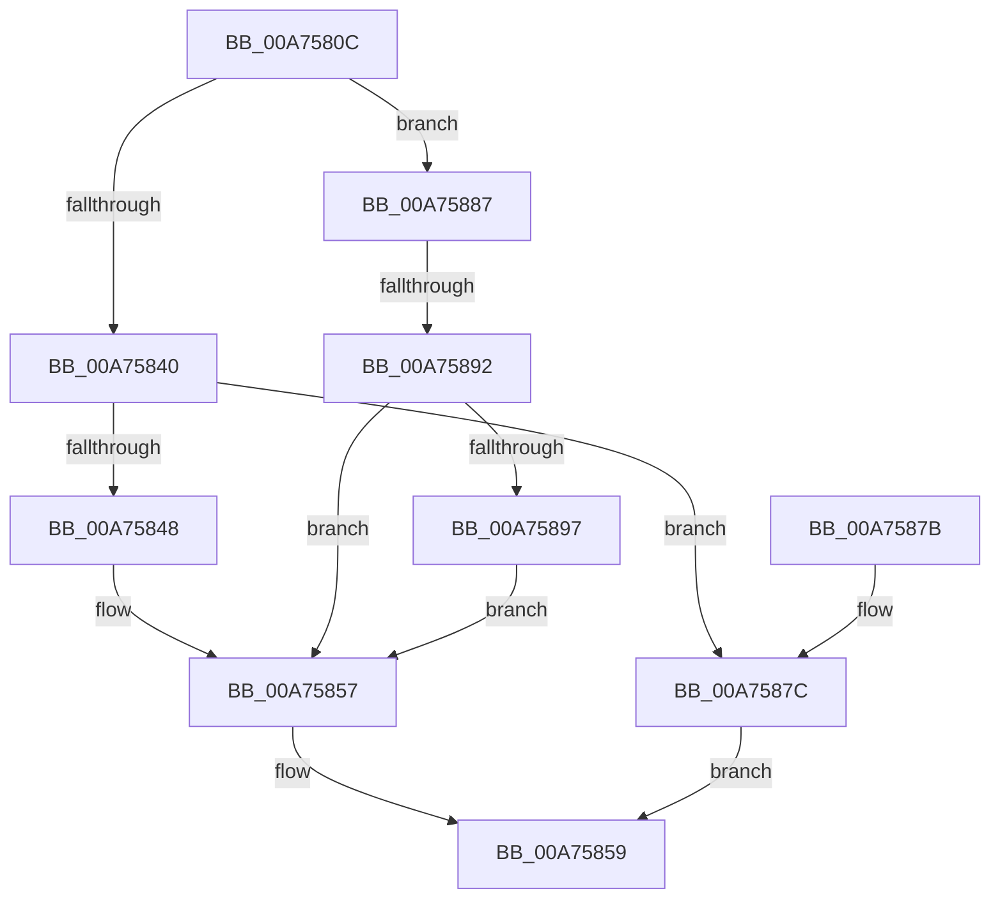

# ExEnableHandleExceptions

- RVA: `0x00A7580C`–`0x00A7589F` (길이 `147` bytes)
- VA: `0x0000000140A7580C`
- 실행 섹션: `PAGE`
- PDB 이름 있음: `예`; PDB Function 태그: `예`
- unwind 정보 RVA: `0x0007AE84`
- 디코드: `47`개 명령, `147/147` bytes 표시
- 미해석 바이트: `0` (있으면 어셈블리에 `.byte`로 보존)

> 이 문서는 커널 이미지의 기계어와 PDB 기호를 분석해 생성했습니다. 4번과 5번은 함수 원형과 자료형을 바이너리 사용 방식에서 추정한 C 해석이며 원본 소스 복구 결과는 아닙니다.

## 1. Dependencies

- 직접 호출 지점: **2**; 고유 호출 대상: **2**
- 직접 호출자로 확인된 함수: **1**
- RIP 상대 이미지 참조: **0**

### Outgoing calls
- `0x00A75832` → [ExpLockHandleTableExclusive](../../text/45/ExpLockHandleTableExclusive_function_00458B08.md) (function, `0x00458B08`)
- `0x00A7585F` → [ExpUnlockHandleTableExclusive](../../text/46/ExpUnlockHandleTableExclusive_function_004608A8.md) (function, `0x004608A8`)

### Direct callers
- [NtSetInformationProcess](../AE/NtSetInformationProcess_function_00AE5370.md) at `0x00AE7B42`
- [NtSetInformationProcess](../AE/NtSetInformationProcess_function_00AE5370.md) at `0x00AE8ABC`

### Static image references
- 디코드된 RIP-relative 메모리 참조가 없습니다.

## 2. Other-region calls and transfers

- 다른 실행 섹션으로 향하는 call: **2**
  - `0x00A75832` → [ExpLockHandleTableExclusive](../../text/45/ExpLockHandleTableExclusive_function_00458B08.md) (`PAGE` → `.text`)
  - `0x00A7585F` → [ExpUnlockHandleTableExclusive](../../text/46/ExpUnlockHandleTableExclusive_function_004608A8.md) (`PAGE` → `.text`)
- call이 아닌 외부 분기/꼬리 이동: **1**
  - `0x00A7588C` → [sub_00B4107A](../B4/Unknown_function_00B4107A.md) (`tail-transfer`)

## 3. Assembly (complete function range)

```asm
00A7580C  48 89 5C 24 08                  mov qword ptr [rsp + 8], rbx
00A75811  48 89 6C 24 10                  mov qword ptr [rsp + 0x10], rbp
00A75816  48 89 74 24 18                  mov qword ptr [rsp + 0x18], rsi
00A7581B  57                              push rdi
00A7581C  48 83 EC 20                     sub rsp, 0x20
00A75820  65 48 8B 2C 25 88 01 00 00      mov rbp, qword ptr gs:[0x188]
00A75829  40 8A FA                        mov dil, dl
00A7582C  48 8B D5                        mov rdx, rbp
00A7582F  48 8B F1                        mov rsi, rcx
00A75832  E8 D1 32 9E FF                  call 0x140458b08
00A75837  48 8B 4E 60                     mov rcx, qword ptr [rsi + 0x60]
00A7583B  48 85 C9                        test rcx, rcx
00A7583E  75 47                           jne 0x140a75887
00A75840  8A 4E 2C                        mov cl, byte ptr [rsi + 0x2c]
00A75843  F6 C1 02                        test cl, 2
00A75846  75 34                           jne 0x140a7587c
00A75848  40 F6 DF                        neg dil
00A7584B  1A C0                           sbb al, al
00A7584D  80 E1 FD                        and cl, 0xfd
00A75850  24 02                           and al, 2
00A75852  0A C1                           or al, cl
00A75854  88 46 2C                        mov byte ptr [rsi + 0x2c], al
00A75857  B3 01                           mov bl, 1
00A75859  48 8B D5                        mov rdx, rbp
00A7585C  48 8B CE                        mov rcx, rsi
00A7585F  E8 44 B0 9E FF                  call 0x1404608a8
00A75864  48 8B 6C 24 38                  mov rbp, qword ptr [rsp + 0x38]
00A75869  8A C3                           mov al, bl
00A7586B  48 8B 5C 24 30                  mov rbx, qword ptr [rsp + 0x30]
00A75870  48 8B 74 24 40                  mov rsi, qword ptr [rsp + 0x40]
00A75875  48 83 C4 20                     add rsp, 0x20
00A75879  5F                              pop rdi
00A7587A  C3                              ret
00A7587B  CC                              int3
00A7587C  40 F6 DF                        neg dil
00A7587F  B1 01                           mov cl, 1
00A75881  1A DB                           sbb bl, bl
00A75883  22 D9                           and bl, cl
00A75885  EB D2                           jmp 0x140a75859
00A75887  8B 41 08                        mov eax, dword ptr [rcx + 8]
00A7588A  A8 08                           test al, 8
00A7588C  0F 85 E8 B7 0C 00               jne 0x140b4107a
00A75892  40 84 FF                        test dil, dil
00A75895  74 C0                           je 0x140a75857
00A75897  83 C8 08                        or eax, 8
00A7589A  89 41 08                        mov dword ptr [rcx + 8], eax
00A7589D  EB B8                           jmp 0x140a75857
```

## 4. C-style interpretation (structured pseudocode)

```c
__int64 __fastcall ExEnableHandleExceptions(__int64 a1, unsigned __int8 a2)
{
    __int64 result;
    __int64 v_rbx;
    __int64 v_rdi;
    __int64 v_rsp;
    unsigned __int64 v_stack_p10;
    unsigned __int64 v_stack_p18;
    unsigned __int64 v_stack_p8;

    v_stack_p8 = v_rbx;
    v_stack_p10 = v_rbp;
    v_stack_p18 = v_rsi;
    v_rsp = (v_rsp) - (32);
    result = ExpLockHandleTableExclusive(a1, *(unsigned __int64 *)(gs_base + (0 + 392)), a3, a4);
    if (*(unsigned __int64 *)(a1 + 96) != 0) goto loc_00A75887;
    if ((((unsigned __int8)(*(unsigned __int8 *)(a1 + 44))) & (2)) != 0) goto loc_00A7587C;
    v_rdi = (unsigned __int8)(-(a2));
    a1 = (unsigned __int8)((*(unsigned __int8 *)(a1 + 44)) & (253));
    result = (unsigned __int8)((result) & (2));
    result = (unsigned __int8)((result) | ((unsigned __int8)(a1)));
    *(unsigned __int8 *)(a1 + 44) = (unsigned __int8)(result);
loc_00A75857:
loc_00A75859:
    result = ExpUnlockHandleTableExclusive(a1, *(unsigned __int64 *)(gs_base + (0 + 392)), a3, a4);
    v_rsp = (v_rsp) + (32);
    return 1;
loc_00A7587C:
    v_rdi = (unsigned __int8)(-(v_rdi));
    v_rbx = (unsigned __int8)((v_stack_p8) & (1));
    goto loc_00A75859;
loc_00A75887:
    if ((unsigned __int8)(v_rdi) == 0) goto loc_00A75857;
    result = (unsigned int)(((unsigned int)(*(unsigned int *)(1 + 8))) | (8));
    *(unsigned int *)(1 + 8) = (unsigned int)(result);
    goto loc_00A75857;
}
```

## 5. (Beta) C Style

```c
int64_t ExEnableHandleExceptions(void *Arg1, uint8_t Arg2)
{
    uint8_t *arg1 = (uint8_t *)Arg1;

    int64_t result;
    int64_t local_rbx;
    int64_t local_rdi;
    int64_t local_rsp;
    uint64_t v_stack_p10;
    uint64_t v_stack_p18;
    uint64_t v_stack_p8;

    v_stack_p8 = local_rbx;
    v_stack_p10 = local_rbp;
    v_stack_p18 = local_rsi;
    local_rsp = (local_rsp) - (32);
    result = ExpLockHandleTableExclusive(Arg1, *(uint64_t *)(gs_base + (0 + 0x188)), a3, a4);
    if (*(uint64_t *)(arg1 + 0x60) != 0) goto loc_00A75887;
    if ((((uint8_t)(*(uint8_t *)(arg1 + 0x2C))) & (2)) != 0) goto loc_00A7587C;
    local_rdi = (uint8_t)(-(Arg2));
    Arg1 = (uint8_t)((*(uint8_t *)(arg1 + 0x2C)) & (253));
    result = (uint8_t)((result) & (2));
    result = (uint8_t)((result) | ((uint8_t)(Arg1)));
    *(uint8_t *)(arg1 + 0x2C) = (uint8_t)(result);
loc_00A75857:
loc_00A75859:
    result = ExpUnlockHandleTableExclusive(Arg1, *(uint64_t *)(gs_base + (0 + 0x188)), a3, a4);
    local_rsp = (local_rsp) + (32);
    return 1;
loc_00A7587C:
    local_rdi = (uint8_t)(-(local_rdi));
    local_rbx = (uint8_t)((v_stack_p8) & (1));
    goto loc_00A75859;
loc_00A75887:
    if ((uint8_t)(local_rdi) == 0) goto loc_00A75857;
    result = (uint32_t)(((uint32_t)(*(uint32_t *)(1 + 0x8))) | (8));
    *(uint32_t *)(1 + 0x8) = (uint32_t)(result);
    goto loc_00A75857;
}
```

### 관측된 메모리 오프셋

구조체 형식이 확인되지 않은 접근은 인자 기준의 오프셋으로만 기록했습니다.

| 기준 인자 | 오프셋 표현 | 폭 (bit) | 접근 |
|---|---:|---:|---|
| `Arg1` | `+ 0x2C` | `8` | `R` |
| `Arg1` | `+ 0x2C` | `8` | `W` |
| `Arg1` | `+ 0x60` | `64` | `R` |

## 6. Execution-region graph

[열기: 2D/3D 그래프와 함수 탐색 컨트롤 패널](../../../control-panel.html?section=page&rva=0x00A7580C&view=graph)

- 2D 그래프는 위에서 아래로 흐르고, 3D 그래프는 빈 공간을 드래그해 회전합니다. Shift+드래그는 이동, 휠은 확대·축소, 함수 노드 선택은 대상 보고서 이동입니다.

### Static fallback


