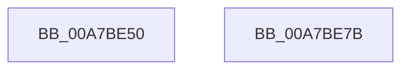

# ExUnsubscribeWnfStateChange

- RVA: `0x00A7BE50`–`0x00A7BE7C` (길이 `44` bytes)
- VA: `0x0000000140A7BE50`
- 실행 섹션: `PAGE`
- PDB 이름 있음: `예`; PDB Function 태그: `아니요`
- unwind 정보 RVA: `0x0005C788`
- 디코드: `10`개 명령, `44/44` bytes 표시
- 미해석 바이트: `0` (있으면 어셈블리에 `.byte`로 보존)

> 이 문서는 커널 이미지의 기계어와 PDB 기호를 분석해 생성했습니다. 4번과 5번은 함수 원형과 자료형을 바이너리 사용 방식에서 추정한 C 해석이며 원본 소스 복구 결과는 아닙니다.

## 1. Dependencies

- 직접 호출 지점: **2**; 고유 호출 대상: **2**
- 직접 호출자로 확인된 함수: **6**
- RIP 상대 이미지 참조: **1**

### Outgoing calls
- `0x00A7BE6C` → [ExpWnfDeleteSubscription](../90/ExpWnfDeleteSubscription_function_00908528.md) (function, `0x00908528`)
- `0x00A7BE71` → [KeLeaveCriticalRegion](../../text/25/KeLeaveCriticalRegion_function_0025D8B0.md) (function, `0x0025D8B0`)

### Direct callers
- [CcContainerRestoreCallBack](../../text/57/CcContainerRestoreCallBack_function_0057B000.md) at `0x0057B036`
- [EtwpUnsubscribeContainerStateWnf](../../text/64/EtwpUnsubscribeContainerStateWnf_function_0064F340.md) at `0x0064F354`
- [PoRegisterForEffectivePowerModeNotifications](../75/PoRegisterForEffectivePowerModeNotifications_function_0075C210.md) at `0x0075C2FE`
- [PoUnregisterFromEffectivePowerModeNotifications](../75/PoUnregisterFromEffectivePowerModeNotifications_function_0075C340.md) at `0x0075C383`
- [RtlpCtContextFree](../79/RtlpCtContextFree_function_007948DC.md) at `0x007948EE`
- [CmFcpManagerPublishFeatureUsageDataBuffers](../A9/CmFcpManagerPublishFeatureUsageDataBuffers_function_00A9677C.md) at `0x00A96962`

### Static image references
- `0x00A7BE65` → RVA `0x00FC6AB0` (`ALMOSTRO`; read)

## 2. Other-region calls and transfers

- 다른 실행 섹션으로 향하는 call: **1**
  - `0x00A7BE71` → [KeLeaveCriticalRegion](../../text/25/KeLeaveCriticalRegion_function_0025D8B0.md) (`PAGE` → `.text`)
- 별도 외부 분기/꼬리 이동을 확인하지 못했습니다.

## 3. Assembly (complete function range)

```asm
00A7BE50  48 83 EC 28                     sub rsp, 0x28
00A7BE54  65 48 8B 04 25 88 01 00 00      mov rax, qword ptr gs:[0x188]
00A7BE5D  66 FF 88 E4 01 00 00            dec word ptr [rax + 0x1e4]
00A7BE64  90                              nop
00A7BE65  48 8B 15 44 AC 54 00            mov rdx, qword ptr [rip + 0x54ac44]
00A7BE6C  E8 B7 C6 E8 FF                  call 0x140908528
00A7BE71  E8 3A 1A 7E FF                  call 0x14025d8b0
00A7BE76  48 83 C4 28                     add rsp, 0x28
00A7BE7A  C3                              ret
00A7BE7B  CC                              int3
```

## 4. C-style interpretation (structured pseudocode)

```c
__int64 __fastcall ExUnsubscribeWnfStateChange(void)
{
    __int64 result;
    __int64 v_rsp;

    v_rsp = (v_rsp) - (40);
    result = ExpWnfDeleteSubscription(a1, *(unsigned __int64 *)(v_rip + 5549124), a3, a4);
    result = KeLeaveCriticalRegion(a1, *(unsigned __int64 *)(v_rip + 5549124), a3, a4);
    v_rsp = (v_rsp) + (40);
    return result;
}
```

## 5. (Beta) C Style

```c
void ExUnsubscribeWnfStateChange(void)
{
    int64_t result;
    int64_t local_rsp;

    local_rsp = (local_rsp) - (40);
    result = ExpWnfDeleteSubscription(a1, *(uint64_t *)(v_rip + 0x54AC44), a3, a4);
    result = KeLeaveCriticalRegion(a1, *(uint64_t *)(v_rip + 0x54AC44), a3, a4);
    local_rsp = (local_rsp) + (40);
    return result;
}
```

## 6. Execution-region graph

[열기: 2D/3D 그래프와 함수 탐색 컨트롤 패널](../../../control-panel.html?section=page&rva=0x00A7BE50&view=graph)

- 2D 그래프는 위에서 아래로 흐르고, 3D 그래프는 빈 공간을 드래그해 회전합니다. Shift+드래그는 이동, 휠은 확대·축소, 함수 노드 선택은 대상 보고서 이동입니다.

### Static fallback


