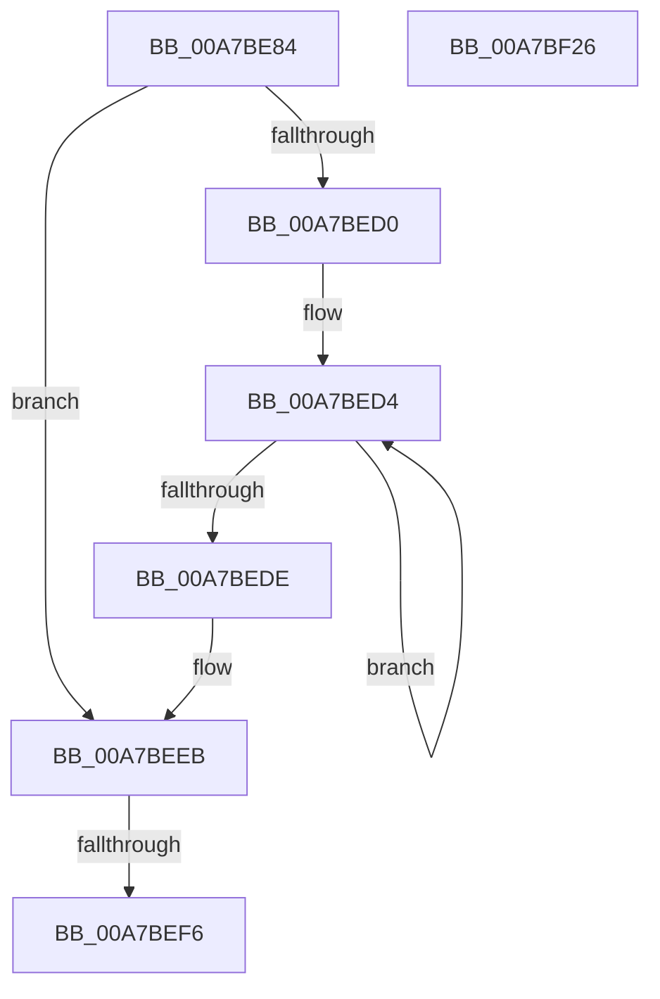

# ExpCreateOutputEFI

- RVA: `0x00A7BE84`–`0x00A7BF27` (길이 `163` bytes)
- VA: `0x0000000140A7BE84`
- 실행 섹션: `PAGE`
- PDB 이름 있음: `예`; PDB Function 태그: `예`
- unwind 정보 RVA: `0x000B67C8`
- 디코드: `51`개 명령, `163/163` bytes 표시
- 미해석 바이트: `0` (있으면 어셈블리에 `.byte`로 보존)

> 이 문서는 커널 이미지의 기계어와 PDB 기호를 분석해 생성했습니다. 4번과 5번은 함수 원형과 자료형을 바이너리 사용 방식에서 추정한 C 해석이며 원본 소스 복구 결과는 아닙니다.

## 1. Dependencies

- 직접 호출 지점: **1**; 고유 호출 대상: **1**
- 직접 호출자로 확인된 함수: **2**
- RIP 상대 이미지 참조: **1**

### Outgoing calls
- `0x00A7BF09` → [_security_check_cookie](../../text/6A/_security_check_cookie_function_006AC640.md) (function, `0x006AC640`)

### Direct callers
- [ExpConvertSignatureName](../7C/ExpConvertSignatureName_function_007CB0C8.md) at `0x007CB1A1`
- [ExpTranslateNtPath](../7C/ExpTranslateNtPath_function_007CCEF4.md) at `0x007CD1E4`

### Static image references
- `0x00A7BE98` → RVA `0x00E0A740` (`.data`; read)

## 2. Other-region calls and transfers

- 다른 실행 섹션으로 향하는 call: **1**
  - `0x00A7BF09` → [_security_check_cookie](../../text/6A/_security_check_cookie_function_006AC640.md) (`PAGE` → `.text`)
- call이 아닌 외부 분기/꼬리 이동: **1**
  - `0x00A7BEF0` → [sub_00B42738](../B4/Unknown_function_00B42738.md) (`tail-transfer`)

## 3. Assembly (complete function range)

```asm
00A7BE84  48 89 5C 24 18                  mov qword ptr [rsp + 0x18], rbx
00A7BE89  55                              push rbp
00A7BE8A  56                              push rsi
00A7BE8B  57                              push rdi
00A7BE8C  41 54                           push r12
00A7BE8E  41 55                           push r13
00A7BE90  41 56                           push r14
00A7BE92  41 57                           push r15
00A7BE94  48 83 EC 60                     sub rsp, 0x60
00A7BE98  48 8B 05 A1 E8 38 00            mov rax, qword ptr [rip + 0x38e8a1]
00A7BE9F  48 33 C4                        xor rax, rsp
00A7BEA2  48 89 44 24 58                  mov qword ptr [rsp + 0x58], rax
00A7BEA7  4C 8B B4 24 D0 00 00 00         mov r14, qword ptr [rsp + 0xd0]
00A7BEAF  33 F6                           xor esi, esi
00A7BEB1  8B DE                           mov ebx, esi
00A7BEB3  49 8B C1                        mov rax, r9
00A7BEB6  48 89 44 24 38                  mov qword ptr [rsp + 0x38], rax
00A7BEBB  4D 8B F8                        mov r15, r8
00A7BEBE  89 74 24 30                     mov dword ptr [rsp + 0x30], esi
00A7BEC2  4C 8B E2                        mov r12, rdx
00A7BEC5  8D 6E 36                        lea ebp, [rsi + 0x36]
00A7BEC8  48 8B F9                        mov rdi, rcx
00A7BECB  4D 85 F6                        test r14, r14
00A7BECE  74 1B                           je 0x140a7beeb
00A7BED0  48 83 C8 FF                     or rax, 0xffffffffffffffff
00A7BED4  48 FF C0                        inc rax
00A7BED7  66 41 39 34 46                  cmp word ptr [r14 + rax*2], si
00A7BEDC  75 F6                           jne 0x140a7bed4
00A7BEDE  8D 1C 45 02 00 00 00            lea ebx, [rax*2 + 2]
00A7BEE5  49 8B C1                        mov rax, r9
00A7BEE8  8D 6B 3A                        lea ebp, [rbx + 0x3a]
00A7BEEB  83 C5 04                        add ebp, 4
00A7BEEE  39 2A                           cmp dword ptr [rdx], ebp
00A7BEF0  0F 83 42 68 0C 00               jae 0x140b42738
00A7BEF6  BE 23 00 00 C0                  mov esi, 0xc0000023
00A7BEFB  41 89 2C 24                     mov dword ptr [r12], ebp
00A7BEFF  8B C6                           mov eax, esi
00A7BF01  48 8B 4C 24 58                  mov rcx, qword ptr [rsp + 0x58]
00A7BF06  48 33 CC                        xor rcx, rsp
00A7BF09  E8 32 07 C3 FF                  call 0x1406ac640
00A7BF0E  48 8B 9C 24 B0 00 00 00         mov rbx, qword ptr [rsp + 0xb0]
00A7BF16  48 83 C4 60                     add rsp, 0x60
00A7BF1A  41 5F                           pop r15
00A7BF1C  41 5E                           pop r14
00A7BF1E  41 5D                           pop r13
00A7BF20  41 5C                           pop r12
00A7BF22  5F                              pop rdi
00A7BF23  5E                              pop rsi
00A7BF24  5D                              pop rbp
00A7BF25  C3                              ret
00A7BF26  CC                              int3
```

## 4. C-style interpretation (structured pseudocode)

```c
__int64 __fastcall ExpCreateOutputEFI(__int64 a1, __int64 a2, __int64 a3, __int64 a4, __int64 a5, __int64 a6, __int64 a7)
{
    __int64 result;
    __int64 v_rbp;
    __int64 v_rsi;
    __int64 v_rsp;
    unsigned __int64 v_stack_m40;
    unsigned __int64 v_stack_m60;
    unsigned int v_stack_m68;
    unsigned __int64 v_stack_p18;

    v_stack_p18 = v_rbx;
    v_rsp = (v_rsp) - (96);
    result = (*(unsigned __int64 *)(v_rip + 3729569)) ^ (v_rsp);
    v_stack_m40 = result;
    v_rsi = 0;
    v_stack_m60 = a4;
    v_stack_m68 = 0;
    if (a7 == 0) goto loc_00A7BEEB;
    result = (a4) | (-1);
loc_00A7BED4:
    result = (result) + 1;
    if ((*(unsigned __int16 *)(a7 + result * 2)) != 0) goto loc_00A7BED4;
loc_00A7BEEB:
    v_rbp = (unsigned int)((result * 2 + 2 + 58) + (4));
    *(unsigned int *)(a2) = (unsigned int)(v_rbp);
    a1 = (v_stack_m40) ^ (v_rsp);
    result = _security_check_cookie(a1, a2, a3, a4);
    v_rsp = (v_rsp) + (96);
    return result;
}
```

## 5. (Beta) C Style

```c
int64_t ExpCreateOutputEFI(int64_t Arg1, void *Arg2, int64_t Arg3, int64_t Arg4, uint64_t Arg5, uint64_t Arg6, int64_t Arg7)
{
    uint8_t *arg2 = (uint8_t *)Arg2;

    int64_t result;
    int64_t local_rbp;
    int64_t local_rsi;
    int64_t local_rsp;
    uint64_t v_stack_m40;
    uint64_t v_stack_m60;
    uint32_t v_stack_m68;
    uint64_t v_stack_p18;

    v_stack_p18 = local_rbx;
    local_rsp = (local_rsp) - (96);
    result = (*(uint64_t *)(v_rip + 0x38E8A1)) ^ (local_rsp);
    v_stack_m40 = result;
    local_rsi = 0;
    v_stack_m60 = Arg4;
    v_stack_m68 = 0;
    if (Arg7 == 0) goto loc_00A7BEEB;
    result = (Arg4) | (-1);
loc_00A7BED4:
    result = (result) + 1;
    if ((*(uint16_t *)(Arg7 + result * 2)) != 0) goto loc_00A7BED4;
loc_00A7BEEB:
    local_rbp = (uint32_t)((result * 2 + 2 + 58) + (4));
    *(uint32_t *)(arg2) = (uint32_t)(local_rbp);
    Arg1 = (v_stack_m40) ^ (local_rsp);
    result = _security_check_cookie(Arg1, Arg2, Arg3, Arg4);
    local_rsp = (local_rsp) + (96);
    return result;
}
```

### 관측된 메모리 오프셋

구조체 형식이 확인되지 않은 접근은 인자 기준의 오프셋으로만 기록했습니다.

| 기준 인자 | 오프셋 표현 | 폭 (bit) | 접근 |
|---|---:|---:|---|
| `Arg2` | `+ 0x0` | `32` | `R` |
| `Arg2` | `+ 0x0` | `32` | `W` |

## 6. Execution-region graph

[열기: 2D/3D 그래프와 함수 탐색 컨트롤 패널](../../../control-panel.html?section=page&rva=0x00A7BE84&view=graph)

- 2D 그래프는 위에서 아래로 흐르고, 3D 그래프는 빈 공간을 드래그해 회전합니다. Shift+드래그는 이동, 휠은 확대·축소, 함수 노드 선택은 대상 보고서 이동입니다.

### Static fallback


