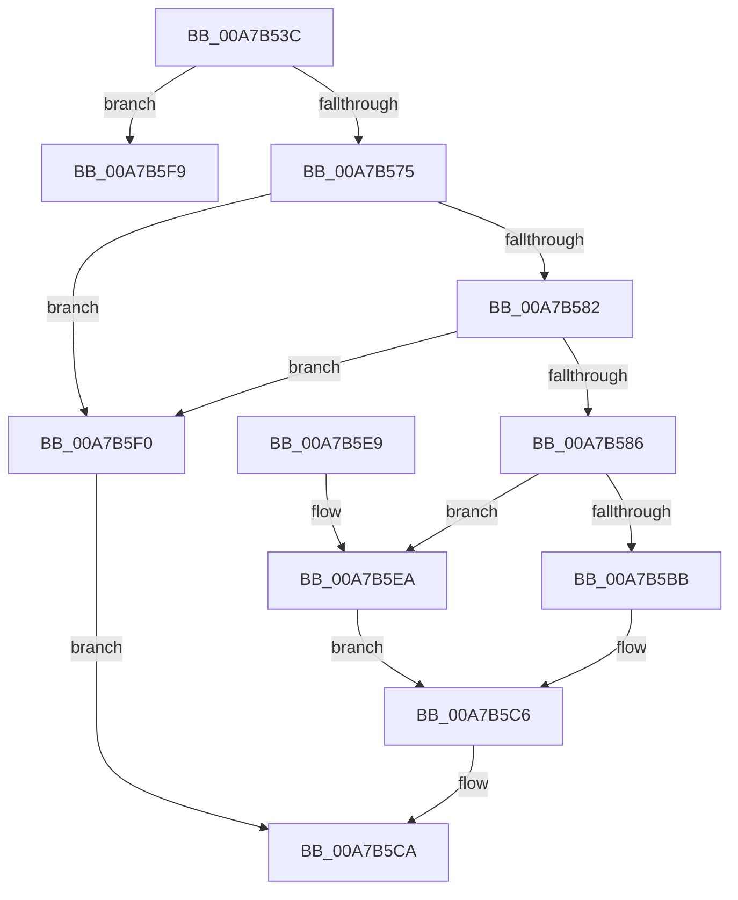

# ExpCreateOutputNT

- RVA: `0x00A7B53C`–`0x00A7B602` (길이 `198` bytes)
- VA: `0x0000000140A7B53C`
- 실행 섹션: `PAGE`
- PDB 이름 있음: `예`; PDB Function 태그: `예`
- unwind 정보 RVA: `0x000B662C`
- 디코드: `60`개 명령, `198/198` bytes 표시
- 미해석 바이트: `0` (있으면 어셈블리에 `.byte`로 보존)

> 이 문서는 커널 이미지의 기계어와 PDB 기호를 분석해 생성했습니다. 4번과 5번은 함수 원형과 자료형을 바이너리 사용 방식에서 추정한 C 해석이며 원본 소스 복구 결과는 아닙니다.

## 1. Dependencies

- 직접 호출 지점: **2**; 고유 호출 대상: **1**
- 직접 호출자로 확인된 함수: **3**
- RIP 상대 이미지 참조: **0**

### Outgoing calls
- `0x00A7B5A6` → [wcscpy_s](../../text/50/wcscpy_s_function_005064B0.md) (function, `0x005064B0`)
- `0x00A7B5C1` → [wcscpy_s](../../text/50/wcscpy_s_function_005064B0.md) (function, `0x005064B0`)

### Direct callers
- [ExpConvertArcName](../7C/ExpConvertArcName_function_007CAF04.md) at `0x007CAFCD`
- [ExpConvertSignatureName](../7C/ExpConvertSignatureName_function_007CB0C8.md) at `0x007CB2B0`
- [ExpTranslateEfiPath](ExpTranslateEfiPath_function_00A7AF84.md) at `0x00A7B0E8`

### Static image references
- 디코드된 RIP-relative 메모리 참조가 없습니다.

## 2. Other-region calls and transfers

- 다른 실행 섹션으로 향하는 call: **2**
  - `0x00A7B5A6` → [wcscpy_s](../../text/50/wcscpy_s_function_005064B0.md) (`PAGE` → `.text`)
  - `0x00A7B5C1` → [wcscpy_s](../../text/50/wcscpy_s_function_005064B0.md) (`PAGE` → `.text`)
- call이 아닌 외부 분기/꼬리 이동: **1**
  - `0x00A7B5FD` → [sub_00B42696](../B4/Unknown_function_00B42696.md) (`tail-transfer`)

## 3. Assembly (complete function range)

```asm
00A7B53C  48 8B C4                        mov rax, rsp
00A7B53F  48 89 58 08                     mov qword ptr [rax + 8], rbx
00A7B543  48 89 68 10                     mov qword ptr [rax + 0x10], rbp
00A7B547  48 89 70 18                     mov qword ptr [rax + 0x18], rsi
00A7B54B  48 89 78 20                     mov qword ptr [rax + 0x20], rdi
00A7B54F  41 54                           push r12
00A7B551  41 56                           push r14
00A7B553  41 57                           push r15
00A7B555  48 83 EC 20                     sub rsp, 0x20
00A7B559  41 0F B7 38                     movzx edi, word ptr [r8]
00A7B55D  45 33 E4                        xor r12d, r12d
00A7B560  83 C7 02                        add edi, 2
00A7B563  49 8B E9                        mov rbp, r9
00A7B566  4D 8B F8                        mov r15, r8
00A7B569  48 8B F2                        mov rsi, rdx
00A7B56C  4D 85 C9                        test r9, r9
00A7B56F  0F 85 84 00 00 00               jne 0x140a7b5f9
00A7B575  8D 47 02                        lea eax, [rdi + 2]
00A7B578  83 C7 0E                        add edi, 0xe
00A7B57B  D1 E8                           shr eax, 1
00A7B57D  48 85 C9                        test rcx, rcx
00A7B580  74 6E                           je 0x140a7b5f0
00A7B582  39 3A                           cmp dword ptr [rdx], edi
00A7B584  72 6A                           jb 0x140a7b5f0
00A7B586  C7 01 01 00 00 00               mov dword ptr [rcx], 1
00A7B58C  48 8D 59 0C                     lea rbx, [rcx + 0xc]
00A7B590  89 79 04                        mov dword ptr [rcx + 4], edi
00A7B593  C7 41 08 03 00 00 00            mov dword ptr [rcx + 8], 3
00A7B59A  48 8B CB                        mov rcx, rbx
00A7B59D  4D 8B 40 08                     mov r8, qword ptr [r8 + 8]
00A7B5A1  8B D0                           mov edx, eax
00A7B5A3  44 8B F0                        mov r14d, eax
00A7B5A6  E8 05 AF A8 FF                  call 0x1405064b0
00A7B5AB  41 0F B7 0F                     movzx ecx, word ptr [r15]
00A7B5AF  48 83 C1 02                     add rcx, 2
00A7B5B3  48 03 CB                        add rcx, rbx
00A7B5B6  48 85 ED                        test rbp, rbp
00A7B5B9  74 2F                           je 0x140a7b5ea
00A7B5BB  4C 8B C5                        mov r8, rbp
00A7B5BE  41 8B D6                        mov edx, r14d
00A7B5C1  E8 EA AE A8 FF                  call 0x1405064b0
00A7B5C6  89 3E                           mov dword ptr [rsi], edi
00A7B5C8  33 C0                           xor eax, eax
00A7B5CA  48 8B 5C 24 40                  mov rbx, qword ptr [rsp + 0x40]
00A7B5CF  48 8B 6C 24 48                  mov rbp, qword ptr [rsp + 0x48]
00A7B5D4  48 8B 74 24 50                  mov rsi, qword ptr [rsp + 0x50]
00A7B5D9  48 8B 7C 24 58                  mov rdi, qword ptr [rsp + 0x58]
00A7B5DE  48 83 C4 20                     add rsp, 0x20
00A7B5E2  41 5F                           pop r15
00A7B5E4  41 5E                           pop r14
00A7B5E6  41 5C                           pop r12
00A7B5E8  C3                              ret
00A7B5E9  CC                              int3
00A7B5EA  66 44 89 21                     mov word ptr [rcx], r12w
00A7B5EE  EB D6                           jmp 0x140a7b5c6
00A7B5F0  89 3A                           mov dword ptr [rdx], edi
00A7B5F2  B8 23 00 00 C0                  mov eax, 0xc0000023
00A7B5F7  EB D1                           jmp 0x140a7b5ca
00A7B5F9  48 83 C8 FF                     or rax, 0xffffffffffffffff
00A7B5FD  E9 94 70 0C 00                  jmp 0x140b42696
```

## 4. C-style interpretation (structured pseudocode)

```c
__int64 __fastcall ExpCreateOutputNT(__int64 a1, __int64 a2, __int64 a3, __int64 a4)
{
    __int64 result;
    __int64 v_r12;
    __int64 v_rdi;
    __int64 v_rsp;
    unsigned __int64 v_stack_p10;
    unsigned __int64 v_stack_p18;
    unsigned __int64 v_stack_p20;
    unsigned __int64 v_stack_p8;

    *(unsigned __int64 *)(v_rsp + 8) = v_rbx;
    *(unsigned __int64 *)(v_rsp + 16) = v_rbp;
    *(unsigned __int64 *)(v_rsp + 24) = v_rsi;
    *(unsigned __int64 *)(v_rsp + 32) = v_rdi;
    v_rsp = (v_rsp) - (32);
    v_r12 = 0;
    v_rdi = (unsigned int)((*(unsigned __int16 *)(a3)) + (2));
    if (a4 != 0) goto loc_00A7B5F9;
    v_rdi = (unsigned int)((v_rdi) + (14));
    result = (unsigned int)((v_rdi + 2) >> (1));
    if (a1 == 0) goto loc_00A7B5F0;
    if ((*(unsigned int *)(a2)) < ((unsigned int)(v_rdi))) goto loc_00A7B5F0;
    *(unsigned int *)(a1) = 1;
    *(unsigned int *)(a1 + 4) = (unsigned int)(v_rdi);
    *(unsigned int *)(a1 + 8) = 3;
    result = wcscpy_s(a1 + 12, (unsigned int)((unsigned int)(result)), *(unsigned __int64 *)(a3 + 8), a4);
    a1 = (*(unsigned __int16 *)(a3)) + (2);
    a1 = (a1) + (a1 + 12);
    if (a4 == 0) goto loc_00A7B5EA;
    result = wcscpy_s(a1, (unsigned int)((unsigned int)((unsigned int)((unsigned int)(result)))), a4, a4);
loc_00A7B5C6:
    *(unsigned int *)(a2) = (unsigned int)(v_rdi);
    result = 0;
loc_00A7B5CA:
    v_rsp = (v_rsp) + (32);
    return result;
loc_00A7B5EA:
    *(unsigned __int16 *)(a1) = 0;
    goto loc_00A7B5C6;
loc_00A7B5F0:
    *(unsigned int *)((unsigned int)((unsigned int)((unsigned int)((unsigned int)(result))))) = (unsigned int)(v_stack_p20);
    goto loc_00A7B5CA;
loc_00A7B5F9:
    result = ((unsigned int)(0xC0000023ULL)) | (-1);
}
```

## 5. (Beta) C Style

```c
int64_t ExpCreateOutputNT(int64_t Arg1, void *Arg2, void *Arg3, int64_t Arg4)
{
    uint8_t *arg2 = (uint8_t *)Arg2;
    uint8_t *arg3 = (uint8_t *)Arg3;

    int64_t result;
    int64_t local_r12;
    int64_t local_rdi;
    int64_t local_rsp;
    uint64_t v_stack_p10;
    uint64_t v_stack_p18;
    uint64_t v_stack_p20;
    uint64_t v_stack_p8;

    *(uint64_t *)(local_rsp + 0x8) = local_rbx;
    *(uint64_t *)(local_rsp + 0x10) = local_rbp;
    *(uint64_t *)(local_rsp + 0x18) = local_rsi;
    *(uint64_t *)(local_rsp + 0x20) = local_rdi;
    local_rsp = (local_rsp) - (32);
    local_r12 = 0;
    local_rdi = (uint32_t)((*(uint16_t *)(arg3)) + (2));
    if (Arg4 != 0) goto loc_00A7B5F9;
    local_rdi = (uint32_t)((local_rdi) + (14));
    result = (uint32_t)((local_rdi + 2) >> (1));
    if (Arg1 == 0) goto loc_00A7B5F0;
    if ((*(uint32_t *)(arg2)) < ((uint32_t)(local_rdi))) goto loc_00A7B5F0;
    *(uint32_t *)(Arg1) = 1;
    *(uint32_t *)(Arg1 + 0x4) = (uint32_t)(local_rdi);
    *(uint32_t *)(Arg1 + 0x8) = 3;
    result = wcscpy_s(Arg1 + 12, (uint32_t)((uint32_t)(result)), *(uint64_t *)(arg3 + 0x8), Arg4);
    Arg1 = (*(uint16_t *)(arg3)) + (2);
    Arg1 = (Arg1) + (Arg1 + 12);
    if (Arg4 == 0) goto loc_00A7B5EA;
    result = wcscpy_s(Arg1, (uint32_t)((uint32_t)((uint32_t)((uint32_t)(result)))), Arg4, Arg4);
loc_00A7B5C6:
    *(uint32_t *)(arg2) = (uint32_t)(local_rdi);
    result = 0;
loc_00A7B5CA:
    local_rsp = (local_rsp) + (32);
    return result;
loc_00A7B5EA:
    *(uint16_t *)(Arg1) = 0;
    goto loc_00A7B5C6;
loc_00A7B5F0:
    *(uint32_t *)((uint32_t)((uint32_t)((uint32_t)((uint32_t)(result))))) = (uint32_t)(v_stack_p20);
    goto loc_00A7B5CA;
loc_00A7B5F9:
    result = ((uint32_t)(0xC0000023ULL)) | (-1);
}
```

### 관측된 메모리 오프셋

구조체 형식이 확인되지 않은 접근은 인자 기준의 오프셋으로만 기록했습니다.

| 기준 인자 | 오프셋 표현 | 폭 (bit) | 접근 |
|---|---:|---:|---|
| `Arg2` | `+ 0x0` | `32` | `R` |
| `Arg2` | `+ 0x0` | `32` | `W` |
| `Arg3` | `+ 0x0` | `16` | `R` |
| `Arg3` | `+ 0x8` | `64` | `R` |

## 6. Execution-region graph

[열기: 2D/3D 그래프와 함수 탐색 컨트롤 패널](../../../control-panel.html?section=page&rva=0x00A7B53C&view=graph)

- 2D 그래프는 위에서 아래로 흐르고, 3D 그래프는 빈 공간을 드래그해 회전합니다. Shift+드래그는 이동, 휠은 확대·축소, 함수 노드 선택은 대상 보고서 이동입니다.

### Static fallback


