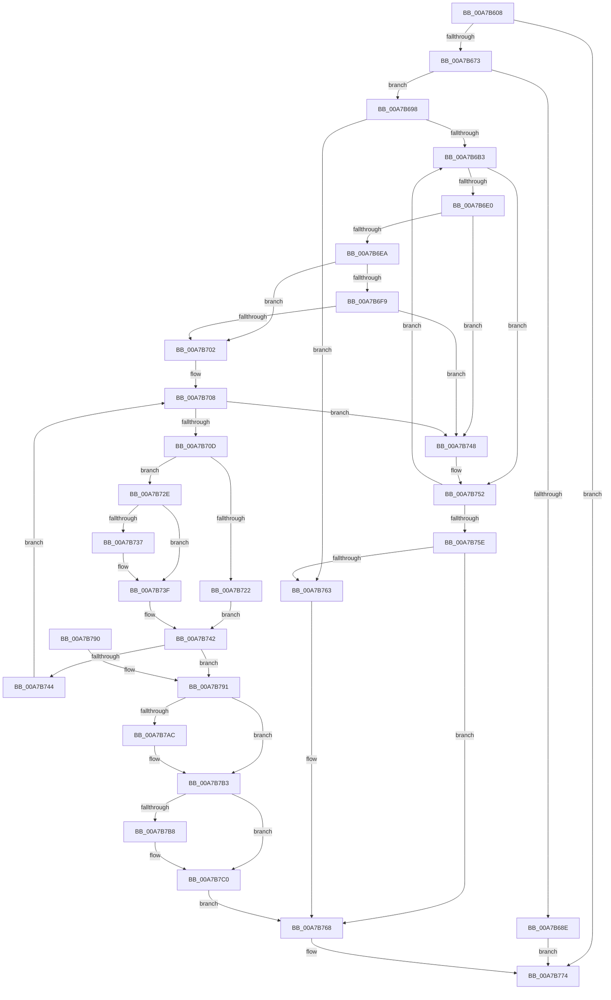

# ExpFindDiskSignature

- RVA: `0x00A7B608`–`0x00A7B7CC` (길이 `452` bytes)
- VA: `0x0000000140A7B608`
- 실행 섹션: `PAGE`
- PDB 이름 있음: `예`; PDB Function 태그: `아니요`
- unwind 정보 RVA: `0x000B665C`
- 디코드: `130`개 명령, `452/452` bytes 표시
- 미해석 바이트: `0` (있으면 어셈블리에 `.byte`로 보존)

> 이 문서는 커널 이미지의 기계어와 PDB 기호를 분석해 생성했습니다. 4번과 5번은 함수 원형과 자료형을 바이너리 사용 방식에서 추정한 C 해석이며 원본 소스 복구 결과는 아닙니다.

## 1. Dependencies

- 직접 호출 지점: **8**; 고유 호출 대상: **6**
- 직접 호출자로 확인된 함수: **3**
- RIP 상대 이미지 참조: **2**

### Outgoing calls
- `0x00A7B666` → [ZwQuerySystemInformation](../../text/6A/ZwQuerySystemInformation_function_006AD790.md) (function, `0x006AD790`)
- `0x00A7B681` → [ExAllocatePool2](../../poolcode/B8/ExAllocatePool2_function_00B820F0.md) (function, `0x00B820F0`)
- `0x00A7B6C5` → [swprintf_s](../../text/50/swprintf_s_function_00504B20.md) (function, `0x00504B20`)
- `0x00A7B6D2` → [ExpGetPartitionTableInfo](ExpGetPartitionTableInfo_function_00A7B7D4.md) (function, `0x00A7B7D4`)
- `0x00A7B74D` → [ExFreePoolWithTag](../../poolcode/B8/ExFreePoolWithTag_function_00B82870.md) (function, `0x00B82870`)
- `0x00A7B76D` → [ExFreePoolWithTag](../../poolcode/B8/ExFreePoolWithTag_function_00B82870.md) (function, `0x00B82870`)
- `0x00A7B77C` → [_security_check_cookie](../../text/6A/_security_check_cookie_function_006AC640.md) (function, `0x006AC640`)
- `0x00A7B7C5` → [ExFreePoolWithTag](../../poolcode/B8/ExFreePoolWithTag_function_00B82870.md) (function, `0x00B82870`)

### Direct callers
- [ExpConvertSignatureName](../7C/ExpConvertSignatureName_function_007CB0C8.md) at `0x007CB1D9`
- [ExpTranslateEfiPath](ExpTranslateEfiPath_function_00A7AF84.md) at `0x00A7B17F`
- [sub_00B42738](../B4/Unknown_function_00B42738.md) at `0x00B4276F`

### Static image references
- `0x00A7B617` → RVA `0x00E0A740` (`.data`; read)
- `0x00A7B6B6` → RVA `0x00B08810` (` ?? ::NNGAKEGL::`string'`; read)

## 2. Other-region calls and transfers

- 다른 실행 섹션으로 향하는 call: **7**
  - `0x00A7B666` → [ZwQuerySystemInformation](../../text/6A/ZwQuerySystemInformation_function_006AD790.md) (`PAGE` → `.text`)
  - `0x00A7B681` → [ExAllocatePool2](../../poolcode/B8/ExAllocatePool2_function_00B820F0.md) (`PAGE` → `POOLCODE`)
  - `0x00A7B6C5` → [swprintf_s](../../text/50/swprintf_s_function_00504B20.md) (`PAGE` → `.text`)
  - `0x00A7B74D` → [ExFreePoolWithTag](../../poolcode/B8/ExFreePoolWithTag_function_00B82870.md) (`PAGE` → `POOLCODE`)
  - `0x00A7B76D` → [ExFreePoolWithTag](../../poolcode/B8/ExFreePoolWithTag_function_00B82870.md) (`PAGE` → `POOLCODE`)
  - `0x00A7B77C` → [_security_check_cookie](../../text/6A/_security_check_cookie_function_006AC640.md) (`PAGE` → `.text`)
  - `0x00A7B7C5` → [ExFreePoolWithTag](../../poolcode/B8/ExFreePoolWithTag_function_00B82870.md) (`PAGE` → `POOLCODE`)
- 별도 외부 분기/꼬리 이동을 확인하지 못했습니다.

## 3. Assembly (complete function range)

```asm
00A7B608  40 53                           push rbx
00A7B60A  55                              push rbp
00A7B60B  56                              push rsi
00A7B60C  57                              push rdi
00A7B60D  41 54                           push r12
00A7B60F  41 55                           push r13
00A7B611  41 56                           push r14
00A7B613  48 83 EC 70                     sub rsp, 0x70
00A7B617  48 8B 05 22 F1 38 00            mov rax, qword ptr [rip + 0x38f122]
00A7B61E  48 33 C4                        xor rax, rsp
00A7B621  48 89 44 24 60                  mov qword ptr [rsp + 0x60], rax
00A7B626  4C 8B AC 24 D0 00 00 00         mov r13, qword ptr [rsp + 0xd0]
00A7B62E  33 C0                           xor eax, eax
00A7B630  48 83 64 24 20 00               and qword ptr [rsp + 0x20], 0
00A7B636  0F 57 C0                        xorps xmm0, xmm0
00A7B639  4C 89 4C 24 40                  mov qword ptr [rsp + 0x40], r9
00A7B63E  45 33 C9                        xor r9d, r9d
00A7B641  4C 89 44 24 38                  mov qword ptr [rsp + 0x38], r8
00A7B646  48 89 54 24 30                  mov qword ptr [rsp + 0x30], rdx
00A7B64B  44 8D 40 18                     lea r8d, [rax + 0x18]
00A7B64F  48 89 4C 24 28                  mov qword ptr [rsp + 0x28], rcx
00A7B654  48 8D 54 24 48                  lea rdx, [rsp + 0x48]
00A7B659  8D 48 07                        lea ecx, [rax + 7]
00A7B65C  48 89 44 24 58                  mov qword ptr [rsp + 0x58], rax
00A7B661  0F 11 44 24 48                  movups xmmword ptr [rsp + 0x48], xmm0
00A7B666  E8 25 21 C3 FF                  call 0x1406ad790
00A7B66B  85 C0                           test eax, eax
00A7B66D  0F 88 01 01 00 00               js 0x140a7b774
00A7B673  BA 4C 00 00 00                  mov edx, 0x4c
00A7B678  41 B8 45 6E 76 72               mov r8d, 0x72766e45
00A7B67E  8D 4A F4                        lea ecx, [rdx - 0xc]
00A7B681  E8 6A 6A 10 00                  call 0x140b820f0
00A7B686  48 8B E8                        mov rbp, rax
00A7B689  48 85 C0                        test rax, rax
00A7B68C  75 0A                           jne 0x140a7b698
00A7B68E  B8 9A 00 00 C0                  mov eax, 0xc000009a
00A7B693  E9 DC 00 00 00                  jmp 0x140a7b774
00A7B698  45 33 E4                        xor r12d, r12d
00A7B69B  80 BC 24 D8 00 00 00 01         cmp byte ptr [rsp + 0xd8], 1
00A7B6A3  41 0F 94 C4                     sete r12b
00A7B6A7  33 F6                           xor esi, esi
00A7B6A9  39 74 24 48                     cmp dword ptr [rsp + 0x48], esi
00A7B6AD  0F 86 B0 00 00 00               jbe 0x140a7b763
00A7B6B3  44 8B CE                        mov r9d, esi
00A7B6B6  4C 8D 05 53 D1 08 00            lea r8, [rip + 0x8d153]
00A7B6BD  BA 26 00 00 00                  mov edx, 0x26
00A7B6C2  48 8B CD                        mov rcx, rbp
00A7B6C5  E8 56 94 A8 FF                  call 0x140504b20
00A7B6CA  48 8D 54 24 20                  lea rdx, [rsp + 0x20]
00A7B6CF  48 8B CD                        mov rcx, rbp
00A7B6D2  E8 FD 00 00 00                  call 0x140a7b7d4
00A7B6D7  8B D8                           mov ebx, eax
00A7B6D9  44 8B F0                        mov r14d, eax
00A7B6DC  85 C0                           test eax, eax
00A7B6DE  78 72                           js 0x140a7b752
00A7B6E0  4C 8B 44 24 20                  mov r8, qword ptr [rsp + 0x20]
00A7B6E5  45 39 20                        cmp dword ptr [r8], r12d
00A7B6E8  75 5E                           jne 0x140a7b748
00A7B6EA  80 BC 24 D8 00 00 00 01         cmp byte ptr [rsp + 0xd8], 1
00A7B6F2  4C 8B 54 24 28                  mov r10, qword ptr [rsp + 0x28]
00A7B6F7  74 09                           je 0x140a7b702
00A7B6F9  41 8B 02                        mov eax, dword ptr [r10]
00A7B6FC  41 39 40 08                     cmp dword ptr [r8 + 8], eax
00A7B700  75 46                           jne 0x140a7b748
00A7B702  45 8B 48 04                     mov r9d, dword ptr [r8 + 4]
00A7B706  33 D2                           xor edx, edx
00A7B708  41 3B D1                        cmp edx, r9d
00A7B70B  73 3B                           jae 0x140a7b748
00A7B70D  48 8D 3C D2                     lea rdi, [rdx + rdx*8]
00A7B711  48 C1 E7 04                     shl rdi, 4
00A7B715  49 03 F8                        add rdi, r8
00A7B718  80 BC 24 D8 00 00 00 01         cmp byte ptr [rsp + 0xd8], 1
00A7B720  74 0C                           je 0x140a7b72e
00A7B722  48 8B 44 24 30                  mov rax, qword ptr [rsp + 0x30]
00A7B727  8B 00                           mov eax, dword ptr [rax]
00A7B729  39 47 48                        cmp dword ptr [rdi + 0x48], eax
00A7B72C  EB 14                           jmp 0x140a7b742
00A7B72E  48 8B 4F 60                     mov rcx, qword ptr [rdi + 0x60]
00A7B732  49 2B 0A                        sub rcx, qword ptr [r10]
00A7B735  75 08                           jne 0x140a7b73f
00A7B737  48 8B 4F 68                     mov rcx, qword ptr [rdi + 0x68]
00A7B73B  49 2B 4A 08                     sub rcx, qword ptr [r10 + 8]
00A7B73F  48 85 C9                        test rcx, rcx
00A7B742  74 4D                           je 0x140a7b791
00A7B744  FF C2                           inc edx
00A7B746  EB C0                           jmp 0x140a7b708
00A7B748  33 D2                           xor edx, edx
00A7B74A  49 8B C8                        mov rcx, r8
00A7B74D  E8 1E 71 10 00                  call 0x140b82870
00A7B752  FF C6                           inc esi
00A7B754  3B 74 24 48                     cmp esi, dword ptr [rsp + 0x48]
00A7B758  0F 82 55 FF FF FF               jb 0x140a7b6b3
00A7B75E  45 85 F6                        test r14d, r14d
00A7B761  78 05                           js 0x140a7b768
00A7B763  BB 3A 00 00 C0                  mov ebx, 0xc000003a
00A7B768  33 D2                           xor edx, edx
00A7B76A  48 8B CD                        mov rcx, rbp
00A7B76D  E8 FE 70 10 00                  call 0x140b82870
00A7B772  8B C3                           mov eax, ebx
00A7B774  48 8B 4C 24 60                  mov rcx, qword ptr [rsp + 0x60]
00A7B779  48 33 CC                        xor rcx, rsp
00A7B77C  E8 BF 0E C3 FF                  call 0x1406ac640
00A7B781  48 83 C4 70                     add rsp, 0x70
00A7B785  41 5E                           pop r14
00A7B787  41 5D                           pop r13
00A7B789  41 5C                           pop r12
00A7B78B  5F                              pop rdi
00A7B78C  5E                              pop rsi
00A7B78D  5D                              pop rbp
00A7B78E  5B                              pop rbx
00A7B78F  C3                              ret
00A7B790  CC                              int3
00A7B791  8B 47 48                        mov eax, dword ptr [rdi + 0x48]
00A7B794  48 8B 4C 24 30                  mov rcx, qword ptr [rsp + 0x30]
00A7B799  89 01                           mov dword ptr [rcx], eax
00A7B79B  48 8B 44 24 38                  mov rax, qword ptr [rsp + 0x38]
00A7B7A0  48 8B 4C 24 40                  mov rcx, qword ptr [rsp + 0x40]
00A7B7A5  89 30                           mov dword ptr [rax], esi
00A7B7A7  48 85 C9                        test rcx, rcx
00A7B7AA  74 07                           je 0x140a7b7b3
00A7B7AC  48 8B 47 38                     mov rax, qword ptr [rdi + 0x38]
00A7B7B0  48 89 01                        mov qword ptr [rcx], rax
00A7B7B3  4D 85 ED                        test r13, r13
00A7B7B6  74 08                           je 0x140a7b7c0
00A7B7B8  48 8B 47 40                     mov rax, qword ptr [rdi + 0x40]
00A7B7BC  49 89 45 00                     mov qword ptr [r13], rax
00A7B7C0  33 D2                           xor edx, edx
00A7B7C2  49 8B C8                        mov rcx, r8
00A7B7C5  E8 A6 70 10 00                  call 0x140b82870
00A7B7CA  EB 9C                           jmp 0x140a7b768
```

## 4. C-style interpretation (structured pseudocode)

```c
__int64 __fastcall ExpFindDiskSignature(__int64 a1, __int64 a2, __int64 a3, __int64 a4, __int64 a5, unsigned __int8 a6)
{
    __int64 result;
    __int64 v_r12;
    __int64 v_rbx;
    __int64 v_rdi;
    __int64 v_rsi;
    __int64 v_rsp;
    unsigned __int64 v_stack_m48;
    unsigned __int64 v_stack_m50;
    unsigned __int64 v_stack_m60;
    unsigned __int64 v_stack_m68;
    unsigned __int64 v_stack_m70;
    unsigned __int64 v_stack_m78;
    unsigned __int64 v_stack_m80;
    unsigned __int64 v_stack_m88;
    unsigned __int64 v_stack_p30;
    unsigned __int64 v_stack_p38;
    unsigned __int64 v_stack_p40;

    v_rsp = (v_rsp) - (112);
    result = (*(unsigned __int64 *)(v_rip + 3731746)) ^ (v_rsp);
    v_stack_m48 = result;
    result = 0;
    v_stack_m68 = a4;
    a4 = 0;
    v_stack_m70 = a3;
    v_stack_m78 = a2;
    v_stack_m80 = a1;
    v_stack_m50 = 0;
    v_stack_m60 = v_xmm0;
    result = ZwQuerySystemInformation(result + 7, v_stack_m60, result + 24, a4);
    if (sign_flag) goto loc_00A7B774;
    result = ExAllocatePool2(76 - 12, 76, (unsigned int)(0x72766E45ULL), a4);
    if (result != 0) goto loc_00A7B698;
    goto loc_00A7B774;
loc_00A7B698:
    v_r12 = 0;
    v_r12 = (a6 == 1) ? 1 : 0;
    v_rsi = 0;
    if (v_stack_m60 <= 0) goto loc_00A7B763;
loc_00A7B6B3:
    result = swprintf_s(result, 38, v_rip + 577875, 0);
    result = ExpGetPartitionTableInfo(result, v_stack_m88, v_rip + 577875, 0);
    if (sign_flag) goto loc_00A7B752;
    if ((*(unsigned int *)(v_stack_m88)) != ((unsigned int)(v_r12))) goto loc_00A7B748;
    if (a6 == 1) goto loc_00A7B702;
    if ((*(unsigned int *)(v_stack_m88 + 8)) != ((unsigned int)((unsigned int)(*(unsigned int *)(v_stack_m80))))) goto loc_00A7B748;
loc_00A7B702:
    a2 = 0;
loc_00A7B708:
    if (0 >= ((unsigned int)((unsigned int)(*(unsigned int *)(v_stack_m88 + 4))))) goto loc_00A7B748;
    v_rdi = (a2 + a2 * 8) << (4);
    v_rdi = (v_rdi) + (v_stack_m88);
    if (a6 == 1) goto loc_00A7B72E;
    goto loc_00A7B742;
loc_00A7B72E:
    a1 = (*(unsigned __int64 *)(v_rdi + 96)) - (*(unsigned __int64 *)(v_stack_m80));
    if (!(condition_is_not_equal)) {
        a1 = *(unsigned __int64 *)(v_rdi + 104);
        a1 = (a1) - (*(unsigned __int64 *)(v_stack_m80 + 8));
    }
loc_00A7B742:
    if (a1 == 0) goto loc_00A7B791;
    a2 = (unsigned int)((a2) + 1);
    goto loc_00A7B708;
loc_00A7B748:
    a2 = 0;
    result = ExFreePoolWithTag(v_stack_m88, a2, v_stack_m88, (unsigned int)(*(unsigned int *)(v_stack_m88 + 4)));
loc_00A7B752:
    v_rsi = (unsigned int)((v_rsi) + 1);
    if (((unsigned int)(v_rsi)) < v_stack_m60) goto loc_00A7B6B3;
    v_rbx = (unsigned int)((unsigned int)(result));
    if (!(sign_flag)) {
        v_rbx = 0xC000003AULL;
    }
    a2 = 0;
    result = ExFreePoolWithTag(result, a2, v_stack_m88, (unsigned int)(*(unsigned int *)(v_stack_m88 + 4)));
loc_00A7B774:
    a1 = (v_stack_m48) ^ (v_rsp);
    result = _security_check_cookie(a1, a2, v_stack_m88, (unsigned int)(*(unsigned int *)(v_stack_m88 + 4)));
    v_rsp = (v_rsp) + (112);
    return result;
loc_00A7B791:
    *(unsigned int *)(v_stack_p30) = (unsigned int)((unsigned int)(*(unsigned int *)(v_rdi + 72)));
    *(unsigned int *)(v_stack_p38) = (unsigned int)(v_rsi);
    result = v_stack_p38;
    if (v_stack_p40 != 0) {
        result = *(unsigned __int64 *)(v_rdi + 56);
        *(unsigned __int64 *)(v_stack_p40) = result;
    }
    if (a5 != 0) {
        result = *(unsigned __int64 *)(v_rdi + 64);
        *(unsigned __int64 *)(a5) = result;
    }
    a2 = 0;
    result = ExFreePoolWithTag(v_stack_m88, a2, v_stack_m88, (unsigned int)(*(unsigned int *)(v_stack_m88 + 4)));
    goto loc_00A7B768;
}
```

## 5. (Beta) C Style

```c
int64_t ExpFindDiskSignature(int64_t Arg1, int64_t Arg2, int64_t Arg3, int64_t Arg4, int64_t Arg5, uint8_t Arg6)
{
    int64_t result;
    int64_t local_r12;
    int64_t local_rbx;
    int64_t local_rdi;
    int64_t local_rsi;
    int64_t local_rsp;
    uint64_t v_stack_m48;
    uint64_t v_stack_m50;
    uint64_t v_stack_m60;
    uint64_t v_stack_m68;
    uint64_t v_stack_m70;
    uint64_t v_stack_m78;
    uint64_t v_stack_m80;
    uint64_t v_stack_m88;
    uint64_t v_stack_p30;
    uint64_t v_stack_p38;
    uint64_t v_stack_p40;

    local_rsp = (local_rsp) - (112);
    result = (*(uint64_t *)(v_rip + 0x38F122)) ^ (local_rsp);
    v_stack_m48 = result;
    result = 0;
    v_stack_m68 = Arg4;
    Arg4 = 0;
    v_stack_m70 = Arg3;
    v_stack_m78 = Arg2;
    v_stack_m80 = Arg1;
    v_stack_m50 = 0;
    v_stack_m60 = v_xmm0;
    result = ZwQuerySystemInformation(result + 7, v_stack_m60, result + 24, Arg4);
    if (sign_flag) goto loc_00A7B774;
    result = ExAllocatePool2(76 - 12, 76, (uint32_t)(0x72766E45ULL), Arg4);
    if (result != 0) goto loc_00A7B698;
    goto loc_00A7B774;
loc_00A7B698:
    local_r12 = 0;
    local_r12 = (Arg6 == 1) ? 1 : 0;
    local_rsi = 0;
    if (v_stack_m60 <= 0) goto loc_00A7B763;
loc_00A7B6B3:
    result = swprintf_s(result, 38, v_rip + 577875, 0);
    result = ExpGetPartitionTableInfo(result, v_stack_m88, v_rip + 577875, 0);
    if (sign_flag) goto loc_00A7B752;
    if ((*(uint32_t *)(v_stack_m88)) != ((uint32_t)(local_r12))) goto loc_00A7B748;
    if (Arg6 == 1) goto loc_00A7B702;
    if ((*(uint32_t *)(v_stack_m88 + 0x8)) != ((uint32_t)((uint32_t)(*(uint32_t *)(v_stack_m80))))) goto loc_00A7B748;
loc_00A7B702:
    Arg2 = 0;
loc_00A7B708:
    if (0 >= ((uint32_t)((uint32_t)(*(uint32_t *)(v_stack_m88 + 0x4))))) goto loc_00A7B748;
    local_rdi = (Arg2 + Arg2 * 8) << (4);
    local_rdi = (local_rdi) + (v_stack_m88);
    if (Arg6 == 1) goto loc_00A7B72E;
    goto loc_00A7B742;
loc_00A7B72E:
    Arg1 = (*(uint64_t *)(local_rdi + 0x60)) - (*(uint64_t *)(v_stack_m80));
    if (!(condition_is_not_equal)) {
        Arg1 = *(uint64_t *)(local_rdi + 0x68);
        Arg1 = (Arg1) - (*(uint64_t *)(v_stack_m80 + 0x8));
    }
loc_00A7B742:
    if (Arg1 == 0) goto loc_00A7B791;
    Arg2 = (uint32_t)((Arg2) + 1);
    goto loc_00A7B708;
loc_00A7B748:
    Arg2 = 0;
    result = ExFreePoolWithTag(v_stack_m88, Arg2, v_stack_m88, (uint32_t)(*(uint32_t *)(v_stack_m88 + 0x4)));
loc_00A7B752:
    local_rsi = (uint32_t)((local_rsi) + 1);
    if (((uint32_t)(local_rsi)) < v_stack_m60) goto loc_00A7B6B3;
    local_rbx = (uint32_t)((uint32_t)(result));
    if (!(sign_flag)) {
        local_rbx = 0xC000003AULL;
    }
    Arg2 = 0;
    result = ExFreePoolWithTag(result, Arg2, v_stack_m88, (uint32_t)(*(uint32_t *)(v_stack_m88 + 0x4)));
loc_00A7B774:
    Arg1 = (v_stack_m48) ^ (local_rsp);
    result = _security_check_cookie(Arg1, Arg2, v_stack_m88, (uint32_t)(*(uint32_t *)(v_stack_m88 + 0x4)));
    local_rsp = (local_rsp) + (112);
    return result;
loc_00A7B791:
    *(uint32_t *)(v_stack_p30) = (uint32_t)((uint32_t)(*(uint32_t *)(local_rdi + 0x48)));
    *(uint32_t *)(v_stack_p38) = (uint32_t)(local_rsi);
    result = v_stack_p38;
    if (v_stack_p40 != 0) {
        result = *(uint64_t *)(local_rdi + 0x38);
        *(uint64_t *)(v_stack_p40) = result;
    }
    if (Arg5 != 0) {
        result = *(uint64_t *)(local_rdi + 0x40);
        *(uint64_t *)(Arg5) = result;
    }
    Arg2 = 0;
    result = ExFreePoolWithTag(v_stack_m88, Arg2, v_stack_m88, (uint32_t)(*(uint32_t *)(v_stack_m88 + 0x4)));
    goto loc_00A7B768;
}
```

## 6. Execution-region graph

[열기: 2D/3D 그래프와 함수 탐색 컨트롤 패널](../../../control-panel.html?section=page&rva=0x00A7B608&view=graph)

- 2D 그래프는 위에서 아래로 흐르고, 3D 그래프는 빈 공간을 드래그해 회전합니다. Shift+드래그는 이동, 휠은 확대·축소, 함수 노드 선택은 대상 보고서 이동입니다.

### Static fallback


