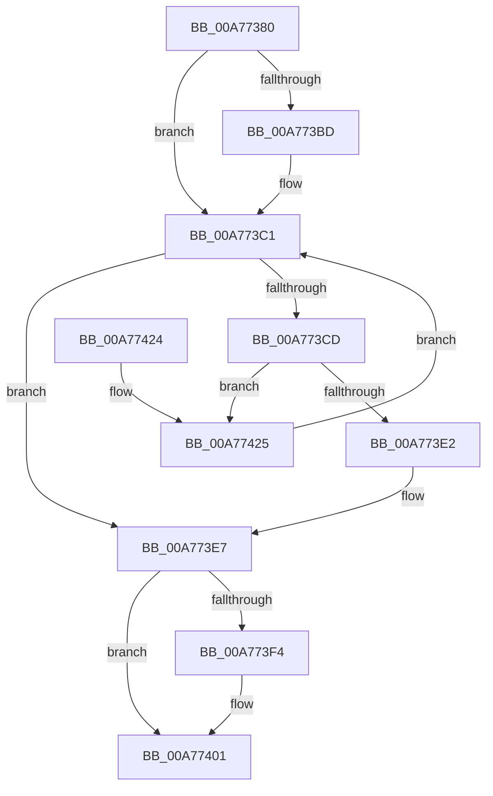

# ExpGetNextCallback

- RVA: `0x00A77380`–`0x00A7742A` (길이 `170` bytes)
- VA: `0x0000000140A77380`
- 실행 섹션: `PAGE`
- PDB 이름 있음: `예`; PDB Function 태그: `아니요`
- unwind 정보 RVA: `0x000AFAEC`
- 디코드: `47`개 명령, `170/170` bytes 표시
- 미해석 바이트: `0` (있으면 어셈블리에 `.byte`로 보존)

> 이 문서는 커널 이미지의 기계어와 PDB 기호를 분석해 생성했습니다. 4번과 5번은 함수 원형과 자료형을 바이너리 사용 방식에서 추정한 C 해석이며 원본 소스 복구 결과는 아닙니다.

## 1. Dependencies

- 직접 호출 지점: **4**; 고유 호출 대상: **4**
- 직접 호출자로 확인된 함수: **0**
- RIP 상대 이미지 참조: **1**

### Outgoing calls
- `0x00A773AC` → [ExpLockCallbackListShared](../../text/4B/ExpLockCallbackListShared_function_004B1460.md) (function, `0x004B1460`)
- `0x00A773D9` → [ObReferenceObjectSafeWithTag](../../text/21/ObReferenceObjectSafeWithTag_function_00210EE0.md) (function, `0x00210EE0`)
- `0x00A773EA` → [ExpUnlockCallbackListShared](../../text/4A/ExpUnlockCallbackListShared_function_004ABC3C.md) (function, `0x004ABC3C`)
- `0x00A773FC` → [ObfDereferenceObjectWithTag](../../text/2F/ObfDereferenceObjectWithTag_function_002F78E0.md) (function, `0x002F78E0`)

### Direct callers
- 이 함수 시작 RVA로 연결되는 직접 call은 확인되지 않았습니다. 간접 호출은 완전히 역산할 수 없습니다.

### Static image references
- `0x00A773B1` → RVA `0x00EFACB0` (`.data`; read)

## 2. Other-region calls and transfers

- 다른 실행 섹션으로 향하는 call: **4**
  - `0x00A773AC` → [ExpLockCallbackListShared](../../text/4B/ExpLockCallbackListShared_function_004B1460.md) (`PAGE` → `.text`)
  - `0x00A773D9` → [ObReferenceObjectSafeWithTag](../../text/21/ObReferenceObjectSafeWithTag_function_00210EE0.md) (`PAGE` → `.text`)
  - `0x00A773EA` → [ExpUnlockCallbackListShared](../../text/4A/ExpUnlockCallbackListShared_function_004ABC3C.md) (`PAGE` → `.text`)
  - `0x00A773FC` → [ObfDereferenceObjectWithTag](../../text/2F/ObfDereferenceObjectWithTag_function_002F78E0.md) (`PAGE` → `.text`)
- 별도 외부 분기/꼬리 이동을 확인하지 못했습니다.

## 3. Assembly (complete function range)

```asm
00A77380  48 8B C4                        mov rax, rsp
00A77383  48 89 58 08                     mov qword ptr [rax + 8], rbx
00A77387  48 89 68 10                     mov qword ptr [rax + 0x10], rbp
00A7738B  48 89 70 18                     mov qword ptr [rax + 0x18], rsi
00A7738F  48 89 78 20                     mov qword ptr [rax + 0x20], rdi
00A77393  41 56                           push r14
00A77395  48 83 EC 20                     sub rsp, 0x20
00A77399  65 4C 8B 34 25 88 01 00 00      mov r14, qword ptr gs:[0x188]
00A773A2  48 8B F9                        mov rdi, rcx
00A773A5  49 8B CE                        mov rcx, r14
00A773A8  33 F6                           xor esi, esi
00A773AA  33 ED                           xor ebp, ebp
00A773AC  E8 AF A0 A3 FF                  call 0x1404b1460
00A773B1  48 8B 1D F8 38 48 00            mov rbx, qword ptr [rip + 0x4838f8]
00A773B8  48 85 FF                        test rdi, rdi
00A773BB  74 04                           je 0x140a773c1
00A773BD  48 8B 5F 28                     mov rbx, qword ptr [rdi + 0x28]
00A773C1  48 8D 05 E8 38 48 00            lea rax, [rip + 0x4838e8]
00A773C8  48 3B D8                        cmp rbx, rax
00A773CB  74 1A                           je 0x140a773e7
00A773CD  48 8D 6B D8                     lea rbp, [rbx - 0x28]
00A773D1  BA 45 78 45 6E                  mov edx, 0x6e457845
00A773D6  48 8B CD                        mov rcx, rbp
00A773D9  E8 02 9B 79 FF                  call 0x140210ee0
00A773DE  84 C0                           test al, al
00A773E0  74 43                           je 0x140a77425
00A773E2  BE 01 00 00 00                  mov esi, 1
00A773E7  49 8B CE                        mov rcx, r14
00A773EA  E8 4D 48 A3 FF                  call 0x1404abc3c
00A773EF  48 85 FF                        test rdi, rdi
00A773F2  74 0D                           je 0x140a77401
00A773F4  BA 45 78 45 6E                  mov edx, 0x6e457845
00A773F9  48 8B CF                        mov rcx, rdi
00A773FC  E8 DF 04 88 FF                  call 0x1402f78e0
00A77401  48 8B 5C 24 30                  mov rbx, qword ptr [rsp + 0x30]
00A77406  F7 DE                           neg esi
00A77408  48 8B 74 24 40                  mov rsi, qword ptr [rsp + 0x40]
00A7740D  48 8B 7C 24 48                  mov rdi, qword ptr [rsp + 0x48]
00A77412  48 1B C0                        sbb rax, rax
00A77415  48 23 C5                        and rax, rbp
00A77418  48 8B 6C 24 38                  mov rbp, qword ptr [rsp + 0x38]
00A7741D  48 83 C4 20                     add rsp, 0x20
00A77421  41 5E                           pop r14
00A77423  C3                              ret
00A77424  CC                              int3
00A77425  48 8B 1B                        mov rbx, qword ptr [rbx]
00A77428  EB 97                           jmp 0x140a773c1
```

## 4. C-style interpretation (structured pseudocode)

```c
__int64 __fastcall ExpGetNextCallback(__int64 a1)
{
    __int64 result;
    __int64 v_rbp;
    __int64 v_rbx;
    __int64 v_rsi;
    __int64 v_rsp;
    unsigned __int64 v_stack_p10;
    unsigned __int64 v_stack_p18;
    unsigned __int64 v_stack_p20;
    unsigned __int64 v_stack_p8;

    *(unsigned __int64 *)(v_rsp + 8) = v_rbx;
    *(unsigned __int64 *)(v_rsp + 16) = v_rbp;
    *(unsigned __int64 *)(v_rsp + 24) = v_rsi;
    *(unsigned __int64 *)(v_rsp + 32) = v_rdi;
    v_rsp = (v_rsp) - (32);
    v_rsi = 0;
    v_rbp = 0;
    result = ExpLockCallbackListShared(*(unsigned __int64 *)(gs_base + (0 + 392)), a2, a3, a4);
    v_rbx = *(unsigned __int64 *)(v_rip + 4733176);
    if (a1 != 0) {
        v_rbx = *(unsigned __int64 *)(a1 + 40);
    }
    if (v_rbx == (v_rip + 4733160)) goto loc_00A773E7;
    result = ObReferenceObjectSafeWithTag(v_rbx - 40, (unsigned int)(0x6E457845ULL), a3, a4);
    if ((unsigned __int8)(result) == 0) goto loc_00A77425;
loc_00A773E7:
    result = ExpUnlockCallbackListShared(*(unsigned __int64 *)(gs_base + (0 + 392)), (unsigned int)(0x6E457845ULL), a3, a4);
    if (a1 != 0) {
        a2 = 0x6E457845ULL;
        a1 = a1;
        result = ObfDereferenceObjectWithTag(a1, a2, a3, a4);
    }
    v_rsi = (unsigned int)(-(1));
    result = (result) & (v_rbx - 40);
    v_rsp = (v_rsp) + (32);
    return result;
loc_00A77425:
    goto loc_00A773C1;
}
```

## 5. (Beta) C Style

```c
int64_t ExpGetNextCallback(int64_t Arg1)
{
    int64_t result;
    int64_t local_rbp;
    int64_t local_rbx;
    int64_t local_rsi;
    int64_t local_rsp;
    uint64_t v_stack_p10;
    uint64_t v_stack_p18;
    uint64_t v_stack_p20;
    uint64_t v_stack_p8;

    *(uint64_t *)(local_rsp + 0x8) = local_rbx;
    *(uint64_t *)(local_rsp + 0x10) = local_rbp;
    *(uint64_t *)(local_rsp + 0x18) = local_rsi;
    *(uint64_t *)(local_rsp + 0x20) = local_rdi;
    local_rsp = (local_rsp) - (32);
    local_rsi = 0;
    local_rbp = 0;
    result = ExpLockCallbackListShared(*(uint64_t *)(gs_base + (0 + 0x188)), a2, a3, a4);
    local_rbx = *(uint64_t *)(v_rip + 0x4838F8);
    if (Arg1 != 0) {
        local_rbx = *(uint64_t *)(Arg1 + 0x28);
    }
    if (local_rbx == (v_rip + 4733160)) goto loc_00A773E7;
    result = ObReferenceObjectSafeWithTag(local_rbx - 40, (uint32_t)(0x6E457845ULL), a3, a4);
    if ((uint8_t)(result) == 0) goto loc_00A77425;
loc_00A773E7:
    result = ExpUnlockCallbackListShared(*(uint64_t *)(gs_base + (0 + 0x188)), (uint32_t)(0x6E457845ULL), a3, a4);
    if (Arg1 != 0) {
        a2 = 0x6E457845ULL;
        Arg1 = Arg1;
        result = ObfDereferenceObjectWithTag(Arg1, a2, a3, a4);
    }
    local_rsi = (uint32_t)(-(1));
    result = (result) & (local_rbx - 40);
    local_rsp = (local_rsp) + (32);
    return result;
loc_00A77425:
    goto loc_00A773C1;
}
```

## 6. Execution-region graph

[열기: 2D/3D 그래프와 함수 탐색 컨트롤 패널](../../../control-panel.html?section=page&rva=0x00A77380&view=graph)

- 2D 그래프는 위에서 아래로 흐르고, 3D 그래프는 빈 공간을 드래그해 회전합니다. Shift+드래그는 이동, 휠은 확대·축소, 함수 노드 선택은 대상 보고서 이동입니다.

### Static fallback


