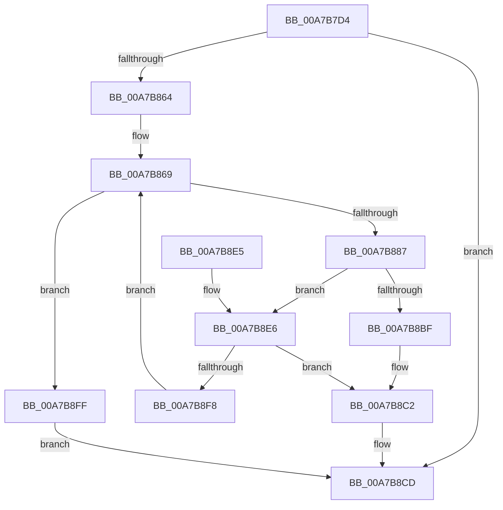

# ExpGetPartitionTableInfo

- RVA: `0x00A7B7D4`–`0x00A7B90B` (길이 `311` bytes)
- VA: `0x0000000140A7B7D4`
- 실행 섹션: `PAGE`
- PDB 이름 있음: `예`; PDB Function 태그: `아니요`
- unwind 정보 RVA: `0x000B667C`
- 디코드: `81`개 명령, `311/311` bytes 표시
- 미해석 바이트: `0` (있으면 어셈블리에 `.byte`로 보존)

> 이 문서는 커널 이미지의 기계어와 PDB 기호를 분석해 생성했습니다. 4번과 5번은 함수 원형과 자료형을 바이너리 사용 방식에서 추정한 C 해석이며 원본 소스 복구 결과는 아닙니다.

## 1. Dependencies

- 직접 호출 지점: **7**; 고유 호출 대상: **6**
- 직접 호출자로 확인된 함수: **2**
- RIP 상대 이미지 참조: **0**

### Outgoing calls
- `0x00A7B812` → [RtlInitUnicodeString](../../text/42/RtlInitUnicodeString_function_0042A780.md) (function, `0x0042A780`)
- `0x00A7B85B` → [ZwOpenFile](../../text/6A/ZwOpenFile_function_006AD730.md) (function, `0x006AD730`)
- `0x00A7B876` → [ExAllocatePool2](../../poolcode/B8/ExAllocatePool2_function_00B820F0.md) (function, `0x00B820F0`)
- `0x00A7B8B4` → [ZwDeviceIoControlFile](../../text/6A/ZwDeviceIoControlFile_function_006AD1B0.md) (function, `0x006AD1B0`)
- `0x00A7B8C6` → [ZwClose](../../text/6A/ZwClose_function_006AD2B0.md) (function, `0x006AD2B0`)
- `0x00A7B8EB` → [ExFreePoolWithTag](../../poolcode/B8/ExFreePoolWithTag_function_00B82870.md) (function, `0x00B82870`)
- `0x00A7B8FF` → [ZwClose](../../text/6A/ZwClose_function_006AD2B0.md) (function, `0x006AD2B0`)

### Direct callers
- [ExpDiskEnumCallback](../../text/4F/ExpDiskEnumCallback_function_004FB9AC.md) at `0x004FB9C7`
- [ExpFindDiskSignature](ExpFindDiskSignature_function_00A7B608.md) at `0x00A7B6D2`

### Static image references
- 디코드된 RIP-relative 메모리 참조가 없습니다.

## 2. Other-region calls and transfers

- 다른 실행 섹션으로 향하는 call: **7**
  - `0x00A7B812` → [RtlInitUnicodeString](../../text/42/RtlInitUnicodeString_function_0042A780.md) (`PAGE` → `.text`)
  - `0x00A7B85B` → [ZwOpenFile](../../text/6A/ZwOpenFile_function_006AD730.md) (`PAGE` → `.text`)
  - `0x00A7B876` → [ExAllocatePool2](../../poolcode/B8/ExAllocatePool2_function_00B820F0.md) (`PAGE` → `POOLCODE`)
  - `0x00A7B8B4` → [ZwDeviceIoControlFile](../../text/6A/ZwDeviceIoControlFile_function_006AD1B0.md) (`PAGE` → `.text`)
  - `0x00A7B8C6` → [ZwClose](../../text/6A/ZwClose_function_006AD2B0.md) (`PAGE` → `.text`)
  - `0x00A7B8EB` → [ExFreePoolWithTag](../../poolcode/B8/ExFreePoolWithTag_function_00B82870.md) (`PAGE` → `POOLCODE`)
  - `0x00A7B8FF` → [ZwClose](../../text/6A/ZwClose_function_006AD2B0.md) (`PAGE` → `.text`)
- 별도 외부 분기/꼬리 이동을 확인하지 못했습니다.

## 3. Assembly (complete function range)

```asm
00A7B7D4  48 89 5C 24 08                  mov qword ptr [rsp + 8], rbx
00A7B7D9  48 89 74 24 10                  mov qword ptr [rsp + 0x10], rsi
00A7B7DE  55                              push rbp
00A7B7DF  57                              push rdi
00A7B7E0  41 56                           push r14
00A7B7E2  48 8D 6C 24 B9                  lea rbp, [rsp - 0x47]
00A7B7E7  48 81 EC A0 00 00 00            sub rsp, 0xa0
00A7B7EE  33 C0                           xor eax, eax
00A7B7F0  0F 57 C0                        xorps xmm0, xmm0
00A7B7F3  21 45 33                        and dword ptr [rbp + 0x33], eax
00A7B7F6  4C 8B F2                        mov r14, rdx
00A7B7F9  48 21 45 77                     and qword ptr [rbp + 0x77], rax
00A7B7FD  48 8B D1                        mov rdx, rcx
00A7B800  89 45 1B                        mov dword ptr [rbp + 0x1b], eax
00A7B803  48 8D 4D F7                     lea rcx, [rbp - 9]
00A7B807  21 45 1B                        and dword ptr [rbp + 0x1b], eax
00A7B80A  0F 11 45 F7                     movups xmmword ptr [rbp - 9], xmm0
00A7B80E  0F 11 45 07                     movups xmmword ptr [rbp + 7], xmm0
00A7B812  E8 69 EF 9A FF                  call 0x14042a780
00A7B817  48 83 65 1F 00                  and qword ptr [rbp + 0x1f], 0
00A7B81C  48 8D 45 F7                     lea rax, [rbp - 9]
00A7B820  0F 57 C0                        xorps xmm0, xmm0
00A7B823  C7 44 24 28 60 00 00 00         mov dword ptr [rsp + 0x28], 0x60
00A7B82B  4C 8D 4D 07                     lea r9, [rbp + 7]
00A7B82F  48 89 45 27                     mov qword ptr [rbp + 0x27], rax
00A7B833  4C 8D 45 17                     lea r8, [rbp + 0x17]
00A7B837  C7 45 17 30 00 00 00            mov dword ptr [rbp + 0x17], 0x30
00A7B83E  BA 80 00 10 00                  mov edx, 0x100080
00A7B843  C7 45 2F 40 02 00 00            mov dword ptr [rbp + 0x2f], 0x240
00A7B84A  48 8D 4D 77                     lea rcx, [rbp + 0x77]
00A7B84E  C7 44 24 20 03 00 00 00         mov dword ptr [rsp + 0x20], 3
00A7B856  F3 0F 7F 45 37                  movdqu xmmword ptr [rbp + 0x37], xmm0
00A7B85B  E8 D0 1E C3 FF                  call 0x1406ad730
00A7B860  85 C0                           test eax, eax
00A7B862  78 69                           js 0x140a7b8cd
00A7B864  BB 30 09 00 00                  mov ebx, 0x930
00A7B869  8B D3                           mov edx, ebx
00A7B86B  B9 40 00 00 00                  mov ecx, 0x40
00A7B870  41 B8 45 6E 76 72               mov r8d, 0x72766e45
00A7B876  E8 75 68 10 00                  call 0x140b820f0
00A7B87B  48 8B 4D 77                     mov rcx, qword ptr [rbp + 0x77]
00A7B87F  48 8B F0                        mov rsi, rax
00A7B882  48 85 C0                        test rax, rax
00A7B885  74 78                           je 0x140a7b8ff
00A7B887  89 5C 24 48                     mov dword ptr [rsp + 0x48], ebx
00A7B88B  45 33 C9                        xor r9d, r9d
00A7B88E  48 89 44 24 40                  mov qword ptr [rsp + 0x40], rax
00A7B893  45 33 C0                        xor r8d, r8d
00A7B896  83 64 24 38 00                  and dword ptr [rsp + 0x38], 0
00A7B89B  48 8D 45 07                     lea rax, [rbp + 7]
00A7B89F  48 83 64 24 30 00               and qword ptr [rsp + 0x30], 0
00A7B8A5  33 D2                           xor edx, edx
00A7B8A7  C7 44 24 28 50 00 07 00         mov dword ptr [rsp + 0x28], 0x70050
00A7B8AF  48 89 44 24 20                  mov qword ptr [rsp + 0x20], rax
00A7B8B4  E8 F7 18 C3 FF                  call 0x1406ad1b0
00A7B8B9  8B F8                           mov edi, eax
00A7B8BB  85 C0                           test eax, eax
00A7B8BD  78 27                           js 0x140a7b8e6
00A7B8BF  49 89 36                        mov qword ptr [r14], rsi
00A7B8C2  48 8B 4D 77                     mov rcx, qword ptr [rbp + 0x77]
00A7B8C6  E8 E5 19 C3 FF                  call 0x1406ad2b0
00A7B8CB  8B C7                           mov eax, edi
00A7B8CD  4C 8D 9C 24 A0 00 00 00         lea r11, [rsp + 0xa0]
00A7B8D5  49 8B 5B 20                     mov rbx, qword ptr [r11 + 0x20]
00A7B8D9  49 8B 73 28                     mov rsi, qword ptr [r11 + 0x28]
00A7B8DD  49 8B E3                        mov rsp, r11
00A7B8E0  41 5E                           pop r14
00A7B8E2  5F                              pop rdi
00A7B8E3  5D                              pop rbp
00A7B8E4  C3                              ret
00A7B8E5  CC                              int3
00A7B8E6  33 D2                           xor edx, edx
00A7B8E8  48 8B CE                        mov rcx, rsi
00A7B8EB  E8 80 6F 10 00                  call 0x140b82870
00A7B8F0  81 FF 23 00 00 C0               cmp edi, 0xc0000023
00A7B8F6  75 CA                           jne 0x140a7b8c2
00A7B8F8  03 DB                           add ebx, ebx
00A7B8FA  E9 6A FF FF FF                  jmp 0x140a7b869
00A7B8FF  E8 AC 19 C3 FF                  call 0x1406ad2b0
00A7B904  B8 9A 00 00 C0                  mov eax, 0xc000009a
00A7B909  EB C2                           jmp 0x140a7b8cd
```

## 4. C-style interpretation (structured pseudocode)

```c
__int64 __fastcall ExpGetPartitionTableInfo(__int64 a1, __int64 a2)
{
    __int64 result;
    __int64 v_rbx;
    __int64 v_rsp;
    unsigned __int64 v_stack_m18;
    unsigned __int64 v_stack_m28;
    unsigned int v_stack_m2C;
    unsigned int v_stack_m30;
    unsigned __int64 v_stack_m38;
    unsigned __int64 v_stack_m40;
    unsigned int v_stack_m44;
    unsigned __int64 v_stack_m48;
    unsigned __int64 v_stack_m58;
    unsigned __int64 v_stack_m5F;
    unsigned __int64 v_stack_m68;
    unsigned int v_stack_m70;
    unsigned __int64 v_stack_m78;
    unsigned int v_stack_m80;
    unsigned __int64 v_stack_m88;
    unsigned int v_stack_m90;
    unsigned int v_stack_m98;
    unsigned __int64 v_stack_p10;
    unsigned __int64 v_stack_p18;
    unsigned __int64 v_stack_p8;

    v_stack_p8 = v_rbx;
    v_stack_p10 = v_rsi;
    v_rsp = (v_rsp) - (160);
    result = 0;
    v_stack_m44 = 0;
    v_stack_m68 = v_xmm0;
    v_stack_m58 = v_xmm0;
    result = RtlInitUnicodeString(v_stack_m68, a1, a3, a4);
    v_stack_m90 = 96;
    v_stack_m38 = v_stack_m68;
    v_stack_m48 = 48;
    v_stack_m30 = 576;
    v_stack_m98 = 3;
    v_stack_m28 = v_xmm0;
    result = ZwOpenFile(v_stack_p18, (unsigned int)(0x100080ULL), v_stack_m48, v_stack_m58);
    if (sign_flag) goto loc_00A7B8CD;
loc_00A7B869:
    result = ExAllocatePool2(64, (unsigned int)((unsigned int)((unsigned int)(0x930ULL))), (unsigned int)(0x72766E45ULL), v_stack_m58);
    if (result == 0) goto loc_00A7B8FF;
    v_stack_m70 = (unsigned int)((unsigned int)(0x930ULL));
    a4 = 0;
    v_stack_m78 = result;
    a3 = 0;
    a2 = 0;
    v_stack_m90 = 0x70050ULL;
    v_stack_m98 = v_stack_m58;
    result = ZwDeviceIoControlFile(v_stack_p18, a2, a3, a4);
    if (sign_flag) goto loc_00A7B8E6;
    *(unsigned __int64 *)(a2) = result;
loc_00A7B8C2:
    result = ZwClose(v_stack_p18, a2, a3, a4);
loc_00A7B8CD:
    return (unsigned int)((unsigned int)((unsigned int)((unsigned int)(result))));
loc_00A7B8E6:
    a2 = 0;
    result = ExFreePoolWithTag(*(unsigned __int64 *)(v_stack_m18 + 40), a2, a3, a4);
    if (((unsigned int)((unsigned int)((unsigned int)(result)))) != 0xC0000023ULL) goto loc_00A7B8C2;
    v_rbx = (unsigned int)((*(unsigned __int64 *)(v_stack_m18 + 32)) + ((unsigned int)(*(unsigned __int64 *)(v_stack_m18 + 32))));
    goto loc_00A7B869;
loc_00A7B8FF:
    result = ZwClose(*(unsigned __int64 *)(v_stack_m18 + 40), a2, a3, a4);
    goto loc_00A7B8CD;
}
```

## 5. (Beta) C Style

```c
int64_t ExpGetPartitionTableInfo(int64_t Arg1, void *Arg2)
{
    uint8_t *arg2 = (uint8_t *)Arg2;

    int64_t result;
    int64_t local_rbx;
    int64_t local_rsp;
    uint64_t v_stack_m18;
    uint64_t v_stack_m28;
    uint32_t v_stack_m2C;
    uint32_t v_stack_m30;
    uint64_t v_stack_m38;
    uint64_t v_stack_m40;
    uint32_t v_stack_m44;
    uint64_t v_stack_m48;
    uint64_t v_stack_m58;
    uint64_t v_stack_m5F;
    uint64_t v_stack_m68;
    uint32_t v_stack_m70;
    uint64_t v_stack_m78;
    uint32_t v_stack_m80;
    uint64_t v_stack_m88;
    uint32_t v_stack_m90;
    uint32_t v_stack_m98;
    uint64_t v_stack_p10;
    uint64_t v_stack_p18;
    uint64_t v_stack_p8;

    v_stack_p8 = local_rbx;
    v_stack_p10 = local_rsi;
    local_rsp = (local_rsp) - (160);
    result = 0;
    v_stack_m44 = 0;
    v_stack_m68 = v_xmm0;
    v_stack_m58 = v_xmm0;
    result = RtlInitUnicodeString(v_stack_m68, Arg1, a3, a4);
    v_stack_m90 = 96;
    v_stack_m38 = v_stack_m68;
    v_stack_m48 = 48;
    v_stack_m30 = 576;
    v_stack_m98 = 3;
    v_stack_m28 = v_xmm0;
    result = ZwOpenFile(v_stack_p18, (uint32_t)(0x100080ULL), v_stack_m48, v_stack_m58);
    if (sign_flag) goto loc_00A7B8CD;
loc_00A7B869:
    result = ExAllocatePool2(64, (uint32_t)((uint32_t)((uint32_t)(0x930ULL))), (uint32_t)(0x72766E45ULL), v_stack_m58);
    if (result == 0) goto loc_00A7B8FF;
    v_stack_m70 = (uint32_t)((uint32_t)(0x930ULL));
    a4 = 0;
    v_stack_m78 = result;
    a3 = 0;
    Arg2 = 0;
    v_stack_m90 = 0x70050ULL;
    v_stack_m98 = v_stack_m58;
    result = ZwDeviceIoControlFile(v_stack_p18, Arg2, a3, a4);
    if (sign_flag) goto loc_00A7B8E6;
    *(uint64_t *)(arg2) = result;
loc_00A7B8C2:
    result = ZwClose(v_stack_p18, Arg2, a3, a4);
loc_00A7B8CD:
    return (uint32_t)((uint32_t)((uint32_t)((uint32_t)(result))));
loc_00A7B8E6:
    Arg2 = 0;
    result = ExFreePoolWithTag(*(uint64_t *)(v_stack_m18 + 0x28), Arg2, a3, a4);
    if (((uint32_t)((uint32_t)((uint32_t)(result)))) != 0xC0000023ULL) goto loc_00A7B8C2;
    local_rbx = (uint32_t)((*(uint64_t *)(v_stack_m18 + 0x20)) + ((uint32_t)(*(uint64_t *)(v_stack_m18 + 0x20))));
    goto loc_00A7B869;
loc_00A7B8FF:
    result = ZwClose(*(uint64_t *)(v_stack_m18 + 0x28), Arg2, a3, a4);
    goto loc_00A7B8CD;
}
```

### 관측된 메모리 오프셋

구조체 형식이 확인되지 않은 접근은 인자 기준의 오프셋으로만 기록했습니다.

| 기준 인자 | 오프셋 표현 | 폭 (bit) | 접근 |
|---|---:|---:|---|
| `Arg2` | `+ 0x0` | `64` | `W` |

## 6. Execution-region graph

[열기: 2D/3D 그래프와 함수 탐색 컨트롤 패널](../../../control-panel.html?section=page&rva=0x00A7B7D4&view=graph)

- 2D 그래프는 위에서 아래로 흐르고, 3D 그래프는 빈 공간을 드래그해 회전합니다. Shift+드래그는 이동, 휠은 확대·축소, 함수 노드 선택은 대상 보고서 이동입니다.

### Static fallback


